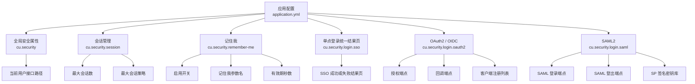
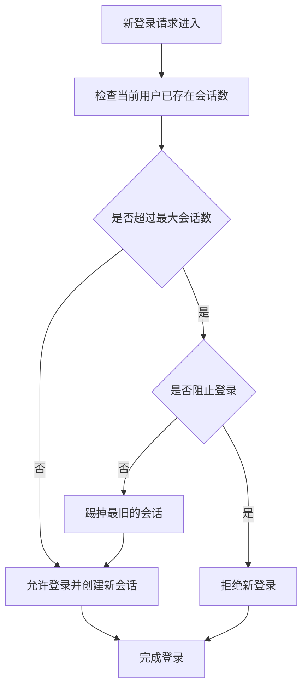
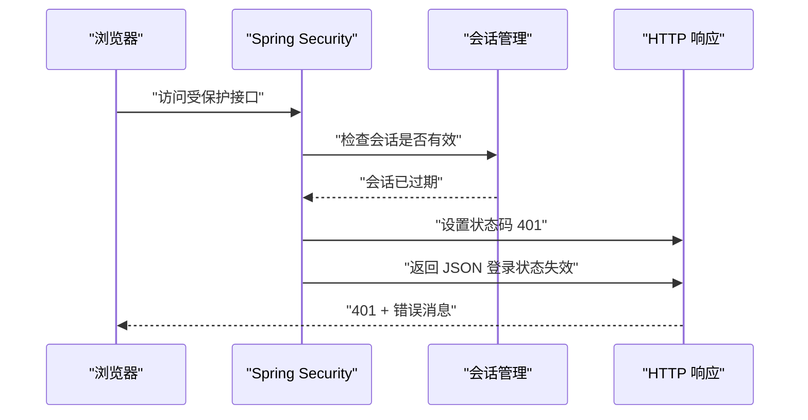
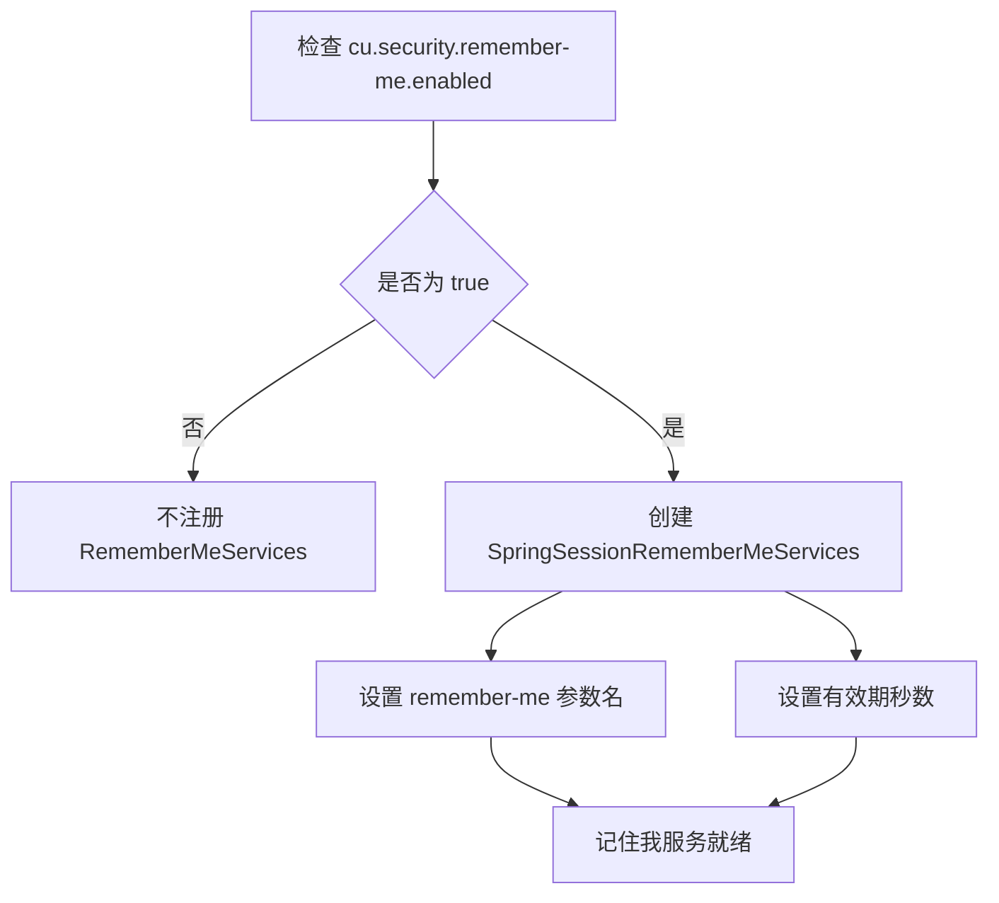
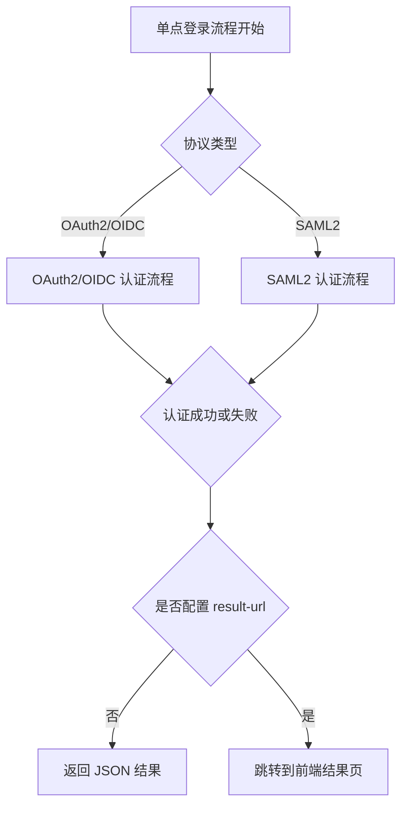
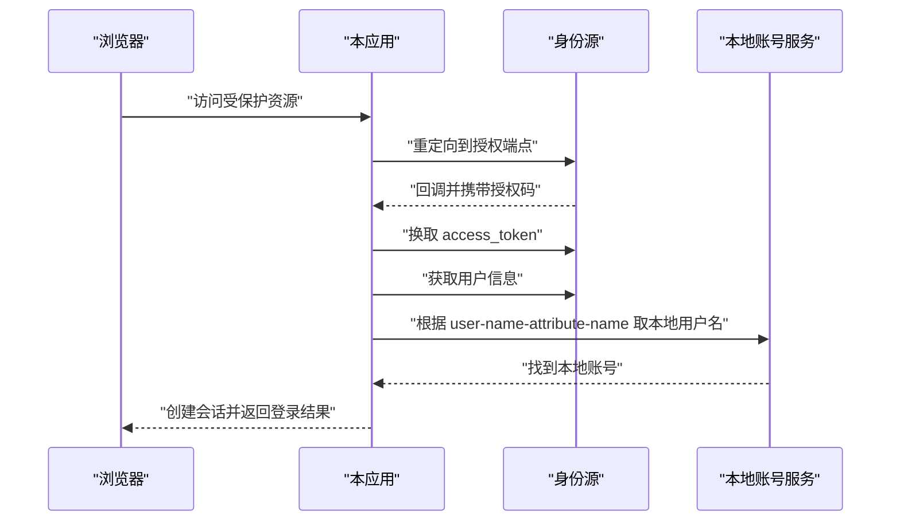
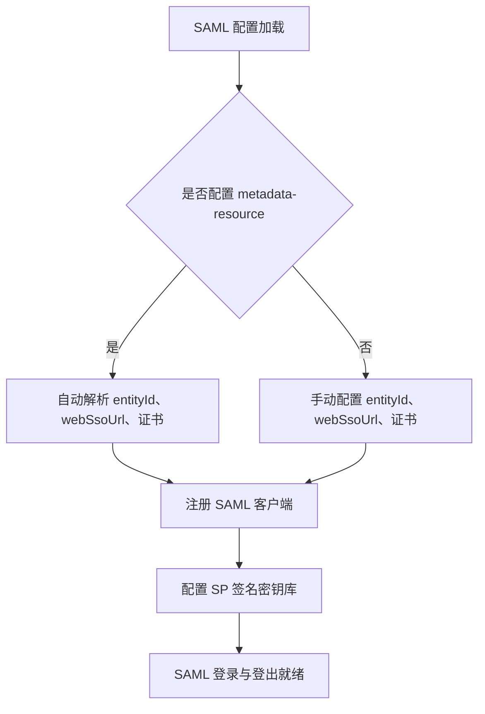

# 安全配置

<cite>
**本文引用的文件**   
- [README_Auth.md](file://README_Auth.md)
- [SsoLoginProperties.java](file://login-spring-boot-starter/src/main/java/com/cu/framework/authentication/properties/SsoLoginProperties.java)
- [Oauth2OidcProperties.java](file://login-spring-boot-starter/src/main/java/com/cu/framework/authentication/oauth2/Oauth2OidcProperties.java)
- [SamlProperties.java](file://login-spring-boot-starter/src/main/java/com/cu/framework/authentication/saml/properties/SamlProperties.java)
- [SessionProperties.java](file://login-spring-boot-starter/src/main/java/com/cu/framework/authentication/properties/SessionProperties.java)
- [RememberMeProperties.java](file://login-spring-boot-starter/src/main/java/com/cu/framework/authentication/properties/RememberMeProperties.java)
- [SessionConfig.java](file://login-spring-boot-starter/src/main/java/com/cu/framework/authentication/config/SessionConfig.java)
- [SecurityProperties.java](file://login-spring-boot-starter/src/main/java/com/cu/framework/authentication/properties/SecurityProperties.java)
- [application.yml（RBAC 示例）](file://sample/auth-rbac-boot-sample/src/main/resources/application.yml)
- [application.yml（登录示例）](file://sample/login-boot-sample/src/main/resources/application.yml)
- [application.yml（根配置说明）](file://docs/application.yml)
</cite>

## 目录
1. [引言](#引言)
2. [项目结构中的安全配置位置](#项目结构中的安全配置位置)
3. [核心安全配置总览](#核心安全配置总览)
4. [当前用户接口配置](#当前用户接口配置)
5. [会话管理配置](#会话管理配置)
6. [记住我功能配置](#记住我功能配置)
7. [单点登录统一配置](#单点登录统一配置)
8. [OAuth2 与 OIDC 协议配置](#oauth2-与-oidc-协议配置)
9. [SAML2 协议配置](#saml2-协议配置)
10. [不同部署环境的安全配置示例](#不同部署环境的安全配置示例)
11. [安全配置最佳实践](#安全配置最佳实践)
12. [常见问题排查](#常见问题排查)
13. [结论](#结论)

## 引言
本文面向 Kewen Framework 中 `login-spring-boot-starter` 模块的安全配置，聚焦以下能力：
- 当前用户接口配置
- 会话最大数量控制与会话冲突处理
- 记住我功能的开关、参数名和有效期
- OAuth2、OIDC、SAML2 三类单点登录的统一结果页配置
- 不同协议各自的关键配置项、默认值、取值范围与生效行为
- 本地开发、内网部署和外网部署的推荐实践

该框架以 Spring Security 为基础，把认证、会话、单点登录和安全返回结构整合到可配置的启动器中；业务侧通过实现 `SecurityUserDetailsService` 提供本地账号与权限，身份源只负责证明“这个人是谁”。

**章节来源**
- [README_Auth.md:1-120](file://README_Auth.md#L1-L120)

## 项目结构中的安全配置位置
与安全相关的主要配置集中在 `login-spring-boot-starter` 模块中：

| 配置类别 | 配置前缀 | 主要属性类 | 作用 |
|---|---|---|---|
| 全局安全属性 | `cu.security` | `SecurityProperties` | 当前用户接口地址等全局安全设置 |
| 会话管理 | `cu.security.session` | `SessionProperties` | 最大会话数、是否阻止挤下线 |
| 记住我 | `cu.security.remember-me` | `RememberMeProperties` | 是否启用、请求参数名、有效期秒数 |
| 单点登录统一结果页 | `cu.security.login.sso` | `SsoLoginProperties` | 统一的成功或失败跳转结果页 |
| OAuth2 / OIDC | `cu.security.login.oauth2` | `Oauth2OidcProperties` | 授权端点、回调端点、客户端注册列表 |
| SAML2 | `cu.security.login.saml` | `SamlProperties` | SAML 登录端点、登出端点、SP 签名密钥库、IdP 注册 |

**图表来源**
- [SecurityProperties.java:1-22](file://login-spring-boot-starter/src/main/java/com/cu/framework/authentication/properties/SecurityProperties.java#L1-L22)
- [SessionProperties.java:1-22](file://login-spring-boot-starter/src/main/java/com/cu/framework/authentication/properties/SessionProperties.java#L1-L22)
- [RememberMeProperties.java:1-26](file://login-spring-boot-starter/src/main/java/com/cu/framework/authentication/properties/RememberMeProperties.java#L1-L26)
- [SsoLoginProperties.java:1-24](file://login-spring-boot-starter/src/main/java/com/cu/framework/authentication/properties/SsoLoginProperties.java#L1-L24)
- [Oauth2OidcProperties.java:1-100](file://login-spring-boot-starter/src/main/java/com/cu/framework/authentication/oauth2/Oauth2OidcProperties.java#L1-L100)
- [SamlProperties.java:1-80](file://login-spring-boot-starter/src/main/java/com/cu/framework/authentication/saml/properties/SamlProperties.java#L1-L80)

**章节来源**
- [README_Auth.md:1-120](file://README_Auth.md#L1-L120)

## 核心安全配置总览
下面给出所有可直接在 `application.yml` 中配置的安全属性清单。

| 配置路径 | 数据类型 | 默认值 | 取值范围 | 生效范围 | 说明 |
|---|---|---|---|---|---|
| `cu.security.current-user-url` | 字符串 | `/currentUser` | 任意合法 URL 路径 | 全局 | 当前用户接口地址；当前代码未读取，配置后不生效，实际路径固定为 `/currentUser` |
| `cu.security.session.maximum-sessions` | 整数 | `10` | 正整数 | 全局会话并发控制 | 同一用户允许的最大会话数 |
| `cu.security.session.max-sessions-prevents-login` | 布尔值 | `false` | `true` / `false` | 全局会话并发控制 | 达到最大会话数时是否阻止新登录；`true` 表示阻止，`false` 表示踢掉最旧会话 |
| `cu.security.remember-me.enabled` | 布尔值 | `true` | `true` / `false` | 全局记住我功能 | 是否注册基于 Spring Session 的 RememberMeServices Bean |
| `cu.security.remember-me.remember-parameter` | 字符串 | `remember-me` | 非空字符串 | 全局记住我参数 | 登录请求中表示“记住我”的参数名 |
| `cu.security.remember-me.validity-seconds` | 整数 | `2592000` | 正整数，单位秒 | 全局记住我有效期 | 默认约 30 天 |
| `cu.security.login.sso.result-url` | 字符串 | 无默认值 | 相对地址或绝对地址 | 全局 SSO 结果页 | 单点登录流程结束后浏览器回到的前端页面 |
| `cu.security.login.oauth2.sso-authorization-uri` | 字符串 | `/oauth2/authorization` | 合法本地授权端点路径 | OAuth2/OIDC 通用 | 发起认证的本地入口 |
| `cu.security.login.oauth2.login-processing-url` | 字符串 | Spring Security 默认回调路径 | 合法回调路径 | OAuth2/OIDC 通用 | IDP 认证成功后重定向回来的处理端点 |
| `cu.security.login.oauth2.clients[*].registration-id` | 字符串 | 无 | 唯一标识 | 单个 OAuth2/OIDC 客户端 | 用于区分不同身份源 |
| `cu.security.login.oauth2.clients[*].client-id` | 字符串 | 无 | 由身份源分配 | 单个 OAuth2/OIDC 客户端 | 客户端 ID |
| `cu.security.login.oauth2.clients[*].client-secret` | 字符串 | 无 | 由身份源分配 | 单个 OAuth2/OIDC 客户端 | 客户端密钥 |
| `cu.security.login.oauth2.clients[*].client-authentication-method` | 枚举 | `CLIENT_SECRET_BASIC` | Basic / Post / None | 单个 OAuth2/OIDC 客户端 | 向令牌端点认证的方式 |
| `cu.security.login.oauth2.clients[*].redirect-uri-template` | 字符串 | `{baseUrl}/login/oauth2/code/{registrationId}` | 含变量模板 | 单个 OAuth2/OIDC 客户端 | 认证成功后的回调地址模板 |
| `cu.security.login.oauth2.clients[*].scopes` | 字符串集合 | 无 | 由身份源定义 | 单个 OAuth2/OIDC 客户端 | 申请的权限范围 |
| `cu.security.login.oauth2.clients[*].issuer-uri` | 字符串 | 无 | 身份源发现地址 | OIDC 模式优先 | 自动发现元数据 |
| `cu.security.login.oauth2.clients[*].authorization-uri` | 字符串 | 无 | 合法 URL | OAuth2 手动模式 | 授权端点 |
| `cu.security.login.oauth2.clients[*].token-uri` | 字符串 | 无 | 合法 URL | OAuth2 手动模式 | 令牌端点 |
| `cu.security.login.oauth2.clients[*].user-info-uri` | 字符串 | 无 | 合法 URL | OAuth2 手动模式 | 用户信息端点 |
| `cu.security.login.oauth2.clients[*].user-name-attribute-name` | 字符串 | OIDC 模式下回退 `sub` | 由身份源返回字段决定 | OAuth2/OIDC 通用 | 映射到本系统用户名 |
| `cu.security.login.oauth2.clients[*].jwk-set-uri` | 字符串 | 无 | 合法 URL | OIDC 或 JWT 场景 | JSON Web Key Set 地址 |
| `cu.security.login.oauth2.clients[*].ignore-ssl` | 布尔值 | `false` | `true` / `false` | 仅影响 userinfo 端点 | 测试环境可用，生产环境应保持关闭 |
| `cu.security.login.saml.login-processing-url` | 字符串 | `/login/saml2/sso/{registrationId}` | 合法 SAML 登录路径 | 单个 SAML 客户端 | SP 发起 SAML 认证的入口 |
| `cu.security.login.saml.logout-request-url` | 字符串 | `/logout/saml2/slo` | 合法登出路径 | 全局 SAML 登出 | SAML LogoutRequest 处理地址 |
| `cu.security.login.saml.logout-response-url` | 字符串 | `/logout/saml2/slo` | 合法登出路径 | 全局 SAML 登出 | SAML LogoutResponse 处理地址 |
| `cu.security.login.saml.sp-signing-keystore.keystore-resource` | 资源路径 | 无 | classpath 或文件系统资源 | SP 签名密钥库 | SP 签名密钥库文件 |
| `cu.security.login.saml.sp-signing-keystore.keystore-password` | 字符串 | `changeit` | 非空字符串 | SP 签名密钥库 | 密钥库密码 |
| `cu.security.login.saml.sp-signing-keystore.key-alias` | 字符串 | `sp-signing` | 非空字符串 | SP 签名密钥库 | 密钥别名 |
| `cu.security.login.saml.sp-signing-keystore.key-password` | 字符串 | `changeit` | 非空字符串 | SP 签名密钥库 | 密钥密码 |
| `cu.security.login.saml.registrations[*].metadata-resource` | 资源路径 | `classpath:saml/idp-metadata.xml` | classpath 资源 | 单个 SAML 客户端 | IdP metadata 文件路径 |
| `cu.security.login.saml.registrations[*].registration-id` | 字符串 | 由实现回退逻辑决定 | 唯一标识 | 单个 SAML 客户端 | Spring Security 注册 ID |
| `cu.security.login.saml.registrations[*].sp-entity-id` | 字符串 | `cu-saml` | 与 IdP 配置一致 | 单个 SAML 客户端 | SP Entity ID |
| `cu.security.login.saml.registrations[*].display-name` | 字符串 | 回退注册 ID | 非空展示名 | 单个 SAML 客户端 | 登录按钮展示名 |

**章节来源**
- [SecurityProperties.java:1-22](file://login-spring-boot-starter/src/main/java/com/cu/framework/authentication/properties/SecurityProperties.java#L1-L22)
- [SessionProperties.java:1-22](file://login-spring-boot-starter/src/main/java/com/cu/framework/authentication/properties/SessionProperties.java#L1-L22)
- [RememberMeProperties.java:1-26](file://login-spring-boot-starter/src/main/java/com/cu/framework/authentication/properties/RememberMeProperties.java#L1-L26)
- [SsoLoginProperties.java:1-24](file://login-spring-boot-starter/src/main/java/com/cu/framework/authentication/properties/SsoLoginProperties.java#L1-L24)
- [Oauth2OidcProperties.java:1-237](file://login-spring-boot-starter/src/main/java/com/cu/framework/authentication/oauth2/Oauth2OidcProperties.java#L1-L237)
- [SamlProperties.java:1-149](file://login-spring-boot-starter/src/main/java/com/cu/framework/authentication/saml/properties/SamlProperties.java#L1-L149)

## 当前用户接口配置
当前用户接口是业务前端或后端获取“已登录用户主体”的重要入口。框架暴露了全局安全属性 `cu.security.current-user-url`，但该属性在当前代码中只是占位配置：

| 项目 | 说明 |
|---|---|
| 配置前缀 | `cu.security` |
| 配置键 | `current-user-url` |
| 默认值 | `/currentUser` |
| 是否生效 | 当前代码未读取，配置后不生效 |
| 实际行为 | 当前用户接口路径固定为 `/currentUser` |
| 业务建议 | 如需自定义当前用户接口路径，应在业务控制器中自行实现，不要依赖该占位属性 |

该属性出现在 RBAC 示例配置中，但实际路由仍由业务控制器决定。因此，它更适合理解为“框架预留的全局安全配置项”，而不是当前可驱动路由的配置。

**章节来源**
- [SecurityProperties.java:1-22](file://login-spring-boot-starter/src/main/java/com/cu/framework/authentication/properties/SecurityProperties.java#L1-L22)
- [application.yml（RBAC 示例）:35-45](file://sample/auth-rbac-boot-sample/src/main/resources/application.yml#L35-L45)

## 会话管理配置
会话管理配置用于限制同一用户的最大会话数量，并控制超出限制时的行为。

### 配置项说明

| 配置项 | 类型 | 默认值 | 取值范围 | 含义 |
|---|---|---:|---|---|
| `maximum-sessions` | 整数 | `10` | 正整数 | 同一用户最多允许多少个活跃会话 |
| `max-sessions-prevents-login` | 布尔值 | `false` | `true` / `false` | 达到最大会话数时是否阻止新登录 |

### 行为规则

**图表来源**
- [SessionConfig.java:80-124](file://login-spring-boot-starter/src/main/java/com/cu/framework/authentication/config/SessionConfig.java#L80-L124)
- [SessionProperties.java:1-22](file://login-spring-boot-starter/src/main/java/com/cu/framework/authentication/properties/SessionProperties.java#L1-L22)

### 过期会话响应
当会话过期时，框架会返回状态码 `401`，并以 JSON 形式提示“登录状态失效，请重新登录”。这个行为通过会话管理配置中的过期策略实现。

**图表来源**
- [SessionConfig.java:96-118](file://login-spring-boot-starter/src/main/java/com/cu/framework/authentication/config/SessionConfig.java#L96-L118)

### 使用建议
- 内网系统：通常保持默认 `maximum-sessions=10`，并可根据业务并发情况调大。
- 外网系统：建议适当降低最大会话数，避免被恶意多会话占用资源。
- 需要强一致性时：开启 `max-sessions-prevents-login=true`，让后续登录直接失败，便于前端提示“已在其他设备登录”。
- 需要用户体验优先时：保持 `max-sessions-prevents-login=false`，让旧会话被踢下线，新登录继续。

**章节来源**
- [SessionProperties.java:1-22](file://login-spring-boot-starter/src/main/java/com/cu/framework/authentication/properties/SessionProperties.java#L1-L22)
- [SessionConfig.java:80-124](file://login-spring-boot-starter/src/main/java/com/cu/framework/authentication/config/SessionConfig.java#L80-L124)

## 记住我功能配置
记住我功能由 `RememberMeProperties` 描述，并通过 `SessionConfig` 在满足条件时注册基于 Spring Session 的 `RememberMeServices`。

### 配置项说明

| 配置项 | 类型 | 默认值 | 取值范围 | 含义 |
|---|---|---:|---|---|
| `enabled` | 布尔值 | `true` | `true` / `false` | 是否启用记住我功能 |
| `remember-parameter` | 字符串 | `remember-me` | 非空字符串 | 登录请求中表示“记住我”的参数名 |
| `validity-seconds` | 整数 | `2592000` | 正整数，单位秒 | 记住我有效期，默认约 30 天 |

### 行为说明
- 只有当 `cu.security.remember-me.enabled=true` 时，才会注册 `SpringSessionRememberMeServices`。
- 记住我参数名和有效期来自 `RememberMeProperties`。
- 代码中存在一个已废弃的 `PersistentHeaderRememberMeService`，其注释明确说明：如果使用 token 模式并结合 Spring Session，则不再需要它。
- 根配置文件中还有一条注释提醒：当前版本中 remember-me 可能只创建了 Bean，但未挂入过滤器链，因此某些环境下的记住我行为需结合具体集成方式验证。

**图表来源**
- [RememberMeProperties.java:1-26](file://login-spring-boot-starter/src/main/java/com/cu/framework/authentication/properties/RememberMeProperties.java#L1-L26)
- [SessionConfig.java:52-68](file://login-spring-boot-starter/src/main/java/com/cu/framework/authentication/config/SessionConfig.java#L52-L68)
- [PersistentHeaderRememberMeService.java:1-30](file://login-spring-boot-starter/src/main/java/com/cu/framework/authentication/extension/PersistentHeaderRememberMeService.java#L1-L30)

### 使用建议
- 如果系统采用前后端分离且使用 Authorization Header 传递 token，应谨慎评估“记住我”的实际意义：长期 token 本身就可能承担持久登录职责。
- 如果仍需要记住我 Cookie 或 Spring Session 的记住我能力，请确保有效期符合安全要求。
- 生产环境建议不要把 `validity-seconds` 设置得过长，避免泄露的 remember-me 凭证长期有效。

**章节来源**
- [RememberMeProperties.java:1-26](file://login-spring-boot-starter/src/main/java/com/cu/framework/authentication/properties/RememberMeProperties.java#L1-L26)
- [SessionConfig.java:52-68](file://login-spring-boot-starter/src/main/java/com/cu/framework/authentication/config/SessionConfig.java#L52-L68)
- [PersistentHeaderRememberMeService.java:1-30](file://login-spring-boot-starter/src/main/java/com/cu/framework/authentication/extension/PersistentHeaderRememberMeService.java#L1-L30)
- [application.yml（根配置说明）:108-113](file://docs/application.yml#L108-L113)

## 单点登录统一配置
Kewen Framework 将 OAuth2、OIDC、SAML2 三类协议的登录结果页抽象到统一的配置项中。

### 统一结果页配置
配置前缀：`cu.security.login.sso`  
配置键：`result-url`  
默认值：无  
类型：字符串  

作用：
- 当配置后，三类协议登录成功或失败都会回到同一个前端页面。
- 成功或失败通过查询参数中的结果标记区分。
- 相对地址由容器按当前请求的 scheme、host、port 解析。
- 绝对地址原样使用，因此适合同源页面或独立部署的前端。
- 留空时，三类协议的成功与失败响应保持 JSON 输出，行为与引入该属性之前一致。

**图表来源**
- [SsoLoginProperties.java:1-24](file://login-spring-boot-starter/src/main/java/com/cu/framework/authentication/properties/SsoLoginProperties.java#L1-L24)

### 使用建议
- 对外暴露的 Web 应用建议配置 `result-url`，让用户看到统一的成功或失败提示。
- 纯 API 应用建议保留默认 JSON 输出行为，即不配置 `result-url`。
- 若前端与后端不在同一域名，应使用绝对地址，并确保跨域策略允许跳转。

**章节来源**
- [SsoLoginProperties.java:1-24](file://login-spring-boot-starter/src/main/java/com/cu/framework/authentication/properties/SsoLoginProperties.java#L1-L24)

## OAuth2 与 OIDC 协议配置
OAuth2 与 OIDC 共用 `Oauth2OidcProperties`，支持两种模式：
- **OAuth2 手动模式**：手动指定授权端点、令牌端点、用户信息端点。
- **OIDC 自动发现模式**：通过 `issuer-uri` 自动发现元数据。

### 关键配置项

| 配置项 | 必填 | 默认值 | 说明 |
|---|---:|---|---|
| `sso-authorization-uri` | 否 | `/oauth2/authorization` | 本地发起认证的入口 |
| `login-processing-url` | 否 | Spring Security 默认回调路径 | IDP 认证成功后回调的处理端点 |
| `clients[*].registration-id` | 是 | 无 | 客户端注册 ID，用于区分不同身份源 |
| `clients[*].client-id` | 是 | 无 | 身份源分配的客户端 ID |
| `clients[*].client-secret` | 是 | 无 | 身份源分配的客户端密钥 |
| `clients[*].client-authentication-method` | 否 | `CLIENT_SECRET_BASIC` | 客户端认证方式 |
| `clients[*].redirect-uri-template` | 否 | `{baseUrl}/login/oauth2/code/{registrationId}` | 回调地址模板 |
| `clients[*].scopes` | 是 | 无 | 申请的范围；OIDC 必须包含 `openid` |
| `clients[*].issuer-uri` | 否 | 无 | OIDC 自动发现地址 |
| `clients[*].authorization-uri` | 手动模式必填 | 无 | 授权端点 |
| `clients[*].token-uri` | 手动模式必填 | 无 | 令牌端点 |
| `clients[*].user-info-uri` | 手动模式必填 | 无 | 用户信息端点 |
| `clients[*].user-name-attribute-name` | 是 | OIDC 模式下回退 `sub` | 映射到本地用户名 |
| `clients[*].jwk-set-uri` | 否 | 无 | JWK Set 地址 |
| `clients[*].ignore-ssl` | 否 | `false` | 仅影响 userinfo 端点的 SSL 校验 |

### OIDC 用户名映射注意事项
- 身份源只负责证明“这个人是谁”，账号信息和权限一律来自本系统。
- 认证成功后写入安全上下文的主体是 `SecurityUser` 或其协议子类型。
- `user-name-attribute-name` 指定的值必须能匹配本系统的用户名。
- 对不上本地账号时，登录失败并返回错误码 `sso_local_user_not_found`。
- OIDC 常用 `preferred_username`；如果不配置，会回退到 `sub`，而 `sub` 通常是身份源数字 ID，不一定等于本地用户名。

**图表来源**
- [Oauth2OidcProperties.java:1-237](file://login-spring-boot-starter/src/main/java/com/cu/framework/authentication/oauth2/Oauth2OidcProperties.java#L1-L237)
- [README-SSO.md:1-120](file://login-spring-boot-starter/README-SSO.md#L1-L120)

### 使用建议
- 优先使用 OIDC 自动发现模式，减少手动维护多个端点。
- 手动模式适用于没有 `.well-known/openid-configuration` 的传统 OAuth2 提供商。
- `scopes` 中 OIDC 必须包含 `openid`。
- `ignore-ssl` 仅用于测试，生产环境务必保持 `false`。

**章节来源**
- [Oauth2OidcProperties.java:1-237](file://login-spring-boot-starter/src/main/java/com/cu/framework/authentication/oauth2/Oauth2OidcProperties.java#L1-L237)
- [README-SSO.md:1-120](file://login-spring-boot-starter/README-SSO.md#L1-L120)

## SAML2 协议配置
SAML2 配置由 `SamlProperties` 描述，支持两种方式：
1. 配置 IdP 的 `metadata.xml`，自动解析 `entityId`、`webSsoUrl` 和证书。
2. 手动配置 `entityId`、`webSsoUrl` 和证书路径。

### 关键配置项

| 配置项 | 类型 | 默认值 | 说明 |
|---|---|---|---|
| `login-processing-url` | 字符串 | `/login/saml2/sso/{registrationId}` | SP 发起 SAML 认证请求的 URL |
| `registrations[*].metadata-resource` | 资源路径 | `classpath:saml/idp-metadata.xml` | IdP metadata 文件路径 |
| `registrations[*].registration-id` | 字符串 | 由实现回退逻辑决定 | Spring Security 注册 ID |
| `registrations[*].sp-entity-id` | 字符串 | `cu-saml` | SP Entity ID，需与 IdP 配置一致 |
| `registrations[*].display-name` | 字符串 | 回退注册 ID | 登录按钮展示名 |
| `logout-request-url` | 字符串 | `/logout/saml2/slo` | SAML LogoutRequest 处理地址 |
| `logout-response-url` | 字符串 | `/logout/saml2/slo` | SAML LogoutResponse 处理地址 |
| `sp-signing-keystore.keystore-resource` | 资源路径 | 无 | SP 签名密钥库文件 |
| `sp-signing-keystore.keystore-password` | 字符串 | `changeit` | 密钥库密码 |
| `sp-signing-keystore.key-alias` | 字符串 | `sp-signing` | 密钥别名 |
| `sp-signing-keystore.key-password` | 字符串 | `changeit` | 密钥密码 |

### SAML 配置要点
- `sp-entity-id` 必须与 IdP 侧配置的 SP `entityId`（Audience）保持一致。
- 推荐使用 `metadata-resource` 自动解析 IdP 元数据，减少手工配置出错概率。
- SAML 的单点登出涉及两个端点：LogoutRequest 和 LogoutResponse，默认都指向 `/logout/saml2/slo`。
- 前端展示名只用于登录按钮文案，不参与协议字段。

**图表来源**
- [SamlProperties.java:1-149](file://login-spring-boot-starter/src/main/java/com/cu/framework/authentication/saml/properties/SamlProperties.java#L1-L149)

**章节来源**
- [SamlProperties.java:1-149](file://login-spring-boot-starter/src/main/java/com/cu/framework/authentication/saml/properties/SamlProperties.java#L1-L149)

## 不同部署环境的安全配置示例
下面给出三类典型环境的配置思路。注意：这些是配置策略说明，不是可直接粘贴的生产配置文件。

### 本地开发环境
目标：快速启动、最小配置、便于调试。

| 配置类别 | 推荐行为 |
|---|---|
| 会话最大数量 | 保持默认或较小值，例如 `10` |
| 最大会话策略 | 保持 `false`，方便反复登录调试 |
| 记住我 | 可开启，但有效期不宜过长 |
| 当前用户接口 | 使用默认 `/currentUser` |
| OAuth2/OIDC | 可使用 `ignore-ssl=true`，仅限测试 |
| SAML2 | 使用本地或测试 IdP 的 metadata |
| 结果页 | 如果是前后端联调，可配置 `result-url` 到本地前端地址 |

参考示例中的会话与记住我配置风格：
- RBAC 示例中启用了记住我，并设置了有效期。
- 登录示例中也有记住我参数名的示例配置。

**章节来源**
- [application.yml（RBAC 示例）:35-45](file://sample/auth-rbac-boot-sample/src/main/resources/application.yml#L35-L45)
- [application.yml（登录示例）:45-48](file://sample/login-boot-sample/src/main/resources/application.yml#L45-L48)

### 内网部署环境
目标：稳定、可控、可审计。

| 配置类别 | 推荐行为 |
|---|---|
| 会话最大数量 | 根据并发用户数调整，避免过大导致内存压力 |
| 最大会话策略 | 若不允许同一用户多端同时在线，设为 `true` |
| 记住我 | 建议关闭或缩短有效期 |
| 当前用户接口 | 使用默认路径，或在业务层实现统一用户查询接口 |
| OAuth2/OIDC | 关闭 `ignore-ssl`，使用可信内部 IdP |
| SAML2 | 使用企业 IdP 的 metadata，严格核对 `sp-entity-id` |
| 结果页 | 配置到内网前端地址 |

### 外网部署环境
目标：高安全、防滥用、强校验。

| 配置类别 | 推荐行为 |
|---|---|
| 会话最大数量 | 适当降低，防止恶意多会话 |
| 最大会话策略 | 建议开启，配合前端提示“已在其他设备登录” |
| 记住我 | 建议关闭，或设置较短有效期 |
| 当前用户接口 | 放在鉴权拦截范围内 |
| OAuth2/OIDC | 必须开启 SSL 校验；使用可信公网 IdP； scopes 最小化 |
| SAML2 | 严格校验 SAML Response 和签名；关闭宽松配置 |
| 结果页 | 使用绝对地址，并确保 HTTPS |

**章节来源**
- [Oauth2OidcProperties.java:180-237](file://login-spring-boot-starter/src/main/java/com/cu/framework/authentication/oauth2/Oauth2OidcProperties.java#L180-L237)
- [SamlProperties.java:1-149](file://login-spring-boot-starter/src/main/java/com/cu/framework/authentication/saml/properties/SamlProperties.java#L1-L149)

## 安全配置最佳实践
1. **不要在生产环境忽略 SSL 证书校验**  
   `ignore-ssl` 仅影响 userinfo 端点，且明确标注仅用于测试环境。生产环境应保持 `false`。

2. **SSO 用户名映射要准确**  
   OAuth2/OIDC 的 `user-name-attribute-name` 必须能匹配本地用户名；否则登录失败，不会留下无权限会话。

3. **会话最大数量要结合业务并发**  
   过大容易耗尽服务器资源；过小会影响正常多端登录体验。建议结合监控指标调整。

4. **记住我不能替代会话安全策略**  
   如果系统已经使用长生命周期 token，记住我可能重复提供持久登录能力，应评估风险。

5. **SAML 的 Entity ID 必须与 IdP 一致**  
   `sp-entity-id` 不一致会导致 SAML Response 的 AudienceRestriction 校验失败。

6. **统一结果页适合 Web 应用**  
   如果前端与后端分离且需要统一登录成功或失败提示，配置 `result-url`；纯 API 服务建议保持 JSON 输出。

7. **敏感配置不要硬编码**  
   client-secret、密钥库密码、数据库密码等应从环境变量或密钥管理服务注入。

8. **日志不要记录会话内容**  
   会话中可能包含原始声明、ID Token 等敏感信息，应避免导出到日志或同步到其他系统。

**章节来源**
- [Oauth2OidcProperties.java:180-237](file://login-spring-boot-starter/src/main/java/com/cu/framework/authentication/oauth2/Oauth2OidcProperties.java#L180-L237)
- [SsoLoginProperties.java:1-24](file://login-spring-boot-starter/src/main/java/com/cu/framework/authentication/properties/SsoLoginProperties.java#L1-L24)
- [SamlProperties.java:1-149](file://login-spring-boot-starter/src/main/java/com/cu/framework/authentication/saml/properties/SamlProperties.java#L1-L149)

## 常见问题排查
| 现象 | 可能原因 | 处理建议 |
|---|---|---|
| 当前用户接口路径不符合预期 | `current-user-url` 当前未生效，路由固定为 `/currentUser` | 检查业务控制器是否正确暴露 `/currentUser` |
| 会话过期后返回 401 | 会话超时或达到最大会话数并被踢下线 | 检查 `spring.session.timeout` 和 `cu.security.session.maximum-sessions` |
| 新登录被拒绝 | 开启了 `max-sessions-prevents-login=true` 且已达最大会话数 | 改为允许挤下线，或增加最大会话数 |
| 单点登录用户名对不上本地账号 | `user-name-attribute-name` 配置错误或 IdP 返回字段变化 | 确认 IdP 返回的用户名字段，并映射到本地用户名 |
| SAML 登录失败 | `sp-entity-id` 与 IdP 不一致，或 metadata 配置错误 | 核对 IdP 配置与 metadata 文件 |
| 记住我未生效 | 当前版本可能只创建了 RememberMeServices Bean，未挂入过滤器链 | 结合具体集成方式检查过滤器链和登录流程 |
| 单点登录成功后没有跳转到前端页面 | 未配置 `result-url`，或前端地址不正确 | 配置 `result-url`，并确保相对地址或绝对地址正确 |

**章节来源**
- [SessionConfig.java:80-124](file://login-spring-boot-starter/src/main/java/com/cu/framework/authentication/config/SessionConfig.java#L80-L124)
- [Oauth2OidcProperties.java:180-237](file://login-spring-boot-starter/src/main/java/com/cu/framework/authentication/oauth2/Oauth2OidcProperties.java#L180-L237)
- [SamlProperties.java:1-149](file://login-spring-boot-starter/src/main/java/com/cu/framework/authentication/saml/properties/SamlProperties.java#L1-L149)
- [application.yml（根配置说明）:108-113](file://docs/application.yml#L108-L113)

## 结论
Kewen Framework 的安全配置围绕当前用户接口、会话管理、记住我和三类单点登录协议展开。核心原则是：
- 身份源只负责证明身份，本地账号与权限由业务系统提供。
- 会话管理提供最大会话数和过期策略，便于控制多端登录和资源占用。
- 记住我功能可选，需结合 token 机制和安全策略评估。
- OAuth2、OIDC、SAML2 共享统一结果页配置，Web 应用可借此获得一致的登录成功或失败体验。
- 生产环境应严格关闭 SSL 绕过、合理配置会话上限、准确映射用户名，并保证 SAML Entity ID 一致。