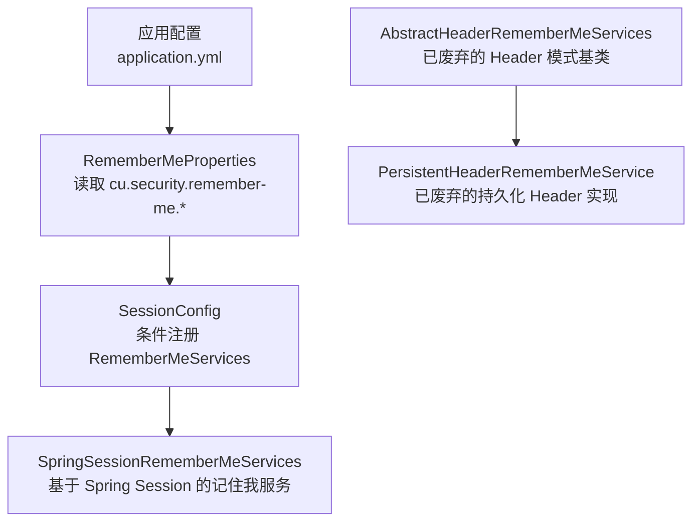
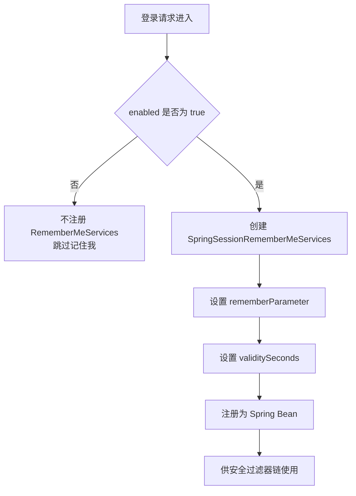
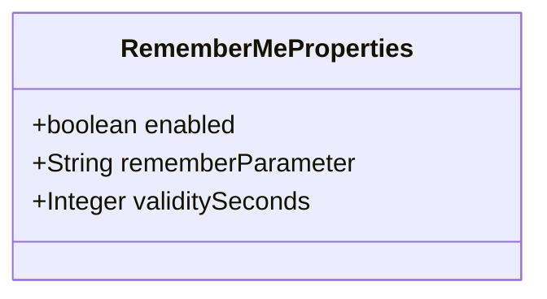
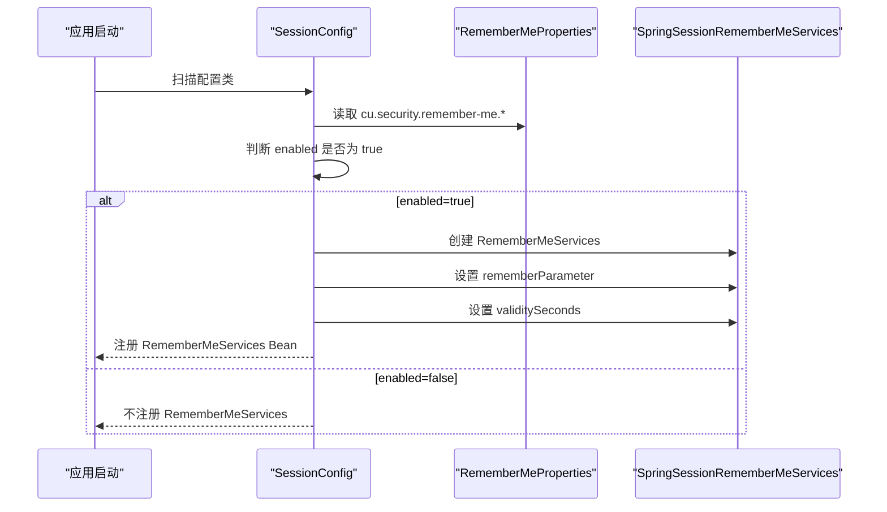
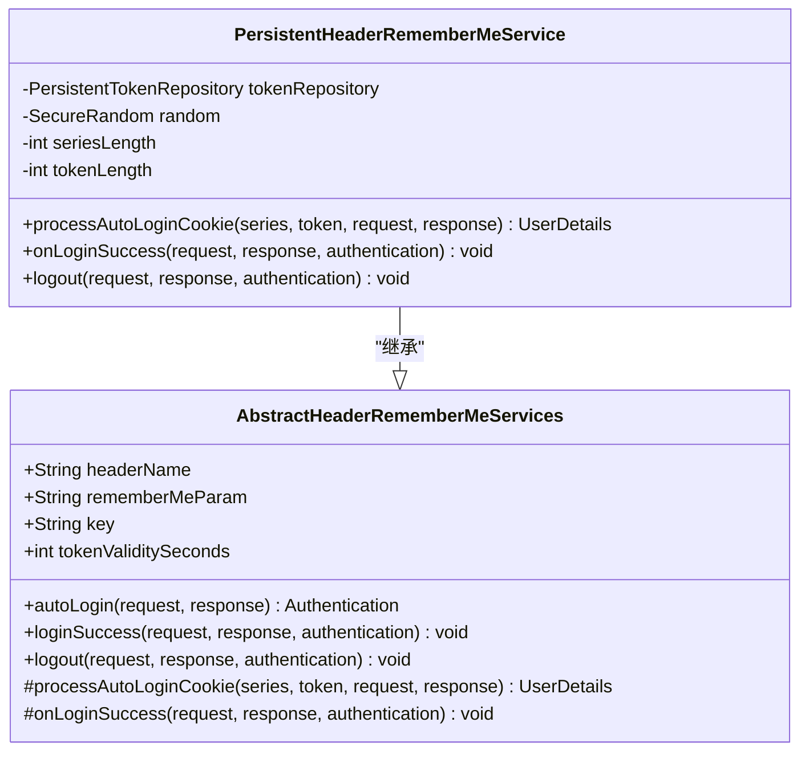
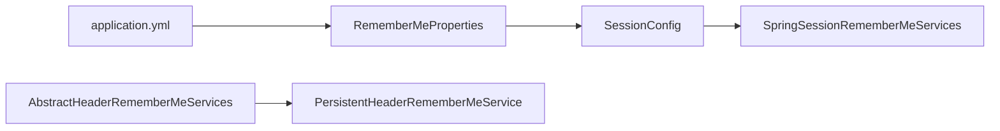
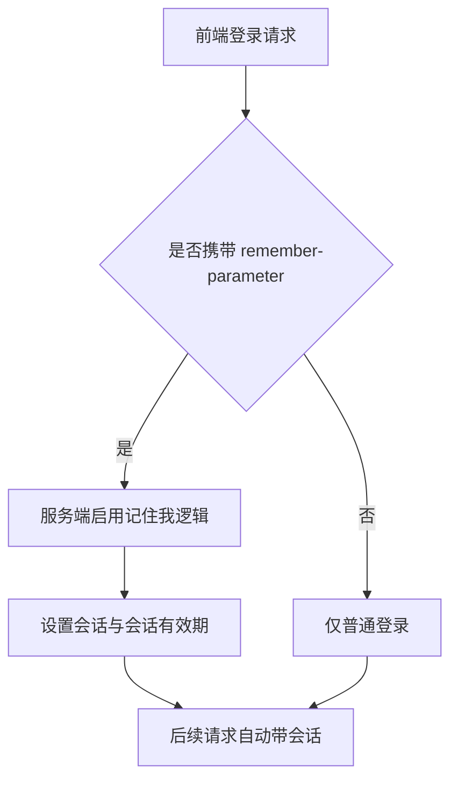

# 记住我配置

<cite>
**本文引用的文件**   
- [RememberMeProperties.java](file://login-spring-boot-starter/src/main/java/com/cu/framework/authentication/properties/RememberMeProperties.java)
- [SessionConfig.java](file://login-spring-boot-starter/src/main/java/com/cu/framework/authentication/config/SessionConfig.java)
- [AbstractHeaderRememberMeServices.java](file://login-spring-boot-starter/src/main/java/com/cu/framework/authentication/extension/AbstractHeaderRememberMeServices.java)
- [PersistentHeaderRememberMeService.java](file://login-spring-boot-starter/src/main/java/com/cu/framework/authentication/extension/PersistentHeaderRememberMeService.java)
- [application.yml（文档参考）](file://docs/application.yml)
- [application.yml（登录示例）](file://sample/login-boot-sample/src/main/resources/application.yml)
- [README.md（登录模块说明）](file://login-spring-boot-starter/README.md)
</cite>

## 目录
1. [引言](#引言)
2. [项目结构定位](#项目结构定位)
3. [核心配置类：RememberMeProperties](#核心配置类remembermeproperties)
4. [架构总览与实现原理](#架构总览与实现原理)
5. [详细组件分析](#详细组件分析)
6. [依赖关系分析](#依赖关系分析)
7. [安全性与有效期权衡](#安全性与有效期权衡)
8. [前端集成与 rememberParameter 自定义](#前端集成与-rememberparameter-自定义)
9. [不同安全级别的配置建议](#不同安全级别的配置建议)
10. [常见问题与解决方案](#常见问题与解决方案)
11. [结论](#结论)

## 引言
本文面向 Kewen Framework 中“记住我”功能的配置与维护人员，围绕 `cu.security.remember-me` 配置前缀下的三个关键属性展开：功能开关 `enabled`、参数名 `rememberParameter`、有效期 `validitySeconds`。文档同时解释当前框架中的实现状态、Cookie 与 Session 机制、安全注意事项、前端集成方式，以及不同业务场景下的最佳实践。

## 项目结构定位
“记住我”相关能力集中在登录认证 Starter 中：

- 配置类位于 `login-spring-boot-starter` 的 `authentication.properties` 包下。
- Spring Bean 装配与条件注册位于 `authentication.config.SessionConfig`。
- 历史 Header 模式 RememberMe 扩展位于 `authentication.extension` 包下，但已被标记为废弃。
- 可运行示例和参考配置位于 `sample/login-boot-sample` 与 `docs/application.yml`。

**图表来源**
- [RememberMeProperties.java:1-26](file://login-spring-boot-starter/src/main/java/com/cu/framework/authentication/properties/RememberMeProperties.java#L1-L26)
- [SessionConfig.java:1-124](file://login-spring-boot-starter/src/main/java/com/cu/framework/authentication/config/SessionConfig.java#L1-L124)
- [AbstractHeaderRememberMeServices.java:1-200](file://login-spring-boot-starter/src/main/java/com/cu/framework/authentication/extension/AbstractHeaderRememberMeServices.java#L1-L200)
- [PersistentHeaderRememberMeService.java:1-161](file://login-spring-boot-starter/src/main/java/com/cu/framework/authentication/extension/PersistentHeaderRememberMeService.java#L1-L161)

**章节来源**
- [RememberMeProperties.java:1-26](file://login-spring-boot-starter/src/main/java/com/cu/framework/authentication/properties/RememberMeProperties.java#L1-L26)
- [SessionConfig.java:1-124](file://login-spring-boot-starter/src/main/java/com/cu/framework/authentication/config/SessionConfig.java#L1-L124)
- [AbstractHeaderRememberMeServices.java:1-200](file://login-spring-boot-starter/src/main/java/com/cu/framework/authentication/extension/AbstractHeaderRememberMeServices.java#L1-L200)
- [PersistentHeaderRememberMeService.java:1-161](file://login-spring-boot-starter/src/main/java/com/cu/framework/authentication/extension/PersistentHeaderRememberMeService.java#L1-L161)

## 核心配置类：RememberMeProperties
`RememberMeProperties` 是“记住我”功能的唯一配置入口，通过 Spring Boot 的 `@ConfigurationProperties("cu.security.remember-me")` 绑定到配置文件。它包含以下三个字段：

| 配置键 | 默认值 | 数据类型 | 作用 |
|---|---:|---:|---|
| `cu.security.remember-me.enabled` | `true` | `boolean` | 是否启用记住我功能；为 `false` 时不注册 `RememberMeServices` Bean。 |
| `cu.security.remember-me.remember-parameter` | `"remember-me"` | `String` | 登录请求中用于声明是否需要记住我的参数名或请求头名。 |
| `cu.security.remember-me.validitySeconds` | `2592000` | `Integer` | 记住我 Token 的有效期，单位秒；默认值为 30 天。 |

### 各字段语义与使用方式

- **enabled：功能启用开关**
  - 当值为 `true` 时，`SessionConfig` 会创建并注册一个 `RememberMeServices` Bean。
  - 当值为 `false` 时，该 Bean 不会被创建，因此“记住我”逻辑不会参与后续认证流程。
  - 该开关适合按环境切换：开发环境可开启方便调试，生产高安全环境可选择关闭。

- **rememberParameter：记住我参数名**
  - 默认值为 `remember-me`。
  - 在基于 Spring Session 的实现中，该值被设置为 `SpringSessionRememberMeServices` 的记住我参数名。
  - 前端登录请求需要携带同名参数，才能触发记住我逻辑。
  - 如果需要与现有前端协议兼容，可改为其他名称，例如 `rememberMe`、`keep_login` 等。

- **validitySeconds：有效期**
  - 默认值为 `2592000`，即 30 天。
  - 单位为秒，不是毫秒、分钟或天。
  - 该值控制记住我 Token 的生命周期；时间越长，用户免登录体验越好，但安全风险越高。

**章节来源**
- [RememberMeProperties.java:1-26](file://login-spring-boot-starter/src/main/java/com/cu/framework/authentication/properties/RememberMeProperties.java#L1-L26)
- [SessionConfig.java:50-80](file://login-spring-boot-starter/src/main/java/com/cu/framework/authentication/config/SessionConfig.java#L50-L80)
- [application.yml（文档参考）:108-116](file://docs/application.yml#L108-L116)
- [application.yml（登录示例）:45-52](file://sample/login-boot-sample/src/main/resources/application.yml#L45-L52)

## 架构总览与实现原理
Kewen Framework 当前对“记住我”的实现分为两条线索：

1. **当前推荐路径：Spring Session 模式的 RememberMe**
   - 由 `SessionConfig` 根据 `cu.security.remember-me.enabled` 条件注册 `SpringSessionRememberMeServices`。
   - 参数名和有效期分别来自 `RememberMeProperties` 的 `rememberParameter` 和 `validitySeconds`。
   - 该模式依赖 Spring Session，通常结合数据库持久化会话。

2. **历史路径：Header 模式的 RememberMe**
   - `AbstractHeaderRememberMeServices` 提供抽象基类，支持从请求头解析 remember-me Token。
   - `PersistentHeaderRememberMeService` 是该基类的具体实现，使用内存持久化 Token 仓库。
   - 这两个类均被标注为 `@Deprecated`，注释中也明确说明：如果 Token 模式已经改用 Spring Session，则 Header 模式不再必要。

**图表来源**
- [SessionConfig.java:50-80](file://login-spring-boot-starter/src/main/java/com/cu/framework/authentication/config/SessionConfig.java#L50-L80)
- [RememberMeProperties.java:1-26](file://login-spring-boot-starter/src/main/java/com/cu/framework/authentication/properties/RememberMeProperties.java#L1-L26)

**章节来源**
- [SessionConfig.java:1-124](file://login-spring-boot-starter/src/main/java/com/cu/framework/authentication/config/SessionConfig.java#L1-L124)
- [AbstractHeaderRememberMeServices.java:1-200](file://login-spring-boot-starter/src/main/java/com/cu/framework/authentication/extension/AbstractHeaderRememberMeServices.java#L1-L200)
- [PersistentHeaderRememberMeService.java:1-161](file://login-spring-boot-starter/src/main/java/com/cu/framework/authentication/extension/PersistentHeaderRememberMeService.java#L1-L161)

## 详细组件分析

### RememberMeProperties：配置数据模型
该类是一个简单的配置载体，没有复杂业务逻辑，主要职责是：

- 声明配置前缀 `cu.security.remember-me`。
- 提供 `enabled`、`rememberParameter`、`validitySeconds` 三个字段。
- 通过 Lombok 生成 Getter/Setter，便于 Spring Boot 配置绑定。

其数据结构可以理解为：

**图表来源**
- [RememberMeProperties.java:1-26](file://login-spring-boot-starter/src/main/java/com/cu/framework/authentication/properties/RememberMeProperties.java#L1-L26)

**章节来源**
- [RememberMeProperties.java:1-26](file://login-spring-boot-starter/src/main/java/com/cu/framework/authentication/properties/RememberMeProperties.java#L1-L26)

### SessionConfig：条件注册 RememberMeServices
`SessionConfig` 负责将配置映射到 Spring Security 的 `RememberMeServices`。关键点如下：

- 通过 `@EnableConfigurationProperties` 显式启用 `RememberMeProperties`。
- 使用 `@ConditionalOnProperty(name = "cu.security.remember-me.enabled", havingValue = "true")` 控制 Bean 是否注册。
- 将 `rememberParameter` 注入到 `SpringSessionRememberMeServices` 的参数名。
- 将 `validitySeconds` 注入到 `SpringSessionRememberMeServices` 的有效期。

**图表来源**
- [SessionConfig.java:25-80](file://login-spring-boot-starter/src/main/java/com/cu/framework/authentication/config/SessionConfig.java#L25-L80)
- [RememberMeProperties.java:1-26](file://login-spring-boot-starter/src/main/java/com/cu/framework/authentication/properties/RememberMeProperties.java#L1-L26)

**章节来源**
- [SessionConfig.java:1-124](file://login-spring-boot-starter/src/main/java/com/cu/framework/authentication/config/SessionConfig.java#L1-L124)

### AbstractHeaderRememberMeServices 与 PersistentHeaderRememberMeService：历史实现
这两个类属于历史实现，具有以下特征：

- 提供基于请求头的 RememberMe 机制。
- 支持从请求头中解析 series 与 token。
- 支持登录成功时写入响应头、登出时清除响应头。
- 使用 `InMemoryTokenRepositoryImpl` 作为默认持久化仓库。
- 被标记为 `@Deprecated`，且代码注释明确指出：如果 Token 模式已迁移到 Spring Session，则不再需要该实现。

**图表来源**
- [AbstractHeaderRememberMeServices.java:1-200](file://login-spring-boot-starter/src/main/java/com/cu/framework/authentication/extension/AbstractHeaderRememberMeServices.java#L1-L200)
- [PersistentHeaderRememberMeService.java:1-161](file://login-spring-boot-starter/src/main/java/com/cu/framework/authentication/extension/PersistentHeaderRememberMeService.java#L1-L161)

**章节来源**
- [AbstractHeaderRememberMeServices.java:1-200](file://login-spring-boot-starter/src/main/java/com/cu/framework/authentication/extension/AbstractHeaderRememberMeServices.java#L1-L200)
- [PersistentHeaderRememberMeService.java:1-161](file://login-spring-boot-starter/src/main/java/com/cu/framework/authentication/extension/PersistentHeaderRememberMeService.java#L1-L161)

## 依赖关系分析
从依赖角度看，“记住我”功能的核心依赖如下：

- `RememberMeProperties` 依赖 Spring Boot 的配置绑定机制。
- `SessionConfig` 依赖 `RememberMeProperties`、Spring Security 的 `RememberMeServices`、Spring Session 的 `SpringSessionRememberMeServices`。
- 历史 Header 实现依赖 Spring Security 的持久化 Token 机制和内存 Token 仓库。

**图表来源**
- [RememberMeProperties.java:1-26](file://login-spring-boot-starter/src/main/java/com/cu/framework/authentication/properties/RememberMeProperties.java#L1-L26)
- [SessionConfig.java:25-80](file://login-spring-boot-starter/src/main/java/com/cu/framework/authentication/config/SessionConfig.java#L25-L80)
- [AbstractHeaderRememberMeServices.java:1-200](file://login-spring-boot-starter/src/main/java/com/cu/framework/authentication/extension/AbstractHeaderRememberMeServices.java#L1-L200)
- [PersistentHeaderRememberMeService.java:1-161](file://login-spring-boot-starter/src/main/java/com/cu/framework/authentication/extension/PersistentHeaderRememberMeService.java#L1-L161)

**章节来源**
- [SessionConfig.java:1-124](file://login-spring-boot-starter/src/main/java/com/cu/framework/authentication/config/SessionConfig.java#L1-L124)
- [RememberMeProperties.java:1-26](file://login-spring-boot-starter/src/main/java/com/cu/framework/authentication/properties/RememberMeProperties.java#L1-L26)

## 安全性与有效期权衡
### Cookie 与 Session 机制
- 当前配置注册的 `SpringSessionRememberMeServices` 基于 Spring Session，适合后端会话已经持久化的场景。
- 若使用 Cookie 存储会话，需要注意浏览器 Cookie 的安全属性，如 `HttpOnly`、`Secure`、`SameSite` 等，这些通常由容器或框架的其他会话配置控制，不在 `RememberMeProperties` 中直接暴露。
- 历史 Header 实现会将 remember-me Token 放入响应头，但该类已被废弃，不建议在新项目中采用。

### validitySeconds 的时间单位与默认值
- 时间单位为秒。
- 默认值 `2592000` 等于 30 天。
- 增大有效期会提升用户体验，但会增加 Token 泄露后的风险窗口。
- 缩短有效期会降低长期未主动登出的安全风险，但可能频繁要求重新登录。

### 安全建议
- 高安全系统应限制 `validitySeconds`，并结合会话并发控制和登录审计。
- 敏感业务建议关闭记住我功能，或在高风险操作后强制重新认证。
- 不要在生产环境使用硬编码密钥或弱随机数；历史 Header 实现中已有相关校验和随机数生成逻辑，但由于该实现已废弃，不应作为新方案依据。

**章节来源**
- [SessionConfig.java:50-80](file://login-spring-boot-starter/src/main/java/com/cu/framework/authentication/config/SessionConfig.java#L50-L80)
- [PersistentHeaderRememberMeService.java:1-161](file://login-spring-boot-starter/src/main/java/com/cu/framework/authentication/extension/PersistentHeaderRememberMeService.java#L1-L161)
- [AbstractHeaderRememberMeServices.java:1-200](file://login-spring-boot-starter/src/main/java/com/cu/framework/authentication/extension/AbstractHeaderRememberMeServices.java#L1-L200)

## 前端集成与 rememberParameter 自定义
### rememberParameter 的作用
`rememberParameter` 决定前端登录请求中哪个字段表示“是否记住我”。默认值是 `remember-me`。

### 自定义方法
1. 修改 `cu.security.remember-me.remember-parameter` 为新参数名。
2. 同步修改前端登录表单或 JSON 请求体中的字段名。
3. 保持服务端配置与前端请求一致，否则服务器无法识别记住我意图。

### 前端集成要点
- 如果前端使用 JSON 登录，应在登录请求体中加入 remember 参数。
- 如果前端使用表单提交，应确保表单字段名与服务端配置一致。
- 记住我成功后，浏览器通常需要保留会话 Cookie；后续请求由服务器根据会话恢复登录状态。
- 如果使用前后端分离部署，还需要注意跨域 Cookie 配置；但这不属于 `RememberMeProperties` 的直接职责。

**图表来源**
- [SessionConfig.java:50-80](file://login-spring-boot-starter/src/main/java/com/cu/framework/authentication/config/SessionConfig.java#L50-L80)
- [RememberMeProperties.java:1-26](file://login-spring-boot-starter/src/main/java/com/cu/framework/authentication/properties/RememberMeProperties.java#L1-L26)

**章节来源**
- [RememberMeProperties.java:1-26](file://login-spring-boot-starter/src/main/java/com/cu/framework/authentication/properties/RememberMeProperties.java#L1-L26)
- [SessionConfig.java:50-80](file://login-spring-boot-starter/src/main/java/com/cu/framework/authentication/config/SessionConfig.java#L50-L80)

## 不同安全级别的配置建议
### 低安全级别
适用场景：内部工具、演示系统、本地开发环境。

- `enabled: true`
- `remember-parameter: remember-me`
- `validitySeconds: 2592000` 或更长

优点：开发效率高，用户无需频繁登录。  
风险：Token 泄露影响时间较长。

### 中等安全级别
适用场景：一般企业系统、非金融类业务。

- `enabled: true`
- `remember-parameter: 与前端约定一致的参数名`
- `validitySeconds: 7 天至 14 天`

优点：兼顾体验与安全。  
风险：仍需防范 Cookie 泄露和共享设备风险。

### 高安全级别
适用场景：金融、政务、敏感数据处理系统。

- `enabled: false`
- 或者 `enabled: true`，但 `validitySeconds` 较短，并配合会话并发控制和操作审计

优点：显著降低长期未认证会话的风险。  
风险：用户体验下降，需要更完善的登录引导。

### 配置对照表

| 安全级别 | enabled | rememberParameter | validitySeconds | 建议 |
|---|---:|---|---:|---|
| 低安全 | `true` | `remember-me` | 30 天以上 | 快速验证功能 |
| 中等安全 | `true` | 按需自定义 | 7 至 14 天 | 平衡体验与安全 |
| 高安全 | `false` 或较短有效期 | 与前端统一 | 较短 | 优先最小权限与最短会话 |

**章节来源**
- [application.yml（文档参考）:108-116](file://docs/application.yml#L108-L116)
- [application.yml（登录示例）:45-52](file://sample/login-boot-sample/src/main/resources/application.yml#L45-L52)
- [README.md（登录模块说明）:1-120](file://login-spring-boot-starter/README.md#L1-L120)

## 常见问题与解决方案

### 问题一：设置了 remember-me 配置但没有生效
**原因：**
- 当前框架仅在 `SessionConfig` 中注册了 `RememberMeServices` Bean。
- 文档说明指出：该 Bean 目前未挂入过滤器链，因此配置项在当前状态下不产生完整行为。

**解决思路：**
- 确认 `cu.security.remember-me.enabled` 是否为 `true`。
- 如需完整记住我行为，应检查安全过滤器链是否引入对应实现；当前仓库中该功能处于“已装配但未完全接线”的状态。
- 不要误以为配置一定生效，应以实际测试为准。

**章节来源**
- [SessionConfig.java:50-80](file://login-spring-boot-starter/src/main/java/com/cu/framework/authentication/config/SessionConfig.java#L50-L80)
- [application.yml（文档参考）:108-116](file://docs/application.yml#L108-L116)
- [README.md（登录模块说明）:1-120](file://login-spring-boot-starter/README.md#L1-L120)

### 问题二：不知道 rememberParameter 应该传什么值
**说明：**
- `rememberParameter` 是参数名，不是布尔值。
- 默认参数名为 `remember-me`。
- 前端需要在登录请求中包含该字段，并使用能表达“开启记住我”的值。

**解决思路：**
- 若保持默认配置，前端应发送 `remember-me` 字段。
- 若修改了 `remember-parameter`，必须同步更新前端。
- 可参考历史 Header 实现中对 remember-me 参数的判断逻辑，理解常见取值语义。

**章节来源**
- [RememberMeProperties.java:1-26](file://login-spring-boot-starter/src/main/java/com/cu/framework/authentication/properties/RememberMeProperties.java#L1-L26)
- [AbstractHeaderRememberMeServices.java:1-200](file://login-spring-boot-starter/src/main/java/com/cu/framework/authentication/extension/AbstractHeaderRememberMeServices.java#L1-L200)

### 问题三：validitySeconds 设置后时间不符合预期
**原因：**
- 该字段单位是秒。
- 默认值 `2592000` 是 30 天。

**解决思路：**
- 计算天数时使用 `天数 × 24 × 60 × 60`。
- 例如 7 天对应 `604800` 秒。
- 避免把秒误认为毫秒或其他单位。

**章节来源**
- [RememberMeProperties.java:1-26](file://login-spring-boot-starter/src/main/java/com/cu/framework/authentication/properties/RememberMeProperties.java#L1-L26)
- [application.yml（文档参考）:108-116](file://docs/application.yml#L108-L116)

### 问题四：能否直接使用 Header 模式的 RememberMe
**现状：**
- `AbstractHeaderRememberMeServices` 和 `PersistentHeaderRememberMeService` 已被标记为废弃。
- 代码注释明确说明，如果 Token 模式已迁移到 Spring Session，则不需要 Header 模式。

**建议：**
- 新项目不要扩展或使用这两个类。
- 继续使用基于 Spring Session 的 `SpringSessionRememberMeServices` 路径。

**章节来源**
- [AbstractHeaderRememberMeServices.java:1-200](file://login-spring-boot-starter/src/main/java/com/cu/framework/authentication/extension/AbstractHeaderRememberMeServices.java#L1-L200)
- [PersistentHeaderRememberMeService.java:1-161](file://login-spring-boot-starter/src/main/java/com/cu/framework/authentication/extension/PersistentHeaderRememberMeService.java#L1-L161)

## 结论
Kewen Framework 的“记住我”配置入口是 `RememberMeProperties`，通过 `cu.security.remember-me` 前缀管理功能开关、参数名和有效期。当前实现中，该配置主要用于创建 `SpringSessionRememberMeServices` Bean，但是否真正接入安全过滤器链取决于上层安全配置；文档明确提示当前该功能“只创建 Bean，未挂入过滤器链”，因此不能仅凭配置就断言记住我已完全生效。

在实际使用中，建议优先关注三点：

1. 使用 `enabled` 控制功能是否启用。
2. 使用 `rememberParameter` 与前端统一记住我参数名。
3. 使用 `validitySeconds` 在用户体验和安全风险之间取得平衡。

对于高安全系统，应谨慎开启记住我功能，并配合会话管理、审计和风险控制策略。对于历史 Header 模式实现，应视为废弃能力，避免在新系统中继续扩展。