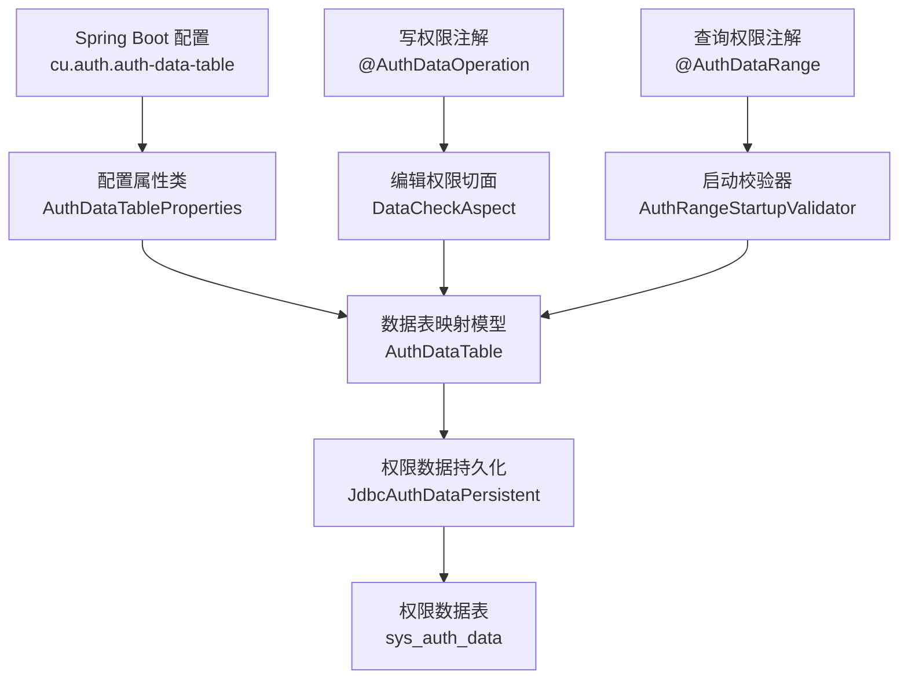
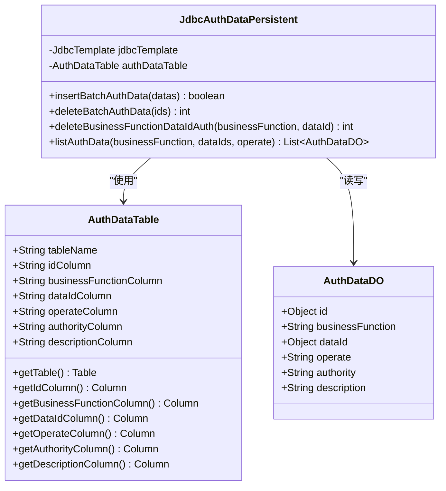
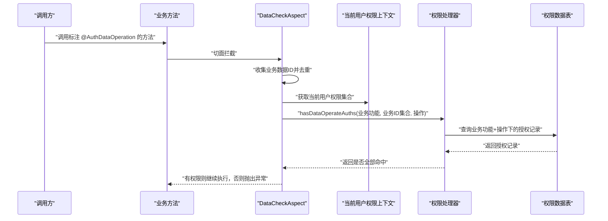
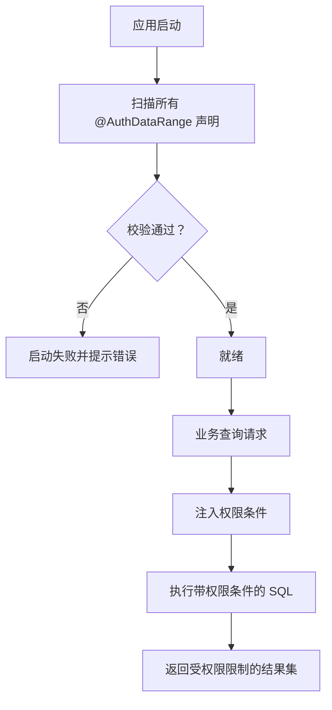

# 权限配置

<cite>
**本文引用的文件**   
- [权限初始化脚本](file://docs/sql/auth-rbac.sql)
- [数据表映射模型](file://auth/auth-core/src/main/java/com/cu/framework/auth/core/data/AuthDataTable.java)
- [权限数据持久化实现](file://auth/auth-core/src/main/java/com/cu/framework/auth/core/data/JdbcAuthDataPersistent.java)
- [权限数据对象](file://auth/auth-core/src/main/java/com/cu/framework/auth/core/data/AuthDataDO.java)
- [编辑操作权限注解](file://auth/auth-core/src/main/java/com/cu/framework/auth/core/AuthDataOperation.java)
- [数据范围权限注解](file://auth/auth-core/src/main/java/com/cu/framework/auth/core/AuthDataRange.java)
- [编辑权限切面](file://auth/auth-core/src/main/java/com/cu/framework/auth/core/data/edit/DataCheckAspect.java)
- [数据范围启动校验器](file://auth/auth-core/src/main/java/com/cu/framework/auth/core/data/range/AuthRangeStartupValidator.java)
- [Spring Boot 配置属性类](file://auth/auth-core-spring-boot-starter/src/main/java/com/cu/framework/boot/auth/core/properties/AuthDataTableProperties.java)
- [应用配置参考](file://docs/application.yml)
</cite>

## 目录
1. [引言](#引言)
2. [项目结构与权限模块边界](#项目结构与权限模块边界)
3. [核心概念与配置入口](#核心概念与配置入口)
4. [权限数据表字段映射详解](#权限数据表字段映射详解)
5. [数据库结构设计要求与命名规范](#数据库结构设计要求与命名规范)
6. [权限初始化脚本与示例数据](#权限初始化脚本与示例数据)
7. [权限校验流程](#权限校验流程)
8. [自定义字段映射与表结构扩展](#自定义字段映射与表结构扩展)
9. [性能优化建议](#性能优化建议)
10. [常见问题排查指南](#常见问题排查指南)
11. [结论](#结论)

## 引言
本文面向 Kewen Framework 中“权限配置”这一主题，重点说明业务数据权限相关的配置属性、权限数据表字段映射、SQL 初始化方式，以及如何在实际业务中调整权限表结构和扩展字段。文档同时覆盖查询侧的数据范围过滤和写侧的数据操作权限校验，帮助读者从配置、数据结构到运行时行为建立完整理解。

权限体系在框架中由多个层次组成：
- 配置层：通过 Spring Boot 配置属性绑定权限数据表的表名与列名。
- 数据层：使用 JSqlParser 构造 SQL，将业务功能、业务ID、操作类型、权限串、权限描述作为参数安全写入和读取。
- 注解层：通过 `@AuthDataOperation` 声明写操作权限，通过 `@AuthDataRange` 声明查询数据范围。
- 运行层：启动期校验声明，运行期注入权限条件并执行权限比对。

## 项目结构与权限模块边界
权限相关代码主要分布在以下位置：
- 权限核心模型与持久化逻辑位于 `auth/auth-core`。
- Spring Boot 自动装配与配置属性位于 `auth/auth-core-spring-boot-starter`。
- RBAC 相关实体、菜单、角色、用户等辅助表定义位于 `auth/auth-rbac` 及对应 SQL。
- 初始化 SQL 集中在 `docs/sql/auth-rbac.sql`。
- 配置键参考集中在 `docs/application.yml`。



**图表来源**
- [Spring Boot 配置属性类:1-109](file://auth/auth-core-spring-boot-starter/src/main/java/com/cu/framework/boot/auth/core/properties/AuthDataTableProperties.java#L1-L109)
- [数据表映射模型:1-113](file://auth/auth-core/src/main/java/com/cu/framework/auth/core/data/AuthDataTable.java#L1-L113)
- [权限数据持久化实现:1-179](file://auth/auth-core/src/main/java/com/cu/framework/auth/core/data/JdbcAuthDataPersistent.java#L1-L179)
- [权限初始化脚本:1-148](file://docs/sql/auth-rbac.sql#L1-L148)
- [编辑权限切面:1-149](file://auth/auth-core/src/main/java/com/cu/framework/auth/core/data/edit/DataCheckAspect.java#L1-L149)
- [数据范围启动校验器:1-163](file://auth/auth-core/src/main/java/com/cu/framework/auth/core/data/range/AuthRangeStartupValidator.java#L1-L163)

**章节来源**
- [权限初始化脚本:1-148](file://docs/sql/auth-rbac.sql#L1-L148)
- [Spring Boot 配置属性类:1-109](file://auth/auth-core-spring-boot-starter/src/main/java/com/cu/framework/boot/auth/core/properties/AuthDataTableProperties.java#L1-L109)

## 核心概念与配置入口
权限数据表的配置由 `AuthDataTableProperties` 提供，默认前缀为 `cu.auth.auth-data-table`。该配置类把 YAML 中的键值映射为 Java 属性，再交给 `AuthDataTable` 用于构造 SQL 中的表和列。

| 配置项 | 默认值 | 含义 | 是否可自定义 |
|---|---:|---|---|
| `cu.auth.auth-data-table.table-name` | `sys_auth_data` | 权限数据表表名 | 是 |
| `cu.auth.auth-data-table.id-column` | `id` | 权限记录主键列名，删除时使用 | 是 |
| `cu.auth.auth-data-table.business-function-column` | `business_function` | 业务功能列名，用于区分不同业务模块 | 是 |
| `cu.auth.auth-data-table.data-id-column` | `data_id` | 业务ID存储列名，类型随业务主键 | 是 |
| `cu.auth.auth-data-table.operate-column` | `operate` | 操作类型列名，如 `unified`、`modify`、`delete` | 是 |
| `cu.auth.auth-data-table.authority-column` | `authority` | 权限字符串列名 | 是 |
| `cu.auth.auth-data-table.description-column` | `description` | 权限描述列名 | 是 |

这些配置最终被封装进 `AuthDataTable`，并由 `JdbcAuthDataPersistent` 在插入、删除、查询时动态生成 SQL。这样做的目的是让框架不假设业务ID的类型，也不直接拼接业务值，而是统一以 JDBC 参数形式下发，提高安全性和可扩展性。

**章节来源**
- [Spring Boot 配置属性类:1-109](file://auth/auth-core-spring-boot-starter/src/main/java/com/cu/framework/boot/auth/core/properties/AuthDataTableProperties.java#L1-L109)
- [数据表映射模型:1-113](file://auth/auth-core/src/main/java/com/cu/framework/auth/core/data/AuthDataTable.java#L1-L113)
- [应用配置参考:1-200](file://docs/application.yml#L1-L200)

## 权限数据表字段映射详解
权限数据表的核心职责是回答一个问题：**当前用户对某个业务功能的某条具体数据，是否拥有指定操作的权限。**

### 字段映射关系
| 配置项 | 对应数据库列 | 数据类型建议 | 用途 |
|---|---|---|---|
| `table-name` | 权限表名，通常为 `sys_auth_data` | 表名 | 标识权限数据存储位置 |
| `id-column` | `id` | `bigint` | 权限记录主键，用于批量删除 |
| `business-function-column` | `business_function` | `varchar(64)` | 业务功能标识，例如订单、合同、客户等 |
| `data-id-column` | `data_id` | `bigint` 或 `varchar` | 业务主键ID；框架不假设类型，按实际业务主键类型存储 |
| `operate-column` | `operate` | `varchar(64)` | 操作类型，默认 `unified`，也可自定义 `modify`、`delete` 等 |
| `authority-column` | `authority` | `varchar(100)` | 权限字符串，与用户权限集合进行匹配 |
| `description-column` | `description` | `varchar(200)` | 权限描述，便于后台管理和审计 |

### 数据对象映射
`AuthDataDO` 是权限数据在内存中的载体，包含权限记录主键、业务功能、业务ID、操作类型、权限字符串和描述。查询返回的对象中，`id` 来自权限表主键，`dataId` 来自业务ID列，其他字段用于权限匹配。



**图表来源**
- [数据表映射模型:1-113](file://auth/auth-core/src/main/java/com/cu/framework/auth/core/data/AuthDataTable.java#L1-L113)
- [权限数据对象:1-54](file://auth/auth-core/src/main/java/com/cu/framework/auth/core/data/AuthDataDO.java#L1-L54)
- [权限数据持久化实现:1-179](file://auth/auth-core/src/main/java/com/cu/framework/auth/core/data/JdbcAuthDataPersistent.java#L1-L179)

### 关键行为说明
- **批量插入**：只向业务功能、业务ID、操作、权限字符串、权限描述五列写入值，全部使用 JDBC 参数。
- **批量删除**：根据权限表主键列表删除。
- **按业务功能与业务ID删除**：清空某个业务功能下某个业务ID的所有权限记录。
- **按业务功能和操作查询**：返回权限记录的 `id`、`data_id`、`authority`、`description`，用于后续与当前用户权限集合比对。

**章节来源**
- [权限数据持久化实现:1-179](file://auth/auth-core/src/main/java/com/cu/framework/auth/core/data/JdbcAuthDataPersistent.java#L1-L179)
- [权限数据对象:1-54](file://auth/auth-core/src/main/java/com/cu/framework/auth/core/data/AuthDataDO.java#L1-L54)

## 数据库结构设计要求与命名规范
### 权限数据表 `sys_auth_data`
权限数据表是数据权限的基础表，推荐遵循以下设计：

| 字段 | 类型 | 约束 | 说明 |
|---|---|---|---|
| `id` | `bigint` | 主键、自增 | 权限记录主键 |
| `business_function` | `varchar(64)` | 非空 | 业务功能标识 |
| `data_id` | `bigint` 或 `varchar` | 非空 | 业务主键ID；若业务主键是字符串，则改为 `varchar` |
| `operate` | `varchar(64)` | 非空，默认 `unified` | 操作类型 |
| `authority` | `varchar(100)` | 非空 | 权限字符串 |
| `description` | `varchar(200)` | 非空 | 权限描述 |
| `create_time` | `datetime` | 可选 | 创建时间 |
| `update_time` | `datetime` | 可选 | 修改时间 |

脚本中还定义了组合索引：
- `(business_function, operate, data_id, authority)`

该索引有利于按业务功能、操作类型和业务ID快速定位权限记录。

### 其他关联表
虽然权限数据表是数据权限核心，但 RBAC 初始化脚本还包含菜单、路由、角色、用户、部门等表。它们共同支撑菜单权限、角色权限和用户上下文，但与“业务数据权限字段映射”相对独立。

```mermaid
erDiagram
  SYS_AUTH_DATA {
    bigint id PK
    varchar business_function
    bigint_or_varchar data_id
    varchar operate
    varchar authority
    varchar description
    datetime create_time
    datetime update_time
  }

  SYS_MENU_API {
    bigint id PK
    varchar path
    varchar name
    bigint parent_id
    tinyint auth_type
    tinyint deleted
    datetime create_time
    datetime update_time
  }

  SYS_AUTH_MENU {
    bigint id PK
    bigint api_id
    varchar authority
    varchar description
    datetime create_time
    datetime update_time
  }

  SYS_ROLE {
    bigint id PK
    varchar name
    datetime create_time
    datetime update_time
  }

  SYS_USER {
    bigint id PK
    varchar username UK
    varchar phone UK
    datetime create_time
    datetime update_time
  }

  SYS_USER_ROLE {
    bigint id PK
    bigint user_id
    bigint role_id
    KEY user_role_idx user_id, role_id
  }

  SYS_MENU_API ||--o{ SYS_AUTH_MENU : "api_id 关联"
  SYS_USER ||--o{ SYS_USER_ROLE : "user_id 关联"
  SYS_ROLE ||--o{ SYS_USER_ROLE : "role_id 关联"
```

**图表来源**
- [权限初始化脚本:1-148](file://docs/sql/auth-rbac.sql#L1-L148)

**章节来源**
- [权限初始化脚本:1-148](file://docs/sql/auth-rbac.sql#L1-L148)

## 权限初始化脚本与示例数据
初始化脚本位于 `docs/sql/auth-rbac.sql`，支持 MySQL 与 H2（MySQL 模式）。脚本包含以下内容：
- 删除并重建 `sys_auth_data`、`sys_auth_menu`、`sys_dept`、`sys_menu_api`、`sys_menu_route`、`sys_role`、`sys_user`、`sys_user_credential`、`sys_user_dept`、`sys_user_role`。
- 为 `sys_auth_data` 建立组合索引。
- 为 `sys_menu_api.path` 建立唯一索引。
- 为 `sys_user.username`、`sys_user.phone` 建立唯一索引。
- 为 `sys_user_dept.user_id`、`sys_user_role.user_id` 建立联合索引。
- 创建视图 `view_menu_api_auth`，用于查看菜单API与其自身权限的关联结果。

### 权限数据表示例数据
示例数据应围绕“业务功能、业务ID、操作类型、权限字符串、权限描述”五个维度设计。由于脚本未内置业务示例数据，建议在业务上线前补充如下类型的记录：
- 订单模块：对订单查询、修改、删除分别授予不同权限字符串。
- 合同模块：对合同查看、编辑、审批分别授予不同权限字符串。
- 每个业务ID对应一个具体业务记录的主键。

示例数据组织原则：
- `business_function` 使用稳定、可读的业务标识。
- `operate` 优先使用框架默认 `unified`，特殊场景使用自定义操作。
- `authority` 与后端权限控制逻辑保持一致。
- `description` 要能表达该权限的实际意义，便于后台管理。

**章节来源**
- [权限初始化脚本:1-148](file://docs/sql/auth-rbac.sql#L1-L148)

## 权限校验流程
权限校验分为两类：
1. **写操作权限校验**：使用 `@AuthDataOperation`，在方法执行前检查当前用户是否有权操作本次涉及的业务数据。
2. **查询数据范围校验**：使用 `@AuthDataRange`，在 MyBatis 查询语句上注入权限条件，限制查询结果范围。

### 写操作权限校验流程


**图表来源**
- [编辑权限切面:1-149](file://auth/auth-core/src/main/java/com/cu/framework/auth/core/data/edit/DataCheckAspect.java#L1-L149)
- [编辑操作权限注解:1-51](file://auth/auth-core/src/main/java/com/cu/framework/auth/core/AuthDataOperation.java#L1-L51)
- [权限数据持久化实现:1-179](file://auth/auth-core/src/main/java/com/cu/framework/auth/core/data/JdbcAuthDataPersistent.java#L1-L179)

### 查询数据范围校验流程


**图表来源**
- [数据范围启动校验器:1-163](file://auth/auth-core/src/main/java/com/cu/framework/auth/core/data/range/AuthRangeStartupValidator.java#L1-L163)
- [数据范围权限注解:1-81](file://auth/auth-core/src/main/java/com/cu/framework/auth/core/AuthDataRange.java#L1-L81)

### 注解配置要点
| 注解 | 关键属性 | 默认值 | 说明 |
|---|---|---|---|
| `@AuthDataOperation` | `businessFunction` | 无默认值 | 业务功能标识 |
| `@AuthDataOperation` | `operate` | `unified` | 操作类型 |
| `@AuthDataRange` | `businessFunction` | 无默认值 | 业务功能标识 |
| `@AuthDataRange` | `table` | 空字符串 | 多表联查时指定主表 |
| `@AuthDataRange` | `tableAlias` | 空字符串 | 多表联查时指定表别名 |
| `@AuthDataRange` | `dataIdColumn` | `id` | 业务主键列名 |
| `@AuthDataRange` | `operate` | `unified` | 操作类型 |
| `@AuthDataRange` | `matchMethod` | `IN` | 匹配方式，权限数据量大时可考虑 `EXISTS` |

**章节来源**
- [编辑权限切面:1-149](file://auth/auth-core/src/main/java/com/cu/framework/auth/core/data/edit/DataCheckAspect.java#L1-L149)
- [编辑操作权限注解:1-51](file://auth/auth-core/src/main/java/com/cu/framework/auth/core/AuthDataOperation.java#L1-L51)
- [数据范围权限注解:1-81](file://auth/auth-core/src/main/java/com/cu/framework/auth/core/AuthDataRange.java#L1-L81)
- [数据范围启动校验器:1-163](file://auth/auth-core/src/main/java/com/cu/framework/auth/core/data/range/AuthRangeStartupValidator.java#L1-L163)

## 自定义字段映射与表结构扩展
### 如何修改字段映射
如果业务希望权限表不在 `sys_auth_data`，或者列名不是默认值，只需修改 `cu.auth.auth-data-table` 下的配置。例如：
- 将权限表改名为 `biz_auth_data`。
- 将业务功能列改为 `func_code`。
- 将业务ID列改为 `target_id`。
- 将操作列改为 `action`。
- 将权限字符串列改为 `perm_code`。
- 将描述列改为 `remark`。

修改后，框架会在构造 SQL 时使用新列名，不影响其他模块。

### 如何扩展权限表字段
当前 `JdbcAuthDataPersistent` 的插入和查询只处理框架所需的五列。如果需要扩展权限表字段，例如增加租户ID、企业ID、状态、版本等，需要注意：
1. **新增字段不参与框架生成的 SQL**：新增字段不会自动写入或删除。
2. **业务层负责扩展字段的写入**：应在业务 Service 层插入权限记录时，额外设置扩展字段。
3. **保持框架列不变**：不要改变 `business_function`、`data_id`、`operate`、`authority`、`description` 的语义，否则会影响权限判定。
4. **扩展字段参与查询时**：如需按扩展字段过滤，应在业务 Mapper 或查询 SQL 中自行处理，而不是依赖框架自动注入。
5. **扩展索引策略**：如果新增高频查询维度，应单独评估是否需要索引，避免影响已有组合索引的性能。

### 字段命名规范建议
- 业务功能列建议使用小写下划线风格，如 `business_function`、`func_code`。
- 业务ID列应与业务主键语义一致，如 `order_id`、`contract_id`；若统一使用 `data_id`，需保证业务ID全局唯一且类型稳定。
- 操作列建议使用短小明确的英文词，如 `unified`、`modify`、`delete`、`approve`。
- 权限字符串列建议使用稳定编码，如 `order:view`、`order:edit`。
- 描述列应面向管理员，避免过长，便于展示。

**章节来源**
- [Spring Boot 配置属性类:1-109](file://auth/auth-core-spring-boot-starter/src/main/java/com/cu/framework/boot/auth/core/properties/AuthDataTableProperties.java#L1-L109)
- [权限数据持久化实现:1-179](file://auth/auth-core/src/main/java/com/cu/framework/auth/core/data/JdbcAuthDataPersistent.java#L1-L179)

## 性能优化建议
### 1. 合理选择匹配方式
`@AuthDataRange` 支持 `IN` 和 `EXISTS` 两种匹配方式：
- 默认 `IN`：适合权限表规模不大、业务ID数量可控的场景。
- `EXISTS`：当权限表数据量很大时，可减少子查询返回列和连接开销。

### 2. 控制单次业务ID数量
写操作权限校验对去重后的业务ID数量设置了上限。如果一次调用涉及过多业务ID，应分批提交，避免触发拒绝逻辑。

### 3. 合理使用索引
- 保留 `sys_auth_data` 的组合索引 `(business_function, operate, data_id, authority)`。
- 若业务频繁按租户或企业维度过滤权限，可在扩展字段上加合适索引，但不要盲目增加高基数唯一索引。
- 菜单权限相关表可根据查询路径建立必要索引，例如 `sys_menu_api.path` 的唯一索引已存在。

### 4. 避免缓存与权限条件冲突
启动期会校验 `@AuthDataRange` 所在语句是否启用二级缓存。因为缓存键在权限条件注入之前计算，两者不能共存。需要关闭相关语句的二级缓存。

### 5. 减少无效查询
- 权限数据应尽量按业务功能拆分，避免把所有权限混在一个 `business_function` 中。
- 权限字符串要与权限判断逻辑一一对应，避免模糊匹配导致全表扫描。
- 对于热点业务ID，可在上层做适当缓存，但需注意权限变更后的失效策略。

**章节来源**
- [数据范围权限注解:1-81](file://auth/auth-core/src/main/java/com/cu/framework/auth/core/AuthDataRange.java#L1-L81)
- [编辑权限切面:1-149](file://auth/auth-core/src/main/java/com/cu/framework/auth/core/data/edit/DataCheckAspect.java#L1-L149)
- [数据范围启动校验器:1-163](file://auth/auth-core/src/main/java/com/cu/framework/auth/core/data/range/AuthRangeStartupValidator.java#L1-L163)
- [权限初始化脚本:1-148](file://docs/sql/auth-rbac.sql#L1-L148)

## 常见问题排查指南
### 问题1：启动时报 `@AuthDataRange` 声明校验失败
常见原因：
- 注解对应的 MyBatis 映射语句不存在。
- 注解标在了非查询语句上。
- 语句启用了二级缓存。
- 静态 SQL 中找不到声明的目标表。
- 注解错误地放在非 Mapper 接口方法上。

排查步骤：
1. 确认 Mapper 接口方法名与 XML 中的 `id` 一致。
2. 确认注解只用在查询方法上。
3. 关闭相关语句的二级缓存。
4. 检查 SQL 中是否存在注解指定的表名和表别名。
5. 确保注解在 Mapper 接口方法上，而非 Controller 或 Service。

**章节来源**
- [数据范围启动校验器:1-163](file://auth/auth-core/src/main/java/com/cu/framework/auth/core/data/range/AuthRangeStartupValidator.java#L1-L163)

### 问题2：写操作报“权限校验不通过”
常见原因：
- 没有正确传递承载业务ID的参数。
- 业务ID为空或为空集合。
- 业务ID数量超过上限。
- 权限表中缺少对应业务功能、操作类型和业务ID的记录。
- 当前用户权限集合与权限字符串不匹配。

排查步骤：
1. 确认方法参数中包含正确的业务ID承载对象。
2. 检查业务ID是否非空且数量不超过上限。
3. 检查 `sys_auth_data` 中是否存在对应 `business_function`、`operate`、`data_id` 的记录。
4. 检查当前用户权限集合是否包含对应 `authority`。

**章节来源**
- [编辑权限切面:1-149](file://auth/auth-core/src/main/java/com/cu/framework/auth/core/data/edit/DataCheckAspect.java#L1-L149)
- [编辑操作权限注解:1-51](file://auth/auth-core/src/main/java/com/cu/framework/auth/core/AuthDataOperation.java#L1-L51)

### 问题3：查询结果不受权限限制
常见原因：
- 注解没有加在 MyBatis Mapper 查询方法上。
- 注解中的 `table`、`tableAlias`、`dataIdColumn` 与实际 SQL 不一致。
- 使用了 MyBatis-Plus 内建方法，而这些方法不受 `@AuthDataRange` 管辖。
- 权限表没有正确初始化或权限数据缺失。

排查步骤：
1. 确认注解在 Mapper 接口查询方法上。
2. 核对注解中表名、别名、主键列是否与 SQL 一致。
3. 对复杂查询改用自定义 SQL，并在自定义语句上使用注解。
4. 确认 `sys_auth_data` 已初始化并包含有效权限数据。

**章节来源**
- [数据范围权限注解:1-81](file://auth/auth-core/src/main/java/com/cu/framework/auth/core/AuthDataRange.java#L1-L81)
- [权限初始化脚本:1-148](file://docs/sql/auth-rbac.sql#L1-L148)

### 问题4：自定义字段映射后查询失败
常见原因：
- 配置了新的列名，但数据库表字段名未同步修改。
- 业务层仍按旧列名插入或更新权限记录。
- 扩展字段参与查询但未在业务 SQL 中处理。

排查步骤：
1. 检查 `cu.auth.auth-data-table` 配置与数据库列名完全一致。
2. 检查业务层插入权限记录时使用的列名。
3. 如果是扩展字段，确认是否在业务层自行处理查询和索引。

**章节来源**
- [Spring Boot 配置属性类:1-109](file://auth/auth-core-spring-boot-starter/src/main/java/com/cu/framework/boot/auth/core/properties/AuthDataTableProperties.java#L1-L109)
- [权限数据持久化实现:1-179](file://auth/auth-core/src/main/java/com/cu/framework/auth/core/data/JdbcAuthDataPersistent.java#L1-L179)

## 结论
Kewen Framework 的权限配置以 `cu.auth.auth-data-table` 为核心入口，通过 `AuthDataTableProperties` 和 `AuthDataTable` 完成表名与列名的映射，再由 `JdbcAuthDataPersistent` 安全地构造 SQL。权限数据表 `sys_auth_data` 是业务数据权限的基础，配合 `@AuthDataOperation` 和 `@AuthDataRange` 实现写操作校验和查询范围控制。

在实际项目中，建议：
- 先使用默认配置和默认表结构快速验证权限能力。
- 明确业务功能、操作类型和权限字符串的命名规范。
- 按需扩展权限表字段，但不破坏框架所需列的语义。
- 结合业务数据量选择合适的匹配方式和索引策略。
- 利用启动期校验尽早发现配置错误，降低线上风险。