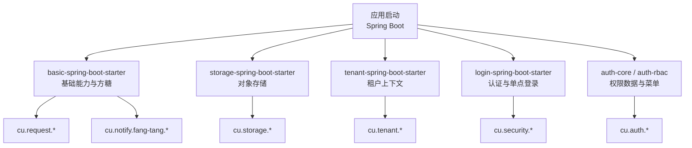
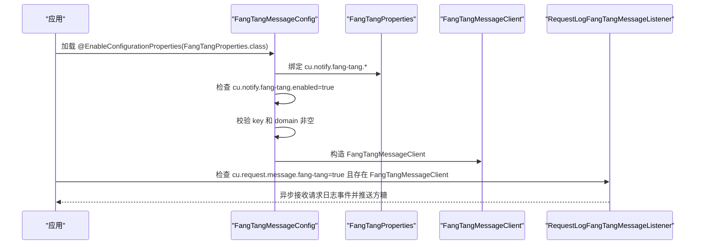
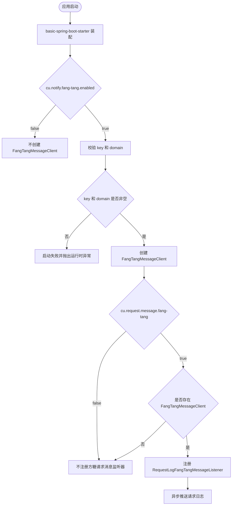
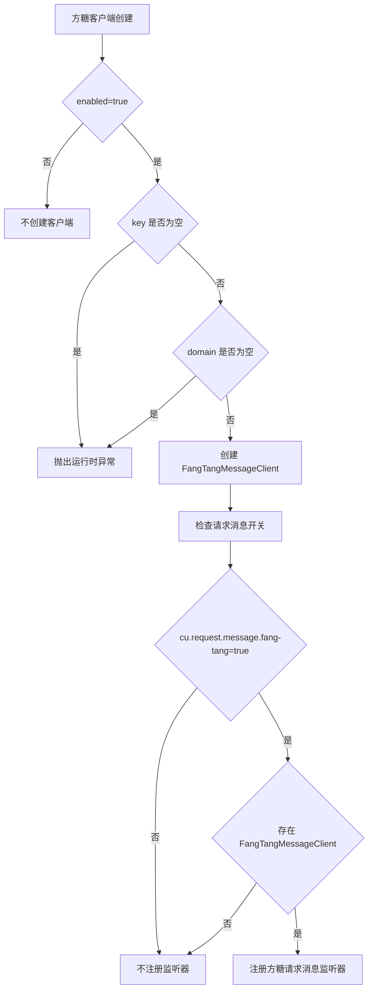

# 核心配置

<cite>
**本文引用的文件**   
- [docs/application.yml](file://docs/application.yml)
- [FangTangProperties.java](file://boot/basic-spring-boot-starter/src/main/java/com/cu/framework/boot/basic/properties/FangTangProperties.java)
- [FangTangMessageConfig.java](file://boot/basic-spring-boot-starter/src/main/java/com/cu/framework/boot/basic/config/FangTangMessageConfig.java)
- [BasicSupportConfig.java](file://boot/basic-spring-boot-starter/src/main/java/com/cu/framework/boot/basic/config/BasicSupportConfig.java)
- [RequestLogFangTangMessageListener.java](file://basic-support/src/main/java/com/cu/framework/basic/support/log/RequestLogFangTangMessageListener.java)
- [StorageProperties.java](file://boot/storage-spring-boot-starter/src/main/java/com/cu/framework/storage/boot/StorageProperties.java)
- [SecurityProperties.java](file://login-spring-boot-starter/src/main/java/com/cu/framework/authentication/properties/SecurityProperties.java)
- [SessionProperties.java](file://login-spring-boot-starter/src/main/java/com/cu/framework/authentication/properties/SessionProperties.java)
- [SsoLoginProperties.java](file://login-spring-boot-starter/src/main/java/com/cu/framework/authentication/properties/SsoLoginProperties.java)
- [SecurityLoginProperties.java](file://login-spring-boot-starter/src/main/java/com/cu/framework/authentication/password/properties/SecurityLoginProperties.java)
- [Oauth2OidcProperties.java](file://login-spring-boot-starter/src/main/java/com/cu/framework/authentication/oauth2/Oauth2OidcProperties.java)
- [SamlProperties.java](file://login-spring-boot-starter/src/main/java/com/cu/framework/authentication/saml/properties/SamlProperties.java)
- [AuthDataTableProperties.java](file://auth/auth-core-spring-boot-starter/src/main/java/com/cu/framework/boot/auth/core/properties/AuthDataTableProperties.java)
- [application.yml（基础示例）](file://sample/basic-boot-sample/src/main/resources/application.yml)
- [application.yml（租户示例）](file://sample/tenant-boot-sample/src/main/resources/application.yml)
</cite>

## 目录
1. [引言](#引言)
2. [项目结构与配置总览](#项目结构与配置总览)
3. [应用基础配置](#应用基础配置)
4. [方糖消息通知配置](#方糖消息通知配置)
5. [存储与对象上传配置](#存储与对象上传配置)
6. [租户隔离配置](#租户隔离配置)
7. [认证与安全配置](#认证与安全配置)
8. [权限数据表映射配置](#权限数据表映射配置)
9. [配置依赖关系与加载优先级](#配置依赖关系与加载优先级)
10. [典型环境配置示例](#典型环境配置示例)
11. [常见配置场景与最佳实践](#常见配置场景与最佳实践)
12. [配置验证规则与错误处理](#配置验证规则与错误处理)
13. [故障排查指南](#故障排查指南)
14. [结论](#结论)

## 引言
本文件聚焦 Kewen Framework 的核心配置，覆盖应用基础属性、方糖消息通知、存储、租户、登录认证、单点登录以及权限数据表映射等关键能力。文档目标是在不直接粘贴代码的前提下，帮助开发者理解每个配置项的用途、数据类型、默认值、取值范围、生效范围和依赖关系，并给出开发、测试和生产环境的参考示例及常见问题处理方法。

框架的配置以 Spring Boot 的 `@ConfigurationProperties` 为主，按功能模块拆分为多个命名空间：
- `cu.request.*`：请求日志持久化与消息通知开关。
- `cu.notify.fang-tang.*`：方糖消息客户端。
- `cu.storage.*`：对象存储（当前固定七牛实现）。
- `cu.tenant.*`：租户上下文开关。
- `cu.auth.*`：权限相关表结构及菜单缓存等。
- `cu.security.*`：会话、记住我、密码登录、OAuth2/OIDC、SAML2 等安全能力。

## 项目结构与配置总览
Kewen Framework 的配置不是集中在单个类中，而是由多个 starter 分别暴露自己的属性类，并通过 Spring Boot 自动装配启用。配置参考手册位于仓库的文档 YAML 文件中；可运行的完整示例位于各 sample 项目的 `application.yml` 或 profile 配置中。

**图表来源**
- [FangTangProperties.java:1-52](file://boot/basic-spring-boot-starter/src/main/java/com/cu/framework/boot/basic/properties/FangTangProperties.java#L1-L52)
- [StorageProperties.java:1-63](file://boot/storage-spring-boot-starter/src/main/java/com/cu/framework/storage/boot/StorageProperties.java#L1-L63)
- [SecurityProperties.java:1-22](file://login-spring-boot-starter/src/main/java/com/cu/framework/authentication/properties/SecurityProperties.java#L1-L22)
- [AuthDataTableProperties.java:1-109](file://auth/auth-core-spring-boot-starter/src/main/java/com/cu/framework/boot/auth/core/properties/AuthDataTableProperties.java#L1-L109)

**章节来源**
- [docs/application.yml:1-208](file://docs/application.yml#L1-L208)

## 应用基础配置
应用基础配置通常包括应用名、端口、激活的 profile 等通用 Spring Boot 属性，以及框架自身的基础开关。

| 配置路径 | 类型 | 默认值 | 取值范围 | 说明 | 生效范围 |
|---|---|---:|---|---|---|
| `spring.application.name` | 字符串 | 无 | 任意合法应用名 | 应用标识，用于日志、方糖消息标题等 | 全局 |
| `server.port` | 整数 | Spring Boot 默认值 | 端口号 | Web 服务监听端口 | 全局 |
| `spring.profiles.active` | 字符串列表 | 无 | `h2`、`mysql` 等 | 切换不同运行环境的数据源和脚本行为 | 全局 |
| `cu.request.persistent.database` | 布尔值 | `false` | `true`、`false` | 是否将请求日志持久化到数据库 | basic 支持层 |
| `cu.request.message.fang-tang` | 布尔值 | `false` | `true`、`false` | 是否把请求来源 IP 推送到方糖 | basic 支持层 |

其中：
- `cu.request.persistent.database=true` 会启用数据库持久化监听器，需要执行 `docs/sql/basic-support.sql` 创建 `sys_request_log` 等相关表。
- `cu.request.message.fang-tang=true` 只表示“允许通过方糖渠道推送请求日志”，还需要同时启用 `cu.notify.fang-tang.enabled=true` 才会注册实际的消息监听器。

**章节来源**
- [docs/application.yml:12-25](file://docs/application.yml#L12-L25)
- [BasicSupportConfig.java:27-44](file://boot/basic-spring-boot-starter/src/main/java/com/cu/framework/boot/basic/config/BasicSupportConfig.java#L27-L44)
- [application.yml（基础示例）:1-22](file://sample/basic-boot-sample/src/main/resources/application.yml#L1-L22)

## 方糖消息通知配置
方糖消息通知是 Kewen Framework 提供的应用外通知能力，主要用于把请求日志、异常或业务告警推送到方糖平台。

### 核心配置项

| 配置路径 | 类型 | 默认值 | 取值范围 | 说明 | 必填性 |
|---|---|---:|---|---|---|
| `cu.notify.fang-tang.enabled` | 布尔值 | `false` | `true`、`false` | 是否启用方糖消息客户端 | 启用时为必填前提 |
| `cu.notify.fang-tang.key` | 字符串 | 空 | 方糖 SendKey | 方糖消息通道密钥 | 启用时必填 |
| `cu.notify.fang-tang.domain` | 字符串 | `https://sctapi.ftqq.com` | 方糖 API 域名 | 与 key 拼接为 `{domain}/{key}.send` | 启用时必填 |

### 配置绑定与 Bean 创建流程

**图表来源**
- [FangTangMessageConfig.java:20-44](file://boot/basic-spring-boot-starter/src/main/java/com/cu/framework/boot/basic/config/FangTangMessageConfig.java#L20-L44)
- [BasicSupportConfig.java:36-44](file://boot/basic-spring-boot-starter/src/main/java/com/cu/framework/boot/basic/config/BasicSupportConfig.java#L36-L44)
- [RequestLogFangTangMessageListener.java:33-96](file://basic-support/src/main/java/com/cu/framework/basic/support/log/RequestLogFangTangMessageListener.java#L33-L96)

### 重要行为
- 当 `cu.notify.fang-tang.enabled=false` 时，不会创建 `FangTangMessageClient` Bean。
- 当 `enabled=true` 但 `key` 为空时，启动阶段会抛出运行时异常。
- 当 `enabled=true` 但 `domain` 为空时，同样会抛出运行时异常。
- 请求日志的方糖推送是异步的，并使用本地缓存对同一来源 IP 做去重，避免短时间内重复推送。

**章节来源**
- [FangTangProperties.java:12-52](file://boot/basic-spring-boot-starter/src/main/java/com/cu/framework/boot/basic/properties/FangTangProperties.java#L12-L52)
- [FangTangMessageConfig.java:20-44](file://boot/basic-spring-boot-starter/src/main/java/com/cu/framework/boot/basic/config/FangTangMessageConfig.java#L20-L44)
- [RequestLogFangTangMessageListener.java:33-108](file://basic-support/src/main/java/com/cu/framework/basic/support/log/RequestLogFangTangMessageListener.java#L33-L108)

## 存储与对象上传配置
存储配置目前固定使用七牛云作为底层实现，虽然暴露了 `type` 字段，但当前不会根据该字段切换其他存储厂商。

### 核心配置项

| 配置路径 | 类型 | 默认值 | 取值范围 | 说明 | 必填性 |
|---|---|---:|---|---|---|
| `cu.storage.type` | 字符串 | 空 | 预留字段 | 当前不会切换存储类型 | 未接线 |
| `cu.storage.access-key` | 字符串 | 空 | 七牛 AccessKey | 上传所需凭证 | 上传功能必填 |
| `cu.storage.secret-key` | 字符串 | 空 | 七牛 SecretKey | 上传所需凭证 | 上传功能必填 |
| `cu.storage.bucket` | 字符串 | 空 | 七牛存储桶名称 | 上传目标空间 | 上传功能必填 |
| `cu.storage.root-path` | 字符串 | 空串 | 任意前缀路径 | 生成对象 key 时的根前缀 | 可选 |
| `cu.storage.is-public` | 布尔值 | `true` | `true`、`false` | 是否为公开空间；`false` 时下载链接带签名 | 可选 |
| `cu.storage.download-domain` | 字符串 | 空 | 下载域名 | 生成下载链接时使用 | 下载功能必填 |
| `cu.storage.upload-callback-url` | 字符串 | 空 | HTTP 回调地址 | 上传成功后回调 | 可选 |
| `cu.storage.region` | 字符串 | `region2` | `region0`、`huadong`、`region1`、`huabei`、`region2`、`huanan`、`region3`、`beimei`、`region4`、`xinjiapo`、`auto` | 七牛区域 | 可选 |
| `cu.storage.persistent-notify-url` | 字符串 | 空 | HTTP 回调地址 | 数据处理异步通知地址 | 可选 |
| `cu.storage.use-https-download` | 布尔值 | `false` | `true`、`false` | 生成的下载链接是否使用 HTTPS | 可选 |

### 配置约束与建议
- `access-key`、`secret-key`、`bucket`、`download-domain` 在启用上传或下载功能时通常必须填写。
- `is-public=false` 时，下载链接会带有有效期签名，适合私有空间。
- `use-https-download=true` 要求 `download-domain` 已在存储侧配置好有效证书，否则会出现 HTTPS 访问问题。
- `region` 默认保留历史兼容值 `region2`，部署时应与实际七牛存储桶所在区域一致。

**章节来源**
- [StorageProperties.java:12-63](file://boot/storage-spring-boot-starter/src/main/java/com/cu/framework/storage/boot/StorageProperties.java#L12-L63)
- [docs/application.yml:30-60](file://docs/application.yml#L30-L60)

## 租户隔离配置
租户配置用于开启框架中的租户上下文能力，包括请求过滤器和 Feign 租户头拦截器等。

| 配置路径 | 类型 | 默认值 | 取值范围 | 说明 | 生效范围 |
|---|---|---:|---|---|---|
| `cu.tenant.open` | 布尔值 | `false` | `true`、`false` | 是否开启租户 | tenant starter |

当 `cu.tenant.open=true` 时，框架会从请求上下文中提取租户信息，并在后续多租户场景中透传。租户示例没有强制要求业务表，但 basic starter 传递的 MyBatis Plus 依赖仍会触发数据源初始化，因此仍需配置可用的数据库连接。

**章节来源**
- [docs/application.yml:64-70](file://docs/application.yml#L64-L70)
- [application.yml（租户示例）:1-14](file://sample/tenant-boot-sample/src/main/resources/application.yml#L1-L14)

## 认证与安全配置
认证与安全配置集中在 `cu.security.*` 下，涵盖会话管理、记住我、密码登录、OAuth2/OIDC 单点登录和 SAML2 单点登录。

### 会话与通用安全配置

| 配置路径 | 类型 | 默认值 | 取值范围 | 说明 | 生效范围 |
|---|---|---:|---|---|---|
| `cu.security.current-user-url` | 字符串 | `/currentUser` | 任意 URL 路径 | 当前用户接口地址；当前代码未读取，实际路径固定 | security 属性类 |
| `cu.security.session.maximum-sessions` | 整数 | `10` | 正整数 | 同一用户最大并发会话数 | 会话并发控制 |
| `cu.security.session.max-sessions-prevents-login` | 布尔值 | `false` | `true`、`false` | 达到上限时阻止新登录；`false` 则踢掉最早会话 | 会话并发控制 |

### 记住我配置
| 配置路径 | 类型 | 默认值 | 取值范围 | 说明 | 生效范围 |
|---|---|---:|---|---|---|
| `cu.security.remember-me.enabled` | 布尔值 | `true` | `true`、`false` | 是否注册 RememberMeServices Bean | 当前未挂入过滤器链 |
| `cu.security.remember-me.remember-parameter` | 字符串 | `remember-me` | 请求参数名 | 记住我参数名 | 当前未接线 |
| `cu.security.remember-me.validity-seconds` | 整数 | `2592000` | 秒 | 记住我有效期，约 30 天 | 当前未接线 |

注意：文档明确标注记住 me 当前只创建 Bean，未挂入过滤器链，因此这些配置项不会真正影响登录流程。

### 密码登录配置

| 配置路径 | 类型 | 默认值 | 取值范围 | 说明 | 生效范围 |
|---|---|---:|---|---|---|
| `cu.security.login.password.login-url` | 字符串 | `/login` | POST 登录接口路径 | 账号密码 JSON 登录入口 | 密码登录 |
| `cu.security.login.password.username-parameter` | 字符串 | `username` | 请求参数名 | 用户名参数名 | 密码登录 |
| `cu.security.login.password.password-parameter` | 字符串 | `password` | 请求参数名 | 密码参数名 | 密码登录 |

### 单点登录共用结果页

| 配置路径 | 类型 | 默认值 | 取值范围 | 说明 | 生效范围 |
|---|---|---:|---|---|---|
| `cu.security.login.sso.result-url` | 字符串 | 空 | 相对或绝对 URL | 单点登录成功或失败后跳转的前端页面 | OAuth2/OIDC/SAML2 共用 |

留空时三类协议的成功与失败响应保持 JSON 输出；配置后统一跳转到该地址，并通过查询参数区分成功或失败。

### OAuth2/OIDC 配置要点
OAuth2/OIDC 使用嵌套的 `clients` 列表，每个元素代表一个身份提供方。

| 配置路径 | 类型 | 默认值 | 取值范围 | 说明 | 必填性 |
|---|---|---:|---|---|---|
| `cu.security.login.oauth2.sso-authorization-uri` | 字符串 | `/oauth2/authorization` | 授权请求基址 | 本地发起授权请求的端点 | 可选 |
| `cu.security.login.oauth2.login-processing-url` | 字符串 | `/login/oauth2/code/*` | Ant 通配路径 | IDP 回调处理端点 | 可选 |
| `cu.security.login.oauth2.clients[].protocol-type` | 枚举 | `oauth2` | `oauth2`、`oidc` | 协议类型 | 可选 |
| `cu.security.login.oauth2.clients[].registration-id` | 字符串 | 空 | 唯一注册标识 | 用于 `/oauth2/authorization/{registrationId}` | 必填 |
| `cu.security.login.oauth2.clients[].client-id` | 字符串 | 空 | 身份提供方分配值 | 客户端 ID | 必填 |
| `cu.security.login.oauth2.clients[].client-secret` | 字符串 | 空 | 身份提供方分配值 | 客户端密钥 | 必填 |
| `cu.security.login.oauth2.clients[].client-authentication-method` | 枚举 | `client_secret_basic` | 客户端认证方式 | 向令牌端点认证的方式 | 可选 |
| `cu.security.login.oauth2.clients[].redirect-uri-template` | 字符串 | `{baseUrl}/login/oauth2/code/{registrationId}` | URI 模板 | 回调地址模板 | 可选 |
| `cu.security.login.oauth2.clients[].scopes` | 字符串集合 | 空 | 权限范围 | OIDC 会自动补 `openid` | 可选 |
| `cu.security.login.oauth2.clients[].issuer-uri` | 字符串 | 空 | OIDC Issuer 地址 | 自动发现元数据 | OIDC 模式必填 |
| `cu.security.login.oauth2.clients[].authorization-uri` | 字符串 | 空 | 授权端点 | OAuth2 手动模式必填 | OAuth2 手动模式 |
| `cu.security.login.oauth2.clients[].token-uri` | 字符串 | 空 | 令牌端点 | OAuth2 手动模式必填 | OAuth2 手动模式 |
| `cu.security.login.oauth2.clients[].user-info-uri` | 字符串 | 空 | 用户信息端点 | OAuth2 手动模式必填 | OAuth2 手动模式 |
| `cu.security.login.oauth2.clients[].user-name-attribute-name` | 字符串 | 空 | 用户名字段名 | OIDC 未配置时回退 `sub` | 视身份提供方而定 |
| `cu.security.login.oauth2.clients[].jwk-set-uri` | 字符串 | 空 | JWK Set 地址 | 手动覆盖 OIDC 自动发现 | 可选 |
| `cu.security.login.oauth2.clients[].ignore-ssl` | 布尔值 | `false` | `true`、`false` | 跳过 userinfo SSL 证书校验 | 仅测试环境建议 |

注意：`authorization-grant-type` 和 `user-info-authentication-method` 当前被标注为未接线或固定实现，配置后可能不改变行为。

### SAML2 配置要点
SAML2 支持通过 IdP 的 metadata.xml 自动解析 entityId、SSO URL 和验签证书，也支持手动配置。

| 配置路径 | 类型 | 默认值 | 取值范围 | 说明 | 必填性 |
|---|---|---:|---|---|---|
| `cu.security.login.saml.login-processing-url` | 字符串 | `/login/saml2/sso/{registrationId}` | SP 回调地址模板 | SAML 认证请求处理入口 | 可选 |
| `cu.security.login.saml.logout-request-url` | 字符串 | `/logout/saml2/slo` | 单点登出请求地址 | 接收 LogoutRequest | 可选 |
| `cu.security.login.saml.logout-response-url` | 字符串 | `/logout/saml2/slo` | 单点登出响应地址 | 接收 LogoutResponse | 可选 |
| `cu.security.login.saml.registrations[].metadata-resource` | 资源路径 | `classpath:saml/idp-metadata.xml` | classpath 路径 | IdP metadata 文件 | 推荐方式 |
| `cu.security.login.saml.registrations[].registration-id` | 字符串 | 空 | 注册标识 | 未配置时回退 `sp-entity-id` | 可选 |
| `cu.security.login.saml.registrations[].sp-entity-id` | 字符串 | `cu-saml` | SP Entity ID | 需与 IdP Audience 一致 | 可选 |
| `cu.security.login.saml.registrations[].display-name` | 字符串 | 空 | 前端展示名 | 登录按钮文案 | 可选 |
| `cu.security.login.saml.sp-signing-keystore.keystore-resource` | 资源路径 | 空 | JKS 路径 | SP 签名密钥库 | 可选 |
| `cu.security.login.saml.sp-signing-keystore.keystore-password` | 字符串 | `changeit` | JKS 密码 | 密钥库密码 | 可选 |
| `cu.security.login.saml.sp-signing-keystore.key-alias` | 字符串 | `sp-signing` | 密钥别名 | 签名用密钥别名 | 可选 |
| `cu.security.login.saml.sp-signing-keystore.key-password` | 字符串 | `changeit` | 密钥密码 | 签名用密钥密码 | 可选 |
| `cu.security.login.saml.login-page-url` | 字符串 | 空 | 自定义登录入口 | 已废弃且未实现 | 已废弃 |

**章节来源**
- [SecurityProperties.java:12-22](file://login-spring-boot-starter/src/main/java/com/cu/framework/authentication/properties/SecurityProperties.java#L12-L22)
- [SessionProperties.java:12-22](file://login-spring-boot-starter/src/main/java/com/cu/framework/authentication/properties/SessionProperties.java#L12-L22)
- [SsoLoginProperties.java:12-24](file://login-spring-boot-starter/src/main/java/com/cu/framework/authentication/properties/SsoLoginProperties.java#L12-L24)
- [SecurityLoginProperties.java:12-29](file://login-spring-boot-starter/src/main/java/com/cu/framework/authentication/password/properties/SecurityLoginProperties.java#L12-L29)
- [Oauth2OidcProperties.java:1-200](file://login-spring-boot-starter/src/main/java/com/cu/framework/authentication/oauth2/Oauth2OidcProperties.java#L1-L200)
- [SamlProperties.java:12-149](file://login-spring-boot-starter/src/main/java/com/cu/framework/authentication/saml/properties/SamlProperties.java#L12-L149)
- [docs/application.yml:72-208](file://docs/application.yml#L72-L208)

## 权限数据表映射配置
权限数据表映射用于将框架内部的权限数据与业务数据库中的表结构对应起来。

| 配置路径 | 类型 | 默认值 | 取值范围 | 说明 | 生效范围 |
|---|---|---:|---|---|---|
| `cu.auth.auth-data-table.table-name` | 字符串 | `sys_auth_data` | 数据库表名 | 权限数据表名 | auth-core |
| `cu.auth.auth-data-table.id-column` | 字符串 | `id` | 列名 | 主键列名 | auth-core |
| `cu.auth.auth-data-table.business-function-column` | 字符串 | `business_function` | 列名 | 业务功能列名 | auth-core |
| `cu.auth.auth-data-table.data-id-column` | 字符串 | `data_id` | 列名 | 业务 ID 列名 | auth-core |
| `cu.auth.auth-data-table.operate-column` | 字符串 | `operate` | 列名 | 操作类型列名 | auth-core |
| `cu.auth.auth-data-table.authority-column` | 字符串 | `authority` | 列名 | 权限字符串列名 | auth-core |
| `cu.auth.auth-data-table.description-column` | 字符串 | `description` | 列名 | 权限描述列名 | auth-core |

此外还有：
- `cu.auth.cache-auth`：是否缓存菜单与权限数据；`false` 时每次直接查库，默认 `false`。
- `cu.auth.permit-url`：免登录放行 URL，多个 URL 可用分号或逗号分隔，与 `@SecurityIgnore` 收集的 URL 合并。

**章节来源**
- [AuthDataTableProperties.java:12-109](file://auth/auth-core-spring-boot-starter/src/main/java/com/cu/framework/boot/auth/core/properties/AuthDataTableProperties.java#L12-L109)
- [docs/application.yml:72-92](file://docs/application.yml#L72-L92)

## 配置依赖关系与加载优先级
Kewen Framework 的配置依赖关系主要体现在三个层面：Starter 装配、条件装配注解、以及业务功能开关组合。

**图表来源**
- [FangTangMessageConfig.java:20-44](file://boot/basic-spring-boot-starter/src/main/java/com/cu/framework/boot/basic/config/FangTangMessageConfig.java#L20-L44)
- [BasicSupportConfig.java:27-44](file://boot/basic-spring-boot-starter/src/main/java/com/cu/framework/boot/basic/config/BasicSupportConfig.java#L27-L44)

### 加载优先级说明
框架遵循 Spring Boot 标准配置加载顺序，但需要注意以下重点：
1. `docs/application.yml` 是参考手册，不是可直接启动的配置；实际运行应使用 sample 或业务应用的 `application.yml`。
2. 若某个 starter 暴露的属性类未被自动装配，即使配置文件中写了对应键也不会生效。
3. 条件装配注解会覆盖普通配置绑定：例如 `@ConditionalOnProperty(prefix = "cu.notify.fang-tang", name = "enabled", havingValue = "true")` 会阻止客户端 Bean 在非启用状态下创建。
4. 某些属性虽然有默认值，但业务逻辑仍将其视为必填，例如方糖的 `key` 和 `domain`。
5. 部分属性标记为“未接线”或“已废弃”，表示存在配置键但当前代码不消费或不推荐使用。

**章节来源**
- [docs/application.yml:1-20](file://docs/application.yml#L1-L20)
- [FangTangMessageConfig.java:20-44](file://boot/basic-spring-boot-starter/src/main/java/com/cu/framework/boot/basic/config/FangTangMessageConfig.java#L20-L44)
- [BasicSupportConfig.java:27-44](file://boot/basic-spring-boot-starter/src/main/java/com/cu/framework/boot/basic/config/BasicSupportConfig.java#L27-L44)

## 典型环境配置示例
以下示例基于仓库中的 sample 项目和文档配置，按环境拆分。为避免泄露真实密钥，示例中保留占位符。

### 开发环境示例
开发环境通常希望：
- 快速启动。
- 使用内存数据库。
- 打开方糖消息通知以便调试。
- 打开请求日志持久化以便查看。

参考配置位置：
- [application.yml（基础示例）:1-22](file://sample/basic-boot-sample/src/main/resources/application.yml#L1-L22)
- [application.yml（基础示例）:24-79](file://sample/basic-boot-sample/src/main/resources/application.yml#L24-L79)

典型配置要点：
- `spring.profiles.active=h2`
- `cu.notify.fang-tang.enabled=true`
- `cu.notify.fang-tang.key=your_fangtang_key`
- `cu.notify.fang-tang.domain=https://sctapi.ftqq.com`
- `cu.request.message.fang-tang=true`
- `cu.request.persistent.database=true`
- H2 控制台可通过 `/h2-console` 访问。

### 测试环境示例
测试环境可以复用开发环境，但建议：
- 关闭不必要的调试功能。
- 使用独立测试数据库。
- 按需启用方糖消息通知。
- 使用 test-only 的 OAuth2/OIDC 配置，例如设置 `ignore-ssl=true`。

参考配置位置：
- [docs/application.yml:150-208](file://docs/application.yml#L150-L208)

典型配置要点：
- 至少配置一条 `cu.security.login.oauth2.clients`。
- OIDC 模式配置 `issuer-uri`。
- OAuth2 手动模式配置 `authorization-uri`、`token-uri`、`user-info-uri`。
- 必要时设置 `ignore-ssl=true`。

### 生产环境示例
生产环境应关注：
- 关闭内存数据库。
- 使用真实 MySQL 或其他持久化数据源。
- 严格配置存储凭证和下载域名。
- 谨慎启用方糖消息通知。
- 正确配置单点登录域名、证书和回调地址。

参考配置位置：
- [application.yml（基础示例）:58-79](file://sample/basic-boot-sample/src/main/resources/application.yml#L58-L79)
- [application.yml（租户示例）:26-37](file://sample/tenant-boot-sample/src/main/resources/application.yml#L26-L37)
- [docs/application.yml:30-208](file://docs/application.yml#L30-L208)

典型配置要点：
- `spring.profiles.active=mysql`。
- 配置真实的 `spring.datasource.url`、`username`、`password`。
- 预先执行 `docs/sql/basic-support.sql`。
- 配置 `cu.storage.access-key`、`cu.storage.secret-key`、`cu.storage.bucket`、`cu.storage.download-domain`。
- 根据部署域名配置单点登录回调地址。

**章节来源**
- [application.yml（基础示例）:1-79](file://sample/basic-boot-sample/src/main/resources/application.yml#L1-L79)
- [application.yml（租户示例）:1-37](file://sample/tenant-boot-sample/src/main/resources/application.yml#L1-L37)
- [docs/application.yml:30-208](file://docs/application.yml#L30-L208)

## 常见配置场景与最佳实践
### 场景一：仅启用基础服务和方糖消息通知
适用目标：快速搭建基础环境，并观察请求来源 IP 的通知效果。

步骤：
1. 启用 `cu.notify.fang-tang.enabled=true`。
2. 配置 `cu.notify.fang-tang.key` 和 `cu.notify.fang-tang.domain`。
3. 如需推送请求日志，再设置 `cu.request.message.fang-tang=true`。
4. 如需持久化请求日志，设置 `cu.request.persistent.database=true` 并执行建表脚本。

### 场景二：启用对象存储上传和下载
适用目标：启用七牛对象存储，完成图片等资源上传和下载。

步骤：
1. 配置 `access-key`、`secret-key`、`bucket`。
2. 配置 `download-domain`。
3. 根据存储空间是否公开设置 `is-public`。
4. 如使用 HTTPS 下载，确保 `download-domain` 已配置证书并开启 `use-https-download=true`。
5. 如需上传回调或转码通知，配置 `upload-callback-url` 和 `persistent-notify-url`。

### 场景三：启用 OAuth2/OIDC 单点登录
适用目标：接入第三方身份提供方进行统一登录。

步骤：
1. 配置 `cu.security.login.sso.result-url`，让浏览器回到前端页面。
2. 添加至少一条 `cu.security.login.oauth2.clients`。
3. OIDC 模式下配置 `issuer-uri`，系统自动发现端点。
4. OAuth2 手动模式下配置 `authorization-uri`、`token-uri`、`user-info-uri`。
5. 配置 `user-name-attribute-name`，使其能匹配本地用户体系。
6. 必要时设置 `ignore-ssl=true` 用于测试环境。

### 场景四：启用 SAML2 单点登录
适用目标：与企业 SAML IdP 对接。

步骤：
1. 准备 IdP 的 `metadata.xml` 并放入 classpath。
2. 配置 `cu.security.login.saml.registrations[].metadata-resource`。
3. 核对 `sp-entity-id` 与 IdP 配置的 Audience 一致。
4. 如需对 AuthnRequest 和 LogoutRequest 签名，配置 JKS 密钥库和密码。
5. 不要依赖已废弃的 `login-page-url`。

### 最佳实践
- 优先使用 sample 项目的 `application.yml` 作为起点，再替换占位符。
- 不要把敏感配置写入版本控制；使用外部配置中心或环境变量注入。
- 对“必填但未绑定默认值”的字段，启动前应进行预检。
- 对“未接线”或“已废弃”字段保持警惕，不要误以为配置后会生效。
- 使用 profile 区分开发、测试、生产环境，避免硬编码环境差异。

**章节来源**
- [docs/application.yml:1-208](file://docs/application.yml#L1-L208)
- [SamlProperties.java:12-149](file://login-spring-boot-starter/src/main/java/com/cu/framework/authentication/saml/properties/SamlProperties.java#L12-L149)
- [Oauth2OidcProperties.java:1-200](file://login-spring-boot-starter/src/main/java/com/cu/framework/authentication/oauth2/Oauth2OidcProperties.java#L1-L200)

## 配置验证规则与错误处理
框架对关键配置采用两种验证方式：
1. **启动期 Bean 校验**：例如方糖客户端创建时检查 `key` 和 `domain`。
2. **运行时功能开关校验**：例如方糖消息监听器要求同时满足 `cu.request.message.fang-tang=true` 和存在 `FangTangMessageClient`。

### 方糖消息通知的错误处理
当 `cu.notify.fang-tang.enabled=true` 时：
- 如果 `key` 为空，启动失败并抛出运行时异常。
- 如果 `domain` 为空，启动失败并抛出运行时异常。
- 如果未配置 `cu.request.message.fang-tang=true`，不会注册请求消息监听器。
- 如果缺少 `FangTangMessageClient`，也不会注册监听器。

### 请求日志持久化的错误处理
当 `cu.request.persistent.database=true` 时：
- 会注册数据库持久化监听器。
- 如果数据库表不存在，后续日志写入可能失败。
- 建议在首次使用前执行 `docs/sql/basic-support.sql`。

### 单点登录的配置错误处理
- OAuth2/OIDC 的 `clients` 列表若为空，会在配置装配阶段导致空指针异常。
- SAML2 的 `registrations` 列表若为空，也会在配置装配阶段导致空指针异常。
- SAML2 的 `sp-entity-id` 与 IdP 不一致时，SAML Response 的 Audience 校验会失败。
- 已废弃的 `login-page-url` 不会生效，不应作为生产配置依据。

**图表来源**
- [FangTangMessageConfig.java:20-44](file://boot/basic-spring-boot-starter/src/main/java/com/cu/framework/boot/basic/config/FangTangMessageConfig.java#L20-L44)
- [BasicSupportConfig.java:36-44](file://boot/basic-spring-boot-starter/src/main/java/com/cu/framework/boot/basic/config/BasicSupportConfig.java#L36-L44)

**章节来源**
- [FangTangMessageConfig.java:20-44](file://boot/basic-spring-boot-starter/src/main/java/com/cu/framework/boot/basic/config/FangTangMessageConfig.java#L20-L44)
- [BasicSupportConfig.java:27-44](file://boot/basic-spring-boot-starter/src/main/java/com/cu/framework/boot/basic/config/BasicSupportConfig.java#L27-L44)
- [docs/application.yml:150-208](file://docs/application.yml#L150-L208)

## 故障排查指南
### 问题一：方糖消息通知未生效
排查步骤：
1. 检查 `cu.notify.fang-tang.enabled` 是否为 `true`。
2. 检查 `cu.notify.fang-tang.key` 是否配置。
3. 检查 `cu.notify.fang-tang.domain` 是否配置。
4. 如果需要推送请求日志，检查 `cu.request.message.fang-tang` 是否为 `true`。
5. 检查启动日志中是否有“方糖消息通知配置错误”相关异常。

### 问题二：请求日志未持久化
排查步骤：
1. 检查 `cu.request.persistent.database` 是否为 `true`。
2. 检查数据源是否能正常连接。
3. 检查是否已执行 `docs/sql/basic-support.sql`。
4. 检查数据库中是否存在 `sys_request_log` 等相关表。

### 问题三：对象存储上传失败
排查步骤：
1. 检查 `access-key`、`secret-key`、`bucket` 是否正确。
2. 检查七牛存储桶是否已创建且区域配置正确。
3. 检查网络是否能访问七牛 API。
4. 如使用私有空间，检查下载签名和 `download-domain` 是否配置。

### 问题四：OAuth2/OIDC 登录后无法找到本地用户
排查步骤：
1. 检查 `user-name-attribute-name` 是否与身份提供方返回的用户名字段一致。
2. 检查本地用户表中是否存在对应用户名。
3. 如果是 OIDC 模式，确认 `issuer-uri` 可访问并能返回 OpenID 配置。
4. 如果是测试环境，确认 `ignore-ssl` 配置符合预期。

### 问题五：SAML2 认证失败
排查步骤：
1. 检查 `metadata-resource` 指向的 IdP metadata 文件是否存在。
2. 检查 `sp-entity-id` 是否与 IdP 配置的 Audience 一致。
3. 如果使用签名，检查 JKS 文件路径和密码是否正确。
4. 不要依赖 `login-page-url`，该字段已废弃。

**章节来源**
- [FangTangMessageConfig.java:20-44](file://boot/basic-spring-boot-starter/src/main/java/com/cu/framework/boot/basic/config/FangTangMessageConfig.java#L20-L44)
- [BasicSupportConfig.java:27-44](file://boot/basic-spring-boot-starter/src/main/java/com/cu/framework/boot/basic/config/BasicSupportConfig.java#L27-L44)
- [SamlProperties.java:12-149](file://login-spring-boot-starter/src/main/java/com/cu/framework/authentication/saml/properties/SamlProperties.java#L12-L149)
- [Oauth2OidcProperties.java:1-200](file://login-spring-boot-starter/src/main/java/com/cu/framework/authentication/oauth2/Oauth2OidcProperties.java#L1-L200)

## 结论
Kewen Framework 的核心配置以模块化 Starter 为单位，通过 Spring Boot 的 `@ConfigurationProperties` 暴露清晰的配置命名空间。开发者应优先从 sample 项目和环境参考配置入手，逐步启用方糖消息通知、对象存储、租户、认证和单点登录等功能。

在实际使用中，最需要关注的三点是：
1. **启用开关与必填字段**：例如方糖消息的 `enabled`、`key`、`domain`，存储的 `access-key`、`secret-key`、`bucket`、`download-domain`。
2. **功能组合依赖**：例如请求日志方糖推送需要同时启用消息开关和客户端 Bean。
3. **配置有效性**：对“未接线”“已废弃”字段保持警惕，对必填但未赋默认值的字段进行启动前预检。

按照本文的配置分类、依赖关系、示例和排查指南，开发者可以快速搭建 Kewen Framework 的基础环境，并在不同环境中稳定运行。