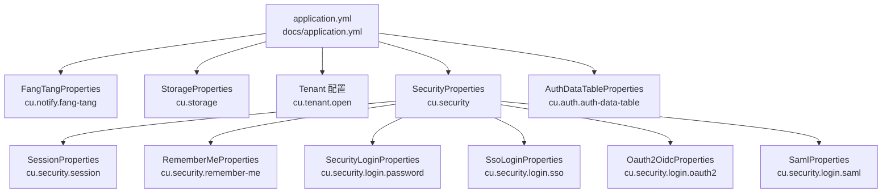
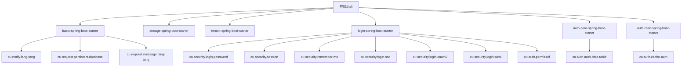

# 配置参考

<cite>
**本文引用的文件**   
- [docs/application.yml](file://docs/application.yml)
- [FangTangProperties.java](file://boot/basic-spring-boot-starter/src/main/java/com/cu/framework/boot/basic/properties/FangTangProperties.java)
- [StorageProperties.java](file://boot/storage-spring-boot-starter/src/main/java/com/cu/framework/storage/boot/StorageProperties.java)
- [SecurityProperties.java](file://login-spring-boot-starter/src/main/java/com/cu/framework/authentication/properties/SecurityProperties.java)
- [SessionProperties.java](file://login-spring-boot-starter/src/main/java/com/cu/framework/authentication/properties/SessionProperties.java)
- [RememberMeProperties.java](file://login-spring-boot-starter/src/main/java/com/cu/framework/authentication/properties/RememberMeProperties.java)
- [SecurityLoginProperties.java](file://login-spring-boot-starter/src/main/java/com/cu/framework/authentication/password/properties/SecurityLoginProperties.java)
- [SsoLoginProperties.java](file://login-spring-boot-starter/src/main/java/com/cu/framework/authentication/properties/SsoLoginProperties.java)
- [Oauth2OidcProperties.java](file://login-spring-boot-starter/src/main/java/com/cu/framework/authentication/oauth2/Oauth2OidcProperties.java)
- [SamlProperties.java](file://login-spring-boot-starter/src/main/java/com/cu/framework/authentication/saml/properties/SamlProperties.java)
- [AuthDataTableProperties.java](file://auth/auth-core-spring-boot-starter/src/main/java/com/cu/framework/boot/auth/core/properties/AuthDataTableProperties.java)
- [additional-spring-configuration-metadata.json（basic）](file://boot/basic-spring-boot-starter/src/main/resources/META-INF/additional-spring-configuration-metadata.json)
- [additional-spring-configuration-metadata.json（tenant）](file://boot/tenant-spring-boot-starter/src/main/resources/META-INF/additional-spring-configuration-metadata.json)
- [additional-spring-configuration-metadata.json（login）](file://login-spring-boot-starter/src/main/resources/META-INF/additional-spring-configuration-metadata.json)
- [additional-spring-configuration-metadata.json（auth-rbac）](file://auth/auth-rbac-spring-boot-starter/src/main/resources/META-INF/additional-spring-configuration-metadata.json)
</cite>

## 目录
1. [简介](#简介)
2. [项目结构中的配置来源](#项目结构中的配置来源)
3. [配置总览与命名空间](#配置总览与命名空间)
4. [核心基础配置](#核心基础配置)
5. [存储配置](#存储配置)
6. [租户配置](#租户配置)
7. [安全与登录配置](#安全与登录配置)
8. [权限与认证数据配置](#权限与认证数据配置)
9. [配置依赖、优先级与验证规则](#配置依赖优先级与验证规则)
10. [常见环境配置场景](#常见环境配置场景)
11. [最佳实践](#最佳实践)
12. [故障排查](#故障排查)
13. [配置模板与示例位置](#配置模板与示例位置)
14. [结论](#结论)

## 简介
本参考文档面向 Kewen Framework 的使用者，系统化梳理仓库中已暴露的配置项。文档覆盖：
- 核心基础配置：请求日志持久化、方糖消息通知等；
- 存储配置：七牛对象存储相关参数；
- 租户配置：多租户开关；
- 安全与登录配置：会话并发、记住我、账号密码登录、OAuth2/OIDC、SAML2；
- 权限与认证数据配置：权限数据表映射、菜单缓存、免登录放行 URL；
- 配置验证规则、错误提示、依赖关系；
- 开发、测试、生产环境的差异建议；
- 可直接复用的配置模板与示例文件位置。

该文档以 `@ConfigurationProperties` 类、Spring 配置文件及框架内注释为依据，不臆造未实现的配置能力。

## 项目结构中的配置来源
Kewen Framework 使用 Spring Boot 的 `@ConfigurationProperties` 将 YAML/properties 绑定到 Java 属性类，并通过 starter 自动装配。主要配置来源如下：

**图表来源**
- [docs/application.yml:1-208](file://docs/application.yml#L1-L208)
- [FangTangProperties.java:1-52](file://boot/basic-spring-boot-starter/src/main/java/com/cu/framework/boot/basic/properties/FangTangProperties.java#L1-L52)
- [StorageProperties.java:1-63](file://boot/storage-spring-boot-starter/src/main/java/com/cu/framework/storage/boot/StorageProperties.java#L1-L63)
- [SecurityProperties.java:1-22](file://login-spring-boot-starter/src/main/java/com/cu/framework/authentication/properties/SecurityProperties.java#L1-L22)
- [SessionProperties.java:1-22](file://login-spring-boot-starter/src/main/java/com/cu/framework/authentication/properties/SessionProperties.java#L1-L22)
- [RememberMeProperties.java:1-26](file://login-spring-boot-starter/src/main/java/com/cu/framework/authentication/properties/RememberMeProperties.java#L1-L26)
- [SecurityLoginProperties.java:1-29](file://login-spring-boot-starter/src/main/java/com/cu/framework/authentication/password/properties/SecurityLoginProperties.java#L1-L29)
- [SsoLoginProperties.java:1-24](file://login-spring-boot-starter/src/main/java/com/cu/framework/authentication/properties/SsoLoginProperties.java#L1-L24)
- [Oauth2OidcProperties.java:1-237](file://login-spring-boot-starter/src/main/java/com/cu/framework/authentication/oauth2/Oauth2OidcProperties.java#L1-L237)
- [SamlProperties.java:1-149](file://login-spring-boot-starter/src/main/java/com/cu/framework/authentication/saml/properties/SamlProperties.java#L1-L149)
- [AuthDataTableProperties.java:1-109](file://auth/auth-core-spring-boot-starter/src/main/java/com/cu/framework/boot/auth/core/properties/AuthDataTableProperties.java#L1-L109)

**章节来源**
- [docs/application.yml:1-208](file://docs/application.yml#L1-L208)

## 配置总览与命名空间
Kewen Framework 的配置按模块划分到以下根命名空间：

| 命名空间 | 对应 Starter / 模块 | 作用范围 | 关键说明 |
|---|---|---|---|
| `cu.request` | basic-spring-boot-starter | 请求日志、请求 IP 上报 | 控制是否把请求日志写入数据库、是否推送方糖消息 |
| `cu.notify.fang-tang` | basic-support / basic-spring-boot-starter | 方糖消息通知 | 启用后需要配置 SendKey |
| `cu.storage` | storage-spring-boot-starter | 对象存储 | 当前固定使用七牛 |
| `cu.tenant` | tenant-spring-boot-starter | 多租户 | 开启后会启用过滤器和 Feign 拦截器 |
| `cu.auth` | auth-core / auth-rbac / login | 权限与登录 | 由多个 starter 共用 |
| `cu.security` | login-spring-boot-starter | 安全与登录 | 会话、记住我、密码登录、单点登录 |

其中，`cu.auth` 下的子项会因启用的 starter 不同而生效范围不同：
- `cu.auth.auth-data-table`：由 auth-core 权限数据表映射读取；
- `cu.auth.cache-auth`：由 auth-rbac 菜单缓存逻辑读取；
- `cu.auth.permit-url`：由 login starter 的免登录放行逻辑读取。

**章节来源**
- [docs/application.yml:1-208](file://docs/application.yml#L1-L208)
- [additional-spring-configuration-metadata.json（login）:1-10](file://login-spring-boot-starter/src/main/resources/META-INF/additional-spring-configuration-metadata.json#L1-L10)
- [additional-spring-configuration-metadata.json（auth-rbac）:1-10](file://auth/auth-rbac-spring-boot-starter/src/main/resources/META-INF/additional-spring-configuration-metadata.json#L1-L10)

## 核心基础配置

### 请求日志与消息通知
| 配置项 | 默认值 | 数据类型 | 取值范围 | 生效范围 | 说明 |
|---|---:|---|---|---|---|
| `cu.request.persistent.database` | `false` | `boolean` | `true` / `false` | basic-spring-boot-starter | 是否把请求日志持久化到数据库；需要 `sys_request_log` 等表 |
| `cu.request.message.fang-tang` | `false` | `boolean` | `true` / `false` | basic-spring-boot-starter | 是否把请求来源 IP 推送到方糖；还需 `cu.notify.fang-tang.enabled=true` |

这两个开关属于“观测与审计”能力，默认关闭，避免在生产环境中无意义地增加数据库写入和网络调用。

**章节来源**
- [docs/application.yml:13-21](file://docs/application.yml#L13-L21)
- [additional-spring-configuration-metadata.json（basic）:1-16](file://boot/basic-spring-boot-starter/src/main/resources/META-INF/additional-spring-configuration-metadata.json#L1-L16)

### 方糖消息通知
| 配置项 | 默认值 | 数据类型 | 取值范围 | 生效范围 | 说明 |
|---|---:|---|---|---|---|
| `cu.notify.fang-tang.enabled` | `false` | `boolean` | `true` / `false` | basic-support | 是否启用方糖消息客户端 |
| `cu.notify.fang-tang.key` | 空字符串 | `String` | 非空 | basic-support | 方糖 SendKey；启用时必填 |
| `cu.notify.fang-tang.domain` | `https://sctapi.ftqq.com` | `String` | 有效域名 | basic-support | 方糖推送接口域名 |

当 `enabled=false` 时，不会创建 `FangTangMessageClient`；当 `enabled=true` 且 `key` 为空时，应视为配置不完整，可能导致启动或发送失败。

**章节来源**
- [docs/application.yml:23-33](file://docs/application.yml#L23-L33)
- [FangTangProperties.java:1-52](file://boot/basic-spring-boot-starter/src/main/java/com/cu/framework/boot/basic/properties/FangTangProperties.java#L1-L52)

## 存储配置

### 七牛对象存储
| 配置项 | 默认值 | 数据类型 | 取值范围 | 生效范围 | 说明 |
|---|---:|---|---|---|---|
| `cu.storage.type` | 空字符串 | `String` | 预留字段 | storage-spring-boot-starter | 当前实现固定使用七牛，配置此项不会切换存储类型 |
| `cu.storage.access-key` | 空字符串 | `String` | 非空 | storage-spring-boot-starter | 七牛 AccessKey；上传功能必需 |
| `cu.storage.secret-key` | 空字符串 | `String` | 非空 | storage-spring-boot-starter | 七牛 SecretKey；上传功能必需 |
| `cu.storage.bucket` | 空字符串 | `String` | 非空 | storage-spring-boot-starter | 七牛存储桶名称；上传功能必需 |
| `cu.storage.root-path` | 空字符串 | `String` | 任意路径前缀 | storage-spring-boot-starter | 生成对象 key 时的前缀 |
| `cu.storage.is-public` | `true` | `Boolean` | `true` / `false` | storage-spring-boot-starter | 是否为公开空间；`false` 时下载链接带有效期签名 |
| `cu.storage.download-domain` | 空字符串 | `String` | 有效域名 | storage-spring-boot-starter | 下载域名；使用下载功能时必填 |
| `cu.storage.upload-callback-url` | 空字符串 | `String` | 回调地址 | storage-spring-boot-starter | 上传成功后的回调地址 |
| `cu.storage.region` | `region2` | `String` | `region0`、`region1`、`region2`、`region3`、`region4`、`auto` | storage-spring-boot-starter | 七牛区域标识 |
| `cu.storage.persistent-notify-url` | 空字符串 | `String` | 异步通知地址 | storage-spring-boot-starter | 数据处理转码等异步通知地址 |
| `cu.storage.use-https-download` | `false` | `Boolean` | `true` / `false` | storage-spring-boot-starter | 生成的下载链接是否使用 HTTPS |

注意：
- `type` 是预留字段，不应误以为可以切换为其他云厂商；
- `download-domain` 在使用下载功能时应配置，并保证域名已配置证书；
- `use-https-download=true` 依赖 `download-domain` 在存储侧具备 HTTPS 证书；
- `persistent-notify-url` 没有默认值，因为它是具体部署环境的回调地址。

**章节来源**
- [docs/application.yml:35-64](file://docs/application.yml#L35-L64)
- [StorageProperties.java:1-63](file://boot/storage-spring-boot-starter/src/main/java/com/cu/framework/storage/boot/StorageProperties.java#L1-L63)

## 租户配置

| 配置项 | 默认值 | 数据类型 | 取值范围 | 生效范围 | 说明 |
|---|---:|---|---|---|---|
| `cu.tenant.open` | `false` | `Boolean` | `true` / `false` | tenant-spring-boot-starter | 是否开启租户；开启后同时启用请求过滤器与 Feign 租户头拦截器 |

租户开关是一个典型的功能门控：只开启时，框架才会注入租户相关的请求处理逻辑。

**章节来源**
- [docs/application.yml:66-68](file://docs/application.yml#L66-L68)
- [additional-spring-configuration-metadata.json（tenant）:1-10](file://boot/tenant-spring-boot-starter/src/main/resources/META-INF/additional-spring-configuration-metadata.json#L1-L10)

## 安全与登录配置

### 安全根配置
| 配置项 | 默认值 | 数据类型 | 取值范围 | 生效范围 | 说明 |
|---|---:|---|---|---|---|
| `cu.security.current-user-url` | `/currentUser` | `String` | 任意路径 | login-spring-boot-starter | 当前用户接口地址；当前代码未读取，接口路径固定为 `/currentUser` |

该项虽然存在，但当前消费方不读取，因此配置后不生效。

**章节来源**
- [docs/application.yml:70-75](file://docs/application.yml#L70-L75)
- [SecurityProperties.java:1-22](file://login-spring-boot-starter/src/main/java/com/cu/framework/authentication/properties/SecurityProperties.java#L1-L22)

### 会话并发控制
| 配置项 | 默认值 | 数据类型 | 取值范围 | 生效范围 | 说明 |
|---|---:|---|---|---|---|
| `cu.security.session.maximum-sessions` | `10` | `int` | 正整数 | login-spring-boot-starter | 同一用户最大并发会话数 |
| `cu.security.session.max-sessions-prevents-login` | `false` | `boolean` | `true` / `false` | login-spring-boot-starter | 达到上限时阻止新登录；`false` 表示挤掉最早会话 |

适合用于防止单账号被滥用，或限制后台管理员在同一设备上的并发登录数量。

**章节来源**
- [docs/application.yml:77-83](file://docs/application.yml#L77-L83)
- [SessionProperties.java:1-22](file://login-spring-boot-starter/src/main/java/com/cu/framework/authentication/properties/SessionProperties.java#L1-L22)

### 记住我
| 配置项 | 默认值 | 数据类型 | 取值范围 | 生效范围 | 说明 |
|---|---:|---|---|---|---|
| `cu.security.remember-me.enabled` | `true` | `boolean` | `true` / `false` | login-spring-boot-starter | 是否注册 `RememberMeServices` Bean |
| `cu.security.remember-me.remember-parameter` | `remember-me` | `String` | 请求参数名 | login-spring-boot-starter | 记住我请求参数名 |
| `cu.security.remember-me.validity-seconds` | `2592000` | `Integer` | 秒 | login-spring-boot-starter | 记住时长，默认 30 天 |

当前 `remember-me` 只创建 Bean，未挂入过滤器链，因此这些配置在当前版本中不生效。

**章节来源**
- [docs/application.yml:85-93](file://docs/application.yml#L85-L93)
- [RememberMeProperties.java:1-26](file://login-spring-boot-starter/src/main/java/com/cu/framework/authentication/properties/RememberMeProperties.java#L1-L26)

### 账号密码登录
| 配置项 | 默认值 | 数据类型 | 取值范围 | 生效范围 | 说明 |
|---|---:|---|---|---|---|
| `cu.security.login.password.login-url` | `/login` | `String` | HTTP 路径 | login-spring-boot-starter | 账号密码 JSON 登录接口路径 |
| `cu.security.login.password.username-parameter` | `username` | `String` | 请求参数名 | login-spring-boot-starter | 用户名参数名 |
| `cu.security.login.password.password-parameter` | `password` | `String` | 请求参数名 | login-spring-boot-starter | 密码参数名 |

这是最基础的本地登录入口，通常配合业务层的用户服务与密码校验逻辑使用。

**章节来源**
- [docs/application.yml:95-101](file://docs/application.yml#L95-L101)
- [SecurityLoginProperties.java:1-29](file://login-spring-boot-starter/src/main/java/com/cu/framework/authentication/password/properties/SecurityLoginProperties.java#L1-L29)

### 单点登录通用结果页
| 配置项 | 默认值 | 数据类型 | 取值范围 | 生效范围 | 说明 |
|---|---:|---|---|---|---|
| `cu.security.login.sso.result-url` | 空字符串 | `String` | 相对或绝对地址 | login-spring-boot-starter | 单点登录结果页地址；留空时三类协议返回 JSON，配置后统一 302 跳转并追加登录状态 |

该配置对 OAuth2/OIDC/SAML2 三类协议共同生效，用于把浏览器重定向到前端页面，而不是直接返回 JSON。

**章节来源**
- [docs/application.yml:103-110](file://docs/application.yml#L103-L110)
- [SsoLoginProperties.java:1-24](file://login-spring-boot-starter/src/main/java/com/cu/framework/authentication/properties/SsoLoginProperties.java#L1-L24)

### OAuth2 / OIDC
| 配置项 | 默认值 | 数据类型 | 取值范围 | 生效范围 | 说明 |
|---|---:|---|---|---|---|
| `cu.security.login.oauth2.sso-authorization-uri` | `/oauth2/authorization` | `String` | 授权端点基址 | login-spring-boot-starter | 本地发起授权请求的端点基址 |
| `cu.security.login.oauth2.login-processing-url` | `/login/oauth2/code/*` | `String` | Ant 通配路径 | login-spring-boot-starter | IDP 回调处理端点 |
| `cu.security.login.oauth2.clients[*].protocol-type` | `oauth2` | 枚举 | `oauth2` / `oidc` | login-spring-boot-starter | 协议类型 |
| `cu.security.login.oauth2.clients[*].registration-id` | 空字符串 | `String` | 唯一标识 | login-spring-boot-starter | 客户端唯一标识；至少一条 |
| `cu.security.login.oauth2.clients[*].client-id` | 空字符串 | `String` | 非空 | login-spring-boot-starter | IDP 分配的客户端 ID |
| `cu.security.login.oauth2.clients[*].client-secret` | 空字符串 | `String` | 非空 | login-spring-boot-starter | IDP 分配的客户端密钥 |
| `cu.security.login.oauth2.clients[*].client-authentication-method` | `client_secret_basic` | 枚举 | `client_secret_basic` / `client_secret_post` / `none` | login-spring-boot-starter | 客户端认证方式 |
| `cu.security.login.oauth2.clients[*].authorization-grant-type` | 空枚举 | 枚举 | 授权类型 | login-spring-boot-starter | 当前未读取，固定使用授权码模式 |
| `cu.security.login.oauth2.clients[*].redirect-uri-template` | `{baseUrl}/login/oauth2/code/{registrationId}` | `String` | URI 模板 | login-spring-boot-starter | 回调地址模板 |
| `cu.security.login.oauth2.clients[*].scopes` | 空集合 | `Set<String>` | 权限范围 | login-spring-boot-starter | OIDC 模式需包含 `openid` |
| `cu.security.login.oauth2.clients[*].issuer-uri` | 空字符串 | `String` | 发现端点 | login-spring-boot-starter | OIDC 模式必填；用于自动发现 |
| `cu.security.login.oauth2.clients[*].authorization-uri` | 空字符串 | `String` | 授权端点 | login-spring-boot-starter | OAuth2 手动模式必填 |
| `cu.security.login.oauth2.clients[*].token-uri` | 空字符串 | `String` | 令牌端点 | login-spring-boot-starter | OAuth2 手动模式必填 |
| `cu.security.login.oauth2.clients[*].user-info-uri` | 空字符串 | `String` | 用户信息端点 | login-spring-boot-starter | OAuth2 手动模式必填 |
| `cu.security.login.oauth2.clients[*].user-info-authentication-method` | `header` | 枚举 | `header` / `form` / `query` | login-spring-boot-starter | 当前未读取，userinfo 认证方式不由本项控制 |
| `cu.security.login.oauth2.clients[*].user-name-attribute-name` | 空字符串 | `String` | 属性名 | login-spring-boot-starter | 用户名属性名；OIDC 未配置回退 `sub` |
| `cu.security.login.oauth2.clients[*].jwk-set-uri` | 空字符串 | `String` | JWK Set 端点 | login-spring-boot-starter | 可选；用于 JWT 验签 |
| `cu.security.login.oauth2.clients[*].client-name` | 空字符串 | `String` | 显示名 | login-spring-boot-starter | 日志与调试用名称 |
| `cu.security.login.oauth2.clients[*].ignore-ssl` | `false` | `boolean` | `true` / `false` | login-spring-boot-starter | 仅测试环境可忽略 SSL 校验 |

重要约束：
- `clients` 列表不能为空，否则 OAuth2/OIDC 配置阶段可能出现空指针异常；
- OIDC 模式优先通过 `issuer-uri` 自动发现，OAuth2 手动模式需要显式配置授权、令牌和用户信息端点；
- `ignore-ssl=true` 只影响 userinfo 端点的 SSL 校验，不会影响 Discovery 或 JWK Set 拉取过程；
- 登录成功后若身份源返回的用户名字段无法匹配本地账号，会返回 `sso_local_user_not_found`。

**章节来源**
- [docs/application.yml:112-176](file://docs/application.yml#L112-L176)
- [Oauth2OidcProperties.java:1-237](file://login-spring-boot-starter/src/main/java/com/cu/framework/authentication/oauth2/Oauth2OidcProperties.java#L1-L237)

### SAML2
| 配置项 | 默认值 | 数据类型 | 取值范围 | 生效范围 | 说明 |
|---|---:|---|---|---|---|
| `cu.security.login.saml.login-processing-url` | `/login/saml2/sso/{registrationId}` | `String` | SSO 回调模板 | login-spring-boot-starter | SP 的 ACS 回调地址模板 |
| `cu.security.login.saml.logout-request-url` | `/logout/saml2/slo` | `String` | 登出请求路径 | login-spring-boot-starter | SP 单点登出请求接收地址 |
| `cu.security.login.saml.logout-response-url` | `/logout/saml2/slo` | `String` | 登出响应路径 | login-spring-boot-starter | SP 单点登出响应接收地址 |
| `cu.security.login.saml.registrations[*].metadata-resource` | `classpath:saml/idp-metadata.xml` | `Resource` | IdP metadata 路径 | login-spring-boot-starter | IdP metadata.xml 文件路径 |
| `cu.security.login.saml.registrations[*].registration-id` | 空字符串 | `String` | 注册 ID | login-spring-boot-starter | 留空时回退 `sp-entity-id` |
| `cu.security.login.saml.registrations[*].sp-entity-id` | `cu-saml` | `String` | Entity ID | login-spring-boot-starter | 需与 IdP 侧 Audience 一致 |
| `cu.security.login.saml.registrations[*].display-name` | 空字符串 | `String` | 展示名 | login-spring-boot-starter | 登录页按钮文案 |
| `cu.security.login.saml.sp-signing-keystore.keystore-resource` | 空资源 | `Resource` | JKS 路径 | login-spring-boot-starter | 不配置则不对 AuthnRequest/LogoutRequest 签名 |
| `cu.security.login.saml.sp-signing-keystore.keystore-password` | `changeit` | `String` | 密码 | login-spring-boot-starter | JKS 密码 |
| `cu.security.login.saml.sp-signing-keystore.key-alias` | `sp-signing` | `String` | 别名 | login-spring-boot-starter | 密钥别名 |
| `cu.security.login.saml.sp-signing-keystore.key-password` | `changeit` | `String` | 密码 | login-spring-boot-starter | 密钥密码 |
| `cu.security.login.saml.login-page-url` | 空字符串 | `String` | 登录入口路径 | login-spring-boot-starter | 已废弃，未实现；登录入口固定为 `/saml2/authenticate/{registrationId}` |

SAML2 支持两种配置方式：
1. 推荐方式：配置 `metadata-resource`，自动解析 entityId、SSO URL 和证书；
2. 手动方式：直接配置 entityId、webSsoUrl 和证书路径。

**章节来源**
- [docs/application.yml:178-208](file://docs/application.yml#L178-L208)
- [SamlProperties.java:1-149](file://login-spring-boot-starter/src/main/java/com/cu/framework/authentication/saml/properties/SamlProperties.java#L1-L149)

## 权限与认证数据配置

### 权限数据表映射
| 配置项 | 默认值 | 数据类型 | 取值范围 | 生效范围 | 说明 |
|---|---:|---|---|---|---|
| `cu.auth.auth-data-table.table-name` | `sys_auth_data` | `String` | 数据库表名 | auth-core | 权限数据表表名 |
| `cu.auth.auth-data-table.id-column` | `id` | `String` | 列名 | auth-core | 主键列名 |
| `cu.auth.auth-data-table.business-function-column` | `business_function` | `String` | 列名 | auth-core | 业务功能列名 |
| `cu.auth.auth-data-table.data-id-column` | `data_id` | `String` | 列名 | auth-core | 业务 ID 列名 |
| `cu.auth.auth-data-table.operate-column` | `operate` | `String` | 列名 | auth-core | 操作类型列名 |
| `cu.auth.auth-data-table.authority-column` | `authority` | `String` | 列名 | auth-core | 权限字符串列名 |
| `cu.auth.auth-data-table.description-column` | `description` | `String` | 列名 | auth-core | 权限描述列名 |

这些配置主要用于把框架内部的权限数据映射到业务数据库中的自定义表结构。如果业务表字段与默认不一致，就需要调整这些列名。

**章节来源**
- [docs/application.yml:72-92](file://docs/application.yml#L72-L92)
- [AuthDataTableProperties.java:1-109](file://auth/auth-core-spring-boot-starter/src/main/java/com/cu/framework/boot/auth/core/properties/AuthDataTableProperties.java#L1-L109)

### 菜单缓存与免登录放行
| 配置项 | 默认值 | 数据类型 | 取值范围 | 生效范围 | 说明 |
|---|---:|---|---|---|---|
| `cu.auth.cache-auth` | `false` | `Boolean` | `true` / `false` | auth-rbac | 是否缓存菜单与权限数据；`false` 时每次查库 |
| `cu.auth.permit-url` | 空字符串 | `String` | 分号或逗号分隔的 URL | login | 免登录放行 URL；与 `@SecurityIgnore` 收集的 URL 合并 |

`permit-url` 常用于开放健康检查、静态资源或第三方回调地址；`cache-auth` 适合读多写少、权限变更不频繁的生产环境。

**章节来源**
- [docs/application.yml:94-110](file://docs/application.yml#L94-L110)
- [additional-spring-configuration-metadata.json（login）:1-10](file://login-spring-boot-starter/src/main/resources/META-INF/additional-spring-configuration-metadata.json#L1-L10)
- [additional-spring-configuration-metadata.json（auth-rbac）:1-10](file://auth/auth-rbac-spring-boot-starter/src/main/resources/META-INF/additional-spring-configuration-metadata.json#L1-L10)

## 配置依赖、优先级与验证规则

### 配置依赖关系

**图表来源**
- [docs/application.yml:1-208](file://docs/application.yml#L1-L208)
- [FangTangProperties.java:1-52](file://boot/basic-spring-boot-starter/src/main/java/com/cu/framework/boot/basic/properties/FangTangProperties.java#L1-L52)
- [StorageProperties.java:1-63](file://boot/storage-spring-boot-starter/src/main/java/com/cu/framework/storage/boot/StorageProperties.java#L1-L63)
- [SecurityProperties.java:1-22](file://login-spring-boot-starter/src/main/java/com/cu/framework/authentication/properties/SecurityProperties.java#L1-L22)
- [SessionProperties.java:1-22](file://login-spring-boot-starter/src/main/java/com/cu/framework/authentication/properties/SessionProperties.java#L1-L22)
- [RememberMeProperties.java:1-26](file://login-spring-boot-starter/src/main/java/com/cu/framework/authentication/properties/RememberMeProperties.java#L1-L26)
- [SecurityLoginProperties.java:1-29](file://login-spring-boot-starter/src/main/java/com/cu/framework/authentication/password/properties/SecurityLoginProperties.java#L1-L29)
- [SsoLoginProperties.java:1-24](file://login-spring-boot-starter/src/main/java/com/cu/framework/authentication/properties/SsoLoginProperties.java#L1-L24)
- [Oauth2OidcProperties.java:1-237](file://login-spring-boot-starter/src/main/java/com/cu/framework/authentication/oauth2/Oauth2OidcProperties.java#L1-L237)
- [SamlProperties.java:1-149](file://login-spring-boot-starter/src/main/java/com/cu/framework/authentication/saml/properties/SamlProperties.java#L1-L149)
- [AuthDataTableProperties.java:1-109](file://auth/auth-core-spring-boot-starter/src/main/java/com/cu/framework/boot/auth/core/properties/AuthDataTableProperties.java#L1-L109)

### 配置优先级
Spring Boot 默认遵循标准优先级：
1. 命令行参数；
2. `java -D` 系统属性；
3. 操作系统环境变量；
4. 外部 `application-{profile}.yml`；
5. 默认 `application.yml`；
6. `@ConfigurationProperties` 的字段默认值。

因此，对于同一个键，运行期传入的值会覆盖配置文件中的值，配置文件中的值会覆盖 Java 类中的默认值。

### 验证规则与错误提示
| 场景 | 规则 | 可能结果 |
|---|---|---|
| `cu.notify.fang-tang.enabled=true` 且 `key` 为空 | 启用方糖但未配置 SendKey | 可能启动失败或发送失败 |
| `cu.storage.access-key` / `secret-key` / `bucket` 为空 | 未配置七牛凭证 | 上传功能不可用 |
| `cu.storage.download-domain` 为空 | 使用下载功能但未配置域名 | 下载链接不可用 |
| `cu.security.login.oauth2.clients` 为空 | 未配置任何 OAuth2/OIDC 客户端 | 配置阶段可能出现空指针异常 |
| OIDC 模式下未配置 `issuer-uri` | 未启用自动发现 | 需要改用手动模式并配置授权、令牌、用户信息端点 |
| OAuth2 手动模式未配置必要端点 | 缺少 `authorization-uri` / `token-uri` / `user-info-uri` | 认证流程无法完成 |
| SAML2 的 `sp-entity-id` 与 IdP 不一致 | Entity ID 不匹配 | SAML Response 的 AudienceRestriction 校验失败 |
| 单点登录用户名属性不匹配本地账号 | `user-name-attribute-name` 指向的身份源字段不存在于本地账号 | 返回 `sso_local_user_not_found` |
| `cu.security.login.saml.login-page-url` | 已废弃且未实现 | 配置无效，登录入口仍为 `/saml2/authenticate/{registrationId}` |

**章节来源**
- [docs/application.yml:1-208](file://docs/application.yml#L1-L208)
- [Oauth2OidcProperties.java:1-237](file://login-spring-boot-starter/src/main/java/com/cu/framework/authentication/oauth2/Oauth2OidcProperties.java#L1-L237)
- [SamlProperties.java:1-149](file://login-spring-boot-starter/src/main/java/com/cu/framework/authentication/saml/properties/SamlProperties.java#L1-L149)

## 常见环境配置场景

### 开发环境
开发环境应以最小可用为原则：
- 关闭不必要的日志持久化和消息推送；
- 允许更宽松的登录行为；
- 单点登录可使用内部测试 IDP；
- 存储使用开发测试桶；
- 不建议开启 `ignore-ssl=true`，除非确有必要且仅限本地。

建议重点关注的配置：
- `cu.request.persistent.database=false`；
- `cu.request.message.fang-tang=false`；
- `cu.notify.fang-tang.enabled=false`；
- `cu.storage.is-public=true`；
- `cu.security.login.sso.result-url` 在开发时可保持空，以便调试 JSON 响应。

### 测试环境
测试环境更接近生产行为，但仍可适度放宽：
- 可开启菜单缓存，减少测试过程中对数据库的压力；
- 可配置真实或准真实的单点登录提供方；
- 存储应使用独立测试桶；
- 若测试 IDP 证书不完整，可在测试配置中谨慎设置 `ignore-ssl=true`，并明确标记为测试专用。

建议重点关注的配置：
- `cu.auth.cache-auth=true`；
- `cu.security.login.oauth2.clients[*].ignore-ssl=true`（仅限测试配置）；
- `cu.storage.is-public=false`（模拟私有桶）。

### 生产环境
生产环境应严格校验所有凭据和连接地址：
- 所有敏感信息应通过外部配置中心或环境变量注入；
- 禁止明文存储密钥；
- 禁用 `ignore-ssl=true`；
- 合理配置会话并发和免登录放行白名单；
- 开启必要的请求日志持久化，但需评估性能；
- 存储域名必须配置 HTTPS。

建议重点关注的配置：
- `cu.notify.fang-tang.enabled=true`（如需告警）；
- `cu.request.persistent.database=true`（如需审计）；
- `cu.security.session.maximum-sessions` 根据业务策略调整；
- `cu.auth.permit-url` 仅放行真正需要的路径；
- `cu.storage.use-https-download=true`；
- `cu.security.login.oauth2.clients[*].ignore-ssl=false`。

[本节为概念性指导，不直接分析具体源码]

## 最佳实践

1. **按模块拆分配置**  
   使用 profile 或外部配置中心管理不同环境配置，不要把生产密钥放在默认 `application.yml` 中。

2. **先启用再扩展**  
   先启用一个 starter，确认基础功能正常，再逐步启用存储、单点登录、租户等功能。

3. **单点登录优先选择 OIDC 自动发现**  
   如果 IDP 支持 OIDC，优先配置 `issuer-uri`，减少手动维护端点 URL 的成本。

4. **SAML2 优先使用 metadata.xml**  
   通过 `metadata-resource` 自动解析 entityId、SSO URL 和证书，降低配置错误概率。

5. **严格控制免登录放行范围**  
   `cu.auth.permit-url` 应只包含必要路径，避免把敏感接口误放通。

6. **区分公开桶与私有桶行为**  
   `cu.storage.is-public=false` 会生成带签名的下载链接，适用于对外暴露受限资源的场景。

7. **不要依赖已废弃或未接线配置**  
   例如 `cu.security.current-user-url`、`cu.security.remember-me.*`、`cu.security.login.saml.login-page-url`、`cu.security.login.oauth2.clients[*].authorization-grant-type` 等在当前版本不生效。

8. **把默认值当作基线，而不是最终配置**  
   文档中的默认值是为了让配置类能够初始化，不代表每个部署都应保留默认值。

[本节为概念性指导，不直接分析具体源码]

## 故障排查

### 启动阶段问题
| 现象 | 可能原因 | 排查步骤 |
|---|---|---|
| 启动时报空指针或配置缺失 | OAuth2/OIDC 的 `clients` 为空 | 检查 `cu.security.login.oauth2.clients` 是否至少有一条配置 |
| 方糖消息未发送 | `enabled=false` 或 `key` 为空 | 检查 `cu.notify.fang-tang.enabled` 和 `key` |
| 单点登录跳转到错误地址 | 回调地址模板或网关转发配置不正确 | 检查 `redirect-uri-template`、`login-processing-url` 和网关路由 |
| SAML Response 校验失败 | `sp-entity-id` 与 IdP 配置的 Audience 不一致 | 核对 `cu.security.login.saml.registrations[*].sp-entity-id` |
| 登录成功但找不到本地用户 | 用户名属性映射不正确 | 检查 `user-name-attribute-name` 和本地账号体系 |

### 运行时问题
| 现象 | 可能原因 | 排查步骤 |
|---|---|---|
| 文件上传失败 | 缺少 access-key、secret-key 或 bucket | 检查 `cu.storage.access-key`、`secret-key`、`bucket` |
| 文件下载 403 或过期 | 私有桶签名失效或域名未配置 | 检查 `is-public`、`download-domain`、`use-https-download` |
| 请求日志未落库 | 未开启持久化或缺少表结构 | 检查 `cu.request.persistent.database` 和数据库表 |
| 单点登录结果仍是 JSON | 未配置 `result-url` | 配置 `cu.security.login.sso.result-url` |
| 记住我无效 | 当前只创建 Bean，未挂入过滤器链 | 确认当前版本是否支持该功能 |

**章节来源**
- [docs/application.yml:1-208](file://docs/application.yml#L1-L208)
- [Oauth2OidcProperties.java:1-237](file://login-spring-boot-starter/src/main/java/com/cu/framework/authentication/oauth2/Oauth2OidcProperties.java#L1-L237)
- [SamlProperties.java:1-149](file://login-spring-boot-starter/src/main/java/com/cu/framework/authentication/saml/properties/SamlProperties.java#L1-L149)

## 配置模板与示例位置
仓库提供两类配置材料：
- **配置参考模板**：`docs/application.yml`，列出各命名空间、默认值和注释说明；
- **可启动示例**：各 sample 模块的 `src/main/resources/application.yml`。

文档顶部明确说明：
- 本文件是参考手册，不是可直接启动的配置；
- 可启动完整示例见 `sample/*/src/main/resources/application.yml`；
- 有默认值的键写的是 `@ConfigurationProperties` 字段初始值；
- 没有初始值的键留空。

因此，实际使用时建议：
1. 从 `docs/application.yml` 复制所需命名空间；
2. 结合 sample 模块中的 `application.yml` 补齐可运行的上下文；
3. 把敏感配置放入外部配置中心或环境变量；
4. 用 `--spring.profiles.active=dev|test|prod` 等方式切换环境。

**章节来源**
- [docs/application.yml:1-8](file://docs/application.yml#L1-L8)

## 结论
Kewen Framework 的配置以 Spring Boot 的标准机制为基础，通过多个 starter 暴露清晰的命名空间：
- `cu.request` 和 `cu.notify.fang-tang` 负责基础观测与消息通知；
- `cu.storage` 负责七牛对象存储；
- `cu.tenant` 控制多租户能力；
- `cu.security` 控制会话、记住我、账号密码登录和三类单点登录；
- `cu.auth` 控制权限数据表映射、菜单缓存和免登录放行。

正确配置的关键在于：
- 区分哪些配置有默认值、哪些是必填；
- 区分哪些配置当前生效、哪些是预留或已废弃；
- 根据开发、测试、生产环境分别管理配置；
- 关注依赖关系，例如方糖消息需要同时启用客户端和 SendKey，单点登录需要完整的客户端或 IdP 元数据。