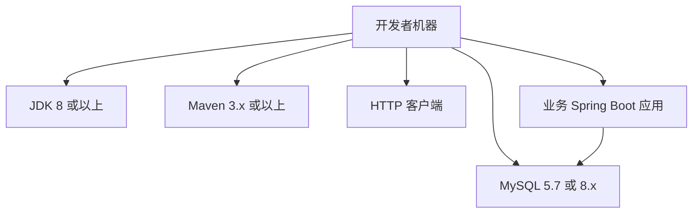
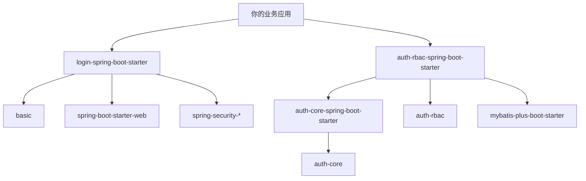
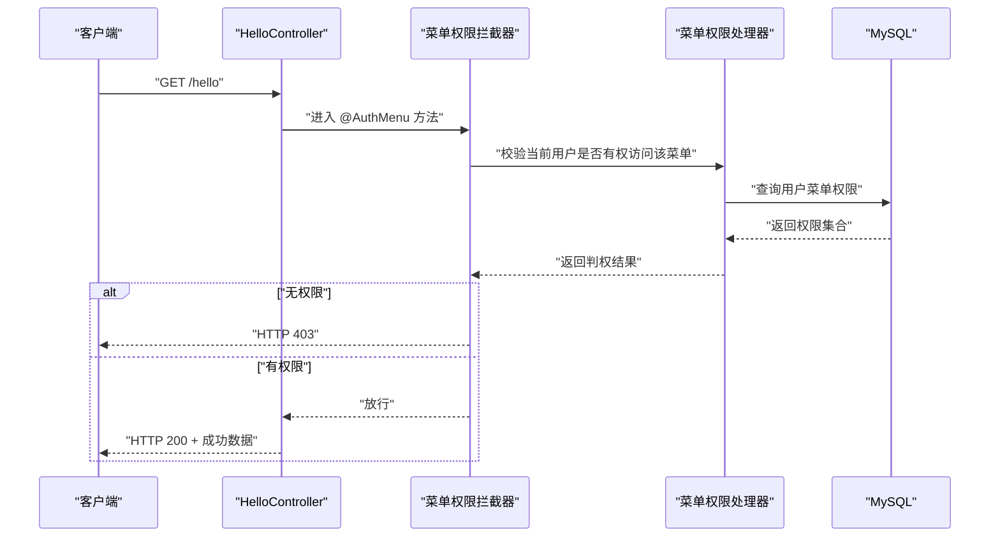

# 快速开始指南

<cite>
**本文引用的文件**   
- [README_Auth.md](file://README_Auth.md)
- [pom.xml](file://pom.xml)
- [auth-rbac.sql](file://docs/sql/auth-rbac.sql)
- [application.yml](file://docs/application.yml)
- [auth-core-boot-sample README.md](file://sample/auth-core-boot-sample/README.md)
- [auth-core-boot-sample pom.xml](file://sample/auth-core-boot-sample/pom.xml)
- [auth-core-boot-sample application.yml](file://sample/auth-core-boot-sample/src/main/resources/application.yml)
- [login-spring-boot-starter pom.xml](file://login-spring-boot-starter/pom.xml)
- [auth-core-spring-boot-starter pom.xml](file://auth/auth-core-spring-boot-starter/pom.xml)
- [auth-rbac-spring-boot-starter pom.xml](file://auth/auth-rbac-spring-boot-starter/pom.xml)
</cite>

## 目录

1. [简介](#简介)
2. [环境准备](#环境准备)
3. [项目克隆与构建](#项目克隆与构建)
4. [数据库初始化](#数据库初始化)
5. [引入依赖](#引入依赖)
6. [基础配置](#基础配置)
7. [第一个接口：使用 @AuthMenu 的权限控制示例](#第一个接口使用-authmenu-的权限控制示例)
8. [启动应用并验证](#启动应用并验证)
9. [常见问题与故障排除](#常见问题与故障排除)
10. [总结](#总结)

## 简介

Kewen Framework（cu-framework）是一套基于注解实现的 Java 后端权限框架，核心思想是围绕用户、角色、部门、菜单和数据权限做统一抽象。官方说明文档指出：

- 它通过 `Java + Maven + Spring + SpringMVC + SpringBoot + SpringSecurity + MybatisPlus + MySQL` 搭建；
- 核心能力包括注解驱动的菜单权限、RBAC 默认实现、SpringSecurity 安全增强、启动时自动把需要鉴权的 API 路径注册到数据库等；
- 对于“快速开始”，文档明确要求先执行 `mvn install` 安装本地仓库，再在业务工程中引入 `login-spring-boot-starter` 和 `auth-rbac-spring-boot-starter`，然后初始化数据库、添加配置并启动。

本快速开始指南的目标是：让一个没有用过该框架的新手，在约 10 分钟内完成环境准备、克隆工程、初始化数据库、引入 starter、写一个带 `@AuthMenu` 的最小程序，并确认接口能返回正确的权限结果。

**章节来源**
- [README_Auth.md:1-40](file://README_Auth.md#L1-L40)
- [README_Auth.md:100-170](file://README_Auth.md#L100-L170)

## 环境准备

### 必需工具

| 工具 | 推荐版本或要求 | 用途 |
|---|---:|---|
| JDK | 至少支持 Java 8 | 编译与运行 Spring Boot 应用 |
| Maven | 3.x 以上 | 构建多模块工程、安装本地仓库 |
| MySQL | 5.7 或 8.x | 持久化用户、角色、部门、菜单与权限数据 |
| 任意 HTTP 客户端 | curl、Postman、浏览器或 IDE 内置 HTTP 客户端 | 调用接口验证权限 |

根工程的 `pom.xml` 中声明了 Java 编译器源和目标为 8，因此最小可用版本为 Java 8。



**图表来源**
- [pom.xml:10-18](file://pom.xml#L10-L18)

### 验证环境是否就绪

1. 打开终端，执行以下命令：

   - `java -version`
   - `mvn -v`
   - 连接本地或远程 MySQL，确认可以创建数据库和执行 SQL 脚本。

2. 如果其中任一命令失败，请先修复对应环境的 PATH、环境变量或数据库连接后再继续。

**章节来源**
- [pom.xml:10-18](file://pom.xml#L10-L18)

## 项目克隆与构建

### 克隆仓库

将仓库克隆到本地任意目录，例如：

```bash
git clone https://gitee.com/LiuKewenSc/cu-framework.git
cd cu-framework
```

### 安装本地仓库

框架由多个 Maven 子模块组成，需要先构建并安装到本地 Maven 仓库，这样你的业务工程才能通过依赖坐标引用它们。

```bash
mvn clean install -DskipTests
```

这一步会依次编译：

- `basic`
- `basic-support`
- `boot`
- `login-spring-boot-starter`
- `sample`
- `other`
- `auth`

其中 `auth` 子模块包含 `auth-core`、`auth-rbac` 以及若干 Spring Boot Starter。

### 为什么需要安装本地仓库

根 `pom.xml` 定义了父工程坐标 `com.cu.framework:cu-parent:0.0.1-SNAPSHOT`，并把 `framework-version` 作为各子模块的版本。若未执行 `mvn install`，业务工程在解析 `login-spring-boot-starter` 或 `auth-rbac-spring-boot-starter` 时会找不到 SNAPSHOT 包。

**章节来源**
- [pom.xml:5-20](file://pom.xml#L5-L20)
- [pom.xml:21-35](file://pom.xml#L21-L35)

## 数据库初始化

### 建表脚本位置

权限框架的通用建表脚本位于：

- [docs/sql/auth-rbac.sql](file://docs/sql/auth-rbac.sql)

该脚本被标注为 MySQL 与 H2（`MODE=MySQL`）通用，不包含特定引擎、字符集或排序规则，而是交给目标数据库的默认值处理。

### 脚本包含哪些数据对象

`auth-rbac.sql` 主要创建以下对象：

| 对象类型 | 名称 | 作用 |
|---|---|---|
| 视图 | `view_menu_api_auth` | 方便查看菜单 API 与其授权关系 |
| 表 | `sys_auth_data` | 应用级数据权限槽位 |
| 表 | `sys_auth_menu` | 菜单权限表 |
| 表 | `sys_dept` | 部门表 |
| 表 | `sys_menu_api` | 菜单 API 表 |
| 表 | `sys_menu_route` | 前端路由菜单表 |
| 表 | `sys_role` | 角色表 |
| 表 | `sys_user` | 用户表 |
| 表 | `sys_user_credential` | 用户凭证表 |
| 表 | `sys_user_dept` | 用户部门关联表 |
| 表 | `sys_user_role` | 用户角色关联表 |

### 初始化步骤

1. 登录 MySQL：

   ```bash
   mysql -h localhost -u root -p
   ```

2. 创建数据库（示例名为 `kewen_framework`）：

   ```sql
   CREATE DATABASE IF NOT EXISTS kewen_framework DEFAULT CHARACTER SET utf8mb4 COLLATE utf8mb4_general_ci;
   USE kewen_framework;
   ```

3. 执行脚本：

   ```bash
   mysql -h localhost -u root -p kewen_framework < docs/sql/auth-rbac.sql
   ```

4. 验证表是否创建成功：

   ```sql
   SHOW TABLES LIKE 'sys_%';
   ```

   应能看到 `sys_user`、`sys_role`、`sys_dept`、`sys_menu_api`、`sys_auth_menu`、`sys_auth_data` 等相关表。

### 是否需要初始业务数据？

`auth-rbac.sql` 只创建表和视图，不插入初始业务数据。若要直接体验完整 RBAC 流程，可以使用 `sample/auth-rbac-boot-sample` 中的脚本；但仅学习 `@AuthMenu` 的最小 Hello World 示例时，可以先跳过种子数据，后续再补充用户、角色和菜单授权。

**章节来源**
- [auth-rbac.sql:1-148](file://docs/sql/auth-rbac.sql#L1-L148)
- [README_Auth.md:120-150](file://README_Auth.md#L120-L150)

## 引入依赖

### 最小依赖组合

根据官方快速开始说明，要启用登录认证与安全拦截，同时引入 RBAC 权限实现，你需要在业务工程的 `pom.xml` 中添加：

| 依赖 | 作用 |
|---|---|
| `login-spring-boot-starter` | 提供 Spring Security、登录态、安全响应、白名单等能力 |
| `auth-rbac-spring-boot-starter` | 提供 RBAC 权限模型及对应的 Starter 装配 |
| `mysql-connector-java` | 连接 MySQL（如果使用 MySQL） |

`login-spring-boot-starter` 内部已经依赖 Spring Security、Web、Jackson、Session JDBC 等组件；`auth-rbac-spring-boot-starter` 又依赖 `auth-core-spring-boot-starter`、`auth-rbac` 和 MyBatis-Plus。



**图表来源**
- [login-spring-boot-starter pom.xml:1-91](file://login-spring-boot-starter/pom.xml#L1-L91)
- [auth-rbac-spring-boot-starter pom.xml:1-39](file://auth/auth-rbac-spring-boot-starter/pom.xml#L1-L39)
- [auth-core-spring-boot-starter pom.xml:1-53](file://auth/auth-core-spring-boot-starter/pom.xml#L1-L53)

### 在你的业务工程中配置 parent

如果你希望继承框架的统一依赖管理，可以把父工程设为 `cu-parent`，并使用与仓库一致的版本号。示例如下：

```xml
<parent>
    <groupId>com.cu.framework</groupId>
    <artifactId>cu-parent</artifactId>
    <version>0.0.1-SNAPSHOT</version>
</parent>
```

然后在 `<dependencies>` 中加入所需 starter。

**章节来源**
- [README_Auth.md:100-170](file://README_Auth.md#L100-L170)
- [pom.xml:5-20](file://pom.xml#L5-L20)
- [login-spring-boot-starter pom.xml:1-30](file://login-spring-boot-starter/pom.xml#L1-L30)
- [auth-rbac-spring-boot-starter pom.xml:1-39](file://auth/auth-rbac-spring-boot-starter/pom.xml#L1-L39)

## 基础配置

### 必须配置的数据库信息

最基础的配置至少要包含：

- 服务端口；
- 数据源 URL；
- 用户名；
- 密码；
- 驱动类名。

官方快速开始示例中使用的是 `.properties` 风格，但 Spring Boot 同样支持 `application.yml`。你可以参考仓库根目录提供的通用配置片段，并结合自己的数据库地址填写。

```yaml
server:
  port: 8081

spring:
  datasource:
    url: jdbc:mysql://localhost:3306/kewen_framework
    username: root
    password: 你的数据库密码
    driver-class-name: com.mysql.cj.jdbc.Driver
```

### 可选配置

仓库中还提供了一个更完整的 `docs/application.yml`，包含消息、请求日志、租户和安全会话等可选配置。这些不是运行最小示例所必需的，但可以帮助你理解框架的其他扩展点。

```yaml
cu:
  message:
    fang-tang:
      key: ''
      domain: ''
  request:
    persistent:
      database: true
    message:
      fang-tang: true
  tenant:
    open: false
  security:
    session:
      maximum-sessions: 10
      maxSessions-prevents-login: false
    remember-me:
      enabled: true
      remember-parameter: remember-me
      validity-seconds: 2592000
```

### 配置校验建议

| 检查项 | 期望行为 | 排查方式 |
|---|---|---|
| 端口未被占用 | 应用正常启动 | 观察控制台是否报端口绑定异常 |
| MySQL 可连接 | 应用能加载数据源 | 使用相同 URL、用户名、密码用客户端连接测试 |
| 驱动类存在 | 应用启动不报 `ClassNotFoundException` | 确认已引入 `mysql-connector-java` |
| 数据库存在 | 建表脚本可执行 | 手动执行 `SHOW TABLES LIKE 'sys_%'` |

**章节来源**
- [README_Auth.md:130-170](file://README_Auth.md#L130-L170)
- [application.yml:1-20](file://docs/application.yml#L1-L20)

## 第一个接口：使用 @AuthMenu 的权限控制示例

### 这个示例要实现什么

我们创建一个最简单的 Spring Boot 控制器，暴露一个接口，并用 `@AuthMenu` 注解标记它。目标是：

1. 接口受菜单权限控制；
2. 当前登录用户如果没有对应菜单权限，接口返回 403；
3. 有权限时返回普通成功响应。

这符合官方文档中对 `@AuthMenu` 的描述：用于判断登录人是否能访问注解对应的 API 接口。

### 第一步：创建 Spring Boot 应用入口

新建一个普通的 Spring Boot 应用，主类上保留默认的 `@SpringBootApplication`。你不需要显式开启额外注解，因为 Starter 会自动装配。

### 第二步：编写权限控制器

在业务包下创建一个控制器，例如 `HelloController`。控制器方法上使用 `@AuthMenu` 注解标记需要鉴权的路径。

由于本指南不直接粘贴代码内容，你可以在业务工程中按以下结构创建：

- 包：`com.example.demo.controller`
- 类名：`HelloController`
- 方法：`GET /hello`
- 注解：`@AuthMenu`
- 返回值：统一响应对象，或直接返回字符串

框架的 `basic` 模块提供了统一响应模型 `Result`，可用于封装返回结果。

### 第三步：理解 @AuthMenu 的作用

`@AuthMenu` 属于 auth-core 的核心注解之一，其职责是：

- 声明某个 Controller 方法或类需要菜单权限校验；
- 在请求进入具体业务逻辑前，由框架的拦截机制判断当前登录用户是否具有对应菜单权限；
- 无权限时返回 403，有权限时继续执行业务方法。

官方文档明确列出 `@AuthMenu` 是“菜单权限注解，判断登录人是否能访问注解对应的 API 接口”。



**图表来源**
- [README_Auth.md:30-60](file://README_Auth.md#L30-L60)
- [auth-core-spring-boot-starter pom.xml:1-53](file://auth/auth-core-spring-boot-starter/pom.xml#L1-L53)

### 第四步：在数据库中登记菜单与权限

由于 `@AuthMenu` 是菜单权限，框架会在启动时扫描 HandlerMapping，把需要鉴权的 API 路径注册到菜单相关表中。之后你需要在系统里给角色或用户授予对应菜单的权限。

最小操作流程：

1. 启动应用；
2. 观察控制台或数据库，确认 `/hello` 对应的菜单行已生成；
3. 通过权限管理功能或脚本，给某个角色授予 `/hello` 的权限；
4. 以拥有该角色的用户登录；
5. 再次调用 `/hello`，应得到 200。

如果尚未设置任何菜单权限，首次调用通常会得到 403。

**章节来源**
- [README_Auth.md:30-60](file://README_Auth.md#L30-L60)
- [README_Auth.md:100-170](file://README_Auth.md#L100-L170)

## 启动应用并验证

### 启动应用

启动你的 Spring Boot 应用后，应观察到：

1. 应用监听你在 `application.yml` 中配置的端口；
2. 数据源初始化成功；
3. 菜单 API 扫描完成；
4. 没有因缺少 Bean 或配置导致的启动异常。

如果使用了 MySQL，请确保 `docs/sql/auth-rbac.sql` 已执行，且 `spring.datasource.*` 配置正确。

### 验证接口是否正常

#### 场景一：无权限调用

在未登录或未授予 `/hello` 菜单权限的情况下调用：

```bash
curl -i http://localhost:8081/hello
```

预期行为：

- 状态码为 403；
- 响应体为框架统一的错误响应格式。

#### 场景二：有权限调用

为当前登录用户授予 `/hello` 的菜单权限后，再次调用：

```bash
curl -i -H "Cookie: JSESSIONID=你的会话标识" http://localhost:8081/hello
```

或使用 Postman 携带登录后的 Session/Cookie。

预期行为：

- 状态码为 200；
- 响应体包含你接口返回的业务数据。

### 验证权限判定是否生效

| 验证项 | 操作 | 成功标志 |
|---|---|---|
| 接口可访问 | 登录后调用 `/hello` | 返回 200 |
| 菜单权限生效 | 撤销权限后调用 `/hello` | 返回 403 |
| 其他接口不受影响 | 调用未加 `@AuthMenu` 的接口 | 正常返回 |
| 数据库菜单行存在 | 查询 `sys_menu_api` | 能看到 `/hello` 相关行 |
| 权限分配有效 | 给用户或角色授予权限后重试 | 从 403 变为 200 |

### 使用示例工程辅助验证

如果你想直接看一个完整可用的示例，仓库提供了 `sample/auth-core-boot-sample`。该示例的特点：

- 不依赖 `auth-rbac`；
- 使用 H2 文件数据库，无需安装 MySQL；
- 自带权限透视台页面；
- 演示 `@AuthMenu`、`@AuthDataOperation`、`@AuthDataRange` 等行为。

你可以从该模块的 README 中学习如何启动、切换身份、查看期望与实际结果对比。

**章节来源**
- [sample/auth-core-boot-sample README.md:1-120](file://sample/auth-core-boot-sample/README.md#L1-L120)
- [sample/auth-core-boot-sample application.yml:1-85](file://sample/auth-core-boot-sample/src/main/resources/application.yml#L1-L85)

## 常见问题与故障排除

### 问题一：Maven 无法解析 `login-spring-boot-starter`

**现象：**

构建时报找不到 `com.cu.framework:login-spring-boot-starter:0.0.1-SNAPSHOT`。

**原因：**

还没有执行 `mvn install`，本地仓库中没有 SNAPSHOT 包。

**解决：**

在项目根目录执行：

```bash
mvn clean install -DskipTests
```

**章节来源**
- [pom.xml:5-20](file://pom.xml#L5-L20)

### 问题二：Spring Boot 启动报端口被占用

**现象：**

控制台出现端口绑定异常。

**原因：**

`server.port` 指定的端口已被其他进程占用。

**解决：**

修改 `application.yml` 中的端口，例如改为 `8082`，或停止占用端口的进程。

**章节来源**
- [application.yml:1-20](file://docs/application.yml#L1-L20)

### 问题三：MySQL 连接失败

**现象：**

启动时报连接超时、拒绝访问或驱动类不存在。

**常见原因：**

- MySQL 未启动；
- URL、用户名、密码错误；
- 驱动类名写错；
- 防火墙阻止连接；
- 数据库不存在。

**解决：**

1. 确认 MySQL 可连接；
2. 检查 `spring.datasource.url`、`username`、`password`；
3. 确认驱动类为 `com.mysql.cj.jdbc.Driver`；
4. 确认已引入 `mysql-connector-java`；
5. 确认数据库 `kewen_framework` 已创建。

**章节来源**
- [README_Auth.md:130-170](file://README_Auth.md#L130-L170)

### 问题四：接口始终返回 403

**可能原因：**

1. 当前用户未登录；
2. 已登录但没有 `/hello` 的菜单权限；
3. 菜单行未注册；
4. 用户-角色-菜单权限关系未配置；
5. 会话 Cookie 未正确携带。

**排查步骤：**

1. 确认登录接口返回成功；
2. 确认请求携带了 Session；
3. 查看 `sys_menu_api` 中是否存在 `/hello`；
4. 查看 `sys_auth_menu` 中是否授予了对应权限；
5. 查看 `sys_user_role` 和 `sys_role` 是否正确关联；
6. 临时放开 `@AuthMenu` 验证是否是权限问题而非业务逻辑问题。

**章节来源**
- [README_Auth.md:30-60](file://README_Auth.md#L30-L60)
- [auth-rbac.sql:1-148](file://docs/sql/auth-rbac.sql#L1-L148)

### 问题五：启动时报缺少 Bean 或装配失败

**可能原因：**

- 只引入了部分 Starter，未引入完整依赖链；
- 自定义权限上下文或菜单处理器未实现框架要求的扩展点；
- Starter 装配顺序不正确。

**建议：**

- 最小示例优先使用官方推荐的 `login-spring-boot-starter` 和 `auth-rbac-spring-boot-starter`；
- 如果实现自定义扩展点，确保容器中存在对应 Bean；
- 参考 `auth-core-boot-sample` 的装配方式。

**章节来源**
- [sample/auth-core-boot-sample README.md:1-120](file://sample/auth-core-boot-sample/README.md#L1-L120)

### 问题六：只想试一下，不想装 MySQL

如果你只是想快速跑通 `@AuthMenu`，可以直接使用 `sample/auth-core-boot-sample`。它默认使用 H2 文件数据库，并在 `data/` 目录下维护数据库文件，不需要外部 MySQL。

注意：该示例的启动工作目录必须是模块目录，否则会读取仓库根目录的 `application.yml`，导致数据表映射不一致。

**章节来源**
- [sample/auth-core-boot-sample README.md:1-120](file://sample/auth-core-boot-sample/README.md#L1-L120)
- [sample/auth-core-boot-sample application.yml:1-85](file://sample/auth-core-boot-sample/src/main/resources/application.yml#L1-L85)

## 总结

按照本指南，你应该能在 10 分钟内完成以下目标：

1. 安装 JDK、Maven、MySQL；
2. 克隆 Kewen Framework 仓库；
3. 执行 `mvn clean install` 安装本地仓库；
4. 执行 `docs/sql/auth-rbac.sql` 初始化权限相关表；
5. 在业务工程中引入 `login-spring-boot-starter` 和 `auth-rbac-spring-boot-starter`；
6. 配置 `application.yml` 中的数据源；
7. 编写一个带 `@AuthMenu` 的 Hello World 接口；
8. 在数据库中登记菜单权限并验证 403 与 200 两种行为。

当你能够稳定看到：

- 无权限时返回 403；
- 有权限时返回 200；
- 数据库中的 `sys_menu_api`、`sys_auth_menu` 等表反映菜单与权限变化；

就说明你已经成功跑通了 Kewen Framework 的第一个权限示例。接下来可以继续学习 `@AuthDataOperation`、`@AuthDataRange`、RBAC 角色授权、部门权限继承等功能。