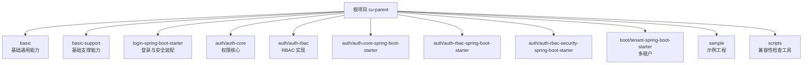
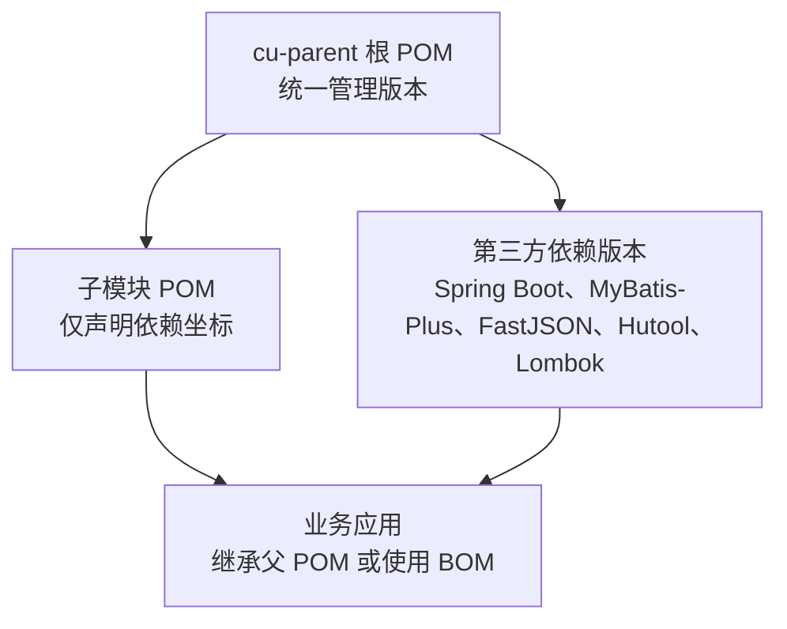
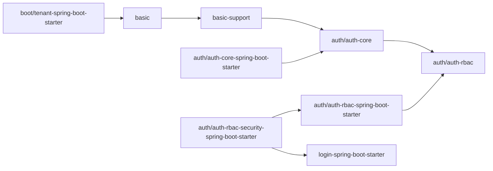
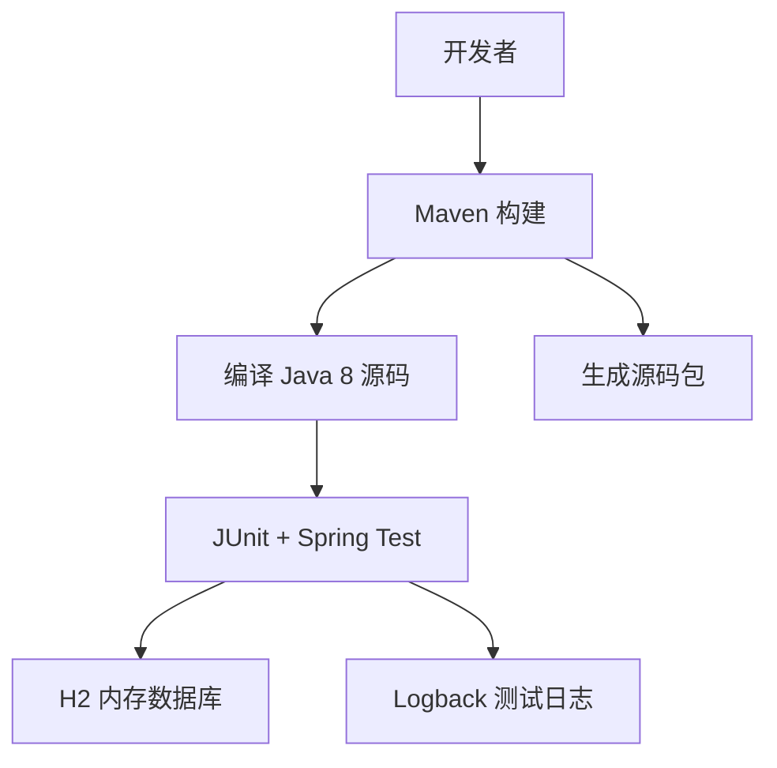
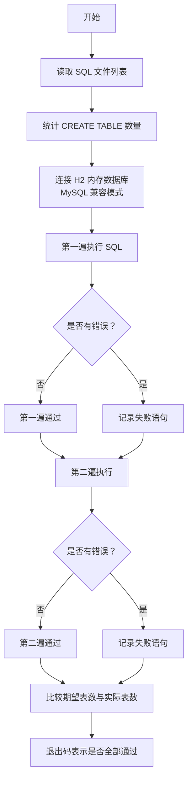

# 技术栈与依赖

<cite>
**本文引用的文件**   
- [根项目 POM](file://pom.xml)
- [basic 模块 POM](file://basic/pom.xml)
- [basic-support 模块 POM](file://basic-support/pom.xml)
- [auth-core 模块 POM](file://auth/auth-core/pom.xml)
- [auth-rbac 模块 POM](file://auth/auth-rbac/pom.xml)
- [auth-core Spring Boot Starter POM](file://auth/auth-core-spring-boot-starter/pom.xml)
- [auth-rbac-security Spring Boot Starter POM](file://auth/auth-rbac-security-spring-boot-starter/pom.xml)
- [登录安全 Starter POM](file://login-spring-boot-starter/pom.xml)
- [多租户 Starter POM](file://boot/tenant-spring-boot-starter/pom.xml)
- [SQL 兼容性检查工具](file://scripts/CheckCompat.java)
- [认证框架说明文档](file://README_Auth.md)
</cite>

## 目录

1. [引言](#引言)
2. [项目结构总览](#项目结构总览)
3. [核心技术栈清单](#核心技术栈清单)
4. [运行时环境要求](#运行时环境要求)
5. [依赖管理策略](#依赖管理策略)
6. [模块间依赖关系](#模块间依赖关系)
7. [开发工具链与构建流程](#开发工具链与构建流程)
8. [数据库与 SQL 兼容性](#数据库与-sql-兼容性)
9. [可选组件与扩展点](#可选组件与扩展点)
10. [依赖升级指南与向后兼容性](#依赖升级指南与向后兼容性)
11. [性能考量与技术选型权衡](#性能考量与技术选型权衡)
12. [常见问题排查](#常见问题排查)
13. [结论](#结论)

## 引言

Kewen Framework 是一个基于 Java、Maven、Spring Boot 和 Spring Security 的后端基础框架，围绕权限控制、统一响应、日志追踪、多租户、存储抽象等能力提供可复用的 Starter。它同时包含一套基于 RBAC 的权限实现，以及用于演示的业务样本工程。

从仓库中的认证框架说明可以看出，该项目以 `Java + Maven + Spring + Spring MVC + Spring Boot + Spring Security + MyBatis Plus + MySQL` 为基础技术路线，并在此基础上进一步整合了 FastJSON、Hutool、Lombok、MyBatis Generator、P6Spy、Guava、JSqlParser 等常用库。

本技术栈文档聚焦以下目标：

- 明确当前仓库中实际使用的核心依赖版本。
- 解释 Spring Boot、Spring Security、MyBatis-Plus、FastJSON、Hutool、Lombok 等技术的选择原因和兼容范围。
- 说明 Maven 父 POM 的统一版本管理和模块依赖边界。
- 给出 JDK、MySQL/H2、Redis 等运行环境的约束与建议。
- 总结构建、测试、SQL 兼容性检查的开发工具链。
- 提供依赖升级路径、向后兼容性注意事项，以及性能与架构取舍分析。

需要特别说明的是：仓库当前根 POM 中未显式声明 Redis 客户端依赖；因此 Redis 属于“可选运行支撑”，而非当前框架代码直接强依赖的核心组件。

**章节来源**
- [根项目 POM:1-279](file://pom.xml#L1-L279)
- [认证框架说明文档:1-200](file://README_Auth.md#L1-L200)

## 项目结构总览

仓库采用多模块 Maven 结构，根模块为 `cu-parent`，主要划分为以下区域：

| 区域 | 职责 | 典型模块 |
|---|---|---|
| 基础能力层 | 统一异常、请求模型、工具类、校验、基础 Web 能力 | `basic` |
| 基础支撑层 | MyBatis-Plus 分页、雪花 ID、Markdown、通知、日志持久化 | `basic-support` |
| 启动装配层 | Spring Boot Starter，负责自动装配、配置、上下文 | `boot/basic-spring-boot-starter`、`boot/storage-spring-boot-starter`、`boot/tenant-spring-boot-starter`、`boot/magic-spring-boot-starter` |
| 登录与安全层 | Spring Security、OAuth2、SAML2、登录返回、过滤器、密码处理 | `login-spring-boot-starter` |
| 权限核心层 | 权限注解、权限模型、权限处理器抽象、RBAC 数据模型 | `auth/auth-core`、`auth/auth-rbac` |
| 权限装配层 | 将权限核心与 Spring Boot、Spring Security 装配起来 | `auth/auth-core-spring-boot-starter`、`auth/auth-rbac-spring-boot-starter`、`auth/auth-rbac-security-spring-boot-starter` |
| 示例工程 | 展示如何组合使用各 Starter | `sample/*` |
| 其他工具 | 代码生成器、兼容性检查脚本 | `other/code-generator`、`scripts` |

该图展示了仓库的模块划分方式：基础能力被多个上层模块复用，权限体系分为“核心抽象”和“RBAC 默认实现”，并通过 Spring Boot Starter 对外暴露装配能力。

**图示来源**
- [根项目 POM:11-25](file://pom.xml#L11-L25)
- [auth-core Spring Boot Starter POM:1-53](file://auth/auth-core-spring-boot-starter/pom.xml#L1-L53)
- [登录安全 Starter POM:1-91](file://login-spring-boot-starter/pom.xml#L1-L91)
- [basic-support 模块 POM:1-43](file://basic-support/pom.xml#L1-L43)

**章节来源**
- [根项目 POM:11-25](file://pom.xml#L11-L25)
- [认证框架说明文档:1-200](file://README_Auth.md#L1-L200)

## 核心技术栈清单

### Spring Boot 2.7.18

根 POM 通过导入 `spring-boot-dependencies` BOM 统一管理 Spring Boot 生态版本。当前版本为 **2.7.18**。

选择原因：

- Spring Boot 2.7 系列是 Spring Framework 5.x 的稳定分支，适合长期维护的企业后端。
- 2.7.18 提供了较晚的补丁修复，有利于在不迁移到 Spring Boot 3 的前提下获得安全性更新。
- 配合 Spring Cloud 2021.0.9 和 Spring Cloud Alibaba 2021.0.5.0，形成相对稳定的微服务基础栈。

兼容范围：

- 编译目标为 Java 8。
- 不强制使用 Jakarta EE 命名空间，仍使用 `javax.servlet`、`javax.validation` 等传统包名。
- 若未来升级到 Spring Boot 3，需要同步迁移到 Spring Framework 6、Jakarta EE 9+、Java 17+，不能仅改版本号。

**章节来源**
- [根项目 POM:1-20](file://pom.xml#L1-L20)
- [根项目 POM:33-44](file://pom.xml#L33-L44)
- [根项目 POM:52-63](file://pom.xml#L52-L63)

### Spring Security

仓库中通过 `login-spring-boot-starter` 引入 Spring Security，包括：

- `spring-boot-starter-security`
- `spring-session-jdbc`
- `spring-security-saml2-service-provider`
- `spring-security-oauth2-client`
- `spring-security-oauth2-jose`

选择原因：

- 提供统一的认证、授权、会话、CSRF、异常处理和返回格式封装。
- 支持 OAuth2 和 SAML2，便于对接企业身份源或第三方单点登录系统。
- 通过 Starter 模式把安全逻辑与业务解耦，业务模块只需关注权限模型和接口契约。

需要注意：

- 旧版 `spring-security-openid` 已被移除，注释明确指出其已在 Spring Security 5.7 废弃，且会引入 Guice 导致类加载冲突。
- 旧版 Spring Security OAuth 相关依赖也被注释掉，说明项目已转向 Spring Security 5.7 之后的 OAuth2/OIDC/SAML 方案。

**章节来源**
- [登录安全 Starter POM:24-91](file://login-spring-boot-starter/pom.xml#L24-L91)

### MyBatis-Plus 3.5.8

根 POM 使用变量 `mybaits-plus-version=3.5.8`，并直接声明以下依赖：

- `mybatis-plus-boot-starter`
- `mybatis-plus`
- `mybatis-plus-generator`

此外还显式引入了：

- `org.mybatis:mybatis:3.5.16`
- `com.github.jsqlparser:jsqlparser:4.7`
- `p6spy:3.9.1`

选择原因：

- MyBatis-Plus 在原生 MyBatis 基础上提供分页、条件构造器、代码生成、通用 Mapper 等能力，降低样板代码。
- 3.5.8 与 Spring Boot 2.7 生态兼容良好。
- JSqlParser 4.7 通常与 MyBatis-Plus 的 SQL 解析能力配合使用。
- P6Spy 可用于 SQL 执行拦截和调试，适合开发和诊断阶段。

兼容性注意：

- 根 POM 中 MyBatis-Plus 的 BOM 导入被注释，因此当前 MyBatis 主版本由父 POM 显式声明为 3.5.16，而不是由 MyBatis-Plus BOM 统一控制。
- 升级 MyBatis-Plus 时，应优先验证 `mybatis`、`jsqlparser`、`p6spy` 之间的版本组合是否稳定。

**章节来源**
- [根项目 POM:1-20](file://pom.xml#L1-L20)
- [根项目 POM:83-119](file://pom.xml#L83-L119)
- [根项目 POM:213-232](file://pom.xml#L213-L232)
- [basic-support 模块 POM:20-35](file://basic-support/pom.xml#L20-L35)
- [auth-core 模块 POM:50-69](file://auth/auth-core/pom.xml#L50-L69)

### FastJSON 2.0.9 与 FastJSON2 2.0.25

根 POM 同时声明：

- `com.alibaba:fastjson:2.0.9`
- `com.alibaba.fastjson2:fastjson2:2.0.25`

选择原因：

- `fastjson` 是早期广泛使用的 JSON 库，很多历史模块可能仍依赖其旧坐标。
- `fastjson2` 是新版本实现，具备更好的性能和安全性改进。
- 项目同时保留两者，说明部分模块可能仍引用旧坐标，而新模块或新场景逐步迁移到新坐标。

兼容建议：

- 业务模块应尽量只依赖 `fastjson2`，避免引入旧 `fastjson` 造成序列化行为不一致。
- 如果业务代码确实依赖旧 `fastjson` API，应在升级前完成替换，再考虑从根 POM 中移除旧依赖。

**章节来源**
- [根项目 POM:107-115](file://pom.xml#L107-L115)
- [basic 模块 POM:33-45](file://basic/pom.xml#L33-L45)
- [auth-core 模块 POM:88-92](file://auth/auth-core/pom.xml#L88-L92)

### Hutool 5.8.18

根 POM 声明 `cn.hutool:hutool-all:5.8.18`，并在多个模块中使用：

- `basic-support`
- `auth-core`

选择原因：

- Hutool 提供集合、字符串、日期、加密、IO、HTTP、JSON 等大量实用工具，可减少自研工具类的维护成本。
- 作为“all”包，便于快速集成；但大型项目中也可按需拆分以减少包体积。

兼容性注意：

- Hutool 5.8 系列与 Spring Boot 2.7、Java 8 兼容。
- 升级时应关注内部工具方法变更，尤其是日期、加密、正则、集合转换等高频 API。

**章节来源**
- [根项目 POM:116-118](file://pom.xml#L116-L118)
- [basic-support 模块 POM:26-35](file://basic-support/pom.xml#L26-L35)
- [auth-core 模块 POM:84-92](file://auth/auth-core/pom.xml#L84-L92)

### Lombok 1.18.30

根 POM 声明 `org.projectlombok:lombok:1.18.30`，并在 `basic`、`auth-core` 等模块中使用。

选择原因：

- 减少实体类、工具类中的 getter/setter、构造器、日志字段等样板代码。
- 提升代码可读性，尤其在权限模型、用户对象、配置类等频繁出现的 POJO 上效果明显。

兼容性注意：

- Lombok 1.18.30 与 Java 8 和 Spring Boot 2.7 兼容。
- IDE 需启用 Lombok 注解处理器；否则编译期无法生成相应代码。

**章节来源**
- [根项目 POM:119-121](file://pom.xml#L119-L121)
- [basic 模块 POM:29-33](file://basic/pom.xml#L29-L33)
- [auth-core 模块 POM:83-92](file://auth/auth-core/pom.xml#L83-L92)

### 其他重要依赖

| 依赖 | 版本 | 作用 | 备注 |
|---|---:|---|---|
| Spring Boot Dependencies | 2.7.18 | 统一管理 Spring Boot 生态版本 | BOM 形式导入 |
| Spring Cloud | 2021.0.9 | 微服务依赖 BOM | 可选，供云原生场景使用 |
| Spring Cloud Alibaba | 2021.0.5.0 | 阿里云微服务依赖 BOM | 可选，供 Nacos、Sentinel 等使用 |
| MyBatis | 3.5.16 | ORM 底层框架 | 非 BOM 管理，显式声明 |
| JSqlParser | 4.7 | SQL 解析 | 常用于权限数据范围或 SQL 改写 |
| MySQL Connector/J | 8.0.33 | MySQL 驱动 | 根 POM 管理 |
| H2 | 未显式版本 | 内存数据库 | 测试依赖，由 Spring Boot 管理 |
| Guava | 32.1.3-jre | 通用工具库 | 集合、缓存、并发工具 |
| Commons Collections4 | 4.3 | Apache 集合工具 | 通用工具 |
| Commons IO | 2.11.0 | IO 工具 | 文件操作、流处理 |
| P6Spy | 3.9.1 | SQL 拦截调试 | 开发诊断用途 |
| Qiniu Java SDK | 7.12.1 | 七牛云存储 SDK | 存储 Starter 可能使用 |
| Swagger | 2.9.2 / 1.9.6 | API 文档（旧） | 根 POM 中有声明，但未在当前模块依赖图中强体现 |

**章节来源**
- [根项目 POM:52-139](file://pom.xml#L52-L139)
- [root POM:213-242](file://pom.xml#L213-L242)
- [auth-core Spring Boot Starter POM:27-53](file://auth/auth-core-spring-boot-starter/pom.xml#L27-L53)

## 运行时环境要求

### Java 版本

根 POM 和多数子模块均设置：

- `maven.compiler.source=8`
- `maven.compiler.target=8`

因此，最低运行环境应为 **JDK 8**。

由于 Spring Boot 2.7.18 也支持更高版本，生产环境可选择 JDK 8、JDK 11 或 JDK 17，但需注意：

- 若保持 Spring Boot 2.7，则不要随意切换到 Jakarta EE 命名空间。
- 若计划升级到 Spring Boot 3，则必须升级到 Java 17+ 并使用 Jakarta EE。

### 数据库

当前仓库明确管理的数据库依赖包括：

- MySQL 驱动：`mysql:mysql-connector-java:8.0.33`
- H2：作为测试依赖，用于单元测试和 SQL 兼容性检查

SQL 脚本位于：

- `docs/sql/auth-rbac.sql`
- `docs/sql/basic-support.sql`
- `sample/*/sql/schema.sql`
- `sample/*/sql/seed-data.sql`

因此，最小可用运行时至少需要一个可连接的 MySQL 实例；测试时可切换为 H2 内存数据库。

### Redis

仓库根 POM 和当前分析的模块 POM 中未发现 Redis 客户端依赖。因此：

- Redis 不是当前框架代码的直接必需依赖。
- 若业务需要缓存，应由业务模块自行引入 Redis 客户端，例如 Lettuce、Jedis 或 Spring Data Redis。
- 会话存储方面，登录 Starter 引入了 `spring-session-jdbc`，说明默认会话可落库，而不是强依赖 Redis。

### 外部系统集成

- 七牛云存储：通过 `qiniu-java-sdk:7.12.1` 暴露存储抽象能力。
- OAuth2/SAML2：通过 Spring Security 提供的依赖对接第三方身份提供方。
- Spring Cloud / Spring Cloud Alibaba：通过 BOM 引入，是否真正使用取决于业务应用是否启用相关 Starter。

**章节来源**
- [根项目 POM:1-20](file://pom.xml#L1-L20)
- [根项目 POM:227-232](file://pom.xml#L227-L232)
- [登录安全 Starter POM:42-71](file://login-spring-boot-starter/pom.xml#L42-L71)
- [根项目 POM:119-121](file://pom.xml#L119-L121)

## 依赖管理策略

### Maven 父 POM 统一版本管理

根项目 `cu-parent` 使用 `<dependencyManagement>` 集中声明第三方依赖版本，子模块通常只声明 groupId 和 artifactId，不声明 version。

这种策略的好处是：

- 所有模块使用同一版本的 Spring Boot、MyBatis-Plus、FastJSON、Hutool、Lombok 等。
- 升级依赖时只需修改父 POM，降低版本不一致风险。
- 对业务应用来说，继承 `cu-parent` 后可直接获得框架定义的依赖版本。

**图示来源**
- [根项目 POM:1-20](file://pom.xml#L1-L20)
- [root POM:28-242](file://pom.xml#L28-L242)
- [basic 模块 POM:1-10](file://basic/pom.xml#L1-L10)

### 子模块版本管理

除了根 POM，auth 模块也有自己的父 POM `auth`，用于统一管理权限相关子模块的版本。类似地，`boot` 模块下也有对应父 POM。

这意味着依赖管理存在多层级：

1. 根 POM：统一管理 Spring 生态、ORM、工具库、数据库驱动等公共依赖。
2. 功能域 POM：如 `auth`、`boot`，统一管理领域内模块版本。
3. 业务应用：继承根 POM 或直接依赖 Starter。

**章节来源**
- [根项目 POM:1-25](file://pom.xml#L1-L25)
- [auth-core Spring Boot Starter POM:1-10](file://auth/auth-core-spring-boot-starter/pom.xml#L1-L10)
- [multi-tenant starter POM:1-10](file://boot/tenant-spring-boot-starter/pom.xml#L1-L10)

## 模块间依赖关系

### 基础模块依赖方向

关键依赖关系说明：

- `basic` 是最低层基础模块，提供统一异常、请求模型、工具类和基础 Web 能力。
- `basic-support` 依赖 `basic`，并引入 MyBatis-Plus、Hutool，提供分页、雪花 ID、工具扩展。
- `auth/auth-core` 依赖 `basic`，定义权限注解、权限模型、权限处理器抽象。
- `auth/auth-rbac` 依赖 `auth-core` 和 `basic-support`，提供 RBAC 默认实现。
- 三个 Spring Boot Starter 分别负责装配权限核心、RBAC 和 Spring Security 集成。
- `login-spring-boot-starter` 是独立的安全登录模块，RBAC Security Starter 在其基础上叠加 RBAC 能力。
- `boot/tenant-spring-boot-starter` 依赖 `basic`，并提供 Feign 可选支持。

**图示来源**
- [basic 模块 POM:22-76](file://basic/pom.xml#L22-L76)
- [basic-support 模块 POM:20-35](file://basic-support/pom.xml#L20-L35)
- [auth-core 模块 POM:23-92](file://auth/auth-core/pom.xml#L23-L92)
- [auth-rbac 模块 POM:23-56](file://auth/auth-rbac/pom.xml#L23-L56)
- [auth-core Spring Boot Starter POM:23-53](file://auth/auth-core-spring-boot-starter/pom.xml#L23-L53)
- [auth-rbac-security Spring Boot Starter POM:23-38](file://auth/auth-rbac-security-spring-boot-starter/pom.xml#L23-L38)
- [登录安全 Starter POM:24-91](file://login-spring-boot-starter/pom.xml#L24-L91)
- [multi-tenant starter POM:22-42](file://boot/tenant-spring-boot-starter/pom.xml#L22-L42)

### Starter 装配边界

- `auth-core-spring-boot-starter`：装配权限核心、Web 拦截、数据库访问能力，并包含测试用 H2 和 Spring Boot Test。
- `auth-rbac-spring-boot-starter`：装配 RBAC Bean 和扫描配置。
- `auth-rbac-security-spring-boot-starter`：将 RBAC 与登录安全 Starter 结合，提供基于 Spring Security 的登录态接入。
- `login-spring-boot-starter`：提供 Spring Security、OAuth2、SAML2、Session JDBC、统一返回等能力。

这种分层使业务应用可以按需引入：

- 仅需基础能力：引入 `basic`。
- 需要登录和安全：引入 `login-spring-boot-starter`。
- 需要 RBAC 权限：引入 `auth-rbac-spring-boot-starter`。
- 需要 Spring Security 集成：引入 `auth-rbac-security-spring-boot-starter`。

**章节来源**
- [auth-core Spring Boot Starter POM:23-53](file://auth/auth-core-spring-boot-starter/pom.xml#L23-L53)
- [auth-rbac-security Spring Boot Starter POM:23-38](file://auth/auth-rbac-security-spring-boot-starter/pom.xml#L23-L38)
- [登录安全 Starter POM:24-91](file://login-spring-boot-starter/pom.xml#L24-L91)

## 开发工具链与构建流程

### 构建工具

项目使用 Maven 进行构建，根 POM 中启用了 `maven-source-plugin`，用于生成源码包。

典型构建命令：

- 全量构建：`mvn clean install -DskipTests`
- 跳过源码打包：根据插件配置调整
- 指定模块构建：`mvn -pl basic -am clean install`

### 编译器与编码

- Java 源和目标版本均为 8。
- 项目构建编码为 UTF-8。
- 推荐使用支持 Lombok 的 IDE，例如 IntelliJ IDEA 并启用注解处理器。

### 测试框架

- 单元测试主要使用 JUnit。
- Web 相关测试使用 Spring Boot Test、Spring Test。
- 测试数据库使用 H2 内存数据库。
- 日志测试需要真实 MDC 实现，因此 `basic` 模块在测试依赖中引入 `logback-classic`。

**图示来源**
- [根项目 POM:244-279](file://pom.xml#L244-L279)
- [basic 模块 POM:47-84](file://basic/pom.xml#L47-L84)
- [auth-core Spring Boot Starter POM:36-53](file://auth/auth-core-spring-boot-starter/pom.xml#L36-L53)

**章节来源**
- [根项目 POM:244-279](file://pom.xml#L244-L279)
- [basic 模块 POM:47-84](file://basic/pom.xml#L47-L84)
- [auth-core Spring Boot Starter POM:36-53](file://auth/auth-core-spring-boot-starter/pom.xml#L36-L53)

## 数据库与 SQL 兼容性

### 支持的数据库

当前仓库明确管理的数据库依赖包括：

- MySQL：驱动版本 8.0.33
- H2：用于测试和 SQL 语法兼容性检查

SQL 脚本位置：

- `docs/sql/auth-rbac.sql`
- `docs/sql/basic-support.sql`
- `sample/auth-core-boot-sample/sql/schema.sql`
- `sample/auth-core-boot-sample/sql/seed-data.sql`
- `sample/auth-rbac-boot-sample/sql/schema.sql`
- `sample/auth-rbac-boot-sample/sql/seed-data.sql`

### SQL 兼容性检查机制

仓库提供一个独立的 Java 工具 `scripts/CheckCompat.java`，其作用是：

- 使用 H2 的 MySQL 兼容模式执行 SQL 脚本。
- 逐条解析语句，捕获 SQL 执行错误。
- 统计 `CREATE TABLE` 数量，验证表是否真的创建成功。
- 重复执行两次，验证脚本可重复执行。
- 输出失败语句和建表数量差异。

**图示来源**
- [SQL 兼容性检查工具:1-144](file://scripts/CheckCompat.java#L1-L144)

该工具的价值在于：

- 不依赖完整 MySQL 环境即可检查 SQL 基本语法。
- 能发现 H2 与 MySQL 语法差异导致的潜在问题。
- 能发现重复执行脚本时的幂等性问题。
- 能帮助评估数据库迁移脚本的正确性。

**章节来源**
- [根项目 POM:227-232](file://pom.xml#L227-L232)
- [SQL 兼容性检查工具:1-144](file://scripts/CheckCompat.java#L1-L144)

## 可选组件与扩展点

### 缓存与 Redis

当前框架没有直接依赖 Redis。如果需要缓存：

- 可在业务模块引入 Spring Data Redis、Lettuce 或 Jedis。
- 不建议在框架基础模块中引入 Redis，以保持基础依赖轻量。
- 若业务需要分布式会话，可考虑替换 `spring-session-jdbc` 为 Redis Session 实现。

### 消息通知

`basic-support` 中包含方糖消息通知相关类，例如 `FangTangMessageClient`、`FangTangMessageDTO`。这属于业务扩展点，不应视为框架强制依赖。

### 存储抽象

`boot/storage-spring-boot-starter` 提供存储抽象，并引入七牛云 SDK。业务可基于该抽象扩展其他存储后端。

### 多租户

`boot/tenant-spring-boot-starter` 提供租户上下文、请求过滤和 Feign 可选支持。Feign 依赖标记为 `optional`，说明只有引入 Feign 时才开启相关支持。

**章节来源**
- [登录安全 Starter POM:42-71](file://login-spring-boot-starter/pom.xml#L42-L71)
- [basic-support 模块 POM:1-43](file://basic-support/pom.xml#L1-L43)
- [multi-tenant starter POM:22-42](file://boot/tenant-spring-boot-starter/pom.xml#L22-L42)

## 依赖升级指南与向后兼容性

### 升级优先级

建议按以下顺序评估升级：

1. **JDK**：确认业务能否迁移到 JDK 11 或 17。
2. **Spring Boot**：如需升级至 3.x，需同步迁移 Jakarta EE 和 Spring Framework 6。
3. **Spring Cloud / Spring Cloud Alibaba**：跟随 Spring Boot 主版本升级。
4. **MyBatis-Plus**：优先验证与 MyBatis、JSqlParser、P6Spy 的版本组合。
5. **FastJSON / FastJSON2**：尽量统一到 `fastjson2`。
6. **Hutool**：关注工具类 API 变更。
7. **Lombok**：一般兼容性较好，但仍需重新编译验证。
8. **MySQL 驱动**：确保与目标 MySQL 版本匹配。

### 关键兼容性风险

| 升级项 | 风险 | 建议 |
|---|---|---|
| Spring Boot 2.7 → 3.x | Jakarta EE 命名空间变化、Servlet API 变化 | 全面扫描 `javax.*` 替换为 `jakarta.*` |
| MyBatis-Plus 升级 | SQL 解析、分页、代码生成行为可能变化 | 先升级后运行全量测试和 SQL 兼容性检查 |
| FastJSON → FastJSON2 | 坐标和行为差异 | 替换依赖坐标并验证序列化结果 |
| Lombok 升级 | 注解生成行为微小差异 | 清理并重新编译 |
| MySQL 驱动升级 | URL、驱动类、数据类型差异 | 在预发环境验证连接和查询 |
| H2 升级 | 测试行为可能变化 | 使用现有 SQL 兼容性工具回归 |

### 向后兼容性建议

- 不要在业务模块中绕过父 POM 的版本管理。
- 新增依赖时优先放入父 POM 的 `dependencyManagement`。
- 对可选依赖使用 `<optional>true</optional>`，避免污染下游依赖树。
- 对破坏性升级添加迁移说明和示例。
- 使用仓库现有的 `scripts/CheckCompat.java` 验证 SQL 变更。

**章节来源**
- [根项目 POM:52-139](file://pom.xml#L52-L139)
- [root POM:213-242](file://pom.xml#L213-L242)
- [登录安全 Starter POM:56-71](file://login-spring-boot-starter/pom.xml#L56-L71)
- [SQL 兼容性检查工具:1-144](file://scripts/CheckCompat.java#L1-L144)

## 性能考量与技术选型权衡

### Spring Boot 2.7.18

优点：

- 成熟稳定，社区和企业生态完善。
- 与 Spring Cloud 2021 系列搭配，适合传统微服务架构。
- 不需要 Jakarta EE 迁移成本。

缺点：

- 相比 Spring Boot 3，无法直接使用 GraalVM Native Image 的新特性。
- 无法享受 Spring Framework 6 的全部优化和新 API。

### Spring Security

优点：

- 提供完整的认证、授权、会话、CSRF、异常处理机制。
- 支持 OAuth2、OIDC、SAML2，便于企业集成。
- 通过 Starter 模式降低接入成本。

权衡：

- 安全链较长，可能对高并发接口带来额外开销。
- 自定义过多 Filter、Handler、Converter 会增加启动时间和调试成本。
- 需要谨慎设计白名单、忽略路径和鉴权粒度。

### MyBatis-Plus

优点：

- 减少样板代码，提升 CRUD 效率。
- 条件构造器和分页简化常见查询。
- 与 MyBatis 生态兼容。

权衡：

- 过度依赖动态条件构造器可能导致 SQL 可读性和可维护性下降。
- 复杂查询仍需手写 SQL，否则容易性能劣化。
- JSqlParser 参与 SQL 解析时，极端复杂 SQL 可能增加解析开销。

### FastJSON 与 FastJSON2

优点：

- FastJSON2 在性能和空值处理上有改进。
- FastJSON 历史兼容性好，便于过渡。

权衡：

- 双依赖存在安全风险和维护成本。
- 不同版本序列化行为可能存在差异，应统一坐标。
- 对于高性能 JSON 场景，还可评估 Jackson、Gson、JSON-B 等替代方案。

### Hutool

优点：

- 工具丰富，开发效率高。
- 覆盖日常开发中的大量通用场景。

权衡：

- `hutool-all` 包较大，可能引入不必要类。
- 应避免过度使用其 HTTP、JSON 等高级能力，以免与 Spring Boot 内置能力重复。

### Lombok

优点：

- 显著减少样板代码。
- 提升实体类和 DTO 的可读性。

权衡：

- 调试时需理解注解生成的代码。
- 某些反射或序列化框架对 Lombok 生成代码的支持需要验证。

### 数据库层

- MyBatis-Plus 适合常规 CRUD，但复杂查询应优先优化 SQL 和索引。
- P6Spy 适合开发和诊断，生产环境需谨慎开启，避免日志膨胀。
- 建议对热点查询增加缓存，但缓存策略应由业务模块决定，而不是框架强加。

**章节来源**
- [根项目 POM:52-139](file://pom.xml#L52-L139)
- [auth-core 模块 POM:50-92](file://auth/auth-core/pom.xml#L50-L92)
- [basic-support 模块 POM:20-35](file://basic-support/pom.xml#L20-L35)

## 常见问题排查

### 启动时报 JSON 序列化相关错误

可能原因：

- 同时存在 `fastjson` 和 `fastjson2`，导致序列化实现不确定。
- 业务代码使用了旧 `fastjson` API，但依赖已迁移。

解决建议：

- 优先统一到 `fastjson2`。
- 检查模块依赖树，确认没有隐式引入旧 `fastjson`。

**章节来源**
- [根项目 POM:107-115](file://pom.xml#L107-L115)
- [basic 模块 POM:33-45](file://basic/pom.xml#L33-L45)
- [auth-core 模块 POM:88-92](file://auth/auth-core/pom.xml#L88-L92)

### Spring Security 登录或鉴权异常

可能原因：

- 未正确引入 `login-spring-boot-starter` 或 `auth-rbac-security-spring-boot-starter`。
- 白名单路径配置不正确。
- 登录主体未正确注入。

解决建议：

- 确认引入的 Starter 是否符合业务需求。
- 检查安全配置、白名单、返回处理器。
- 使用测试用例验证认证流程和返回结构。

**章节来源**
- [登录安全 Starter POM:24-91](file://login-spring-boot-starter/pom.xml#L24-L91)
- [auth-rbac-security Spring Boot Starter POM:23-38](file://auth/auth-rbac-security-spring-boot-starter/pom.xml#L23-L38)

### SQL 在 MySQL 正常但在 H2 或测试环境报错

可能原因：

- SQL 语法与 H2 MySQL 兼容模式不完全一致。
- 脚本不可重复执行。
- 建表数量与预期不符。

解决建议：

- 使用 `scripts/CheckCompat.java` 检查 SQL。
- 区分测试脚本和生产脚本。
- 对 DDL 增加幂等性或分环境执行。

**章节来源**
- [SQL 兼容性检查工具:1-144](file://scripts/CheckCompat.java#L1-L144)

### 依赖版本冲突

可能原因：

- 子模块或业务应用覆盖了父 POM 的版本。
- 间接依赖引入了不同版本的相同库。

解决建议：

- 优先在父 POM 中统一管理版本。
- 使用 Maven 依赖树分析冲突。
- 对可选依赖使用 `<optional>true</optional>`。

**章节来源**
- [根项目 POM:28-242](file://pom.xml#L28-L242)
- [multi-tenant starter POM:22-42](file://boot/tenant-spring-boot-starter/pom.xml#L22-L42)

## 结论

Kewen Framework 的技术栈以 Spring Boot 2.7.18 为核心，围绕 Spring Security、MyBatis-Plus、FastJSON/FastJSON2、Hutool、Lombok、Guava、P6Spy、JSqlParser 等常用库构建。项目通过 Maven 父 POM 统一版本管理，并将基础能力、权限体系、登录安全、存储抽象和多租户能力拆分为多个 Starter，便于业务按需引入。

从仓库现状看，框架更偏向“可插拔的基础设施集合”，而不是一个单一的重型单体。其优势是模块化清晰、扩展性强；代价是模块较多、依赖关系复杂，升级时需要特别注意 Spring Boot、Spring Security、MyBatis-Plus、JSON 库和数据库驱动之间的版本耦合。

对于新项目：

- 如果团队熟悉 Spring Boot 2.7 和 Spring Security，可以直接使用该框架的快速启动能力。
- 如果团队希望更轻量的起步，可以先只引入 `basic` 和 `login-spring-boot-starter`。
- 如果需要 RBAC 权限，再引入 `auth-rbac-spring-boot-starter` 或 `auth-rbac-security-spring-boot-starter`。
- 如果使用 Redis、消息、分布式缓存等能力，建议在业务模块中按需引入，而不是强绑定到框架基础依赖。

对于存量项目：

- 优先清理 FastJSON 双依赖。
- 使用 SQL 兼容性工具验证脚本。
- 制定 Spring Boot 3 和 Jakarta EE 的长期升级计划。
- 对性能敏感路径单独做基准测试，避免框架默认行为成为瓶颈。