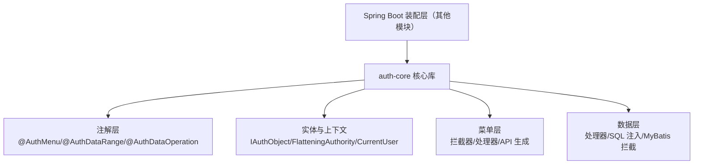
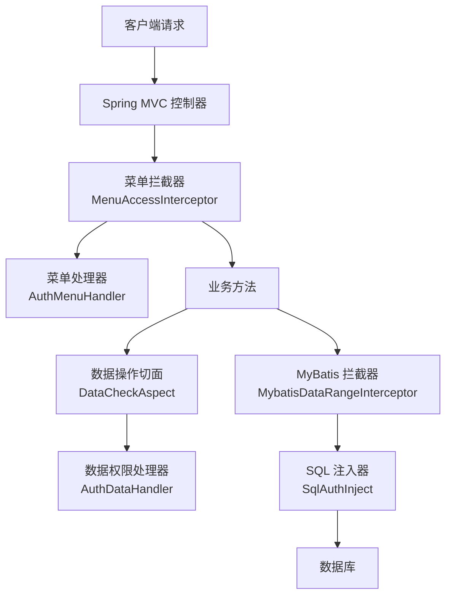
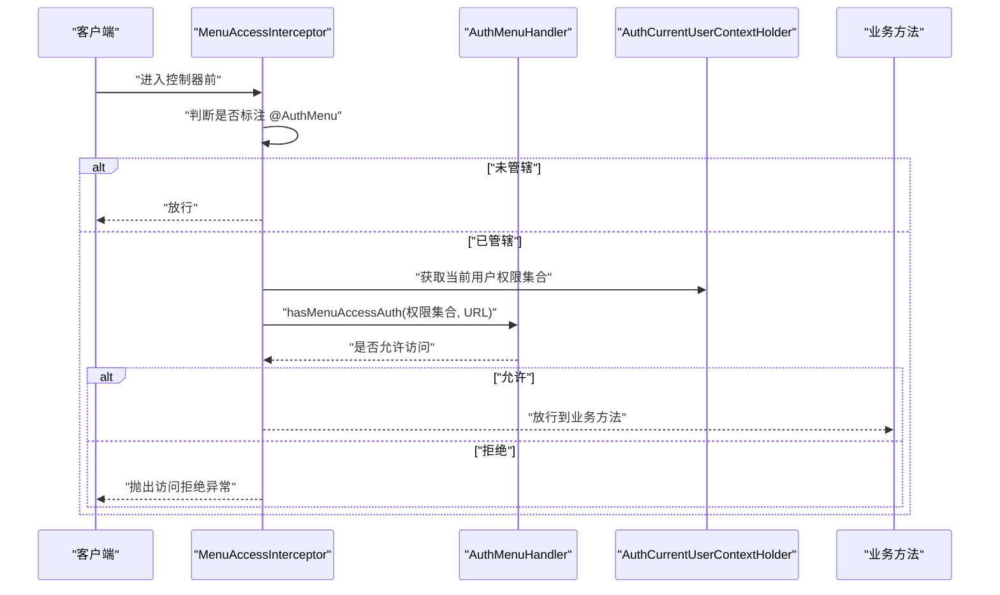
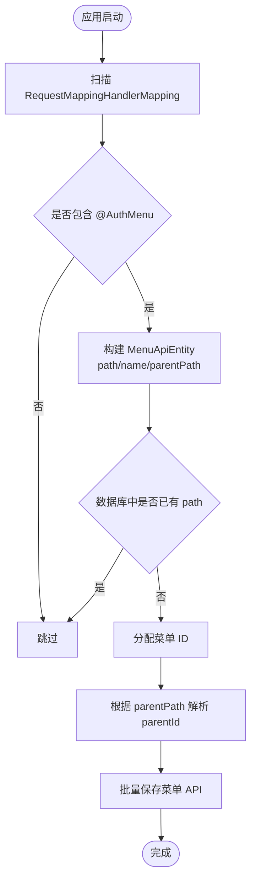
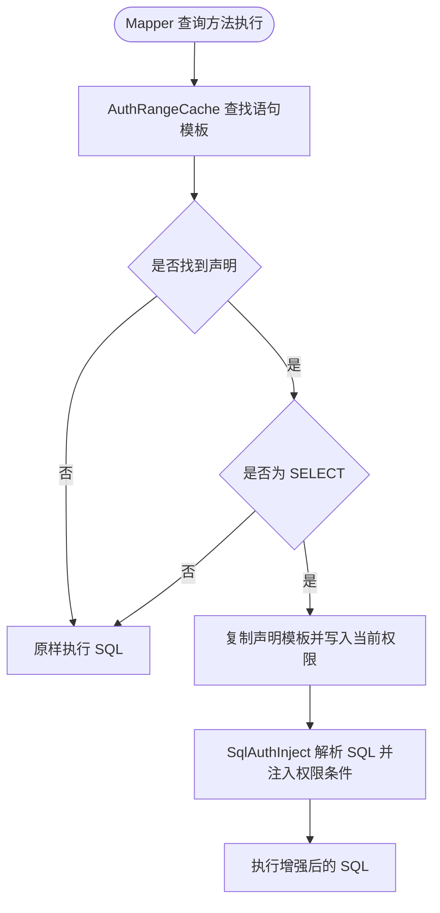
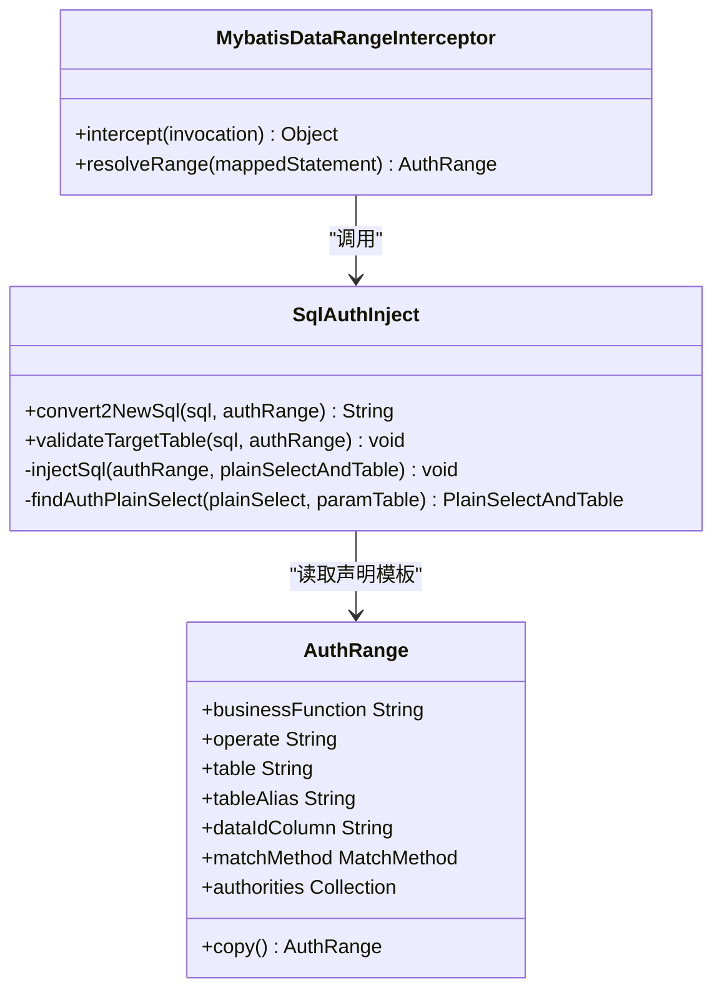
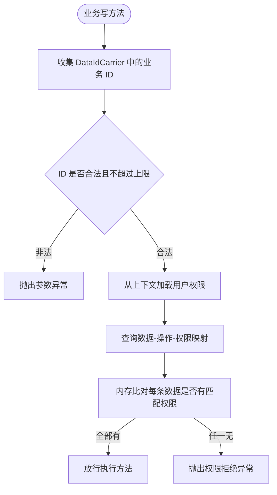
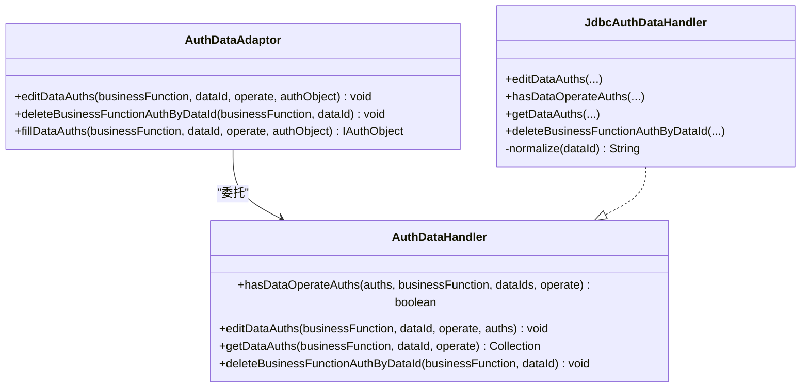
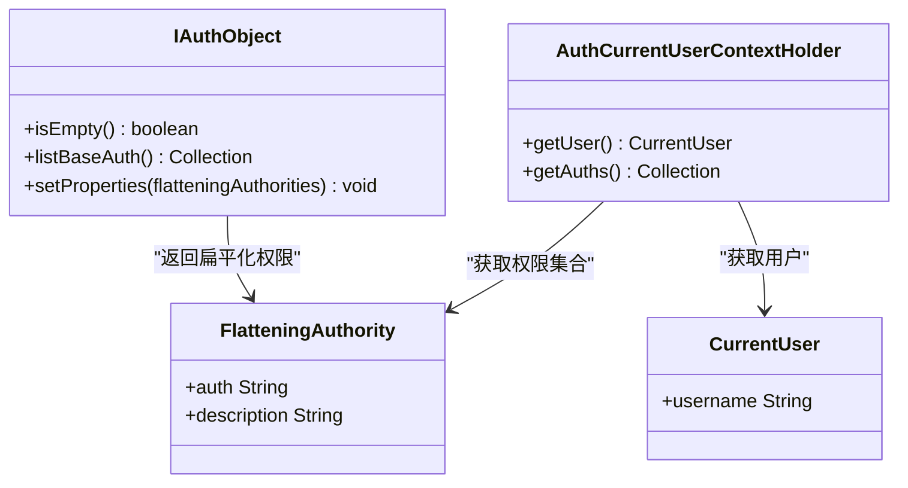
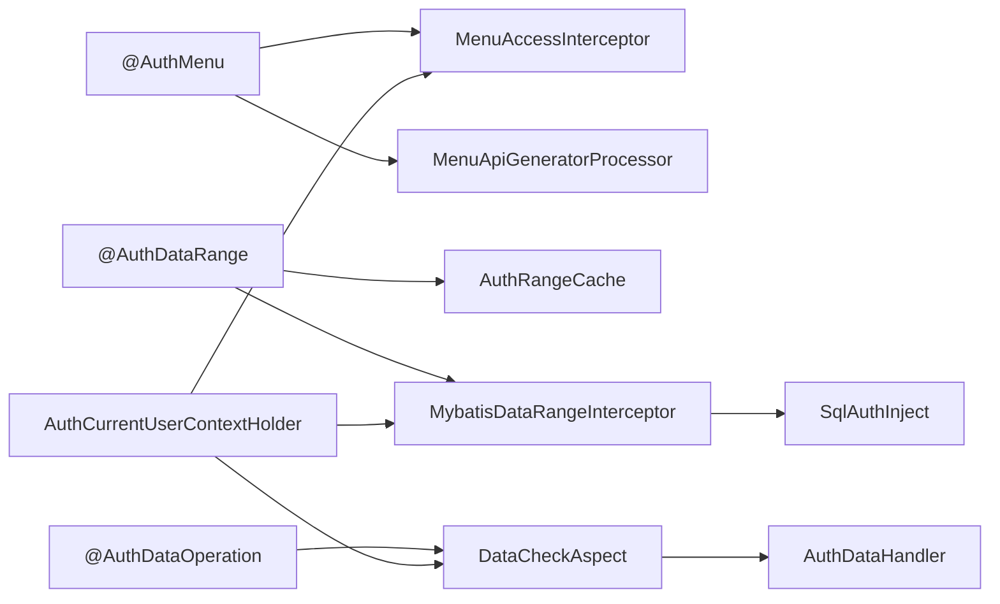

# Auth-Core 权限核心模块

<cite>
**本文引用的文件**   
- [auth-core/README.md](file://auth/auth-core/README.md)
- [auth-core/pom.xml](file://auth/auth-core/pom.xml)
- [AuthMenu.java](file://auth/auth-core/src/main/java/com/cu/framework/auth/core/AuthMenu.java)
- [AuthDataRange.java](file://auth/auth-core/src/main/java/com/cu/framework/auth/core/AuthDataRange.java)
- [AuthDataOperation.java](file://auth/auth-core/src/main/java/com/cu/framework/auth/core/AuthDataOperation.java)
- [AuthCurrentUserContextHolder.java](file://auth/auth-core/src/main/java/com/cu/framework/auth/core/AuthCurrentUserContextHolder.java)
- [AuthDataAdaptor.java](file://auth/auth-core/src/main/java/com/cu/framework/auth/core/AuthDataAdaptor.java)
- [AuthDataHandler.java](file://auth/auth-core/src/main/java/com/cu/framework/auth/core/data/AuthDataHandler.java)
- [JdbcAuthDataHandler.java](file://auth/auth-core/src/main/java/com/cu/framework/auth/core/data/JdbcAuthDataHandler.java)
- [MenuAccessInterceptor.java](file://auth/auth-core/src/main/java/com/cu/framework/auth/core/menu/MenuAccessInterceptor.java)
- [AuthMenuHandler.java](file://auth/auth-core/src/main/java/com/cu/framework/auth/core/menu/AuthMenuHandler.java)
- [MenuApiEntity.java](file://auth/auth-core/src/main/java/com/cu/framework/auth/core/menu/MenuApiEntity.java)
- [MenuApiService.java](file://auth/auth-core/src/main/java/com/cu/framework/auth/core/menu/MenuApiService.java)
- [MenuApiGeneratorProcessor.java](file://auth/auth-core/src/main/java/com/cu/framework/auth/core/menu/MenuApiGeneratorProcessor.java)
- [MybatisDataRangeInterceptor.java](file://auth/auth-core/src/main/java/com/cu/framework/auth/core/data/range/MybatisDataRangeInterceptor.java)
- [AuthRangeCache.java](file://auth/auth-core/src/main/java/com/cu/framework/auth/core/data/range/AuthRangeCache.java)
- [AuthRangeStartupValidator.java](file://auth/auth-core/src/main/java/com/cu/framework/auth/core/data/range/AuthRangeStartupValidator.java)
- [SqlAuthInject.java](file://auth/auth-core/src/main/java/com/cu/framework/auth/core/data/range/SqlAuthInject.java)
- [DataCheckAspect.java](file://auth/auth-core/src/main/java/com/cu/framework/auth/core/data/edit/DataCheckAspect.java)
- [IAuthObject.java](file://auth/auth-core/src/main/java/com/cu/framework/auth/core/entity/IAuthObject.java)
- [FlatteningAuthority.java](file://auth/auth-core/src/main/java/com/cu/framework/auth/core/entity/FlatteningAuthority.java)
- [AbstractIdNameFlagAuthEntity.java](file://auth/auth-core/src/main/java/com/cu/framework/auth/core/entity/AbstractIdNameFlagAuthEntity.java)
</cite>

## 目录
1. [引言](#引言)
2. [项目结构](#项目结构)
3. [核心组件](#核心组件)
4. [架构总览](#架构总览)
5. [详细组件分析](#详细组件分析)
6. [依赖关系分析](#依赖关系分析)
7. [性能与扩展性](#性能与扩展性)
8. [故障排查指南](#故障排查指南)
9. [结论](#结论)

## 引言
Auth-Core 是权限系统的抽象层，负责把“菜单访问控制、数据范围过滤、数据操作校验”统一为可插拔的注解和接口。它不绑定具体业务表结构和认证实现，而是通过以下机制协作：
- 使用 `@AuthMenu` 声明受菜单权限管辖的端点；
- 使用 `@AuthDataRange` 在 MyBatis 查询方法上注入行级数据范围；
- 使用 `@AuthDataOperation` 在写操作上校验目标数据行的操作权限；
- 通过 `AuthCurrentUserContextHolder` 获取当前登录用户及其扁平化权限集合；
- 通过 `AuthDataHandler` / `AuthMenuHandler` 等接口对接 RBAC 或自定义实现；
- 通过 Spring MVC 拦截器、MyBatis 插件和 AspectJ 切面完成运行时控制。

该模块的目标是让业务代码只关心“哪些接口要管、查哪些表的数据、改哪些数据”，而把权限匹配、SQL 改写、异常语义等横切逻辑集中在框架层。

**章节来源**
- [auth-core/README.md:1-15](file://auth/auth-core/README.md#L1-L15)

## 项目结构
auth-core 是一个无 Web 依赖的核心库，但依赖 Spring、Spring MVC、AspectJ、MyBatis 与 SQL 解析库，以提供注解解析、AOP 拦截、SQL 改写与上下文能力。其核心目录组织方式按职责划分：
- 顶层注解：`AuthMenu`、`AuthDataRange`、`AuthDataOperation`、`AuthMenuDoc`；
- 实体与上下文：`entity` 下的权限对象、扁平化权限、当前用户；
- 数据权限：`data` 下的处理器、持久化、SQL 注入与 MyBatis 拦截；
- 菜单权限：`menu` 下的拦截器、处理器、API 生成器与服务接口；
- 启动期校验：`data/range` 中的声明校验器。

**图表来源**
- [auth-core/pom.xml:1-108](file://auth/auth-core/pom.xml#L1-L108)
- [AuthMenu.java:1-16](file://auth/auth-core/src/main/java/com/cu/framework/auth/core/AuthMenu.java#L1-L16)
- [AuthDataRange.java:1-81](file://auth/auth-core/src/main/java/com/cu/framework/auth/core/AuthDataRange.java#L1-L81)
- [AuthDataOperation.java:1-51](file://auth/auth-core/src/main/java/com/cu/framework/auth/core/AuthDataOperation.java#L1-L51)

**章节来源**
- [auth-core/pom.xml:1-108](file://auth/auth-core/pom.xml#L1-L108)

## 核心组件
本节聚焦三个关键注解及其运行位置：

| 注解 | 作用 | 声明位置 | 运行时参与者 | 典型效果 |
|---|---|---|---|---|
| `@AuthMenu` | 声明端点受菜单访问权限控制 | Controller 类或方法 | `MenuAccessInterceptor`、`AuthMenuHandler` | 未授权时抛出访问拒绝异常 |
| `@AuthDataRange` | 为 MyBatis 查询注入数据范围条件 | Mapper 接口查询方法 | `AuthRangeCache`、`MybatisDataRangeInterceptor`、`SqlAuthInject` | 自动拼接权限子查询 |
| `@AuthDataOperation` | 校验对若干业务数据的写操作权限 | 业务方法（Controller/Service） | `DataCheckAspect`、`AuthDataHandler` | 任一数据无权限则整体拒绝 |

这些注解的设计原则是“最小侵入、最大解耦”：
- 注解只描述权限策略，不直接执行业务；
- 执行由拦截器、切面和插件承担；
- 权限数据来源由 `AuthCurrentUserContextHolder` 和 `AuthDataHandler` 抽象；
- 业务只需声明功能标识、操作类型、数据表和主键列名。

**章节来源**
- [AuthMenu.java:1-16](file://auth/auth-core/src/main/java/com/cu/framework/auth/core/AuthMenu.java#L1-L16)
- [AuthDataRange.java:1-81](file://auth/auth-core/src/main/java/com/cu/framework/auth/core/AuthDataRange.java#L1-L81)
- [AuthDataOperation.java:1-51](file://auth/auth-core/src/main/java/com/cu/framework/auth/core/AuthDataOperation.java#L1-L51)

## 架构总览
Auth-Core 的运行时架构分为三层：

1. **声明层**：开发者在 Controller、Mapper、Service 上使用注解声明权限意图。
2. **横切层**：Spring MVC 拦截器、AspectJ 切面、MyBatis 插件分别处理菜单访问、数据操作和数据范围。
3. **权限域**：用户上下文、权限对象、权限处理器和持久化实现构成权限判断与存储的核心。

**图表来源**
- [MenuAccessInterceptor.java:1-93](file://auth/auth-core/src/main/java/com/cu/framework/auth/core/menu/MenuAccessInterceptor.java#L1-L93)
- [DataCheckAspect.java:1-149](file://auth/auth-core/src/main/java/com/cu/framework/auth/core/data/edit/DataCheckAspect.java#L1-L149)
- [MybatisDataRangeInterceptor.java:1-216](file://auth/auth-core/src/main/java/com/cu/framework/auth/core/data/range/MybatisDataRangeInterceptor.java#L1-L216)
- [SqlAuthInject.java:1-200](file://auth/auth-core/src/main/java/com/cu/framework/auth/core/data/range/SqlAuthInject.java#L1-L200)

## 详细组件分析

### 菜单权限控制：`@AuthMenu` 与菜单访问链路
`@AuthMenu` 本身没有属性，只用于声明“是否管辖”。文档文案由 `AuthMenuDoc` 承担，权限判定则由 `MenuAccessInterceptor` 与 `AuthMenuHandler` 完成。

#### 菜单访问流程

**图表来源**
- [MenuAccessInterceptor.java:1-93](file://auth/auth-core/src/main/java/com/cu/framework/auth/core/menu/MenuAccessInterceptor.java#L1-L93)
- [AuthMenuHandler.java:1-27](file://auth/auth-core/src/main/java/com/cu/framework/auth/core/menu/AuthMenuHandler.java#L1-L27)
- [AuthCurrentUserContextHolder.java:1-25](file://auth/auth-core/src/main/java/com/cu/framework/auth/core/AuthCurrentUserContextHolder.java#L1-L25)

#### 菜单 API 自动生成
系统还提供菜单 API 注册能力，扫描所有带 `@AuthMenu` 的 Controller 方法与类，结合 `RequestMappingInfo` 提取路径，并通过 `MenuApiService` 批量入库。父节点通过 `parentPath` 推导，若找不到父节点则降级为根节点。

**图表来源**
- [MenuApiGeneratorProcessor.java:1-214](file://auth/auth-core/src/main/java/com/cu/framework/auth/core/menu/MenuApiGeneratorProcessor.java#L1-L214)
- [MenuApiEntity.java:1-63](file://auth/auth-core/src/main/java/com/cu/framework/auth/core/menu/MenuApiEntity.java#L1-L63)
- [MenuApiService.java:1-38](file://auth/auth-core/src/main/java/com/cu/framework/auth/core/menu/MenuApiService.java#L1-L38)

**章节来源**
- [AuthMenu.java:1-16](file://auth/auth-core/src/main/java/com/cu/framework/auth/core/AuthMenu.java#L1-L16)
- [MenuAccessInterceptor.java:1-93](file://auth/auth-core/src/main/java/com/cu/framework/auth/core/menu/MenuAccessInterceptor.java#L1-L93)
- [MenuApiGeneratorProcessor.java:1-214](file://auth/auth-core/src/main/java/com/cu/framework/auth/core/menu/MenuApiGeneratorProcessor.java#L1-L214)

### 数据范围控制：`@AuthDataRange` 与 SQL 注入
`@AuthDataRange` 的作用是在 MyBatis 查询语句后追加数据权限过滤条件。它支持：
- 指定业务功能标识；
- 指定主表、表别名和数据主键列；
- 指定操作类型；
- 选择 `IN` 或 `EXISTS` 两种匹配方式。

#### 数据范围注入流程

**图表来源**
- [AuthRangeCache.java:1-155](file://auth/auth-core/src/main/java/com/cu/framework/auth/core/data/range/AuthRangeCache.java#L1-L155)
- [MybatisDataRangeInterceptor.java:1-216](file://auth/auth-core/src/main/java/com/cu/framework/auth/core/data/range/MybatisDataRangeInterceptor.java#L1-L216)
- [SqlAuthInject.java:1-200](file://auth/auth-core/src/main/java/com/cu/framework/auth/core/data/range/SqlAuthInject.java#L1-L200)

#### SQL 注入行为
`SqlAuthInject` 基于 JSqlParser 解析 SQL，定位主表与 `WHERE` 条件，然后注入权限子查询。权限集合为空时注入恒假条件，避免误放行；匹配方式支持 `IN` 与 `EXISTS`。

**图表来源**
- [SqlAuthInject.java:1-200](file://auth/auth-core/src/main/java/com/cu/framework/auth/core/data/range/SqlAuthInject.java#L1-L200)
- [MybatisDataRangeInterceptor.java:1-216](file://auth/auth-core/src/main/java/com/cu/framework/auth/core/data/range/MybatisDataRangeInterceptor.java#L1-L216)

**章节来源**
- [AuthDataRange.java:1-81](file://auth/auth-core/src/main/java/com/cu/framework/auth/core/AuthDataRange.java#L1-L81)
- [AuthRangeCache.java:1-155](file://auth/auth-core/src/main/java/com/cu/framework/auth/core/data/range/AuthRangeCache.java#L1-L155)
- [MybatisDataRangeInterceptor.java:1-216](file://auth/auth-core/src/main/java/com/cu/framework/auth/core/data/range/MybatisDataRangeInterceptor.java#L1-L216)
- [SqlAuthInject.java:1-200](file://auth/auth-core/src/main/java/com/cu/framework/auth/core/data/range/SqlAuthInject.java#L1-L200)

### 数据操作控制：`@AuthDataOperation` 与行级写权限
`@AuthDataOperation` 用于在写方法执行前校验“本次涉及的业务数据行是否都有权限”。它通过 `DataCheckAspect` 收集参数中的 `DataIdCarrier`，去重后调用 `AuthDataHandler.hasDataOperateAuths` 进行内存比对。

#### 数据操作校验流程

**图表来源**
- [AuthDataOperation.java:1-51](file://auth/auth-core/src/main/java/com/cu/framework/auth/core/AuthDataOperation.java#L1-L51)
- [DataCheckAspect.java:1-149](file://auth/auth-core/src/main/java/com/cu/framework/auth/core/data/edit/DataCheckAspect.java#L1-L149)
- [AuthDataHandler.java:1-102](file://auth/auth-core/src/main/java/com/cu/framework/auth/core/data/AuthDataHandler.java#L1-L102)
- [JdbcAuthDataHandler.java:1-119](file://auth/auth-core/src/main/java/com/cu/framework/auth/core/data/JdbcAuthDataHandler.java#L1-L119)

#### 数据权限持久化与适配器
`AuthDataAdaptor` 是面向业务的便捷入口，内部委托 `AuthDataHandler` 完成权限读写。默认实现 `JdbcAuthDataHandler` 通过比较现有记录与目标权限集合，计算新增和删除项，再批量更新权限表。

**图表来源**
- [AuthDataAdaptor.java:1-45](file://auth/auth-core/src/main/java/com/cu/framework/auth/core/AuthDataAdaptor.java#L1-L45)
- [AuthDataHandler.java:1-102](file://auth/auth-core/src/main/java/com/cu/framework/auth/core/data/AuthDataHandler.java#L1-L102)
- [JdbcAuthDataHandler.java:1-119](file://auth/auth-core/src/main/java/com/cu/framework/auth/core/data/JdbcAuthDataHandler.java#L1-L119)

**章节来源**
- [AuthDataOperation.java:1-51](file://auth/auth-core/src/main/java/com/cu/framework/auth/core/AuthDataOperation.java#L1-L51)
- [DataCheckAspect.java:1-149](file://auth/auth-core/src/main/java/com/cu/framework/auth/core/data/edit/DataCheckAspect.java#L1-L149)
- [AuthDataAdaptor.java:1-45](file://auth/auth-core/src/main/java/com/cu/framework/auth/core/AuthDataAdaptor.java#L1-L45)
- [AuthDataHandler.java:1-102](file://auth/auth-core/src/main/java/com/cu/framework/auth/core/data/AuthDataHandler.java#L1-L102)
- [JdbcAuthDataHandler.java:1-119](file://auth/auth-core/src/main/java/com/cu/framework/auth/core/data/JdbcAuthDataHandler.java#L1-L119)

### 权限模型与上下文
Auth-Core 的权限模型围绕两个核心概念展开：
- `IAuthObject`：权限集合体，封装角色、部门、岗位等业务权限源，并提供扁平化权限列表；
- `FlatteningAuthority`：扁平化权限字符串，作为最终判定的最小单位。

`AuthCurrentUserContextHolder` 是上下文扩展点：实现类从登录模块中取当前用户及其权限集合。当上下文中无用户或无权限对象时，返回空集合，而不是抛异常。

**图表来源**
- [IAuthObject.java:1-35](file://auth/auth-core/src/main/java/com/cu/framework/auth/core/entity/IAuthObject.java#L1-L35)
- [FlatteningAuthority.java:1-63](file://auth/auth-core/src/main/java/com/cu/framework/auth/core/entity/FlatteningAuthority.java#L1-L63)
- [CurrentUser.java:1-13](file://auth/auth-core/src/main/java/com/cu/framework/auth/core/entity/CurrentUser.java#L1-L13)
- [AuthCurrentUserContextHolder.java:1-25](file://auth/auth-core/src/main/java/com/cu/framework/auth/core/AuthCurrentUserContextHolder.java#L1-L25)

**章节来源**
- [IAuthObject.java:1-35](file://auth/auth-core/src/main/java/com/cu/framework/auth/core/entity/IAuthObject.java#L1-L35)
- [FlatteningAuthority.java:1-63](file://auth/auth-core/src/main/java/com/cu/framework/auth/core/entity/FlatteningAuthority.java#L1-L63)
- [AuthCurrentUserContextHolder.java:1-25](file://auth/auth-core/src/main/java/com/cu/framework/auth/core/AuthCurrentUserContextHolder.java#L1-L25)

### 与 Spring Security 的集成方式
Auth-Core 本身不直接依赖 Spring Security，而是通过以下设计实现松耦合集成：
- 当前用户与权限集合由 `AuthCurrentUserContextHolder` 提供，实际实现可在登录模块中从 `SecurityUserContext` 获取；
- 菜单权限拦截器只依赖 `AuthMenuHandler`，RBAC 实现可放在独立模块；
- Spring Boot Starter 模块负责装配拦截器、切面、MyBatis 插件与启动校验器。

因此，Spring Security 的职责集中在身份认证和会话管理，Auth-Core 的职责集中在权限判定和执行。

**章节来源**
- [AuthCurrentUserContextHolder.java:1-25](file://auth/auth-core/src/main/java/com/cu/framework/auth/core/AuthCurrentUserContextHolder.java#L1-L25)
- [MenuAccessInterceptor.java:1-93](file://auth/auth-core/src/main/java/com/cu/framework/auth/core/menu/MenuAccessInterceptor.java#L1-L93)

## 依赖关系分析
Auth-Core 的依赖关系可以理解为“注解驱动 + 多通道拦截 + 可扩展处理器”。

**图表来源**
- [AuthMenu.java:1-16](file://auth/auth-core/src/main/java/com/cu/framework/auth/core/AuthMenu.java#L1-L16)
- [AuthDataRange.java:1-81](file://auth/auth-core/src/main/java/com/cu/framework/auth/core/AuthDataRange.java#L1-L81)
- [AuthDataOperation.java:1-51](file://auth/auth-core/src/main/java/com/cu/framework/auth/core/AuthDataOperation.java#L1-L51)
- [MenuAccessInterceptor.java:1-93](file://auth/auth-core/src/main/java/com/cu/framework/auth/core/menu/MenuAccessInterceptor.java#L1-L93)
- [MybatisDataRangeInterceptor.java:1-216](file://auth/auth-core/src/main/java/com/cu/framework/auth/core/data/range/MybatisDataRangeInterceptor.java#L1-L216)
- [DataCheckAspect.java:1-149](file://auth/auth-core/src/main/java/com/cu/framework/auth/core/data/edit/DataCheckAspect.java#L1-L149)

### 组件耦合与内聚
- 高内聚：每个注解对应一条清晰职责链；
- 低耦合：权限判定逻辑被抽象为接口，避免硬编码；
- 启动期校验降低运行期静默失效风险；
- SQL 注入与权限判定分离，便于替换持久化实现。

**章节来源**
- [AuthRangeStartupValidator.java:1-163](file://auth/auth-core/src/main/java/com/cu/framework/auth/core/data/range/AuthRangeStartupValidator.java#L1-L163)
- [AuthRangeCache.java:1-155](file://auth/auth-core/src/main/java/com/cu/framework/auth/core/data/range/AuthRangeCache.java#L1-L155)

## 性能与扩展性

### 性能特性
- 数据操作权限校验限制单次最多 100 个业务 ID，防止大规模查询退化；
- 用户权限集合不参与数据操作查询条件，避免权限规模影响 SQL；
- 数据范围 SQL 注入仅在命中声明的 SELECT 语句上发生；
- 声明模板缓存不含用户相关数据，线程安全地复用静态配置；
- 权限集合为空时注入恒假条件，避免构造无效 `IN ()` 子句。

### 优化建议
- 权限表数据量大时，优先使用 `@AuthDataRange(matchMethod = EXISTS)`；
- 将大事务拆分为小批次提交，避免一次性携带过多数据 ID；
- 谨慎启用 MyBatis 二级缓存，因为权限条件注入发生在缓存键计算之前；
- 确保 `AuthCurrentUserContextHolder.getAuths()` 返回稳定的扁平化权限集合，避免每次重复解析；
- 对于高频菜单访问，应保证 `AuthMenuHandler` 的实现具备缓存能力。

**章节来源**
- [DataCheckAspect.java:1-149](file://auth/auth-core/src/main/java/com/cu/framework/auth/core/data/edit/DataCheckAspect.java#L1-L149)
- [JdbcAuthDataHandler.java:1-119](file://auth/auth-core/src/main/java/com/cu/framework/auth/core/data/JdbcAuthDataHandler.java#L1-L119)
- [AuthRangeCache.java:1-155](file://auth/auth-core/src/main/java/com/cu/framework/auth/core/data/range/AuthRangeCache.java#L1-L155)
- [SqlAuthInject.java:1-200](file://auth/auth-core/src/main/java/com/cu/framework/auth/core/data/range/SqlAuthInject.java#L1-L200)

## 故障排查指南

### 常见问题与原因
| 现象 | 可能原因 | 处理建议 |
|---|---|---|
| 启动时报 `@AuthDataRange` 校验失败 | 注解未标在 Mapper 查询方法上 | 将注解移到 Mapper 接口查询方法 |
| 启动时报映射语句解析不到 | Mapper 方法名与 XML 中 id 不一致 | 检查方法签名与映射语句 id |
| 启动时报语句不是查询 | 在写方法上使用了 `@AuthDataRange` | 仅对 SELECT 使用数据范围注解 |
| 启动时报启用了二级缓存 | 注解所在语句启用了二级缓存 | 关闭二级缓存或移除注解 |
| 启动时报目标表不存在 | SQL 中找不到声明的主表或别名 | 检查 `table`、`tableAlias`、`dataIdColumn` |
| 查询结果突然为零 | 当前用户权限集合为空 | 检查用户上下文与权限装载逻辑 |
| 写方法报权限校验不通过 | 某个数据 ID 未命中权限 | 查看日志中涉及的数据 ID 与业务功能 |
| 菜单访问被拒绝 | 用户权限中没有该 URL 对应的菜单 | 检查菜单 API 生成和用户菜单权限 |

### 诊断步骤
1. 确认注解位置是否符合规范：
   - `@AuthMenu`：Controller 类或方法；
   - `@AuthDataRange`：Mapper 接口查询方法；
   - `@AuthDataOperation`：业务写方法。
2. 检查启动日志中是否有 `@AuthDataRange` 声明校验错误。
3. 开启调试日志，观察原始 SQL 与增强后的 SQL。
4. 检查 `AuthCurrentUserContextHolder` 是否能返回用户及权限集合。
5. 核对业务功能标识和操作类型是否与权限表一致。
6. 如果菜单 API 未生成，检查是否存在 `MenuApiService` 实现以及 `@AuthMenu` 是否生效。

**章节来源**
- [AuthRangeStartupValidator.java:1-163](file://auth/auth-core/src/main/java/com/cu/framework/auth/core/data/range/AuthRangeStartupValidator.java#L1-L163)
- [MybatisDataRangeInterceptor.java:1-216](file://auth/auth-core/src/main/java/com/cu/framework/auth/core/data/range/MybatisDataRangeInterceptor.java#L1-L216)
- [DataCheckAspect.java:1-149](file://auth/auth-core/src/main/java/com/cu/framework/auth/core/data/edit/DataCheckAspect.java#L1-L149)
- [MenuAccessInterceptor.java:1-93](file://auth/auth-core/src/main/java/com/cu/framework/auth/core/menu/MenuAccessInterceptor.java#L1-L93)

## 结论
Auth-Core 通过注解定义权限意图，通过拦截器和切面实现运行时控制，通过接口暴露权限扩展点，从而实现了“业务声明简单、框架执行严谨”的权限体系。它把菜单访问、数据范围和数据操作三类常见权限场景统一到同一套设计语言中，同时保留足够的抽象空间，让 RBAC、部门继承、外部认证系统等上层实现自由接入。

在实际使用中，推荐遵循以下实践：
- 明确区分菜单权限、数据范围权限、数据操作权限；
- 使用 `@AuthDataRange` 做读权限，使用 `@AuthDataOperation` 做写权限；
- 使用 `AuthDataAdaptor` 在业务中维护数据级权限；
- 用 `AuthCurrentUserContextHolder` 统一接入登录上下文；
- 对大数据量权限场景选择 `EXISTS` 模式；
- 利用启动期校验尽早发现配置错误，避免运行期静默放行。