# Auth-RBAC 权限实现模块

<cite>
**本文引用的文件**   
- [auth-rbac.sql](file://docs/sql/auth-rbac.sql)
- [RbacAnnotationAuthHandler.java](file://auth/auth-rbac/src/main/java/com/cu/framework/auth/rbac/RbacAnnotationAuthHandler.java)
- [SysUserComposite.java](file://auth/auth-rbac/src/main/java/com/cu/framework/auth/rbac/composite/SysUserComposite.java)
- [SysUserCompositeImpl.java](file://auth/auth-rbac/src/main/java/com/cu/framework/auth/rbac/composite/impl/SysUserCompositeImpl.java)
- [UserAuthInfo.java](file://auth/auth-rbac/src/main/java/com/cu/framework/auth/rbac/composite/model/UserAuthInfo.java)
- [SimpleAuthObject.java](file://auth/auth-rbac/src/main/java/com/cu/framework/auth/rbac/composite/model/SimpleAuthObject.java)
- [DeptWithParents.java](file://auth/auth-rbac/src/main/java/com/cu/framework/auth/rbac/composite/model/DeptWithParents.java)
- [ParentDept.java](file://auth/auth-rbac/src/main/java/com/cu/framework/auth/rbac/composite/model/ParentDept.java)
- [DeptRole.java](file://auth/auth-rbac/src/main/java/com/cu/framework/auth/rbac/composite/model/DeptRole.java)
- [SysUserUnionCompositeMapper.java](file://auth/auth-rbac/src/main/java/com/cu/framework/auth/rbac/composite/mapper/SysUserUnionCompositeMapper.java)
- [SysUserUnionCompositeMapper.xml](file://auth/auth-rbac/src/main/resources/mapper/SysUserUnionCompositeMapper.xml)
- [AuthMenuStore.java](file://auth/auth-rbac/src/main/java/com/cu/framework/auth/rbac/composite/AuthMenuStore.java)
- [MemoryExpiredAuthMenuStore.java](file://auth/auth-rbac/src/main/java/com/cu/framework/auth/rbac/composite/impl/MemoryExpiredAuthMenuStore.java)
- [DefaultSysAuthMenuComposite.java](file://auth/auth-rbac/src/main/java/com/cu/framework/auth/rbac/composite/impl/DefaultSysAuthMenuComposite.java)
- [SysAuthMenuComposite.java](file://auth/auth-rbac/src/main/java/com/cu/framework/auth/rbac/composite/SysAuthMenuComposite.java)
- [RbacMenuApiController.java](file://auth/auth-rbac/src/main/java/com/cu/framework/auth/rbac/controller/RbacMenuApiController.java)
- [RbacCurrentUserService.java](file://auth/auth-rbac/src/main/java/com/cu/framework/auth/rbac/extension/RbacCurrentUserService.java)
- [AuthRbacConfig.java](file://auth/auth-rbac-spring-boot-starter/src/main/java/com/cu/framework/boot/auth/rbac/config/AuthRbacConfig.java)
- [AuthRbacScanConfig.java](file://auth/auth-rbac-spring-boot-starter/src/main/java/com/cu/framework/boot/auth/rbac/config/AuthRbacScanConfig.java)
</cite>

## 目录

1. [引言](#引言)
2. [项目结构定位](#项目结构定位)
3. [RBAC 模型总览](#rbac-模型总览)
4. [数据库表结构设计](#数据库表结构设计)
5. [核心组件与职责](#核心组件与职责)
6. [用户-角色-部门-权限装配流程](#用户-角色-部门-权限装配流程)
7. [菜单与接口权限判定流程](#菜单与接口权限判定流程)
8. [部门级权限继承机制](#部门级权限继承机制)
9. [权限缓存策略与性能优化](#权限缓存策略与性能优化)
10. [扩展点与自定义规则](#扩展点与自定义规则)
11. [配置、启动与部署指南](#配置启动与部署指南)
12. [与其他模块的集成方式](#与其他模块的集成方式)
13. [最佳实践与常见陷阱](#最佳实践与常见陷阱)
14. [故障排查指南](#故障排查指南)
15. [结论](#结论)

## 引言

Auth-RBAC 权限实现模块是权限框架中基于角色的访问控制落地层。它把“用户、角色、部门、菜单、API、路由、权限字符串”组织成一套可装配、可扩展、可缓存的权限体系，并与 auth-core 抽象权限模型、Spring Boot Starter 自动装配以及业务样本工程协作。

该模块的核心目标：

- 提供用户-角色-权限的经典 RBAC 数据模型。
- 在用户登录或权限装载阶段，把用户、角色、部门、部门角色组合权限合并为扁平化权限集合。
- 支持部门层级权限继承，同时区分“本部门自身权限”和“上级对子孙部门的授权”。
- 通过菜单 API 树和权限字符串判断接口访问是否被允许。
- 提供内存可过期菜单缓存接口，默认使用 Guava Cache，并可替换为 Redis 等外部缓存。
- 暴露 Spring Boot Starter 配置类，自动装配注解鉴权处理器、当前用户服务、菜单存储服务。

## 项目结构定位

Auth-RBAC 模块位于 `auth` 子工程下，由以下关键部分组成：

| 包路径 | 职责 |
|---|---|
| `com.cu.framework.auth.rbac` | RBAC 注解鉴权处理器入口 |
| `com.cu.framework.auth.rbac.composite` | 用户权限组合服务、菜单权限组合服务、缓存存储接口 |
| `com.cu.framework.auth.rbac.composite.model` | 用户、角色、部门、部门父链、部门角色组合等权限实体 |
| `com.cu.framework.auth.rbac.mp.entity` | MyBatis-Plus 持久化实体，对应数据库表 |
| `com.cu.framework.auth.rbac.mp.service` | MyBatis-Plus Service 层 |
| `com.cu.framework.auth.rbac.controller` | 菜单 API、菜单路由、用户、角色、部门管理接口 |
| `com.cu.framework.boot.auth.rbac.config` | Spring Boot Starter 自动装配配置 |

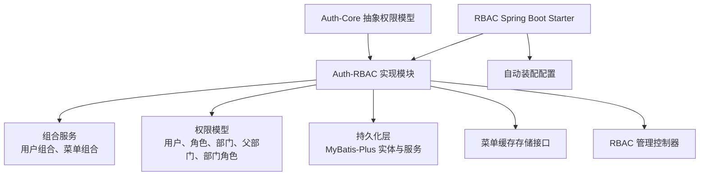

**图表来源**   
- [RbacAnnotationAuthHandler.java:1-27](file://auth/auth-rbac/src/main/java/com/cu/framework/auth/rbac/RbacAnnotationAuthHandler.java#L1-L27)
- [SysUserComposite.java:1-49](file://auth/auth-rbac/src/main/java/com/cu/framework/auth/rbac/composite/SysUserComposite.java#L1-L49)
- [SysAuthMenuComposite.java:1-63](file://auth/auth-rbac/src/main/java/com/cu/framework/auth/rbac/composite/SysAuthMenuComposite.java#L1-L63)
- [AuthMenuStore.java:1-23](file://auth/auth-rbac/src/main/java/com/cu/framework/auth/rbac/composite/AuthMenuStore.java#L1-L23)
- [AuthRbacConfig.java:1-75](file://auth/auth-rbac-spring-boot-starter/src/main/java/com/cu/framework/boot/auth/rbac/config/AuthRbacConfig.java#L1-L75)

**章节来源**   
- [RbacAnnotationAuthHandler.java:1-27](file://auth/auth-rbac/src/main/java/com/cu/framework/auth/rbac/RbacAnnotationAuthHandler.java#L1-L27)
- [AuthRbacScanConfig.java:1-24](file://auth/auth-rbac-spring-boot-starter/src/main/java/com/cu/framework/boot/auth/rbac/config/AuthRbacScanConfig.java#L1-L24)

## RBAC 模型总览

该模块采用经典 RBAC 三层关系，并叠加部门和部门-角色组合维度：

| 概念 | 含义 |
|---|---|
| 用户 | 系统使用者，拥有用户名、昵称、联系方式、头像等基础信息 |
| 角色 | 一组权限的集合，例如管理员、普通用户、审计员 |
| 部门 | 组织架构中的单位，支持父子层级 |
| 权限 | 用字符串表示的原子能力，如菜单按钮、操作标识 |
| 菜单 API | 后端请求路径及其元信息，用于接口级鉴权 |
| 菜单路由 | 前端路由或导航节点，可与菜单 API 关联 |
| 数据权限 | 按业务功能、数据 ID、操作类型、权限字符串划分的数据范围 |

用户到权限的关系不是直接绑定，而是通过角色、部门、部门角色组合间接获得。这样的好处是权限可以复用、可继承、可批量调整。

```mermaid
erDiagram
  SYS_USER ||--o{ SYS_USER_ROLE : "拥有"
  SYS_ROLE ||--o{ SYS_USER_ROLE : "授予"
  SYS_USER ||--o{ SYS_USER_DEPT : "归属"
  SYS_DEPT ||--o{ SYS_USER_DEPT : "包含"
  SYS_MENU_API ||--o{ SYS_AUTH_MENU : "关联"
  SYS_MENU_ROUTE ||o..o{ SYS_MENU_API : "引用"
```

**图表来源**   
- [auth-rbac.sql:1-148](file://docs/sql/auth-rbac.sql#L1-L148)

**章节来源**   
- [auth-rbac.sql:1-148](file://docs/sql/auth-rbac.sql#L1-L148)

## 数据库表结构设计

### 用户与凭证

| 表名 | 主要字段 | 说明 |
|---|---|---|
| `sys_user` | `id`、`name`、`nick_name`、`username`、`phone`、`email`、`avatar_file_id`、`gender`、`create_time`、`update_time` | 用户基本信息，用户名和手机号有唯一索引 |
| `sys_user_credential` | `id`、`user_id`、`password`、`remark`、`password_expired_time`、`account_locked_deadline`、`enabled`、`create_time`、`update_time` | 用户凭证，支持密码、锁定截止时间、启用状态 |
| `sys_user_role` | `id`、`user_id`、`role_id`、`create_time`、`update_time` | 用户-角色多对多关系 |
| `sys_user_dept` | `id`、`user_id`、`dept_id`、`is_primary`、`create_time`、`update_time` | 用户-部门多对多关系，支持主部门标记 |

用户与凭证是一对一逻辑；用户与角色、用户与部门是多对多关系。

### 角色与部门

| 表名 | 主要字段 | 说明 |
|---|---|---|
| `sys_role` | `id`、`name`、`create_time`、`update_time` | 角色定义 |
| `sys_dept` | `id`、`name`、`parent_id`、`create_time`、`update_time` | 部门树，根部门 `parent_id` 为 0 |

部门通过 `parent_id` 形成层级。代码中特别处理了脏数据自引用或成环的情况，避免无限遍历。

### 菜单、API、路由与权限

| 表名 | 主要字段 | 说明 |
|---|---|---|
| `sys_menu_api` | `id`、`path`、`name`、`parent_id`、`remark`、`auth_type`、`deleted`、时间戳 | 菜单 API，`auth_type` 决定基于自身权限还是父菜单权限 |
| `sys_auth_menu` | `id`、`api_id`、`authority`、`description`、时间戳 | 菜单 API 与权限字符串映射 |
| `sys_menu_route` | `id`、`name`、`parent_id`、`path`、`redirect`、`component`、`meta`、`icon`、`hidden`、`api_id`、`type`、`description`、`deleted`、时间戳 | 前端路由或导航节点，可关联 API |
| `sys_auth_data` | `id`、`business_function`、`data_id`、`operate`、`authority`、`description`、时间戳 | 数据权限，按业务功能、数据 ID、操作、权限字符串划分 |

`sys_menu_api` 的 `auth_type` 是接口权限判定的关键：

| 值 | 含义 |
|---|---|
| 1 | 基于自身权限 |
| 2 | 基于父菜单权限 |

### 视图

模块还定义了 `view_menu_api_auth`，用于快速查看已删除标记未删除且基于自身权限的菜单 API 与其权限字符串。

**章节来源**   
- [auth-rbac.sql:1-148](file://docs/sql/auth-rbac.sql#L1-L148)

## 核心组件与职责

### RbacAnnotationAuthHandler

注解权限处理器默认实现，负责将上层传入的用户扁平化权限集合与请求路径交给菜单组合服务判断。

| 方法 | 输入 | 输出 | 行为 |
|---|---|---|---|
| `hasMenuAccessAuth` | 用户扁平化权限集合、请求路径 | 布尔值 | 委托 `SysAuthMenuComposite.hasMenuAuth` |

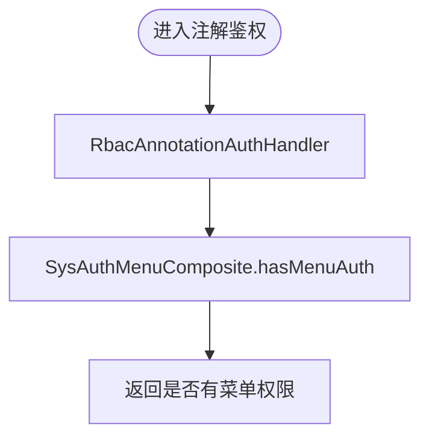

**图表来源**   
- [RbacAnnotationAuthHandler.java:1-27](file://auth/auth-rbac/src/main/java/com/cu/framework/auth/rbac/RbacAnnotationAuthHandler.java#L1-L27)
- [SysAuthMenuComposite.java:1-63](file://auth/auth-rbac/src/main/java/com/cu/framework/auth/rbac/composite/SysAuthMenuComposite.java#L1-L63)

**章节来源**   
- [RbacAnnotationAuthHandler.java:1-27](file://auth/auth-rbac/src/main/java/com/cu/framework/auth/rbac/RbacAnnotationAuthHandler.java#L1-L27)

### SysUserComposite 与实现

用户组合服务是权限装载入口之一，负责：

- 根据用户名加载用户和凭证。
- 根据用户 ID 查询用户、角色、部门、部门角色组合权限。
- 展开部门严格上级链。
- 更新用户密码。

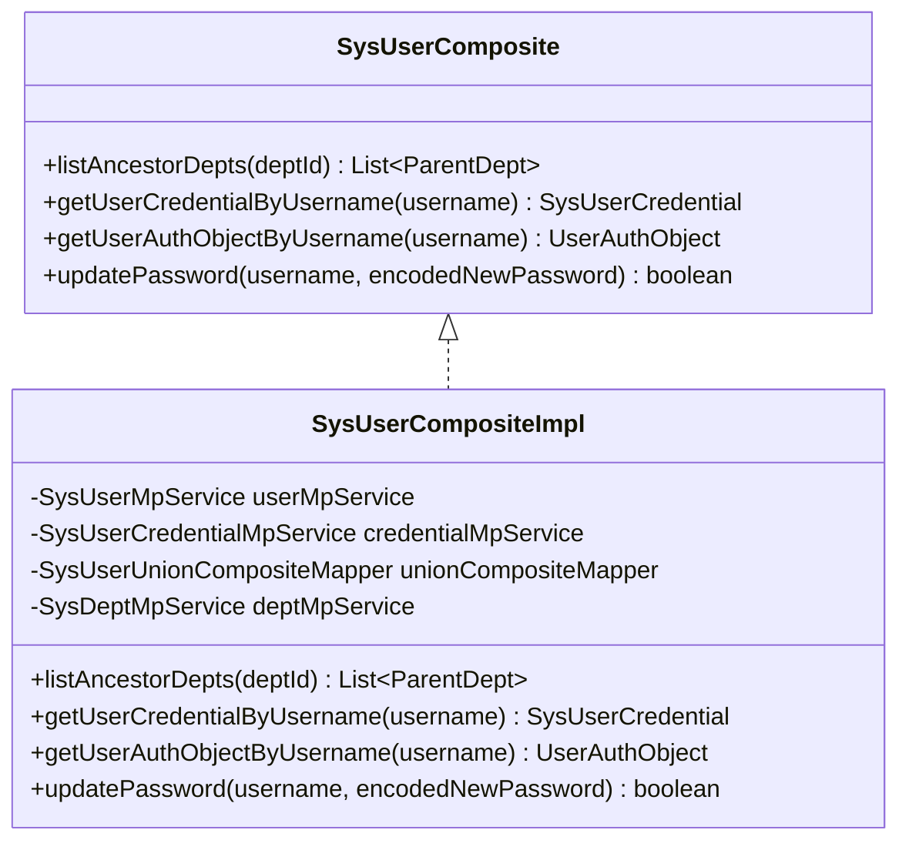

**图表来源**   
- [SysUserComposite.java:1-49](file://auth/auth-rbac/src/main/java/com/cu/framework/auth/rbac/composite/SysUserComposite.java#L1-L49)
- [SysUserCompositeImpl.java:1-152](file://auth/auth-rbac/src/main/java/com/cu/framework/auth/rbac/composite/impl/SysUserCompositeImpl.java#L1-L152)

**章节来源**   
- [SysUserComposite.java:1-49](file://auth/auth-rbac/src/main/java/com/cu/framework/auth/rbac/composite/SysUserComposite.java#L1-L49)
- [SysUserCompositeImpl.java:1-152](file://auth/auth-rbac/src/main/java/com/cu/framework/auth/rbac/composite/impl/SysUserCompositeImpl.java#L1-L152)

### SysAuthMenuComposite 与实现

菜单权限组合服务负责：

- 判断请求路径是否匹配用户权限。
- 构建 API 菜单树。
- 构建路由菜单树。
- 同步菜单 API 与其权限集合。
- 控制是否走菜单缓存。

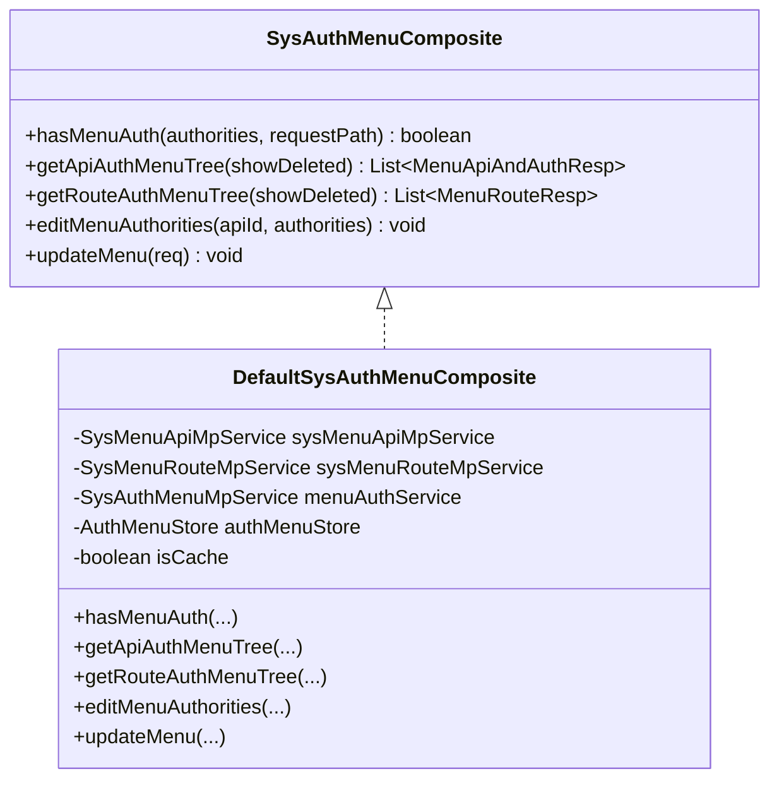

**图表来源**   
- [SysAuthMenuComposite.java:1-63](file://auth/auth-rbac/src/main/java/com/cu/framework/auth/rbac/composite/SysAuthMenuComposite.java#L1-L63)
- [DefaultSysAuthMenuComposite.java:1-269](file://auth/auth-rbac/src/main/java/com/cu/framework/auth/rbac/composite/impl/DefaultSysAuthMenuComposite.java#L1-L269)

**章节来源**   
- [SysAuthMenuComposite.java:1-63](file://auth/auth-rbac/src/main/java/com/cu/framework/auth/rbac/composite/SysAuthMenuComposite.java#L1-L63)
- [DefaultSysAuthMenuComposite.java:1-269](file://auth/auth-rbac/src/main/java/com/cu/framework/auth/rbac/composite/impl/DefaultSysAuthMenuComposite.java#L1-L269)

### 菜单缓存存储

`AuthMenuStore` 是菜单数据缓存抽象，默认实现使用 Guava Cache，写入后 10 分钟过期。

| 方法 | 作用 |
|---|---|
| `getApiMenus` | 获取菜单 API 列表，优先读缓存 |
| `getRouteMenus` | 获取菜单路由列表，优先读缓存 |
| `getAuthMenus` | 获取菜单权限列表，优先读缓存 |

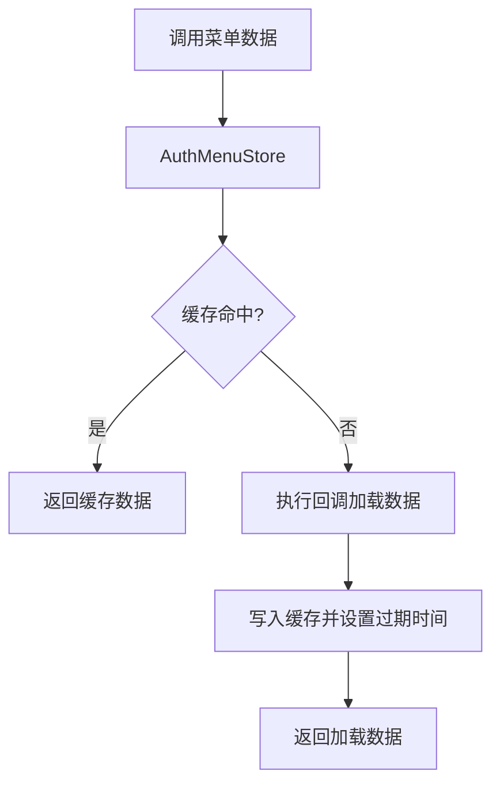

**图表来源**   
- [AuthMenuStore.java:1-23](file://auth/auth-rbac/src/main/java/com/cu/framework/auth/rbac/composite/AuthMenuStore.java#L1-L23)
- [MemoryExpiredAuthMenuStore.java:1-69](file://auth/auth-rbac/src/main/java/com/cu/framework/auth/rbac/composite/impl/MemoryExpiredAuthMenuStore.java#L1-L69)

**章节来源**   
- [AuthMenuStore.java:1-23](file://auth/auth-rbac/src/main/java/com/cu/framework/auth/rbac/composite/AuthMenuStore.java#L1-L23)
- [MemoryExpiredAuthMenuStore.java:1-69](file://auth/auth-rbac/src/main/java/com/cu/framework/auth/rbac/composite/impl/MemoryExpiredAuthMenuStore.java#L1-L69)

## 用户-角色-部门-权限装配流程

用户权限装配发生在 `SysUserCompositeImpl.getUserAuthObjectByUsername` 中，整体流程如下：

1. 根据用户名查找用户。
2. 若用户不存在，返回空权限对象。
3. 查找用户凭证，可能为空。
4. 通过联合查询 Mapper 获取用户的角色、部门、部门角色组合。
5. 将结果填充到 `UserAuthInfo`。
6. `UserAuthInfo.fillUserAuth` 展开部门上级链，并生成部门角色组合权限。
7. 最终 `listBaseAuth()` 汇总所有权限字符串。

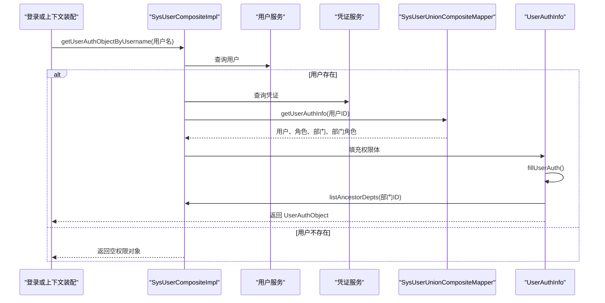

**图表来源**   
- [SysUserCompositeImpl.java:1-152](file://auth/auth-rbac/src/main/java/com/cu/framework/auth/rbac/composite/impl/SysUserCompositeImpl.java#L1-L152)
- [SysUserUnionCompositeMapper.java:1-21](file://auth/auth-rbac/src/main/java/com/cu/framework/auth/rbac/composite/mapper/SysUserUnionCompositeMapper.java#L1-L21)
- [SysUserUnionCompositeMapper.xml:1-33](file://auth/auth-rbac/src/main/resources/mapper/SysUserUnionCompositeMapper.xml#L1-L33)
- [UserAuthInfo.java:1-163](file://auth/auth-rbac/src/main/java/com/cu/framework/auth/rbac/composite/model/UserAuthInfo.java#L1-L163)

**章节来源**   
- [SysUserCompositeImpl.java:1-152](file://auth/auth-rbac/src/main/java/com/cu/framework/auth/rbac/composite/impl/SysUserCompositeImpl.java#L1-L152)
- [SysUserUnionCompositeMapper.xml:1-33](file://auth/auth-rbac/src/main/resources/mapper/SysUserUnionCompositeMapper.xml#L1-L33)
- [UserAuthInfo.java:1-163](file://auth/auth-rbac/src/main/java/com/cu/framework/auth/rbac/composite/model/UserAuthInfo.java#L1-L163)

## 菜单与接口权限判定流程

当请求进入系统时，注解鉴权处理器会调用菜单组合服务判断请求路径是否匹配用户权限。

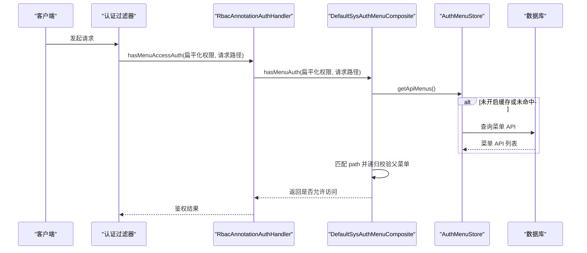

**图表来源**   
- [RbacAnnotationAuthHandler.java:1-27](file://auth/auth-rbac/src/main/java/com/cu/framework/auth/rbac/RbacAnnotationAuthHandler.java#L1-L27)
- [DefaultSysAuthMenuComposite.java:1-269](file://auth/auth-rbac/src/main/java/com/cu/framework/auth/rbac/composite/impl/DefaultSysAuthMenuComposite.java#L1-L269)
- [MemoryExpiredAuthMenuStore.java:1-69](file://auth/auth-rbac/src/main/java/com/cu/framework/auth/rbac/composite/impl/MemoryExpiredAuthMenuStore.java#L1-L69)

### 权限匹配规则

菜单权限判定分两种情况：

| 菜单权限类型 | 判定逻辑 |
|---|---|
| 基于自身权限 | 检查当前 API 的权限字符串是否在用户扁平化权限集合中 |
| 基于父菜单权限 | 向上查找父菜单，继续递归判定，直到根菜单仍未找到则拒绝 |
| 未知类型 | 抛出业务异常 |

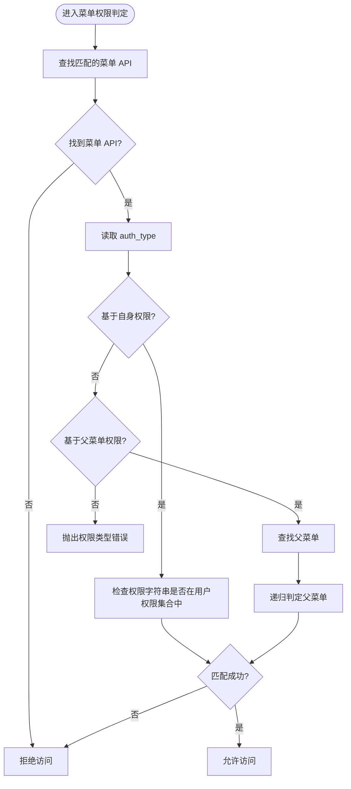

**图表来源**   
- [DefaultSysAuthMenuComposite.java:1-269](file://auth/auth-rbac/src/main/java/com/cu/framework/auth/rbac/composite/impl/DefaultSysAuthMenuComposite.java#L1-L269)

**章节来源**   
- [DefaultSysAuthMenuComposite.java:1-269](file://auth/auth-rbac/src/main/java/com/cu/framework/auth/rbac/composite/impl/DefaultSysAuthMenuComposite.java#L1-L269)

## 部门级权限继承机制

部门权限继承是该模块的重要特性。权限来源包括：

1. 用户自身权限。
2. 角色权限。
3. 部门自身权限。
4. 部门上级链权限。
5. 部门与角色组合权限。

其中，`DeptWithParents` 表示一个部门及其权限，`ParentDept` 表示该部门的严格上级部门，`DeptRole` 表示某个部门与某个角色的组合权限。

### 严格上级链

`SysUserCompositeImpl.listAncestorDepts` 从当前部门向上追溯 `parent_id`，构造“根在前、直接上级在后”的严格上级链，且不包含本部门。

关键点：

- 如果部门 ID 为空或查不到部门，返回空集合。
- 使用 `visited` 集合防止脏数据导致的自引用或循环。
- 遇到 `parent_id` 为 0 或 null 时停止。
- 每个上级记录携带层级距离，但层级不参与权限判定。

### 权限合并

`UserAuthInfo.fillUserAuth` 会为每个部门：

- 清空已有上级链。
- 生成该部门与所有角色的 `DeptRole` 组合。
- 调用 `SysUserComposite.listAncestorDepts` 展开上级链。
- 将上级链追加到部门的 `parents` 中。

`UserAuthInfo.listBaseAuth` 会把用户、角色、部门、部门上级链、部门角色组合的所有权限字符串放入去重集合。

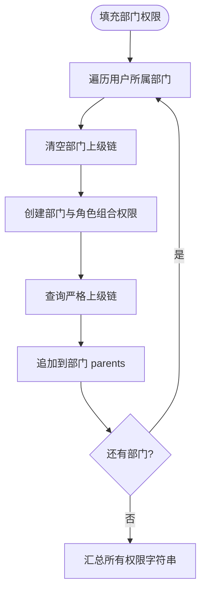

**图表来源**   
- [SysUserCompositeImpl.java:1-152](file://auth/auth-rbac/src/main/java/com/cu/framework/auth/rbac/composite/impl/SysUserCompositeImpl.java#L1-L152)
- [UserAuthInfo.java:1-163](file://auth/auth-rbac/src/main/java/com/cu/framework/auth/rbac/composite/model/UserAuthInfo.java#L1-L163)
- [DeptWithParents.java:1-31](file://auth/auth-rbac/src/main/java/com/cu/framework/auth/rbac/composite/model/DeptWithParents.java#L1-L31)
- [ParentDept.java:1-48](file://auth/auth-rbac/src/main/java/com/cu/framework/auth/rbac/composite/model/ParentDept.java#L1-L48)
- [DeptRole.java:1-69](file://auth/auth-rbac/src/main/java/com/cu/framework/auth/rbac/composite/model/DeptRole.java#L1-L69)

**章节来源**   
- [SysUserCompositeImpl.java:1-152](file://auth/auth-rbac/src/main/java/com/cu/framework/auth/rbac/composite/impl/SysUserCompositeImpl.java#L1-L152)
- [UserAuthInfo.java:1-163](file://auth/auth-rbac/src/main/java/com/cu/framework/auth/rbac/composite/model/UserAuthInfo.java#L1-L163)
- [DeptWithParents.java:1-31](file://auth/auth-rbac/src/main/java/com/cu/framework/auth/rbac/composite/model/DeptWithParents.java#L1-L31)
- [ParentDept.java:1-48](file://auth/auth-rbac/src/main/java/com/cu/framework/auth/rbac/composite/model/ParentDept.java#L1-L48)
- [DeptRole.java:1-69](file://auth/auth-rbac/src/main/java/com/cu/framework/auth/rbac/composite/model/DeptRole.java#L1-L69)

## 权限缓存策略与性能优化

### 菜单缓存开关

`DefaultSysAuthMenuComposite` 通过配置项 `cu.auth.cache-auth` 控制是否启用菜单缓存，默认关闭。

| 配置值 | 行为 |
|---|---|
| `false` | 每次直接查询数据库 |
| `true` | 通过 `AuthMenuStore` 读取或加载菜单数据 |

### 默认内存缓存

默认实现 `MemoryExpiredAuthMenuStore` 使用 Guava `CacheBuilder`，写入后 10 分钟过期。缓存键分别对应：

- `getApiMenus`
- `getRouteMenus`
- `getAuthMenus`

### 性能建议

| 场景 | 建议 |
|---|---|
| 单机部署 | 可开启内存缓存，减少重复菜单查询 |
| 多实例部署 | 需要替换 `AuthMenuStore` 为分布式缓存，如 Redis |
| 菜单频繁变更 | 缩短缓存过期时间或主动失效 |
| 高并发只读场景 | 开启缓存并预热菜单数据 |
| 大数据量菜单 | 考虑分页加载或按租户隔离缓存 |

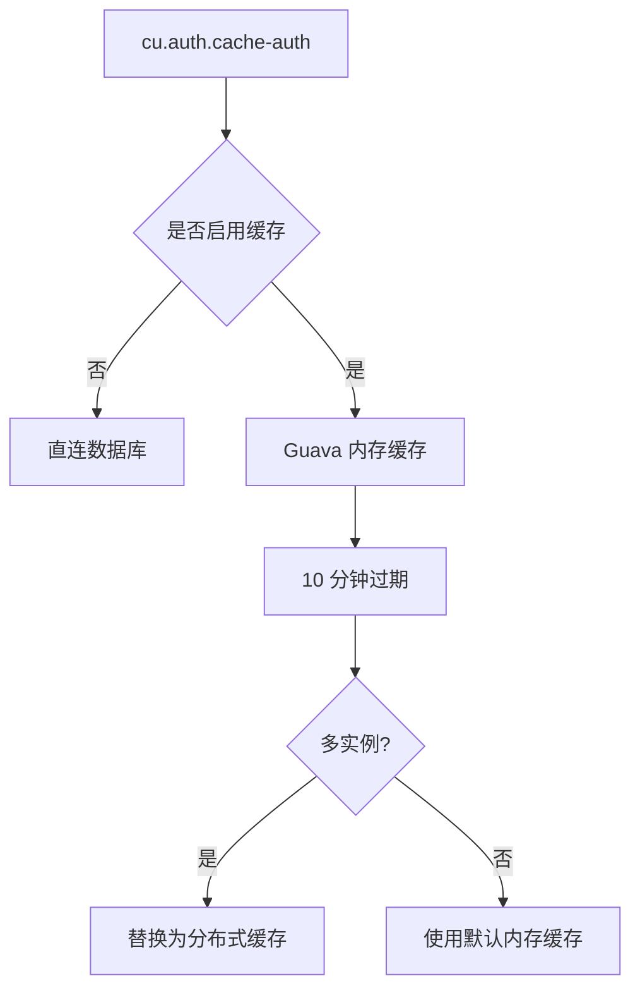

**图表来源**   
- [DefaultSysAuthMenuComposite.java:1-269](file://auth/auth-rbac/src/main/java/com/cu/framework/auth/rbac/composite/impl/DefaultSysAuthMenuComposite.java#L1-L269)
- [MemoryExpiredAuthMenuStore.java:1-69](file://auth/auth-rbac/src/main/java/com/cu/framework/auth/rbac/composite/impl/MemoryExpiredAuthMenuStore.java#L1-L69)

**章节来源**   
- [DefaultSysAuthMenuComposite.java:1-269](file://auth/auth-rbac/src/main/java/com/cu/framework/auth/rbac/composite/impl/DefaultSysAuthMenuComposite.java#L1-L269)
- [MemoryExpiredAuthMenuStore.java:1-69](file://auth/auth-rbac/src/main/java/com/cu/framework/auth/rbac/composite/impl/MemoryExpiredAuthMenuStore.java#L1-L69)

## 扩展点与自定义规则

### 自定义菜单缓存实现

如果需要 Redis、本地多级缓存或带预热的缓存策略，可以实现 `AuthMenuStore`：

| 方法 | 自定义重点 |
|---|---|
| `getApiMenus` | 先查缓存，未命中再执行 `callable` 并写回 |
| `getRouteMenus` | 同上 |
| `getAuthMenus` | 同上 |

推荐做法：

- 使用租户或应用前缀隔离缓存键。
- 为菜单变更事件提供显式失效接口。
- 对超大菜单集做分段缓存或懒加载。

### 自定义用户权限装配

`UserAuthInfo` 提供了两个扩展点：

| 扩展点 | 用途 |
|---|---|
| `addAnotherBashAuth` | 在汇总基础权限时追加额外权限字符串 |
| `setAnotherBaseAuth` | 在解析联合查询结果时处理自定义权限实体 |

如需新增权限维度，例如企业、项目、资源组，可以：

1. 新增权限实体类。
2. 扩展 `UserAuthInfo.setBaseAuth` 的识别逻辑。
3. 在 `listBaseAuth` 中汇总新实体的权限字符串。
4. 在联合查询 Mapper 中补充数据源。

### 自定义菜单更新列

`DefaultSysAuthMenuComposite.UPDATABLE_COLUMNS` 白名单控制了可通过菜单更新接口修改的字段。请求路径不在白名单内，因此不会通过更新接口篡改 URL。

### 自定义当前用户服务

`RbacCurrentUserService` 封装了当前用户密码校验与更新逻辑，依赖 `PasswordEncoder` 和 `SysUserComposite`。业务系统可在此基础上增加二次验证、验证码校验、审计日志等。

**章节来源**   
- [AuthMenuStore.java:1-23](file://auth/auth-rbac/src/main/java/com/cu/framework/auth/rbac/composite/AuthMenuStore.java#L1-L23)
- [UserAuthInfo.java:1-163](file://auth/auth-rbac/src/main/java/com/cu/framework/auth/rbac/composite/model/UserAuthInfo.java#L1-L163)
- [DefaultSysAuthMenuComposite.java:1-269](file://auth/auth-rbac/src/main/java/com/cu/framework/auth/rbac/composite/impl/DefaultSysAuthMenuComposite.java#L1-L269)
- [RbacCurrentUserService.java:1-42](file://auth/auth-rbac/src/main/java/com/cu/framework/auth/rbac/extension/RbacCurrentUserService.java#L1-L42)

## 配置、启动与部署指南

### 引入依赖

引入 RBAC Spring Boot Starter 后，框架会自动扫描：

- `com.cu.framework.auth.rbac.**.mapper`
- `com.cu.framework.auth.rbac.mp.service.impl`
- `com.cu.framework.auth.rbac.composite`
- `com.cu.framework.auth.rbac.controller`

### 自动装配内容

`AuthRbacConfig` 在缺少自定义 Bean 时注册：

| Bean | 作用 |
|---|---|
| `RbacAnnotationAuthHandler` | 注解权限处理器 |
| `AuthDataAdaptor` | 数据权限适配适配器 |
| `RbacCurrentUserService` | 当前用户密码管理服务 |
| `RbacMenuApiService` | 菜单 API 服务 |
| `AuthMenuStore` | 菜单缓存存储，默认内存实现 |

### 必要配置文件

| 配置项 | 默认值 | 说明 |
|---|---|---|
| `cu.auth.cache-auth` | `false` | 是否缓存菜单与权限数据 |
| 数据库连接 | 无 | 需配置 MySQL 或兼容 H2 的数据库连接 |

### 初始化脚本

首次部署应执行 `docs/sql/auth-rbac.sql`，该脚本会：

- 删除旧视图和表。
- 创建用户、凭证、用户角色、用户部门、角色、部门、菜单 API、菜单权限、菜单路由、数据权限表。
- 创建便于查看菜单 API 权限的视图。

### 示例工程

仓库中包含 RBAC 示例工程 `sample/auth-rbac-boot-sample`，其 SQL 脚本位于 `sample/sample/auth-rbac-boot-sample/sql`，可用于验证 RBAC 基本能力和权限矩阵演示。

**章节来源**   
- [AuthRbacConfig.java:1-75](file://auth/auth-rbac-spring-boot-starter/src/main/java/com/cu/framework/boot/auth/rbac/config/AuthRbacConfig.java#L1-L75)
- [AuthRbacScanConfig.java:1-24](file://auth/auth-rbac-spring-boot-starter/src/main/java/com/cu/framework/boot/auth/rbac/config/AuthRbacScanConfig.java#L1-L24)
- [auth-rbac.sql:1-148](file://docs/sql/auth-rbac.sql#L1-L148)

## 与其他模块的集成方式

### 与 Auth-Core 的集成

RBAC 模块依赖 auth-core 提供的抽象权限模型，包括：

- 扁平化权限集合。
- 权限实体标记接口。
- 抽象权限对象基类。
- 菜单处理器接口。

RBAC 通过 `RbacAnnotationAuthHandler` 实现菜单处理器，使 auth-core 能统一调用不同实现。

### 与登录模块的集成

RBAC 通过 `SysUserComposite` 提供用户凭证查询和用户权限对象加载，登录模块可在认证成功后注入用户权限上下文。`RbacCurrentUserService` 进一步封装密码校验与更新。

### 与数据权限的集成

`sys_auth_data` 表承载数据权限，配合 auth-core 的数据操作扩展点，可以在业务查询中注入数据范围过滤条件。RBAC 模块本身不直接实现数据范围拼装，但通过权限字符串与业务功能、操作类型的组合，为数据权限提供基础标识。

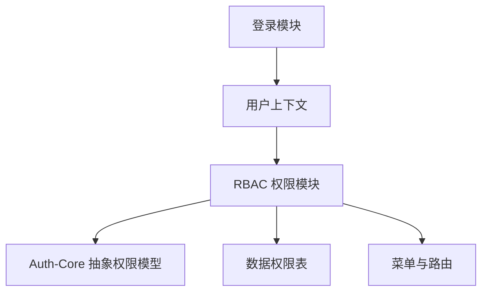

**图表来源**   
- [RbacAnnotationAuthHandler.java:1-27](file://auth/auth-rbac/src/main/java/com/cu/framework/auth/rbac/RbacAnnotationAuthHandler.java#L1-L27)
- [RbacCurrentUserService.java:1-42](file://auth/auth-rbac/src/main/java/com/cu/framework/auth/rbac/extension/RbacCurrentUserService.java#L1-L42)
- [auth-rbac.sql:1-148](file://docs/sql/auth-rbac.sql#L1-L148)

**章节来源**   
- [RbacAnnotationAuthHandler.java:1-27](file://auth/auth-rbac/src/main/java/com/cu/framework/auth/rbac/RbacAnnotationAuthHandler.java#L1-L27)
- [RbacCurrentUserService.java:1-42](file://auth/auth-rbac/src/main/java/com/cu/framework/auth/rbac/extension/RbacCurrentUserService.java#L1-L42)
- [auth-rbac.sql:1-148](file://docs/sql/auth-rbac.sql#L1-L148)

## 最佳实践与常见陷阱

### 权限设计最佳实践

| 主题 | 建议 |
|---|---|
| 权限粒度 | 以最小可用权限为原则，避免过大权限串 |
| 角色命名 | 使用语义清晰的名称，如“订单管理员”“财务审核员” |
| 部门权限 | 仅给部门分配必要的权限，避免全量继承 |
| 菜单权限 | 明确 `auth_type`，尽量让叶子 API 使用“基于自身权限” |
| 数据权限 | 结合业务功能和操作类型，不要只用权限字符串表达复杂范围 |
| 缓存策略 | 生产环境开启菜单缓存，并为菜单变更提供失效方案 |
| 审计追踪 | 对角色分配、部门调整、菜单权限变更记录日志 |

### 常见陷阱

| 问题 | 原因 | 处理方式 |
|---|---|---|
| 多部门用户权限查询报错 | 联合查询没有正确聚合用户权限体 | 确保使用 `userId` 作为父行鉴别列 |
| 部门遍历死循环 | 脏数据导致 `parent_id` 自引用或成环 | 使用 `visited` 集合限制遍历步数 |
| OWNER 菜单未配置权限 | 基于自身权限但未给任何权限，等于无人可访问 | 编辑菜单时必须配置权限集合 |
| 多实例缓存不一致 | 默认内存缓存无法跨进程共享 | 替换为分布式缓存并统一失效策略 |
| 父菜单权限丢失 | 父菜单未配置权限或路径变更 | 检查 `auth_type=2` 的菜单链和父菜单权限 |
| 权限字符串格式错误 | 自定义权限实体序列化位置不正确 | 遵循 `flag` 和 `serialize/deSerialize` 规范 |

**章节来源**   
- [SysUserCompositeImpl.java:1-152](file://auth/auth-rbac/src/main/java/com/cu/framework/auth/rbac/composite/impl/SysUserCompositeImpl.java#L1-L152)
- [SysUserUnionCompositeMapper.xml:1-33](file://auth/auth-rbac/src/main/resources/mapper/SysUserUnionCompositeMapper.xml#L1-L33)
- [RbacMenuApiController.java:1-73](file://auth/auth-rbac/src/main/java/com/cu/framework/auth/rbac/controller/RbacMenuApiController.java#L1-L73)
- [DeptRole.java:1-69](file://auth/auth-rbac/src/main/java/com/cu/framework/auth/rbac/composite/model/DeptRole.java#L1-L69)

## 故障排查指南

### 用户权限为空

现象：登录后用户没有任何菜单或权限。

排查步骤：

1. 确认用户是否存在于 `sys_user`。
2. 确认用户是否分配了角色或部门。
3. 检查 `sys_user_role` 和 `sys_user_dept` 是否有关联记录。
4. 检查 `UserAuthInfo.listBaseAuth()` 是否能汇总出权限字符串。
5. 如果是多部门用户，检查联合查询是否因缺少鉴别列导致拆分失败。

### 接口被拒绝

现象：菜单树能看到，但实际访问被拒绝。

排查步骤：

1. 确认请求路径是否与 `sys_menu_api.path` 一致。
2. 确认菜单 `auth_type` 是“基于自身权限”还是“基于父菜单权限”。
3. 如果是父菜单权限，检查父链是否完整。
4. 检查用户扁平化权限集合是否包含菜单权限字符串。
5. 如启用缓存，检查缓存是否过期或是否需要刷新。

### 菜单更新后权限未生效

现象：更新了菜单 API 或权限集合，但鉴权结果仍为旧值。

排查步骤：

1. 如果使用内存缓存，等待 10 分钟或重启服务。
2. 生产环境应实现可失效的 `AuthMenuStore`。
3. 检查 `updateMenu` 是否成功调用了权限同步逻辑。
4. 检查 OWNER 类型菜单是否被误配为无权限。

### 部门遍历异常

现象：系统启动或权限装载时报错或卡住。

排查步骤：

1. 检查 `sys_dept.parent_id` 是否存在自引用或环。
2. 确认 `SysUserCompositeImpl.listAncestorDepts` 的 `visited` 逻辑仍能终止。
3. 修复脏数据后重新加载权限。

**章节来源**   
- [SysUserCompositeImpl.java:1-152](file://auth/auth-rbac/src/main/java/com/cu/framework/auth/rbac/composite/impl/SysUserCompositeImpl.java#L1-L152)
- [DefaultSysAuthMenuComposite.java:1-269](file://auth/auth-rbac/src/main/java/com/cu/framework/auth/rbac/composite/impl/DefaultSysAuthMenuComposite.java#L1-L269)
- [MemoryExpiredAuthMenuStore.java:1-69](file://auth/auth-rbac/src/main/java/com/cu/framework/auth/rbac/composite/impl/MemoryExpiredAuthMenuStore.java#L1-L69)
- [SysUserUnionCompositeMapper.xml:1-33](file://auth/auth-rbac/src/main/resources/mapper/SysUserUnionCompositeMapper.xml#L1-L33)

## 结论

Auth-RBAC 模块在 auth-core 抽象权限模型之上，实现了完整的 RBAC 落地能力。它以用户、角色、部门为基础，通过组合权限、部门继承、菜单权限、数据权限共同构成可演进的权限体系。

在实际工程中，建议优先保证数据质量，尤其是部门层级和用户-角色-部门关联；其次明确菜单权限类型；最后再考虑缓存优化和扩展定制。对于多实例、高频变更、复杂组织结构的系统，应尽早规划分布式缓存、权限变更事件和权限审计方案。