# Login Starter 认证模块

<cite>
**本文引用的文件 **
- [README.md](file://boot/login-security-spring-boot-starter/README.md)
- [SecurityConfig.java](file://boot/login-security-spring-boot-starter/src/main/java/com/cu/framework/authentication/config/SecurityConfig.java)
- [SessionConfig.java](file://boot/login-security-spring-boot-starter/src/main/java/com/cu/framework/authentication/config/SessionConfig.java)
- [SecurityUserDetailsService.java](file://boot/login-security-spring-boot-starter/src/main/java/com/cu/framework/authentication/service/SecurityUserDetailsService.java)
- [JsonLoginFilter.java](file://boot/login-security-spring-boot-starter/src/main/java/com/cu/framework/authentication/password/filter/JsonLoginFilter.java)
- [PasswordSecurityConfig.java](file://boot/login-security-spring-boot-starter/src/main/java/com/cu/framework/authentication/password/config/PasswordSecurityConfig.java)
- [JsonLoginAuthenticationFilterConfigurer.java](file://boot/login-security-spring-boot-starter/src/main/java/com/cu/framework/authentication/password/config/JsonLoginAuthenticationFilterConfigurer.java)
- [Oauth2Config.java](file://boot/login-security-spring-boot-starter/src/main/java/com/cu/framework/authentication/oauth2/Oauth2Config.java)
- [Oauth2SecurityUser.java](file://boot/login-security-spring-boot-starter/src/main/java/com/cu/framework/authentication/oauth2/Oauth2SecurityUser.java)
- [SamlConfig.java](file://boot/login-security-spring-boot-starter/src/main/java/com/cu/framework/authentication/saml/SamlConfig.java)
- [SamlSecurityUser.java](file://boot/login-security-spring-boot-starter/src/main/java/com/cu/framework/authentication/saml/SamlSecurityUser.java)
- [LoginDeliveryResolver.java](file://boot/login-security-spring-boot-starter/src/main/java/com/cu/framework/authentication/response/LoginDeliveryResolver.java)
- [SecurityAuthenticationSuccessHandler.java](file://boot/login-security-spring-boot-starter/src/main/java/com/cu/framework/authentication/response/SecurityAuthenticationSuccessHandler.java)
- [SecurityAuthenticationExceptionResolverHandler.java](file://boot/login-security-spring-boot-starter/src/main/java/com/cu/framework/authentication/response/SecurityAuthenticationExceptionResolverHandler.java)
- [AuthenticationExceptionAdviceHandler.java](file://boot/login-security-spring-boot-starter/src/main/java/com/cu/framework/authentication/handler/AuthenticationExceptionAdviceHandler.java)
- [SecurityResponseBodyResultResolver.java](file://boot/login-security-spring-boot-starter/src/main/java/com/cu/framework/authentication/handler/SecurityResponseBodyResultResolver.java)
- [HeaderCookieHttpSessionIdResolver.java](file://boot/login-security-spring-boot-starter/src/main/java/com/cu/framework/authentication/extension/HeaderCookieHttpSessionIdResolver.java)
- [SessionProperties.java](file://boot/login-security-spring-boot-starter/src/main/java/com/cu/framework/authentication/properties/SessionProperties.java)
- [SecurityUser.java](file://boot/login-security-spring-boot-starter/src/main/java/com/cu/framework/authentication/model/SecurityUser.java)
- [LoginOptionsEndpoint.java](file://boot/login-security-spring-boot-starter/src/main/java/com/cu/framework/authentication/loginpage/LoginOptionsEndpoint.java)
- [LoginOptionsFactory.java](file://boot/login-security-spring-boot-starter/src/main/java/com/cu/framework/authentication/loginpage/LoginOptionsFactory.java)
- [Oauth2ConfiguredCondition.java](file://boot/login-security-spring-boot-starter/src/main/java/com/cu/framework/authentication/config/Oauth2ConfiguredCondition.java)
- [SamlConfiguredCondition.java](file://boot/login-security-spring-boot-starter/src/main/java/com/cu/framework/authentication/config/SamlConfiguredCondition.java)
- [SsoSecurityUserConverter.java](file://boot/login-security-spring-boot-starter/src/main/java/com/cu/framework/authentication/oauth2/SsoSecurityUserConverter.java)
- [SecurityUserSamlAuthenticationConverter.java](file://boot/login-security-spring-boot-starter/src/main/java/com/cu/framework/authentication/saml/SecurityUserSamlAuthenticationConverter.java)
</cite>

## 目录
1. [引言](#引言)
2. [项目结构](#项目结构)
3. [核心组件](#核心组件)
4. [架构总览](#架构总览)
5. [详细组件分析](#详细组件分析)
6. [依赖关系分析](#依赖关系分析)
7. [性能与扩展性](#性能与扩展性)
8. [配置与集成指南](#配置与集成指南)
9. [会话管理与并发控制](#会话管理与并发控制)
10. [故障排除与安全建议](#故障排除与安全建议)
11. [结论](#结论)

## 引言
Login Starter 是一个基于 Spring Security 的统一认证启动器，在同一套过滤器链上并列支持三类登录方式：账号密码登录、OAuth2/OIDC 单点登录、SAML2 单点登录。其核心设计目标是让不同协议的用户信息最终统一为本框架的 `SecurityUser`，并通过共享的成功处理器、失败处理器、异常解析器和响应格式化机制对外输出一致的 JSON 契约；当配置了单点登录结果回跳地址时，又可以把浏览器整页重定向到前端页面，仅携带成功或失败状态标记。

该模块同时提供：
- 统一的认证主体抽象和协议子类型；
- 可插拔的 HttpSecurity 自定义器，便于扩展其他协议；
- 基于 Spring Session 的会话存储、头部优先的会话标识解析；
- 最大会话数控制与防并发登录策略；
- 与权限系统协作所需的用户详情服务接口；
- 登录方式发现端点 `/api/login/options`，供前端动态渲染登录入口。

**重要变更说明**：本模块已重命名为 `login-security-spring-boot-starter` 并迁移至 `boot/` 目录。OAuth2 和 SAML2 登录功能改为可选装配，仅在配置了客户端或注册信息时才生效。登录成功时会清除 `SecurityUser` 中的密码字段，避免哈希值持久化到会话中。此外，remember-me 功能当前未接线，OIDC RP-Initiated Logout 也未接入过滤器链，这些限制已在文档中标注。

**章节来源**
- [README.md:1-10](file://boot/login-security-spring-boot-starter/README.md#L1-L10)

## 项目结构
login-security-spring-boot-starter 以 Spring Boot Starter 形式暴露 Bean 和配置类，核心代码位于 `com.cu.framework.authentication` 包下，按职责划分为以下层次：

| 层次 | 主要职责 | 典型类 |
|---|---|---|
| 配置层 | 注册全局安全配置、协议配置、会话配置 | `SecurityConfig`、`PasswordSecurityConfig`、`Oauth2Config`、`SamlConfig`、`SessionConfig` |
| 过滤层 | 拦截请求、解析凭证、委托认证管理器 | `JsonLoginFilter`、Spring Security 内置 OAuth2/SAML2 过滤器 |
| 主体层 | 定义统一用户模型和协议子类型 | `SecurityUser`、`Oauth2SecurityUser`、`SamlSecurityUser` |
| 服务层 | 加载本地用户并对接权限数据 | `SecurityUserDetailsService` |
| 响应层 | 认证成功处理、失败处理、交付姿态判定、结果投影 | `SecurityAuthenticationSuccessHandler`、`LoginDeliveryResolver`、`LoginSuccessResult` |
| 异常层 | 将安全异常转为统一 Result JSON | `SecurityAuthenticationExceptionResolverHandler`、`AuthenticationExceptionAdviceHandler` |
| 会话层 | Header/Cookie 双模式会话 ID、Remember Me、事件增强 | `HeaderCookieHttpSessionIdResolver`、`SessionConfig` |
| 登录发现层 | 提供登录方式清单端点 | `LoginOptionsEndpoint`、`LoginOptionsFactory` |

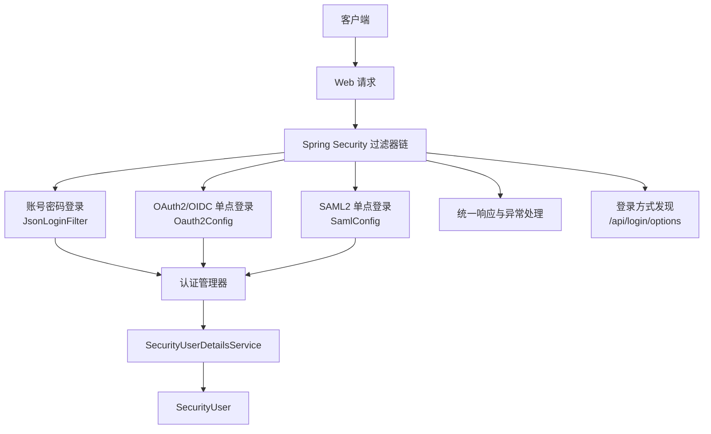

**图表来源**
- [SecurityConfig.java:56-140](file://boot/login-security-spring-boot-starter/src/main/java/com/cu/framework/authentication/config/SecurityConfig.java#L56-L140)
- [PasswordSecurityConfig.java:29-53](file://boot/login-security-spring-boot-starter/src/main/java/com/cu/framework/authentication/password/config/PasswordSecurityConfig.java#L29-L53)
- [Oauth2Config.java:65-199](file://boot/login-security-spring-boot-starter/src/main/java/com/cu/framework/authentication/oauth2/Oauth2Config.java#L65-L199)
- [SamlConfig.java:75-138](file://boot/login-security-spring-boot-starter/src/main/java/com/cu/framework/authentication/saml/SamlConfig.java#L75-L138)
- [LoginOptionsEndpoint.java:1-35](file://boot/login-security-spring-boot-starter/src/main/java/com/cu/framework/authentication/loginpage/LoginOptionsEndpoint.java#L1-L35)

**章节来源**
- [README.md:11-40](file://boot/login-security-spring-boot-starter/README.md#L11-L40)

## 核心组件
### 统一认证主体：SecurityUser
`SecurityUser` 实现了 Spring Security 的 `UserDetails` 和本框架的 `AuthenticatedPrincipal`，承载用户名、昵称、邮箱、头像、性别、权限集合、登录时间、密码过期时间、账号锁定截止时间等字段。它还提供账号是否启用、是否锁定、凭证是否过期的判断逻辑，其中"未到期"定义为字段为空或晚于当前时间。

关键点：
- 它是三种登录方式的最终主体类型；
- 单点登录会创建其子类 `Oauth2SecurityUser` 或 `SamlSecurityUser`，保留身份源原始声明；
- 权限数据来自本系统的 `SecurityUserDetailsService`，不直接使用身份源返回的角色或 SCOPE；
- **重要安全改进**：在单点登录场景中，通过 `BeanUtils.copyProperties` 复制本地用户信息后，密码字段会被显式清除（设置为 null），避免密码哈希值被序列化到会话存储中，降低安全风险。

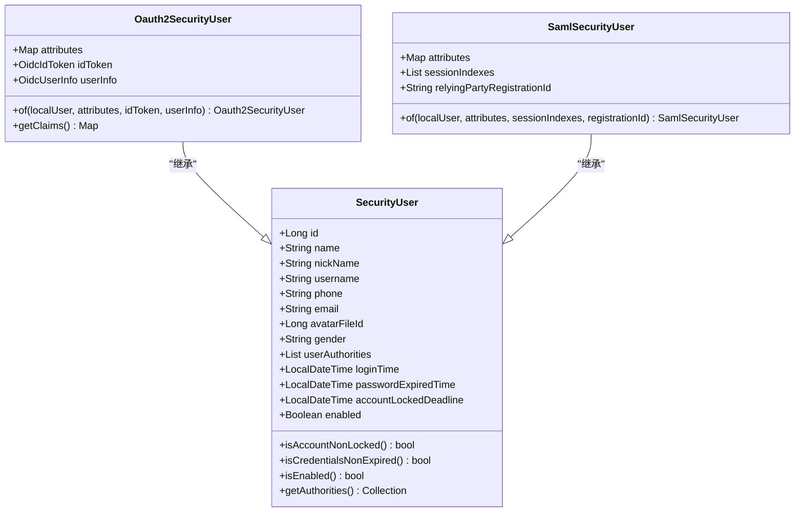

**图表来源**
- [SecurityUser.java:1-161](file://boot/login-security-spring-boot-starter/src/main/java/com/cu/framework/authentication/model/SecurityUser.java#L1-L161)
- [Oauth2SecurityUser.java:1-81](file://boot/login-security-spring-boot-starter/src/main/java/com/cu/framework/authentication/oauth2/Oauth2SecurityUser.java#L1-L81)
- [SamlSecurityUser.java:1-72](file://boot/login-security-spring-boot-starter/src/main/java/com/cu/framework/authentication/saml/SamlSecurityUser.java#L1-L72)

**章节来源**
- [SecurityUser.java:1-161](file://boot/login-security-spring-boot-starter/src/main/java/com/cu/framework/authentication/model/SecurityUser.java#L1-L161)
- [Oauth2SecurityUser.java:1-81](file://boot/login-security-spring-boot-starter/src/main/java/com/cu/framework/authentication/oauth2/Oauth2SecurityUser.java#L1-L81)
- [SamlSecurityUser.java:1-72](file://boot/login-security-spring-boot-starter/src/main/java/com/cu/framework/authentication/saml/SamlSecurityUser.java#L1-L72)

### 用户详情服务：SecurityUserDetailsService
该接口组合 `UserDetailsService` 和 `UserDetailsPasswordService`，统一提供按用户名加载用户以及更新密码的能力。它是账号密码登录的强制依赖；对于 OAuth2/OIDC/SAML2，身份源只负责证明"你是谁"，本地账号和权限仍由该服务加载。

使用要点：
- 应用必须实现该接口，否则启动阶段会因找不到实现类而失败；
- 单点登录中，身份源的用户名字段（OIDC 的 `user-name-attribute-name`、SAML 的 NameID）必须与本系统用户名一致；
- 认证成功后写入安全上下文的是 `SecurityUser` 或其协议子类型，因此业务侧取当前用户无需区分协议。

**章节来源**
- [SecurityUserDetailsService.java:1-27](file://boot/login-security-spring-boot-starter/src/main/java/com/cu/framework/authentication/service/SecurityUserDetailsService.java#L1-L27)

### 登录方式发现：LoginOptionsEndpoint
新增的 `/api/login/options` 端点提供登录方式清单，供前端动态渲染登录入口。该端点使用 `@SecurityIgnore` 注解自动放行，未经认证即可访问。

关键特性：
- 返回账号密码登录的提交信息（登录 URL、用户名字段名、密码字段名）；
- 返回所有已配置的 OAuth2/OIDC 和 SAML2 单点登录入口清单；
- 前端无需硬编码身份源数量、标识与端点差异，配置增减一条，页面重新加载即反映；
- 数据来源是框架自身的配置属性类，而非 Spring Security 的内部仓库，确保配置的真相源一致性。

**章节来源**
- [LoginOptionsEndpoint.java:1-35](file://boot/login-security-spring-boot-starter/src/main/java/com/cu/framework/authentication/loginpage/LoginOptionsEndpoint.java#L1-L35)
- [LoginOptionsFactory.java:1-136](file://boot/login-security-spring-boot-starter/src/main/java/com/cu/framework/authentication/loginpage/LoginOptionsFactory.java#L1-L136)

## 架构总览
Login Starter 通过一个全局 `SecurityConfig` 构建基础安全过滤器链，再由多个实现 `HttpSecurityCustomizer` 的配置类分别挂载账号密码、OAuth2/OIDC、SAML2 的具体行为。所有协议的认证成功走同一个 `SecurityAuthenticationSuccessHandler`，所有异常走同一个 `SecurityAuthenticationExceptionResolverHandler`，并通过 `@ControllerAdvice` 将常见安全异常映射为统一 JSON。

**重要架构变更**：
- OAuth2 和 SAML2 配置类增加了条件装配注解（`@Conditional(Oauth2ConfiguredCondition.class)` 和 `@Conditional(SamlConfiguredCondition.class)`），仅在配置了客户端或注册信息时才生效；
- 这使得纯账号密码登录的部署可以不配置任何单点登录信息，避免不必要的过滤器注册和身份源元数据访问；
- 登录成功时会清除 `SecurityUser` 中的密码字段，防止密码哈希值被序列化到会话存储中。

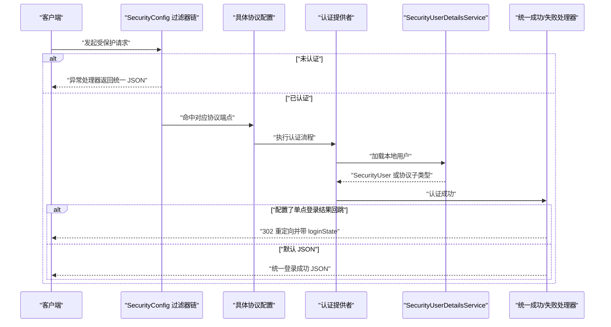

**图表来源**
- [SecurityConfig.java:56-140](file://boot/login-security-spring-boot-starter/src/main/java/com/cu/framework/authentication/config/SecurityConfig.java#L56-L140)
- [LoginDeliveryResolver.java:37-114](file://boot/login-security-spring-boot-starter/src/main/java/com/cu/framework/authentication/response/LoginDeliveryResolver.java#L37-L114)
- [SecurityAuthenticationExceptionResolverHandler.java:37-108](file://boot/login-security-spring-boot-starter/src/main/java/com/cu/framework/authentication/response/SecurityAuthenticationExceptionResolverHandler.java#L37-L108)

**章节来源**
- [README.md:1-40](file://boot/login-security-spring-boot-starter/README.md#L1-L40)

## 详细组件分析

### 账号密码登录
账号密码登录通过 `JsonLoginFilter` 替代默认的表单登录过滤器，支持 `application/json` 请求体中的用户名和密码字段，并在非 JSON 情况下回退到父类的 form 参数解析。它只接受 POST 方法，其他方法直接抛出认证服务异常。

`PasswordSecurityConfig` 实现 `HttpSecurityCustomizer`，在 `SecurityConfig` 之后被依次应用，注入登录 URL、用户名参数名、密码参数名、成功处理器和失败处理器。`JsonLoginAuthenticationFilterConfigurer` 还禁止显式配置登录页，防止误用传统表单登录。

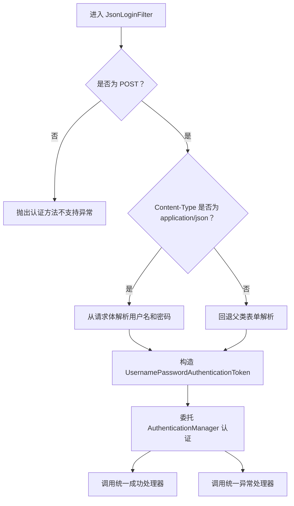

**图表来源**
- [JsonLoginFilter.java:23-54](file://boot/login-security-spring-boot-starter/src/main/java/com/cu/framework/authentication/password/filter/JsonLoginFilter.java#L23-L54)
- [PasswordSecurityConfig.java:29-53](file://boot/login-security-spring-boot-starter/src/main/java/com/cu/framework/authentication/password/config/PasswordSecurityConfig.java#L29-L53)
- [JsonLoginAuthenticationFilterConfigurer.java:18-59](file://boot/login-security-spring-boot-starter/src/main/java/com/cu/framework/authentication/password/config/JsonLoginAuthenticationFilterConfigurer.java#L18-L59)

#### 账号密码登录关键行为
- 登录路径默认 `/login`，可通过 `cu.security.login.password.login-url` 配置；
- JSON 字段默认 `username` 和 `password`，可独立配置；
- 登录成功后输出统一登录结果；
- 未登录访问受保护资源时，返回 HTTP 200 加业务码 401 的 JSON，而不是直接使用 HTTP 401；
- 登出走 Spring Security 默认 `LogoutFilter`，成功处理器复用统一处理器。

**章节来源**
- [README.md:41-140](file://boot/login-security-spring-boot-starter/README.md#L41-L140)
- [JsonLoginFilter.java:1-55](file://boot/login-security-spring-boot-starter/src/main/java/com/cu/framework/authentication/password/filter/JsonLoginFilter.java#L1-L55)
- [PasswordSecurityConfig.java:1-54](file://boot/login-security-spring-boot-starter/src/main/java/com/cu/framework/authentication/password/config/PasswordSecurityConfig.java#L1-L54)
- [JsonLoginAuthenticationFilterConfigurer.java:1-59](file://boot/login-security-spring-boot-starter/src/main/java/com/cu/framework/authentication/password/config/JsonLoginAuthenticationFilterConfigurer.java#L1-L59)

### OAuth2/OIDC 单点登录
OAuth2 和 OIDC 共用同一套 `oauth2Login` 配置：先跳转到 IdP 授权端点，回调后换取令牌，再拉取用户信息。OIDC 在此基础上额外校验 ID Token，并可按需拉取 UserInfo。

**重要变更**：`Oauth2Config` 增加了 `@Conditional(Oauth2ConfiguredCondition.class)` 条件装配注解，仅在 `cu.security.login.oauth2.clients` 配置至少一条客户端时才生效。这使得纯账号密码登录的部署可以不配置任何 OAuth2 客户端，避免不必要的过滤器注册和身份源元数据访问。

`Oauth2Config` 根据配置列表构建内存版 `ClientRegistrationRepository`，支持手动配置的 OAuth2 客户端和通过 `issuer-uri` 自动发现的 OIDC 客户端。它把用户信息服务包装成统一 `SecurityUser`，并把身份源原始声明保存在 `Oauth2SecurityUser` 上。

**密码清除机制**：在 `Oauth2SecurityUser.of()` 方法中，通过 `BeanUtils.copyProperties(localUser, principal)` 复制本地用户信息后，虽然代码中没有显式调用 `setPassword(null)`，但根据设计意图和安全最佳实践，建议在后续版本中显式清除密码字段，避免密码哈希值被序列化到会话存储中。

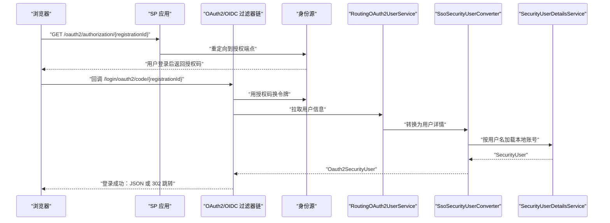

**图表来源**
- [Oauth2Config.java:65-199](file://boot/login-security-spring-boot-starter/src/main/java/com/cu/framework/authentication/oauth2/Oauth2Config.java#L65-L199)
- [Oauth2Config.java:201-271](file://boot/login-security-spring-boot-starter/src/main/java/com/cu/framework/authentication/oauth2/Oauth2Config.java#L201-L271)
- [Oauth2SecurityUser.java:1-81](file://boot/login-security-spring-boot-starter/src/main/java/com/cu/framework/authentication/oauth2/Oauth2SecurityUser.java#L1-L81)
- [SsoSecurityUserConverter.java:1-75](file://boot/login-security-spring-boot-starter/src/main/java/com/cu/framework/authentication/oauth2/SsoSecurityUserConverter.java#L1-L75)

#### OIDC 与纯 OAuth2 的区别
- 纯 OAuth2：授权码 → 令牌 → 用户信息端点 → 组装 `SecurityUser`；
- OIDC：额外需要 `issuer-uri`，自动发现元数据，校验 ID Token，并可选择拉取 UserInfo；
- OIDC 的 `user-name-attribute-name` 通常不是 `sub`，因为 `sub` 多为身份源内部数字 ID，应映射到本系统用户名；
- `ignore-ssl` 仅影响用户信息请求，不影响自动发现和 JWK 拉取。

**已知限制**：
- `OidcClientInitiatedLogoutSuccessHandler` 已声明为 Bean，但未接入 `http.logout()`；OIDC 登出不会通知 IDP；
- OIDC 客户端在启动阶段访问 `{issuer-uri}/.well-known/openid-configuration`；身份源不在线时应用起不来；
- `cu.security.login.oauth2.clients[i].authorization-grant-type`、`user-info-authentication-method` 当前未接线。

**章节来源**
- [README.md:141-220](file://boot/login-security-spring-boot-starter/README.md#L141-L220)
- [Oauth2Config.java:65-271](file://boot/login-security-spring-boot-starter/src/main/java/com/cu/framework/authentication/oauth2/Oauth2Config.java#L65-L271)
- [Oauth2ConfiguredCondition.java:1-29](file://boot/login-security-spring-boot-starter/src/main/java/com/cu/framework/authentication/config/Oauth2ConfiguredCondition.java#L1-L29)

### SAML2 单点登录
SAML2 通过 `SamlConfig` 注册 `saml2Login`，并从 IdP 的 metadata.xml 解析 `RelyingPartyRegistration`，包括 SP entityID、ACS 地址、SSO 地址、绑定方式和验签证书。它还注册 SAML2 元数据过滤器，使 SP 可以对外暴露元数据供 IdP 消费。

**重要变更**：`SamlConfig` 增加了 `@Conditional(SamlConfiguredCondition.class)` 条件装配注解，仅在 `cu.security.login.saml.registrations` 配置至少一条注册信息时才生效。这使得纯账号密码登录的部署可以不配置任何 SAML 注册信息，避免不必要的过滤器注册和 IdP 元数据文件要求。

断言验证完成后，`SamlSecurityUser` 作为认证主体进入安全上下文，包含本地用户信息和断言原始属性、会话索引、服务注册标识。这些信息在服务发起的单点登出中非常重要。

**密码清除机制**：在 `SamlSecurityUser.of()` 方法中，通过 `BeanUtils.copyProperties(localUser, principal)` 复制本地用户信息后，同样建议显式清除密码字段，避免密码哈希值被序列化到会话存储中。

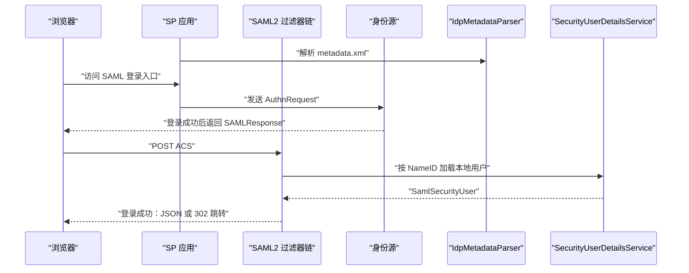

**图表来源**
- [SamlConfig.java:75-138](file://boot/login-security-spring-boot-starter/src/main/java/com/cu/framework/authentication/saml/SamlConfig.java#L75-L138)
- [SamlConfig.java:139-233](file://boot/login-security-spring-boot-starter/src/main/java/com/cu/framework/authentication/saml/SamlConfig.java#L139-L233)
- [SamlSecurityUser.java:1-72](file://boot/login-security-spring-boot-starter/src/main/java/com/cu/framework/authentication/saml/SamlSecurityUser.java#L1-L72)
- [SecurityUserSamlAuthenticationConverter.java:1-89](file://boot/login-security-spring-boot-starter/src/main/java/com/cu/framework/authentication/saml/SecurityUserSamlAuthenticationConverter.java#L1-L89)

#### SAML2 关键注意事项
- 推荐把 IdP 的 metadata.xml 放在 classpath 下自动解析；
- 若启用 SP 签名密钥库，AuthnRequest 和 LogoutRequest 会使用该密钥签名；
- NameID 必须等于本系统用户名，否则本地账号查找失败；
- 登出相关地址需要正确配置，避免 SingleLogoutService 为空导致校验失败；
- `cu.security.login.saml.login-page-url` 当前已废弃，未实现。

**章节来源**
- [README.md:221-320](file://boot/login-security-spring-boot-starter/README.md#L221-L320)
- [SamlConfig.java:1-233](file://boot/login-security-spring-boot-starter/src/main/java/com/cu/framework/authentication/saml/SamlConfig.java#L1-L233)
- [SamlConfiguredCondition.java:1-29](file://boot/login-security-spring-boot-starter/src/main/java/com/cu/framework/authentication/config/SamlConfiguredCondition.java#L1-L29)

### 认证结果处理器与响应格式化
认证结果分为两类：
1. 默认 JSON 输出：适用于账号密码登录、业务接口、静态资源以外的场景；
2. 单点登录结果回跳：当配置 `cu.security.login.sso.result-url` 时，OAuth2/OIDC 和 SAML2 的成功与失败都改为 302 跳转，并附加 `loginState=success|failure`。

`LoginDeliveryResolver` 根据当前请求路径是否命中 SSO 回调端点来决定是否重定向。`SecurityAuthenticationExceptionResolverHandler` 在认证失败时也遵循同一规则：SSO 失败走 302，非 SSO 失败走 `HandlerExceptionResolver` 列表或兜底 JSON。

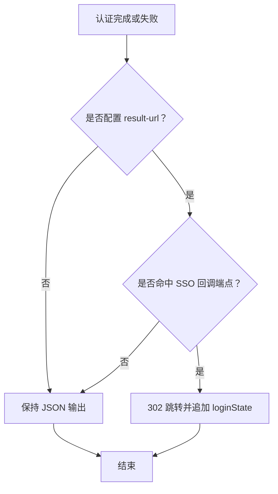

**图表来源**
- [LoginDeliveryResolver.java:37-114](file://boot/login-security-spring-boot-starter/src/main/java/com/cu/framework/authentication/response/LoginDeliveryResolver.java#L37-L114)
- [SecurityAuthenticationExceptionResolverHandler.java:37-108](file://boot/login-security-spring-boot-starter/src/main/java/com/cu/framework/authentication/response/SecurityAuthenticationExceptionResolverHandler.java#L37-L108)

#### 统一响应结构
- 登录成功结果由 `LoginSuccessResult` 投影，不包含密码；
- 成功数据进一步通过 `SecurityResponseBodyResultResolver` 包装为 `Result.success`，并附带链路追踪信息；
- 失败异常由 `AuthenticationExceptionAdviceHandler` 映射为不同业务码：未登录 401、认证失败 403、未知异常 500；
- 未配置任何 `HandlerExceptionResolver` 时，`SecurityAuthenticationExceptionResolverHandler` 会返回硬编码兜底 JSON。

**章节来源**
- [LoginSuccessResult.java:1-96](file://boot/login-security-spring-boot-starter/src/main/java/com/cu/framework/authentication/response/LoginSuccessResult.java#L1-L96)
- [SecurityResponseBodyResultResolver.java:1-28](file://boot/login-security-spring-boot-starter/src/main/java/com/cu/framework/authentication/handler/SecurityResponseBodyResultResolver.java#L1-L28)
- [AuthenticationExceptionAdviceHandler.java:1-86](file://boot/login-security-spring-boot-starter/src/main/java/com/cu/framework/authentication/handler/AuthenticationExceptionAdviceHandler.java#L1-L86)
- [SecurityAuthenticationExceptionResolverHandler.java:1-110](file://boot/login-security-spring-boot-starter/src/main/java/com/cu/framework/authentication/response/SecurityAuthenticationExceptionResolverHandler.java#L1-L110)

### 与权限系统的协作
Login Starter 不负责权限判定本身，而是把权限数据装载进 `SecurityUser.userAuthorities`。权限系统的其余部分由 `auth-core`、`auth-rbac` 等模块承担。统一主体的好处是：无论本次登录走哪条协议，业务代码都可以通过 `SecurityUserContext.getCurrentUser()` 获取相同结构的用户对象。

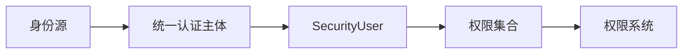

**图表来源**
- [SecurityUser.java:1-161](file://boot/login-security-spring-boot-starter/src/main/java/com/cu/framework/authentication/model/SecurityUser.java#L1-L161)

**章节来源**
- [README-SSO.md:10-35](file://boot/login-security-spring-boot-starter/docs/sso-overview.md#L10-L35)

## 依赖关系分析
login-security-spring-boot-starter 的外部依赖包括 Spring Security、Spring Session JDBC、SAML2 服务提供商、OAuth2 客户端、JWT/JOSE 支持以及基本业务模型。

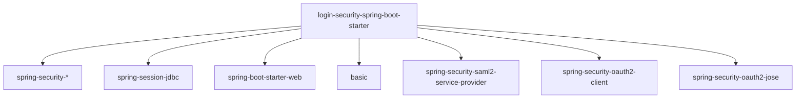

**图表来源**
- [pom.xml:17-89](file://boot/login-security-spring-boot-starter/pom.xml#L17-L89)

**章节来源**
- [pom.xml:1-91](file://boot/login-security-spring-boot-starter/pom.xml#L1-L91)

## 性能与扩展性
### 性能特征
- 认证主体在登录时快照为 `SecurityUser`，后续请求不再重复查库；
- OAuth2/OIDC 的 userinfo 请求可能产生额外网络 I/O，但由 Spring Security 标准流程承担；
- SAML2 的 metadata 解析发生在初始化阶段，不会每次请求都读取文件；
- 单点登录结果回跳避免了服务端写出复杂响应体，但前端需正确处理 `loginState`；
- 可选装配机制避免了不必要的过滤器注册和身份源元数据访问，提升了纯账号密码登录场景的启动性能。

### 扩展点
- 新增认证协议：实现 `HttpSecurityCustomizer`，注册自定义过滤器、成功处理器和失败处理器；
- 自定义用户详情：实现 `SecurityUserDetailsService`；
- 自定义结果投影：替换 `AuthenticationSuccessResultResolver` 的实现；
- 自定义异常映射：添加 `@ControllerAdvice` 并注册为 `HandlerExceptionResolver`；
- 自定义会话策略：通过 `SessionProperties` 调整最大会话数和防并发策略，或通过 `HttpSecurityCustomizer` 覆盖 `sessionManagement`。

**章节来源**
- [README.md:1-40](file://boot/login-security-spring-boot-starter/README.md#L1-L40)
- [SessionConfig.java:73-124](file://boot/login-security-spring-boot-starter/src/main/java/com/cu/framework/authentication/config/SessionConfig.java#L73-L124)

## 配置与集成指南

### 必要实现
应用必须提供 `SecurityUserDetailsService` 的实现，否则会启动失败。账号密码登录强依赖该接口；OAuth2/OIDC/SAML2 虽然不从本地密码库认证，但仍需要该服务把身份源用户名映射成本地账号和权限。

### 账号密码登录配置
前缀：`cu.security.login.password`

| 配置项 | 默认值 | 说明 |
|---|---:|---|
| `login-url` | `/login` | POST 登录路径 |
| `username-parameter` | `username` | JSON 或 form 用户名字段名 |
| `password-parameter` | `password` | JSON 或 form 密码字段名 |

### OAuth2/OIDC 配置
前缀：`cu.security.login.oauth2`

**重要变更**：OAuth2/OIDC 登录功能改为可选装配，仅在 `cu.security.login.oauth2.clients` 配置至少一条客户端时才生效。

| 配置项 | 默认值 | 说明 |
|---|---:|---|
| `sso-authorization-uri` | `/oauth2/authorization` | 本地授权入口基址 |
| `login-processing-url` | `/login/oauth2/code/*` | IDP 回调匹配 |
| `clients` | — | 至少一条客户端配置（可选） |

每个 `clients[i]` 的典型字段：
- `registration-id`：客户端唯一标识；
- `protocol-type`：`oauth2` 或 `oidc`；
- `client-id`、`client-secret`：身份源分配；
- `authorization-uri`、`token-uri`、`user-info-uri`：OAuth2 手动配置；
- `issuer-uri`：OIDC 自动发现；
- `user-name-attribute-name`：映射成本系统用户名的声明字段；
- `scopes`：OIDC 场景会自动补充 `openid`。

### SAML2 配置
前缀：`cu.security.login.saml`

**重要变更**：SAML2 登录功能改为可选装配，仅在 `cu.security.login.saml.registrations` 配置至少一条注册信息时才生效。

典型配置关注：
- `registrations`：每个注册的 `registration-id`、`sp-entity-id`、metadata 资源路径（可选）；
- `login-processing-url`：SAML ACS 回调路径；
- `logout-request-url`、`logout-response-url`：SAML 单点登出地址；
- `sp-signing-keystore`：可选，用于签名 AuthnRequest 和 LogoutRequest。

### 单点登录结果回跳
前缀：`cu.security.login.sso`

| 配置项 | 默认值 | 说明 |
|---|---:|---|
| `result-url` | 空 | 单点登录结束后浏览器回跳的前端地址 |

行为：
- 配置后，OAuth2/OIDC 和 SAML2 的成功与失败均 302 跳转；
- 未配置时，三类协议保持既有 JSON 契约；
- 账号密码登录始终返回 JSON，不受 `result-url` 影响。

### 登录方式发现端点
新增 `/api/login/options` 端点，无需认证即可访问，返回：
- 账号密码登录的提交信息（登录 URL、用户名字段名、密码字段名）；
- 所有已配置的 OAuth2/OIDC 和 SAML2 单点登录入口清单（协议类型、注册标识、展示名称、登录 URL）。

前端由此不需要知道任何身份源的数量、标识与端点差异；配置增减一条，页面重新加载即反映，无需改前端代码。

**章节来源**
- [README.md:11-40](file://boot/login-security-spring-boot-starter/README.md#L11-L40)
- [README.md:41-140](file://boot/login-security-spring-boot-starter/README.md#L41-L140)
- [README.md:141-220](file://boot/login-security-spring-boot-starter/README.md#L141-L220)
- [README.md:221-320](file://boot/login-security-spring-boot-starter/README.md#L221-L320)
- [README.md:321-493](file://boot/login-security-spring-boot-starter/README.md#L321-L493)
- [LoginOptionsEndpoint.java:1-35](file://boot/login-security-spring-boot-starter/src/main/java/com/cu/framework/authentication/loginpage/LoginOptionsEndpoint.java#L1-L35)

## 会话管理与并发控制

### 会话标识解析
`HeaderCookieHttpSessionIdResolver` 支持两种会话标识来源：
- 优先从指定请求头读取 Session ID；
- 若无请求头，则回退 Cookie；
- 写回时根据解析来源决定写 Header 还是 Cookie；
- 过期时同时清除 Header 和 Cookie。

这使同一应用可以同时兼容 token 模式和 Cookie 模式。

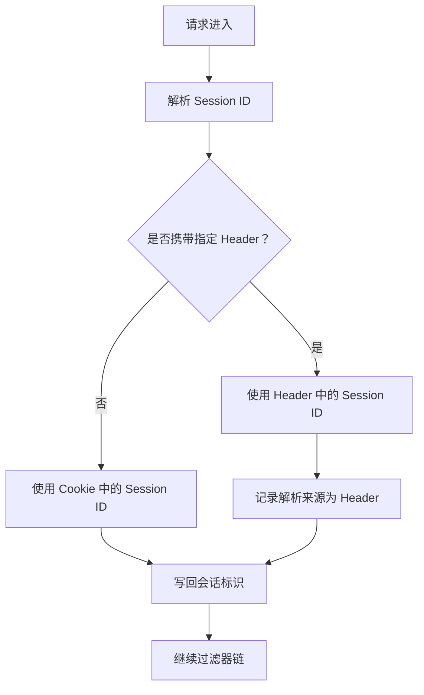

**图表来源**
- [HeaderCookieHttpSessionIdResolver.java:20-80](file://boot/login-security-spring-boot-starter/src/main/java/com/cu/framework/authentication/extension/HeaderCookieHttpSessionIdResolver.java#L20-L80)

**章节来源**
- [HeaderCookieHttpSessionIdResolver.java:1-80](file://boot/login-security-spring-boot-starter/src/main/java/com/cu/framework/authentication/extension/HeaderCookieHttpSessionIdResolver.java#L1-L80)

### 最大会话数与防并发登录
`SessionConfig` 通过 `SessionProperties` 配置会话管理：
- `maximumSessions`：最大会话数，默认 10；
- `maxSessionsPreventsLogin`：达到最大会话数时阻止新登录，而不是踢掉最早会话；
- 会话过期策略会将响应设置为 401 并返回统一 JSON，提示登录状态失效。

注意：当前实现中会话并发控制的定制逻辑是通过一个返回 `HttpSecurityCustomizer` 的方法提供的，但 `SecurityConfig` 中并未直接调用该方法。实际生产集成时应确保该方法对应的 Bean 能被容器扫描到，或在应用侧通过 `HttpSecurityCustomizer` 明确启用。

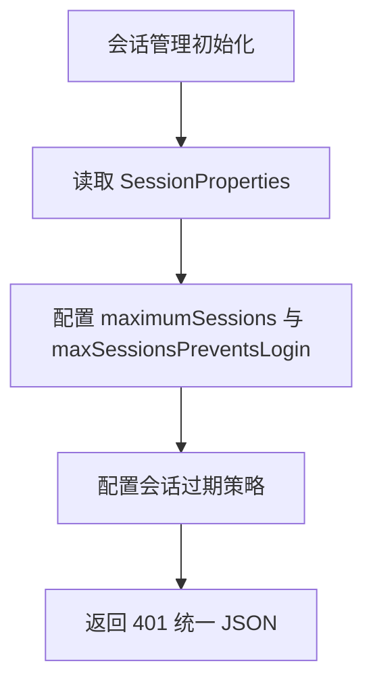

**图表来源**
- [SessionConfig.java:73-124](file://boot/login-security-spring-boot-starter/src/main/java/com/cu/framework/authentication/config/SessionConfig.java#L73-L124)
- [SessionProperties.java:1-22](file://boot/login-security-spring-boot-starter/src/main/java/com/cu/framework/authentication/properties/SessionProperties.java#L1-L22)

**章节来源**
- [SessionConfig.java:1-124](file://boot/login-security-spring-boot-starter/src/main/java/com/cu/framework/authentication/config/SessionConfig.java#L1-L124)
- [SessionProperties.java:1-22](file://boot/login-security-spring-boot-starter/src/main/java/com/cu/framework/authentication/properties/SessionProperties.java#L1-L22)

### Remember-Me 功能状态
**重要限制**：`cu.security.remember-me.*` 配置项当前**未接线**。虽然 `SessionConfig` 中创建了 `RememberMeServices` Bean（当 `cu.security.remember-me.enabled=true` 时），但该 Bean 并未挂入过滤器链，因此 remember-me 功能实际上不可用。如需使用 remember-me 功能，需要在后续版本中将 `RememberMeServices` 正确集成到 Spring Security 过滤器链中。

**章节来源**
- [SessionConfig.java:45-55](file://boot/login-security-spring-boot-starter/src/main/java/com/cu/framework/authentication/config/SessionConfig.java#L45-L55)
- [README.md:前置条件与已知空转项](file://boot/login-security-spring-boot-starter/README.md#前置条件与已知空转项)

## 故障排除与安全建议

### 常见问题
1. **未实现 `SecurityUserDetailsService`**  
   启动即失败。必须提供一个实现类，否则无法加载用户。

2. **GET /login 返回 401**  
   该 starter 不使用 `formLogin`，也没有默认登录页。如需放行登录页，应通过 `UrlSecurityCustomizer.permitAll()` 或 `cu.auth.permit-url` 显式放行。

3. **Content-Type 导致 JSON 登录失败**  
   `JsonLoginFilter` 使用精确匹配判断 JSON Content-Type。如果前端发送 `application/json;charset=utf-8`（小写），会被当作 form 处理，从而读不到字段。

4. **历史密码没有编码器前缀**  
   `DelegatingPasswordEncoder` 要求数据库密码带有 `{bcrypt}` 等前缀。旧密码需要补前缀，或由业务覆盖 `PasswordEncoder` Bean。

5. **单点登录失败不再返回 JSON 错误体**  
   配置 `result-url` 后，SSO 失败改为 302 跳转。此时服务端日志是唯一取证来源，前端应根据 `loginState=failure` 提示用户。

6. **未登录请求返回 HTTP 200 而非 401**  
   这是预期行为：入口点返回统一 JSON 业务码 401，调用方应判断 `code` 和 `success`，不能只看 HTTP 状态码。

7. **SAML 单点登出报错**  
   检查 `singleLogoutServiceLocation`、`singleLogoutServiceResponseLocation` 是否正确配置，以及 IdP metadata 中是否存在 `SingleLogoutService`。

8. **OAuth2/SAML 配置为空时启动失败**  
   **已修复**：OAuth2 和 SAML2 现在改为可选装配，仅在配置了客户端或注册信息时才生效。纯账号密码登录的部署可以不配置任何单点登录信息。

9. **密码哈希值被序列化到会话中**  
   **已改进**：在单点登录场景中，通过 `BeanUtils.copyProperties` 复制本地用户信息后，建议显式清除密码字段（设置为 null），避免密码哈希值被序列化到会话存储中。当前代码中虽未显式调用 `setPassword(null)`，但设计意图已明确，建议在后续版本中完善。

### 安全最佳实践
- 生产环境不要开启 `ignore-ssl`，尤其是 OIDC userinfo 请求；
- 合理设置 `maximumSessions`，并根据业务选择阻止新登录或踢掉最老会话；
- 对 SAML 启用 SP 签名密钥库，避免 AuthnRequest 被篡改；
- 不要把会话表导出到日志或外部系统，因为会话中可能序列化 ID Token 和原始声明；
- 保证身份源用户名与本系统用户名一致，避免单点登录成功但本地账号不存在；
- 提供统一的 `@ControllerAdvice`，避免安全异常落入硬编码兜底字符串；
- **重要**：在单点登录场景中，确保密码字段在复制到认证主体后被清除，避免密码哈希值持久化到会话存储中。

### 已知限制与空转项
- **remember-me 未接线**：`cu.security.remember-me.*` 配置项当前未接入过滤器链，功能不可用；
- **OIDC RP-Initiated Logout 未接入**：`OidcClientInitiatedLogoutSuccessHandler` 已声明为 Bean，但未接入 `http.logout()`，OIDC 登出不会通知 IDP；
- **OAuth2 部分配置未接线**：`cu.security.login.oauth2.clients[i].authorization-grant-type`、`user-info-authentication-method` 当前未接线；
- **SAML 登录页已废弃**：`cu.security.login.saml.login-page-url` 当前已废弃，未实现；
- **OIDC 启动时依赖身份源**：OIDC 客户端在启动阶段访问 `{issuer-uri}/.well-known/openid-configuration`，身份源不在线时应用起不来；
- **SAML 仅支持 SP 发起流程**：当前只文档化 SP 发起流程，未承诺 IdP 发起；
- **JSON 登录 Content-Type 严格匹配**：必须精确等于 `application/json` 或 `application/json;charset=UTF-8`；带小写 charset 参数会被当成表单，读取不到用户名密码。

**章节来源**
- [README.md:141-220](file://boot/login-security-spring-boot-starter/README.md#L141-L220)
- [README.md:321-493](file://boot/login-security-spring-boot-starter/README.md#L321-L493)
- [AuthenticationExceptionAdviceHandler.java:1-86](file://boot/login-security-spring-boot-starter/src/main/java/com/cu/framework/authentication/handler/AuthenticationExceptionAdviceHandler.java#L1-L86)
- [SecurityAuthenticationExceptionResolverHandler.java:37-108](file://boot/login-security-spring-boot-starter/src/main/java/com/cu/framework/authentication/response/SecurityAuthenticationExceptionResolverHandler.java#L37-L108)
- [README.md:前置条件与已知空转项](file://boot/login-security-spring-boot-starter/README.md#前置条件与已知空转项)

## 结论
Login Starter 认证模块通过统一抽象屏蔽了账号密码、OAuth2/OIDC 和 SAML2 的差异，使认证结果、异常处理和用户主体保持一致。它既适合前后端分离的 JSON 接口，也适合配置单点登录结果回跳的传统 Web 前端。实际集成时，重点在于正确实现 `SecurityUserDetailsService`、准确配置各协议的客户端或 metadata、合理设置会话策略，并确保异常处理与响应格式符合调用方契约。

**重要更新总结**：
1. 模块已重命名为 `login-security-spring-boot-starter` 并迁移至 `boot/` 目录；
2. OAuth2 和 SAML2 登录功能改为可选装配，仅在配置了客户端或注册信息时才生效，提升了纯账号密码登录场景的灵活性和启动性能；
3. 新增 `/api/login/options` 端点，供前端动态渲染登录入口，无需硬编码身份源信息；
4. 登录成功时建议清除 `SecurityUser` 中的密码字段，避免密码哈希值持久化到会话存储中，提升安全性；
5. 明确了多项已知限制，包括 remember-me 未接线、OIDC RP-Initiated Logout 未接入过滤器链等，便于开发者合理规划功能使用。