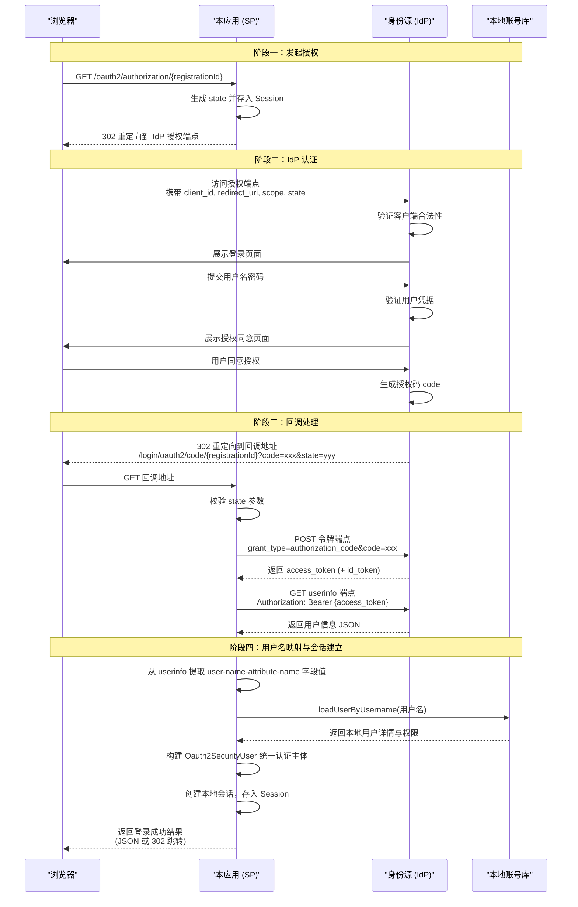
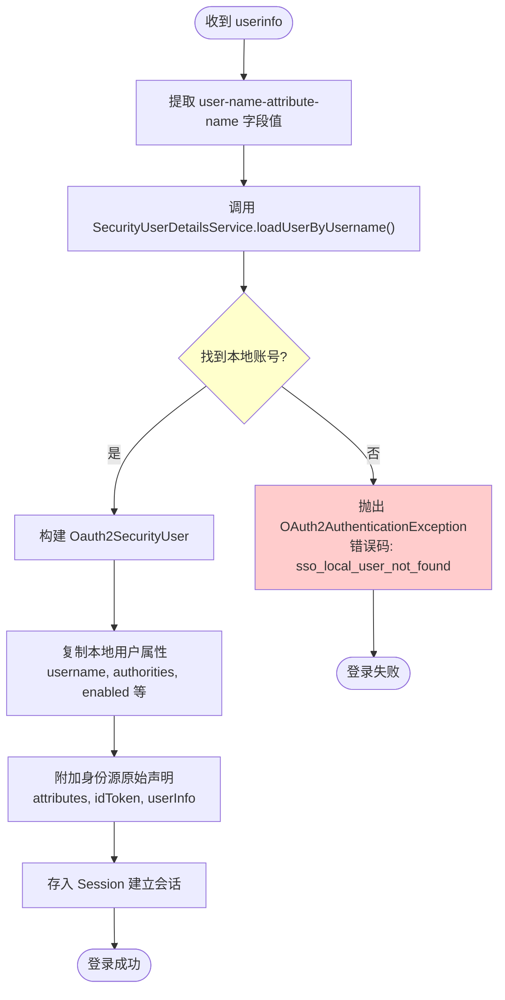
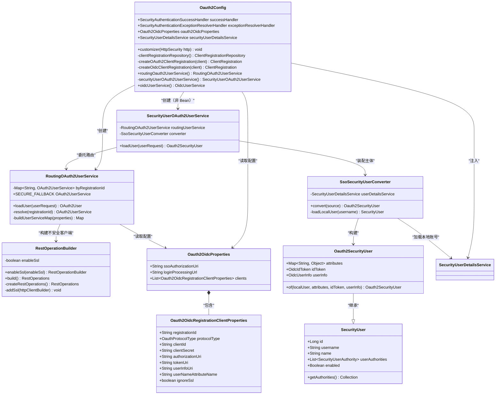

# OAuth2 授权码模式集成指南

<cite>
**本文档引用文件 **
- [oauth2.md](file://boot/login-security-spring-boot-starter/docs/oauth2.md)
- [Oauth2Config.java](file://boot/login-security-spring-boot-starter/src/main/java/com/cu/framework/authentication/oauth2/Oauth2Config.java)
- [RoutingOAuth2UserService.java](file://boot/login-security-spring-boot-starter/src/main/java/com/cu/framework/authentication/oauth2/RoutingOAuth2UserService.java)
- [SecurityUserOAuth2UserService.java](file://boot/login-security-spring-boot-starter/src/main/java/com/cu/framework/authentication/oauth2/SecurityUserOAuth2UserService.java)
- [SsoSecurityUserConverter.java](file://boot/login-security-spring-boot-starter/src/main/java/com/cu/framework/authentication/oauth2/SsoSecurityUserConverter.java)
- [Oauth2OidcProperties.java](file://boot/login-security-spring-boot-starter/src/main/java/com/cu/framework/authentication/oauth2/Oauth2OidcProperties.java)
- [RestOperationBuilder.java](file://boot/login-security-spring-boot-starter/src/main/java/com/cu/framework/authentication/oauth2/RestOperationBuilder.java)
- [SecurityUserDetailsService.java](file://boot/login-security-spring-boot-starter/src/main/java/com/cu/framework/authentication/service/SecurityUserDetailsService.java)
- [Oauth2SecurityUser.java](file://boot/login-security-spring-boot-starter/src/main/java/com/cu/framework/authentication/oauth2/Oauth2SecurityUser.java)
- [SecurityUser.java](file://boot/login-security-spring-boot-starter/src/main/java/com/cu/framework/authentication/model/SecurityUser.java)
- [SsoErrorCodes.java](file://boot/login-security-spring-boot-starter/src/main/java/com/cu/framework/authentication/exception/SsoErrorCodes.java)
- [spec.md](file://openspec/specs/identity/oauth2-login/spec.md)
- [design.md](file://openspec/changes/archive/2026-10-19-refactor-oauth2-userinfo-service/design.md)
- [sso-overview.md](file://boot/login-security-spring-boot-starter/docs/sso-overview.md)
</cite>

## 目录
1. [概述](#概述)
2. [协议工作原理](#协议工作原理)
3. [授权码流程时序](#授权码流程时序)
4. [配置项详解](#配置项详解)
5. [用户名映射逻辑](#用户名映射逻辑)
6. [核心组件架构](#核心组件架构)
7. [常见错误排查](#常见错误排查)
8. [安全注意事项](#安全注意事项)
9. [测试与验证](#测试与验证)

## 概述

本框架基于 Spring Security 实现了 OAuth2 授权码模式（Authorization Code Grant）的单点登录集成方案。OAuth2 授权码模式解决了"让用户在身份源完成登录，应用拿到一个可换用户信息的令牌"的问题。

### 核心设计理念

- **身份源只负责证明"这个人是谁"**：身份提供商（IdP）仅承担认证职责
- **账号信息与权限来自本系统**：SSO 成功后按身份源给出的用户名调用本地账号服务
- **统一认证主体**：进入安全上下文的主体统一为 `SecurityUser`，上层业务无需感知底层协议差异
- **固定授权码模式**：本实现仅支持授权码模式，其他授权类型未接线

**Section sources**
- [oauth2.md:1-15](file://boot/login-security-spring-boot-starter/docs/oauth2.md#L1-L15)
- [sso-overview.md:1-10](file://boot/login-security-spring-boot-starter/docs/sso-overview.md#L1-L10)

## 协议工作原理

### OAuth2 授权码模式核心概念

OAuth2 授权码模式涉及以下角色：

| 角色 | 说明 | 在本框架中的对应 |
| --- | --- | --- |
| 资源所有者（Resource Owner） | 用户本人 | 最终访问系统的用户 |
| 客户端（Client） | 本应用系统 | Spring Boot 应用（SP - Service Provider） |
| 授权服务器（Authorization Server） | 身份源系统 | IdP - Identity Provider |
| 资源服务器（Resource Server） | 提供受保护资源的系统 | 本应用的业务接口 |

### 工作流程

一次完整的 OAuth2 授权码登录包含以下阶段：

1. **发起授权**：用户点击登录，应用重定向到 IdP 授权端点
2. **用户认证**：用户在 IdP 完成登录和授权同意
3. **获取授权码**：IdP 重定向回应用，携带授权码（code）和状态参数（state）
4. **交换令牌**：应用服务端用授权码向 IdP 换取 access_token
5. **获取用户信息**：应用用 access_token 向 IdP 拉取 userinfo
6. **建立本地会话**：将 userinfo 中的用户名映射到本地账号，创建本系统会话

### 关键安全机制

- **State 参数防 CSRF**：授权请求时生成随机 state，回调时校验，防止跨站请求伪造
- **服务端令牌交换**：access_token 的交换在服务端完成，client_secret 不暴露给前端
- **用户名映射而非直接使用**：不将 IdP 的令牌或声明直接作为本系统权限依据

**Section sources**
- [oauth2.md:16-30](file://boot/login-security-spring-boot-starter/docs/oauth2.md#L16-L30)
- [Oauth2Config.java:35-50](file://boot/login-security-spring-boot-starter/src/main/java/com/cu/framework/authentication/oauth2/Oauth2Config.java#L35-L50)

## 授权码流程时序

### 完整交互时序图



**Diagram sources **
- [oauth2.md:32-48](file://boot/login-security-spring-boot-starter/docs/oauth2.md#L32-L48)
- [Oauth2Config.java:115-145](file://boot/login-security-spring-boot-starter/src/main/java/com/cu/framework/authentication/oauth2/Oauth2Config.java#L115-L145)
- [SecurityUserOAuth2UserService.java:40-47](file://boot/login-security-spring-boot-starter/src/main/java/com/cu/framework/authentication/oauth2/SecurityUserOAuth2UserService.java#L40-L47)

### 端点详细说明

| 步骤 | HTTP 方法 | 路径 | 处理组件 | 说明 |
| --- | --- | --- | --- | --- |
| 发起授权 | GET | `/oauth2/authorization/{registrationId}` | `OAuth2AuthorizationRequestRedirectFilter` | 生成分发请求，保存 state 到 Session |
| IdP 登录 | — | IdP 授权端点 | IdP | 用户在身份源完成认证 |
| 回调接收 | GET | `/login/oauth2/code/{registrationId}` | `OAuth2LoginAuthenticationFilter` | 接收授权码，校验 state |
| 令牌交换 | POST | `clients[i].token-uri` | `DefaultAuthorizationCodeTokenResponseClient` | 用授权码换取 access_token |
| 用户信息拉取 | GET | `clients[i].user-info-uri` | `RoutingOAuth2UserService` | 用 access_token 获取用户详情 |
| 用户名映射 | — | — | `SsoSecurityUserConverter` | 将身份源标识映射到本地账号 |
| 会话建立 | — | — | `SecurityAuthenticationSuccessHandler` | 创建本地会话，返回结果 |
| 登出 | POST | `/logout` | Spring Security `LogoutFilter` | 销毁本地会话 |

**Section sources**
- [oauth2.md:32-48](file://boot/login-security-spring-boot-starter/docs/oauth2.md#L32-L48)
- [Oauth2Config.java:115-145](file://boot/login-security-spring-boot-starter/src/main/java/com/cu/framework/authentication/oauth2/Oauth2Config.java#L115-L145)

## 配置项详解

### 配置前缀

所有 OAuth2 相关配置均位于 `cu.security.login.oauth2` 前缀下。

### 全局配置

| 配置键 | 默认值 | 必填 | 说明 |
| --- | --- | --- | --- |
| `sso-authorization-uri` | `/oauth2/authorization` | 否 | 本地授权入口基址，不要写 `{registrationId}`，解析器会自动拼接 |
| `login-processing-url` | `/login/oauth2/code/*` | 否 | 回调匹配模板，使用 Ant 通配符 `*` |
| `clients` | — | 否 | 客户端列表，留空时不装配 OAuth2；配置后至少一条 |

**重要提示**：`sso-authorization-uri` 只写基址，**不要包含 `{registrationId}`**；默认解析器会自动拼上 `/{registrationId}`，重复填写会导致路径匹配失败。

### 客户端配置（clients 列表元素）

每个 `clients[i]` 代表一个身份源，配置项如下：

| 配置键 | 默认值 | 必填 | 说明 |
| --- | --- | --- | --- |
| `registration-id` | — | 是 | 用于 `/oauth2/authorization/{registrationId}` 的唯一标识 |
| `protocol-type` | `oauth2` | 否 | `oauth2` 或 `oidc`；OAuth2 使用手动配置端点 |
| `client-id` | — | 是 | IdP 分配的客户端 ID |
| `client-secret` | — | 是 | IdP 分配的客户端密钥 |
| `client-authentication-method` | `client_secret_basic` | 否 | 令牌端点认证方式：`client_secret_basic` / `client_secret_post` / `none` |
| `redirect-uri-template` | `{baseUrl}/login/oauth2/code/{registrationId}` | 否 | 回调地址模板，IdP 侧登记的必须是展开后的完整 URL |
| `scopes` | — | 建议 | 申请的权限范围，如 `read`、`profile`、`email` |
| `authorization-uri` | — | OAuth2 是 | IdP 授权端点 URL |
| `token-uri` | — | OAuth2 是 | IdP 令牌端点 URL |
| `user-info-uri` | — | OAuth2 是 | IdP 用户信息端点 URL |
| `user-name-attribute-name` | — | OAuth2 是 | userinfo 响应中指向**本系统用户名**的字段名 |
| `jwk-set-uri` | — | 否 | OIDC 可选覆盖；OAuth2 手动模式不使用 |
| `client-name` | — | 否 | 登录页按钮文案；不配回退 `registration-id` |
| `ignore-ssl` | `false` | 否 | 仅豁免 userinfo 请求的证书校验，生产环境务必保持 false |
| `authorization-grant-type` | — | — | **[未接线]** 固定使用授权码模式，配置不生效 |
| `user-info-authentication-method` | — | — | **[未接线]** userinfo 请求认证方式不由本项控制 |

### 配置示例

```yaml
cu:
  security:
    login:
      oauth2:
        sso-authorization-uri: /oauth2/authorization
        login-processing-url: /login/oauth2/code/*
        clients:
          - registration-id: corp-oauth2
            protocol-type: oauth2
            client-id: your-client-id
            client-secret: your-client-secret
            client-authentication-method: client_secret_basic
            redirect-uri-template: "{baseUrl}/login/oauth2/code/{registrationId}"
            scopes:
              - read
              - profile
            authorization-uri: https://idp.example.com/oauth2/authorize
            token-uri: https://idp.example.com/oauth2/token
            user-info-uri: https://idp.example.com/oauth2/userinfo
            user-name-attribute-name: preferred_username
            client-name: 企业 OAuth2
            ignore-ssl: false
```

### 多身份源配置

同一应用可配置多个身份源，每条一个 `clients` 列表元素：

```yaml
cu:
  security:
    login:
      oauth2:
        clients:
          - registration-id: github-oauth2
            protocol-type: oauth2
            client-id: github-client-id
            client-secret: github-client-secret
            authorization-uri: https://github.com/login/oauth/authorize
            token-uri: https://github.com/login/oauth/access_token
            user-info-uri: https://api.github.com/user
            user-name-attribute-name: login
            scopes:
              - user:email
              
          - registration-id: corp-oauth2
            protocol-type: oauth2
            client-id: corp-client-id
            client-secret: corp-client-secret
            authorization-uri: https://corp-idp.example.com/oauth2/authorize
            token-uri: https://corp-idp.example.com/oauth2/token
            user-info-uri: https://corp-idp.example.com/oauth2/userinfo
            user-name-attribute-name: username
```

**注意**：同一 IdP 要同时暴露 OAuth2 与 OIDC 入口时需声明两条配置，`protocol-type` 与 `registration-id` 都不同。OAuth2 与 SAML 允许使用同名 `registration-id`（两套注册仓库、路径前缀不同），但排查日志时建议加 `-oauth2` / `-saml` 后缀区分。

**Section sources**
- [oauth2.md:50-90](file://boot/login-security-spring-boot-starter/docs/oauth2.md#L50-L90)
- [Oauth2OidcProperties.java:25-240](file://boot/login-security-spring-boot-starter/src/main/java/com/cu/framework/authentication/oauth2/Oauth2OidcProperties.java#L25-L240)
- [Oauth2Config.java:160-195](file://boot/login-security-spring-boot-starter/src/main/java/com/cu/framework/authentication/oauth2/Oauth2Config.java#L160-L195)

## 用户名映射逻辑

### 映射流程

用户名映射是 OAuth2 集成的核心环节，决定了身份源认证的用户如何对应到本系统账号：



**Diagram sources **
- [SsoSecurityUserConverter.java:45-75](file://boot/login-security-spring-boot-starter/src/main/java/com/cu/framework/authentication/oauth2/SsoSecurityUserConverter.java#L45-L75)
- [SecurityUserOAuth2UserService.java:40-47](file://boot/login-security-spring-boot-starter/src/main/java/com/cu/framework/authentication/oauth2/SecurityUserOAuth2UserService.java#L40-L47)

### 关键组件

#### 1. SsoSecurityUserConverter（装配器）

负责将身份源返回的原生主体装配为统一认证主体：

- 从 `OAuth2User.getName()` 获取用户名（该值由 `user-name-attribute-name` 配置决定）
- 调用 `SecurityUserDetailsService.loadUserByUsername()` 加载本地账号
- 若本地账号不存在，抛出 `OAuth2AuthenticationException`，错误码为 `sso_local_user_not_found`
- 将本地用户属性复制到 `Oauth2SecurityUser`，并附加身份源原始声明

**设计要点**：
- 装配 MUST 留在链路末端，不能下沉到 `RoutingOAuth2UserService`
- OIDC 的内部委托只消费返回主体的 `getAttributes()`，在其内部装配会使本地账号库每次登录被查两遍
- 当 userinfo 整体被跳过时，内部装配根本不会执行

#### 2. SecurityUserDetailsService（本地账号服务）

应用需实现此接口提供本地账号查询能力：

```java
public interface SecurityUserDetailsService extends UserDetailsService, UserDetailsPasswordService {
    UserDetails loadUserByUsername(String username) throws UsernameNotFoundException;
    UserDetails updatePassword(UserDetails user, String encryptedNewPassword);
}
```

实现类应：
- 根据用户名查询数据库或 LDAP
- 返回包含权限信息的 `SecurityUser` 对象
- 若用户不存在，抛出 `UsernameNotFoundException`

#### 3. Oauth2SecurityUser（统一认证主体）

继承自 `SecurityUser` 并实现 `OidcUser` 接口：

- 账号信息与权限完全来自本地加载的用户
- 保留身份源原始声明（`attributes`）、ID Token（`idToken`）和用户信息（`userInfo`）
- 供依赖认证主体的协议级功能使用（如会话终止）

### 常见错误场景

#### 错误 1：将 sub 配成用户名

**现象**：登录失败，报错 `sso_local_user_not_found`

**原因**：`sub` 通常是身份源自己的数字 ID 或配对码，与本系统用户名不是一回事

**解决**：OAuth2 手动模式必须显式配置 `user-name-attribute-name`，指向 userinfo 响应中实际表示用户名的字段（如 `login`、`username`、`preferred_username`、`email` 等）

#### 错误 2：字段名拼写错误

**现象**：userinfo 解析失败或取到 null 值

**原因**：`user-name-attribute-name` 配置的字段在 userinfo 响应中不存在

**解决**：先直接访问 `user-info-uri` 查看返回的 JSON 结构，确认实际字段名

#### 错误 3：大小写不匹配

**现象**：明明配置了正确的字段名，但仍找不到本地账号

**原因**：身份源返回的用户名大小写与本地账号不一致（如 `Admin` vs `admin`）

**解决**：在 `SecurityUserDetailsService` 实现中进行大小写转换，或确保两边数据口径一致

**Section sources**
- [SsoSecurityUserConverter.java:20-75](file://boot/login-security-spring-boot-starter/src/main/java/com/cu/framework/authentication/oauth2/SsoSecurityUserConverter.java#L20-L75)
- [SecurityUserDetailsService.java:1-27](file://boot/login-security-spring-boot-starter/src/main/java/com/cu/framework/authentication/service/SecurityUserDetailsService.java#L1-L27)
- [Oauth2SecurityUser.java:1-81](file://boot/login-security-spring-boot-starter/src/main/java/com/cu/framework/authentication/oauth2/Oauth2SecurityUser.java#L1-L81)
- [oauth2.md:90-96](file://boot/login-security-spring-boot-starter/docs/oauth2.md#L90-L96)

## 核心组件架构

### 组件关系图



**Diagram sources **
- [Oauth2Config.java:1-274](file://boot/login-security-spring-boot-starter/src/main/java/com/cu/framework/authentication/oauth2/Oauth2Config.java#L1-L274)
- [RoutingOAuth2UserService.java:1-99](file://boot/login-security-spring-boot-starter/src/main/java/com/cu/framework/authentication/oauth2/RoutingOAuth2UserService.java#L1-L99)
- [SecurityUserOAuth2UserService.java:1-47](file://boot/login-security-spring-boot-starter/src/main/java/com/cu/framework/authentication/oauth2/SecurityUserOAuth2UserService.java#L1-L47)
- [SsoSecurityUserConverter.java:1-75](file://boot/login-security-spring-boot-starter/src/main/java/com/cu/framework/authentication/oauth2/SsoSecurityUserConverter.java#L1-L75)
- [Oauth2SecurityUser.java:1-81](file://boot/login-security-spring-boot-starter/src/main/java/com/cu/framework/authentication/oauth2/Oauth2SecurityUser.java#L1-L81)

### 组件职责说明

#### 1. Oauth2Config（配置类）

**职责**：
- 读取 `cu.security.login.oauth2` 配置
- 构建 `ClientRegistrationRepository`（内存版）
- 配置 Spring Security 过滤器链的 `oauth2Login` 部分
- 创建各 Bean 实例

**关键方法**：
- `customizer(HttpSecurity)`：定制过滤器链，设置成功/失败处理器、端点 URI、用户信息服务
- `clientRegistrationRepository()`：根据配置列表构建客户端注册仓库
- `createOAuth2ClientRegistration()`：手动模式创建 ClientRegistration
- `createOidcClientRegistration()`：OIDC 自动发现模式创建 ClientRegistration

**设计决策**：
- `routingOauth2UserService()` 注册为 Bean，供外部注入
- `securityUserOAuth2UserService()` 不注册为 Bean，保持容器内 `OAuth2UserService` 类型单一
- `oidcUserService()` 复用未装配的 `routingOauth2UserService()` 取 userinfo，避免重复查询本地账号库

#### 2. RoutingOAuth2UserService（路由服务）

**职责**：
- 按 `registrationId` 分发 userinfo 请求到对应的 HTTP 客户端
- 管理 per-client 的 SSL 证书校验策略
- 提供安全的兜底实例（始终执行证书校验）

**关键特性**：
- 构造期一次定型，运行时不再查表
- `ignore-ssl=true` 的客户端获得替换过 `RestOperations` 的实例
- 其余客户端共享 `SECURE_FALLBACK`（标准证书校验）
- `registrationId` 未匹配时返回 `SECURE_FALLBACK`，使配置缺失的后果是"登录不上"而非"悄悄不校验证书"

**为什么不用 DelegatingOAuth2UserService**：
Spring Security 5.7.11 中 `OAuth2UserService` 没有 `supports()` 方法，`DelegatingOAuth2UserService` 会对列表里每个 delegate 都调用一次 `loadUser`，等于向每个 IdP 各发一次 userinfo 请求。

#### 3. SecurityUserOAuth2UserService（装配服务）

**职责**：
- 委托 `RoutingOAuth2UserService` 取回身份源原生主体
- 调用 `SsoSecurityUserConverter` 装配成统一认证主体
- 确保装配只在 OAuth2 协议链路末端发生一次

**设计要点**：
- 不注册为 Bean，仅在 `userInfoEndpoint.userService()` 接线时使用
- 与 `SecurityUserOidcUserService` 对称，两者分别在各自协议链路末端各做一次装配
- 装配 MUST 留在本类而不是下沉到 `RoutingOAuth2UserService`

#### 4. SsoSecurityUserConverter（转换器）

**职责**：
- 将身份源返回的主体装配为统一认证主体
- OAuth2 与 OIDC 两条协议链路共用此转换器
- 以主体的标识取本系统账号，展示信息与权限一律来自本系统

**关键逻辑**：
- 从 `source.getName()` 获取用户名（该值由 `user-name-attribute-name` 决定）
- 调用 `SecurityUserDetailsService.loadUserByUsername()` 加载本地账号
- 若取不到，抛出 `OAuth2AuthenticationException`，错误码 `sso_local_user_not_found`
- 将本地用户属性复制到 `Oauth2SecurityUser`，附加身份源原始声明

**为什么不合并到 RoutingOAuth2UserService**：
OIDC 的内部委托只消费返回主体的 `getAttributes()`，最终主体由 `OidcUserService` 用 ID Token 另建。在内部装配会使本地账号库每次登录被查两遍，且当 userinfo 整体被跳过时内部装配根本不会执行。

#### 5. RestOperationBuilder（HTTP 客户端构建器）

**职责**：
- 构建自定义的 `RestOperations`，用于 userinfo 请求
- 支持按需跳过 SSL 证书校验（仅用于测试环境）
- 配置消息转换器与错误处理器，容忍部分 IdP 返回的非标准响应

**关键特性**：
- 启用重定向跟随（`LaxRedirectStrategy`）
- 配置 `OAuth2ErrorResponseErrorHandler` 处理 OAuth2 错误
- 添加 `StringHttpMessageConverter` 和 `MappingJackson2HttpMessageConverter`
- `ignore-ssl=true` 时信任所有证书并跳过主机名校验

**作用范围**：
只影响 userinfo 端点。OIDC Discovery 与 JWK Set 拉取走 Spring 自带的 HTTP 客户端，始终执行标准证书校验。

**Section sources**
- [Oauth2Config.java:1-274](file://boot/login-security-spring-boot-starter/src/main/java/com/cu/framework/authentication/oauth2/Oauth2Config.java#L1-L274)
- [RoutingOAuth2UserService.java:1-99](file://boot/login-security-spring-boot-starter/src/main/java/com/cu/framework/authentication/oauth2/RoutingOAuth2UserService.java#L1-L99)
- [SecurityUserOAuth2UserService.java:1-47](file://boot/login-security-spring-boot-starter/src/main/java/com/cu/framework/authentication/oauth2/SecurityUserOAuth2UserService.java#L1-L47)
- [SsoSecurityUserConverter.java:1-75](file://boot/login-security-spring-boot-starter/src/main/java/com/cu/framework/authentication/oauth2/SsoSecurityUserConverter.java#L1-L75)
- [RestOperationBuilder.java:1-107](file://boot/login-security-spring-boot-starter/src/main/java/com/cu/framework/authentication/oauth2/RestOperationBuilder.java#L1-L107)
- [design.md:1-136](file://openspec/changes/archive/2026-10-19-refactor-oauth2-userinfo-service/design.md#L1-L136)

## 常见错误排查

### 排查清单

当 OAuth2 登录失败时，按以下顺序排查：

#### 1. clients 为空

**现象**：访问 `/oauth2/authorization/{registrationId}` 返回 404

**原因**：`cu.security.login.oauth2.clients` 未配置或为空列表，OAuth2/OIDC 都没装配

**解决**：检查配置文件，确保 `clients` 列表至少有一条有效配置

#### 2. 不需要显式配置 authorizationRequestResolver

**说明**：默认解析器已经按 `sso-authorization-uri` 拼 `registrationId`

**何时需要自定义**：只有要改请求参数或 state 生成方式时才需要自定义 `authorizationRequestResolver`

#### 3. 302 到 IdP 后报 invalid_redirect_uri

**现象**：重定向到 IdP 后被拒绝，显示 "invalid_redirect_uri" 错误

**原因**：IdP 侧登记的回调地址与 `redirect-uri-template` 展开值不一致

**解决**：
- 确认 `redirect-uri-template` 配置正确（默认 `{baseUrl}/login/oauth2/code/{registrationId}`）
- 在 IdP 控制台登记完全一致的回调地址（包括协议、域名、端口、路径）
- 注意 `{baseUrl}` 会被展开为实际访问的应用根 URL

#### 4. 回调 404 或落到白名单

**现象**：IdP 回调回来时应用返回 404，或被当作未认证请求放行

**原因**：`login-processing-url` 与 `redirect-uri-template` 不匹配

**解决**：
- 确认 `login-processing-url` 配置为 `/login/oauth2/code/*`（Ant 通配符）
- 确认 `redirect-uri-template` 展开后的路径落在 `/login/oauth2/code/*` 范围内
- 检查是否有其他过滤器或安全配置拦截了回调路径

#### 5. userinfo 解析失败

**现象**：令牌交换成功，但拉取用户信息时报错

**排查步骤**：
1. 直接访问 `user-info-uri`（带上有效的 access_token）查看返回内容
2. 确认返回的是合法 JSON 格式
3. 确认 `user-name-attribute-name` 配置的字段在响应中存在
4. 检查字段值的类型和格式是否符合预期

**常见原因**：
- IdP 返回 HTML 错误页而非 JSON
- 字段名拼写错误或大小写不匹配
- access_token 已过期或权限不足

#### 6. SSL 证书错误

**现象**：userinfo 请求报 SSL 握手失败或证书不可信

**原因**：IdP 使用自签名证书或证书链不完整

**解决方案 A（推荐）**：
将 IdP 证书导入 JDK cacerts 信任库：
```bash
keytool -importcert -alias idp-cert -file idp.crt -keystore $JAVA_HOME/lib/security/cacerts
```

**解决方案 B（仅测试环境）**：
配置 `ignore-ssl: true`，但注意：
- 只影响 userinfo 端点
- IdP 自签证书在 token 交换阶段仍会失败（需用方案 A）
- 生产环境务必保持 `false`

#### 7. state 校验失败

**现象**：回调时抛 `OAuth2AuthenticationException`，提示 state 不匹配

**原因**：
- 授权跳转期间会话丢失（Cookie 未带上）
- 前后端跨站导致 Cookie 没带上
- 浏览器禁用了第三方 Cookie

**解决**：
- 确认浏览器允许会话 Cookie
- 检查 SameSite 策略配置
- 确认授权请求与回调在同一域名下
- 查看浏览器开发者工具 Network 面板，确认 Cookie 是否正确发送

#### 8. sso_local_user_not_found

**现象**：IdP 认证成功，但本系统登录失败，错误码 `sso_local_user_not_found`

**原因**：
- `user-name-attribute-name` 配置的字段值在本地账号库中不存在
- 常见于将 `sub` 配成用户名（`sub` 通常是身份源的数字 ID）
- 大小写不匹配或空格问题

**解决**：
1. 查看日志中打印的用户名值
2. 直接访问 `user-info-uri` 确认实际字段名和值
3. 修正 `user-name-attribute-name` 配置
4. 或在 `SecurityUserDetailsService` 实现中进行数据清洗（去空格、转小写等）

#### 9. 权限不正确

**现象**：登录成功，但用户权限与预期不符

**原因**：OAuth2 拿到的 scope 不是本系统权限；权限完全由本地账号库决定

**解决**：
- 检查数据库中该用户的角色和权限配置
- 确认 `SecurityUserDetailsService` 实现正确加载了权限
- 理解 OAuth2 scope 与本系统权限无关，scope 仅用于向 IdP 申请访问用户信息的许可

### 日志调试技巧

#### 启用详细日志

在 `application.yml` 中添加：

```yaml
logging:
  level:
    org.springframework.security: DEBUG
    org.springframework.security.oauth2: DEBUG
    com.cu.framework.authentication.oauth2: DEBUG
```

#### 关键日志位置

- **授权请求发起**：查看生成的授权 URL 是否包含正确的参数
- **回调处理**：查看收到的 code 和 state 参数
- **令牌交换**：查看 POST 到 token-uri 的请求和响应
- **userinfo 拉取**：查看 GET 到 user-info-uri 的请求和响应
- **用户名映射**：查看提取的用户名值和加载的本地账号

#### 敏感信息脱敏

框架已确保日志中不打印：
- `client-secret`
- `access_token`
- userinfo 原文

如需调试，可在开发环境临时开启更详细的日志，但生产环境务必关闭。

**Section sources**
- [oauth2.md:98-115](file://boot/login-security-spring-boot-starter/docs/oauth2.md#L98-L115)
- [SsoErrorCodes.java:1-19](file://boot/login-security-spring-boot-starter/src/main/java/com/cu/framework/authentication/exception/SsoErrorCodes.java#L1-L19)
- [spec.md:1-58](file://openspec/specs/identity/oauth2-login/spec.md#L1-L58)

## 安全注意事项

### 必须遵守的安全原则

#### 1. 只使用授权码模式

- 本框架固定使用 `AuthorizationGrantType.AUTHORIZATION_CODE`
- `authorization-grant-type` 配置项当前 **[未接线]**，配了也不会改成其他模式
- 不要尝试通过其他方式绕过此限制

#### 2. client-secret 保密

- **绝对不要**将 `client-secret` 放到前端代码或 JavaScript 中
- `client-secret` 仅用于服务端向 IdP 的令牌端点进行身份验证
- 令牌交换必须在服务端完成，利用 `DefaultAuthorizationCodeTokenResponseClient`

#### 3. state 参数必须保留

- state 参数用于防 CSRF 攻击，存储在 Session 中
- **不要**自定义授权解析器绕过 state 校验
- 确保 Session 机制正常工作，Cookie 能正确传递

#### 4. scopes 按最小权限申请

- 只申请业务必需的 scope
- OAuth2 拿到的 scope **不是**本系统权限
- scope 仅用于向 IdP 申请访问用户信息的许可

#### 5. ignore-ssl 仅用于测试

- `ignore-ssl=true` 只应用于本地测试环境
- **不要**带到生产环境
- 生产环境应将 IdP 证书导入 JDK cacerts 信任库
- 注意：`ignore-ssl` 只影响 userinfo 端点，不影响 token 交换和 OIDC Discovery

#### 6. HTTPS 部署

- 会话 Cookie 和 `Authorization` 头是登录态载体
- 生产环境必须使用 HTTPS 部署
- 设置合适的 SameSite 策略防止 CSRF

#### 7. 日志脱敏

- 日志里不要打印 `client-secret`
- 不要打印 `access_token`
- 不要打印 userinfo 原文
- 框架已做基本脱敏，自定义日志输出时需注意

### 会话安全

#### 会话存储

- 使用 `spring-session-jdbc` 持久化会话
- H2 用 jar 内 schema
- MySQL 使用 `relation/login-security/spring-session-mysql.sql` 并设置 `initialize-schema: never`

#### 并发控制

配置项：
- `cu.security.session.maximum-sessions`：最大并发会话数
- `max-sessions-prevents-login`：超限时阻止新登录还是挤掉最早会话

#### 会话快照

- 主体在会话里是登录时快照
- 改了权限或资料要重新登录才生效
- 不要期望修改后立即生效

#### 会话数据保护

- 会话行里存着身份源声明与 ID Token
- **不要**将会话表导出或同步到日志
- 数据库访问权限应严格控制

### 身份源标识一致性

- 身份源标识要能对上本地用户名
- OAuth2 由 `user-name-attribute-name` 指定的声明提供
- OIDC 未配置时回退 `sub`（但 `sub` 通常不是用户名）
- 两边取值口径必须一致
- 对不上时本次认证失败，不会创建无权限会话

**Section sources**
- [oauth2.md:117-130](file://boot/login-security-spring-boot-starter/docs/oauth2.md#L117-L130)
- [sso-overview.md:140-167](file://boot/login-security-spring-boot-starter/docs/sso-overview.md#L140-L167)
- [spec.md:40-58](file://openspec/specs/identity/oauth2-login/spec.md#L40-L58)

## 测试与验证

### 快速自测步骤

#### 1. 启动示例应用

```bash
cd sample/login-boot-sample
mvn spring-boot:run
```

示例应用使用 H2 内存数据库，端口 8080。

#### 2. 检查登录方式清单

```bash
curl http://localhost:8080/api/login/options
```

预期返回：
```json
{
  "password": {
    "loginUrl": "/login",
    "usernameParameter": "username",
    "passwordParameter": "password"
  },
  "sso": [
    {
      "protocol": "oauth2",
      "registrationId": "demo-oauth2",
      "displayName": "演示 OAuth2 登录",
      "loginUrl": "/oauth2/authorization/demo-oauth2"
    }
  ]
}
```

- 入口条数等于配置有效（能解析出注册标识）的身份源条数
- 缺失 `registration-id` 的客户端会被排除并输出 WARN
- 只返回展示所需字段，不含敏感信息

#### 3. 测试账号密码登录

```bash
curl -X POST http://localhost:8080/login \
  -H "Content-Type: application/json" \
  -d '{"username":"admin","password":"admin123"}' \
  -c cookies.txt
```

预期：
- 返回 JSON 格式的成功结果
- 带回 Session Cookie
- 后续请求带上 Cookie 可访问受保护资源

#### 4. 测试 OAuth2 登录

配置 `result-url: /login.html` 后：

1. 访问 `http://localhost:8080/oauth2/authorization/demo-oauth2`
2. 在 IdP 完成登录
3. 观察是否 302 回 `/login.html?loginState=success` 或 `/login.html?loginState=failure`

#### 5. 验证会话用户

访问示例自带的 `/api/me` 端点，或使用框架侧的 `SecurityUserContext.getCurrentUser()`：

```java
SecurityUser user = SecurityUserContext.getCurrentUser();
System.out.println("用户名: " + user.getUsername());
System.out.println("权限: " + user.getAuthorities());
```

### 单元测试要点

#### 测试 SSL 配置

原测试 `Oauth2UserServiceWiringTest` 的判定手法：
- `RestOperationBuilder` 构造的 `RestTemplate` 只装了 2 个消息转换器
- 默认的 `RestTemplate` 是全套转换器
- 据此反推 `RestOperations` 是否被替换

**注意**：精确类比对（如 `assertEquals(DefaultOAuth2UserService.class, service.getClass())`）要改成按"是否被替换过 RestOperations"判定，否则映射到 `RoutingOAuth2UserService` 内部的具体实例后失效。

#### 三条必须成立的语义

1. `ignore-ssl` 默认值为执行证书校验
2. `ignore-ssl` 只作用于显式配置的那个客户端，不串到同应用内其他身份源
3. `registration-id` 未匹配时落到标准校验实例，失败方向是"登录不上"，不是"悄悄不校验"

### 集成测试建议

#### 1. 配置多个身份源

测试 per-client SSL 策略独立性：
- 配置两个客户端，一个 `ignore-ssl: true`，一个 `false`
- 分别测试两个客户端的 userinfo 请求
- 确认 SSL 豁免不互相影响

#### 2. 测试用户名映射边界情况

- 用户名大小写不一致
- 用户名包含特殊字符或空格
- 本地账号不存在时的错误处理
- 确认错误码为 `sso_local_user_not_found`

#### 3. 测试 state 校验

- 模拟 state 参数被篡改的场景
- 确认认证被拒绝
- 检查是否有适当的错误提示

#### 4. 测试会话并发控制

- 配置 `maximum-sessions: 1`
- 同一用户多次登录
- 验证旧会话被挤掉或新登录被阻止

### 性能考虑

#### userinfo 请求优化

- `RoutingOAuth2UserService` 构造期一次定型，运行时无额外开销
- per-client 的 HTTP 客户端实例复用，避免频繁创建
- `SECURE_FALLBACK` 单例共享，减少内存占用

#### 本地账号查询

- 装配只在链路末端发生一次
- 避免在 `RoutingOAuth2UserService` 内部重复查询
- 建议在 `SecurityUserDetailsService` 实现层做缓存

#### Session 存储

- 使用 JDBC 持久化，适合集群部署
- 注意 Session 清理策略，避免数据库膨胀
- 监控 Session 表的读写性能

**Section sources**
- [sso-overview.md:150-167](file://boot/login-security-spring-boot-starter/docs/sso-overview.md#L150-L167)
- [design.md:100-120](file://openspec/changes/archive/2026-10-19-refactor-oauth2-userinfo-service/design.md#L100-L120)
- [spec.md:1-58](file://openspec/specs/identity/oauth2-login/spec.md#L1-L58)

## 附录

### 相关文档

- [单点登录总览](sso-overview.md)：OAuth2、OIDC、SAML2 的整体架构和共享规则
- [OIDC 细节](oidc.md)：OIDC 协议的扩展功能和 ID Token 校验
- [SAML2 细节](saml2.md)：SAML2 协议的 SP 发起流程
- [login-security-spring-boot-starter](../README.md)：Starter 的整体说明
- [全量配置参考](../../../docs/application.yml)：所有配置项的完整示例

### 明确不支持的功能

- `cu.security.remember-me.*`：**[未接线]**，只创建 Bean，未挂入过滤器链
- OIDC RP-Initiated Logout：处理器已声明为 Bean，但未接入 `http.logout()`，`/logout` 只失效本地会话
- OAuth2 其他授权类型：固定使用授权码模式，`authorization-grant-type` **[未接线]**
- 账号密码登录页：`formLogin` 未启用，`loginPage(...)` 会启动失败

### 版本兼容性

- Spring Security 5.7.11
- 不支持升级到更高版本的 Spring Security（除非同步调整相关代码）
- `OAuth2UserService` 与 `OidcUserService` 没有继承关系，这是重要的架构约束

### 常见问题 FAQ

**Q1：能否同时配置 OAuth2 和 OIDC 指向同一个 IdP？**

A：可以。需要声明两条配置，`protocol-type` 与 `registration-id` 都不同。例如：
```yaml
clients:
  - registration-id: corp-oauth2
    protocol-type: oauth2
    # ... OAuth2 手动配置
  - registration-id: corp-oidc
    protocol-type: oidc
    issuer-uri: https://corp-idp.example.com
```

**Q2：userinfo 端点返回的字段很多，我只需要用户名，其他字段会浪费带宽吗？**

A：不会。`scopes` 控制向 IdP 申请的权限范围，但 userinfo 返回哪些字段由 IdP 决定。如果担心数据量，可以在 IdP 侧配置只返回必要字段。

**Q3：能否在登录成功后立即获取用户的新权限？**

A：不能。主体在会话里是登录时快照，改了权限或资料要重新登录才生效。如需实时更新，应清除用户的所有会话并强制重新登录。

**Q4：ignore-ssl 设为 true 后，为什么 token 交换还是报 SSL 错误？**

A：`ignore-ssl` 只影响 userinfo 端点。令牌交换走 `DefaultAuthorizationCodeTokenResponseClient`，使用 Spring 自带的 HTTP 客户端，始终执行标准证书校验。需要将 IdP 证书导入 JDK cacerts。

**Q5：多个身份源的用户名冲突怎么办？**

A：框架不做去重处理。如果两个 IdP 返回相同的用户名，会被当作同一个本地账号。应在 IdP 侧确保用户名唯一，或在 `SecurityUserDetailsService` 实现中增加身份源标识作为区分。

**Section sources**
- [oauth2.md:132-140](file://boot/login-security-spring-boot-starter/docs/oauth2.md#L132-L140)
- [sso-overview.md:140-167](file://boot/login-security-spring-boot-starter/docs/sso-overview.md#L140-L167)
- [design.md:15-30](file://openspec/changes/archive/2026-10-19-refactor-oauth2-userinfo-service/design.md#L15-L30)