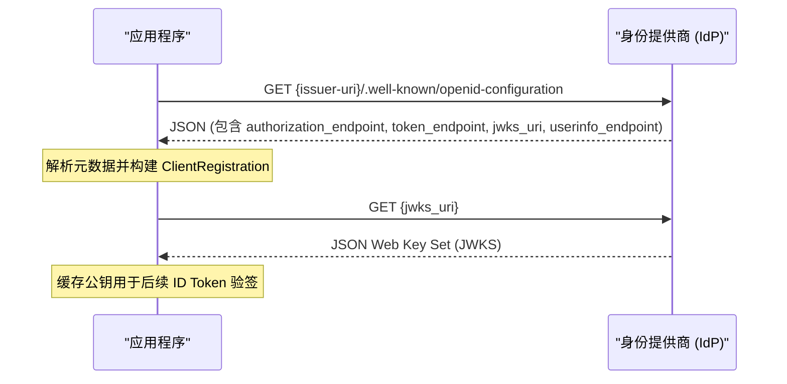
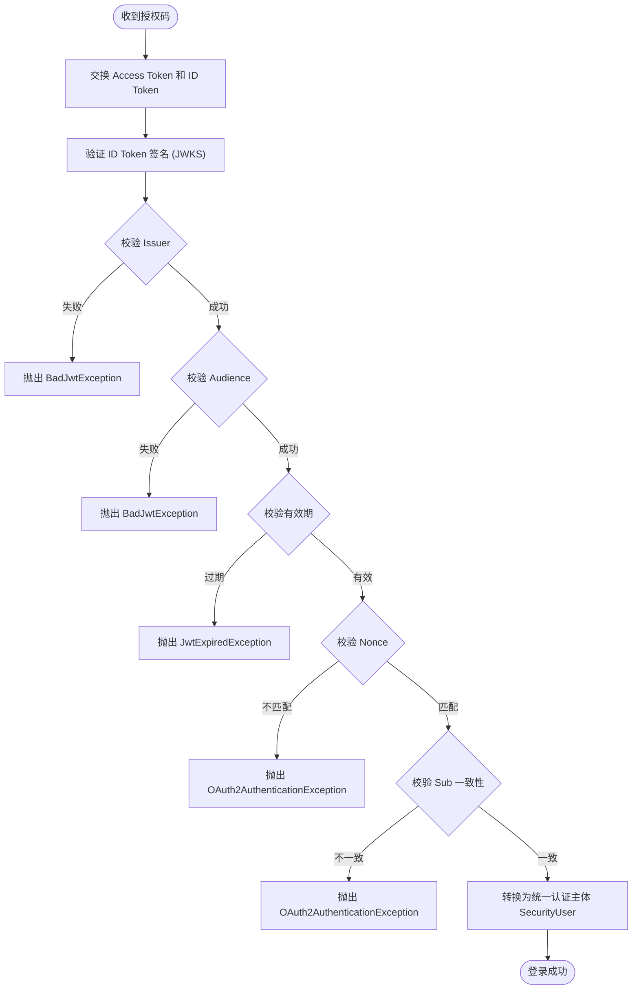

# OIDC Discovery 协议与 JWKS 验证

<cite>
**Referenced Files in This Document **
- [oidc.md](file://boot/login-security-spring-boot-starter/docs/oidc.md)
- [sso-overview.md](file://boot/login-security-spring-boot-starter/docs/sso-overview.md)
- [oauth2.md](file://boot/login-security-spring-boot-starter/docs/oauth2.md)
- [Oauth2Config.java](file://boot/login-security-spring-boot-starter/src/main/java/com/cu/framework/authentication/oauth2/Oauth2Config.java)
- [SecurityUserOidcUserService.java](file://boot/login-security-spring-boot-starter/src/main/java/com/cu/framework/authentication/oauth2/SecurityUserOidcUserService.java)
- [SsoSecurityUserConverter.java](file://boot/login-security-spring-boot-starter/src/main/java/com/cu/framework/authentication/oauth2/SsoSecurityUserConverter.java)
- [Oauth2OidcProperties.java](file://boot/login-security-spring-boot-starter/src/main/java/com/cu/framework/authentication/oauth2/Oauth2OidcProperties.java)
- [RoutingOAuth2UserService.java](file://boot/login-security-spring-boot-starter/src/main/java/com/cu/framework/authentication/oauth2/RoutingOAuth2UserService.java)
- [SecurityUserOAuth2UserService.java](file://boot/login-security-spring-boot-starter/src/main/java/com/cu/framework/authentication/oauth2/SecurityUserOAuth2UserService.java)
- [SsoErrorCodes.java](file://boot/login-security-spring-boot-starter/src/main/java/com/cu/framework/authentication/exception/SsoErrorCodes.java)
</cite>

## Table of Contents
1. [引言](#引言)
2. [启动期网络依赖](#启动期网络依赖)
3. [ID Token 校验流程](#id-token-校验流程)
4. [Nonce 与 State 机制](#nonce-与-state-机制)
5. [常见排错清单](#常见排错清单)
6. [结论](#结论)

## 引言

OIDC（OpenID Connect）是建立在 OAuth2 授权码模式之上的身份层协议。本框架通过 `login-security-spring-boot-starter` 提供了对 OIDC 协议的完整支持，包括自动发现端点、ID Token 签名验证、声明一致性校验以及本地账号映射。本文档详细说明启动期的网络依赖行为、ID Token 的完整校验链路、重放攻击防护机制（nonce/state），并提供详细的故障排查指南。

## 启动期网络依赖

在配置 `protocol-type: oidc` 的客户端时，应用启动阶段会立即产生网络请求。这是由 Spring Security 的 `ClientRegistrations.fromIssuerLocation()` 方法触发的同步调用。

### 自动发现流程

当应用在启动期构建 `ClientRegistration` 对象时，会根据配置的 `issuer-uri` 执行以下操作：

**Diagram sources **
- [Oauth2Config.java:220-240](file://boot/login-security-spring-boot-starter/src/main/java/com/cu/framework/authentication/oauth2/Oauth2Config.java#L220-L240)
- [oidc.md:15-25](file://boot/login-security-spring-boot-starter/docs/oidc.md#L15-L25)

### 关键影响

1. **强耦合性**：如果身份源不在线或 `.well-known/openid-configuration` 端点不可访问，整个应用将无法启动。这不是登录时才发生的失败，而是启动期的硬性依赖。
2. **证书校验**：Discovery 请求使用 Spring 自带的 HTTP 客户端，始终执行标准的 SSL 证书校验。即使配置了 `ignore-ssl: true`，该设置也仅作用于后续的 userinfo 请求，不影响 Discovery 阶段。
3. **本地测试建议**：在离线或本地演示环境中，若希望避免网络请求，应改用 `protocol-type: oauth2` 并手动配置各个端点地址。

**Section sources**
- [Oauth2Config.java:220-240](file://boot/login-security-spring-boot-starter/src/main/java/com/cu/framework/authentication/oauth2/Oauth2Config.java#L220-L240)
- [Oauth2OidcProperties.java:170-180](file://boot/login-security-spring-boot-starter/src/main/java/com/cu/framework/authentication/oauth2/Oauth2OidcProperties.java#L170-L180)

## ID Token 校验流程

ID Token 是 OIDC 协议的核心，它是一个经过签名的 JWT（JSON Web Token），用于证明用户的身份。本框架继承了 Spring Security 的 `OidcUserService`，确保了所有标准校验步骤的执行。

### 校验步骤详解

ID Token 的校验发生在用户完成身份源登录并回调到应用之后，具体流程如下：

**Diagram sources **
- [SecurityUserOidcUserService.java:25-35](file://boot/login-security-spring-boot-starter/src/main/java/com/cu/framework/authentication/oauth2/SecurityUserOidcUserService.java#L25-L35)
- [SsoSecurityUserConverter.java:45-65](file://boot/login-security-spring-boot-starter/src/main/java/com/cu/framework/authentication/oauth2/SsoSecurityUserConverter.java#L45-L65)

### 核心校验项说明

| 校验项 | 说明 | 失败后果 |
| --- | --- | --- |
| **签名验证** | 使用从 `jwks_uri` 获取的公钥验证 JWT 签名 | `BadJwtException: Signed JWT rejected` |
| **Issuer 校验** | 确保 Token 由预期的身份源签发 | `BadJwtException: Invalid issuer` |
| **Audience 校验** | 确保 Token 是发给本应用的 (`client_id`) | `BadJwtException: Invalid audience` |
| **有效期校验** | 检查 `exp` 和 `iat` 声明 | `JwtExpiredException` |
| **Nonce 校验** | 验证 Token 中的 nonce 与会话中存储的一致 | `OAuth2AuthenticationException: invalid_nonce` |
| **Sub 一致性** | 确保 ID Token 的 `sub` 与 UserInfo 的 `sub` 相同 | `OAuth2AuthenticationException` |

### 本地账号映射

在所有协议级校验通过后，框架会通过 `SsoSecurityUserConverter` 将身份源主体转换为统一的 `SecurityUser`：

1. **提取用户名**：根据配置的 `user-name-attribute-name`（如 `preferred_username`）从声明中提取值；若未配置，则回退使用 `sub`。
2. **查询本地库**：调用 `SecurityUserDetailsService.loadUserByUsername()` 查找本地账号。
3. **失败处理**：若本地不存在对应账号，抛出带有错误码 `sso_local_user_not_found` 的异常，不会创建无权限的会话。

**Section sources**
- [SecurityUserOidcUserService.java:1-37](file://boot/login-security-spring-boot-starter/src/main/java/com/cu/framework/authentication/oauth2/SecurityUserOidcUserService.java#L1-L37)
- [SsoSecurityUserConverter.java:1-75](file://boot/login-security-spring-boot-starter/src/main/java/com/cu/framework/authentication/oauth2/SsoSecurityUserConverter.java#L1-L75)
- [SsoErrorCodes.java:1-19](file://boot/login-security-spring-boot-starter/src/main/java/com/cu/framework/authentication/exception/SsoErrorCodes.java#L1-L19)

## Nonce 与 State 机制

为了防止重放攻击和 CSRF（跨站请求伪造），OIDC 协议引入了 `state` 和 `nonce` 两个随机数机制。

### State 机制（防 CSRF）

- **生成时机**：在发起授权请求（`/oauth2/authorization/{id}`）时生成。
- **存储位置**：保存在服务端的 `HttpSession` 中（通过 `HttpSessionOAuth2AuthorizationRequestRepository`）。
- **校验时机**：在回调端点（`/login/oauth2/code/{id}`）处理授权码时校验。
- **作用**：确保回调请求是由当前浏览器发起的原始授权请求触发的。

### Nonce 机制（防重放）

- **生成时机**：在 OIDC 授权请求中额外生成一个随机字符串。
- **存储位置**：同样保存在服务端的 `HttpSession` 中。
- **校验时机**：在解析和验证 ID Token 时，比对 Token 载荷中的 `nonce` 声明与会话中存储的值。
- **作用**：确保收到的 ID Token 是针对本次登录请求新颁发的，而不是被攻击者截获并重放的旧 Token。

### 会话依赖的重要性

由于 `state` 和 `nonce` 都存储在会话中，浏览器在从应用跳转到 IdP 再跳回的过程中，必须能够携带会话 Cookie。如果出现以下情况，校验将失败：
1. 跨域跳转导致 Cookie 丢失（需检查 SameSite 策略）。
2. 多个标签页同时登录导致会话覆盖。
3. 浏览器隐私模式禁用了第三方 Cookie。

**Section sources**
- [oauth2.md:35-40](file://boot/login-security-spring-boot-starter/docs/oauth2.md#L35-L40)
- [oidc.md:55-60](file://boot/login-security-spring-boot-starter/docs/oidc.md#L55-L60)

## 常见排错清单

以下是基于实际开发和维护经验总结的 OIDC 常见问题及解决方案：

### 1. 应用启动失败：连接超时或 404
- **现象**：控制台报错 `ConnectException` 或 `404 Not Found`。
- **原因**：`issuer-uri` 配置错误或 IdP 的 Discovery 端点不可达。
- **解决**：确认 `issuer-uri` 是否可从本机访问，并手动在浏览器中访问 `{issuer-uri}/.well-known/openid-configuration` 确认返回标准 JSON。

### 2. ID Token 签名拒绝：Signed JWT rejected
- **现象**：登录回调时报 `BadJwtException`。
- **原因**：JWKS 地址配置错误或公钥不匹配。
- **解决**：检查 `jwk-set-uri` 是否指向正确的端点，确认返回的 `keys` 数组中包含用于签名的公钥。不要配置需要额外查询参数的动态地址。

### 3. Nonce 校验失败：invalid_nonce
- **现象**：报 `OAuth2AuthenticationException: invalid_nonce`。
- **原因**：会话丢失或时钟偏差。
- **解决**：确认浏览器在跳转期间正确携带了 Cookie；检查应用服务器与 IdP 服务器的时间同步情况。

### 4. 本地账号未找到：sso_local_user_not_found
- **现象**：登录失败，日志显示该错误码。
- **原因**：`user-name-attribute-name` 配置的字段值与本地数据库中的用户名不匹配。
- **解决**：检查 IdP 返回的 UserInfo 或 ID Token 声明，确认配置的属性名（如 `preferred_username`）确实存在且值正确。注意 `sub` 通常是数字 ID，很少直接等于用户名。

### 5. SSL 证书错误：ignore-ssl 无效
- **现象**：即使在配置中设置了 `ignore-ssl: true`，启动期仍报 SSL 错误。
- **原因**：`ignore-ssl` 仅豁免 userinfo 请求的证书校验，Discovery 和 JWKS 拉取仍走标准校验。
- **解决**：将 IdP 的自签名证书导入 JDK 的 `cacerts` 信任库。

### 6. UserInfo 返回 HTML 而非 JSON
- **现象**：报 `Could not extract response: no suitable HttpMessageConverter found ... content type [text/html]`。
- **原因**：UserInfo 端点未认证或被重定向到了登录页。
- **解决**：使用 curl 带上有效的 `access_token` 直接请求 userinfo 端点，确认其返回的是 JSON 格式数据。

**Section sources**
- [oidc.md:65-100](file://boot/login-security-spring-boot-starter/docs/oidc.md#L65-L100)
- [RoutingOAuth2UserService.java:70-90](file://boot/login-security-spring-boot-starter/src/main/java/com/cu/framework/authentication/oauth2/RoutingOAuth2UserService.java#L70-L90)

## 结论

OIDC 协议通过标准化的 ID Token 和严格的校验流程，为单点登录提供了可靠的身份保障。在本框架中，启动期的自动发现简化了配置，但同时也带来了网络依赖；ID Token 的多重校验确保了身份的真实性；而 `nonce` 和 `state` 机制则有效防御了常见的网络攻击。在实际使用中，务必关注 `user-name-attribute-name` 的正确配置以及会话 Cookie 的完整性，以确保登录链路的顺畅。