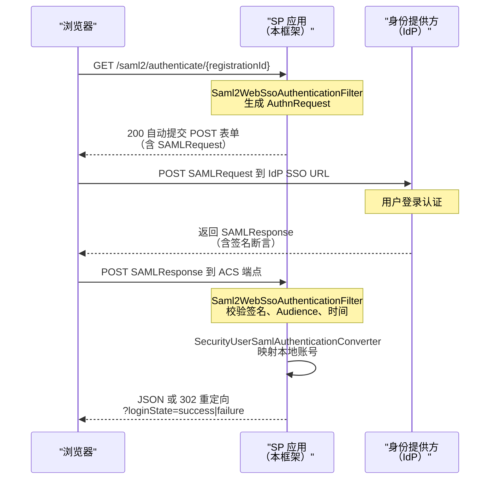
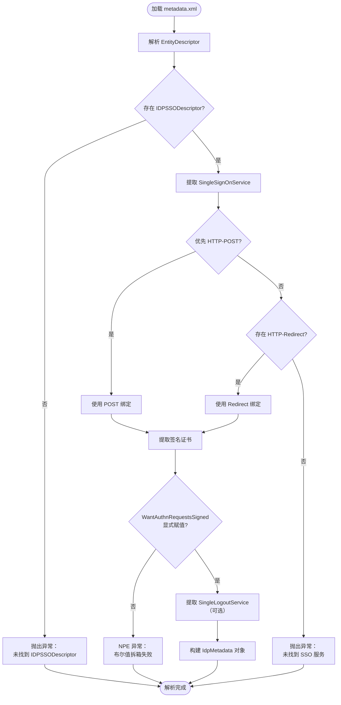
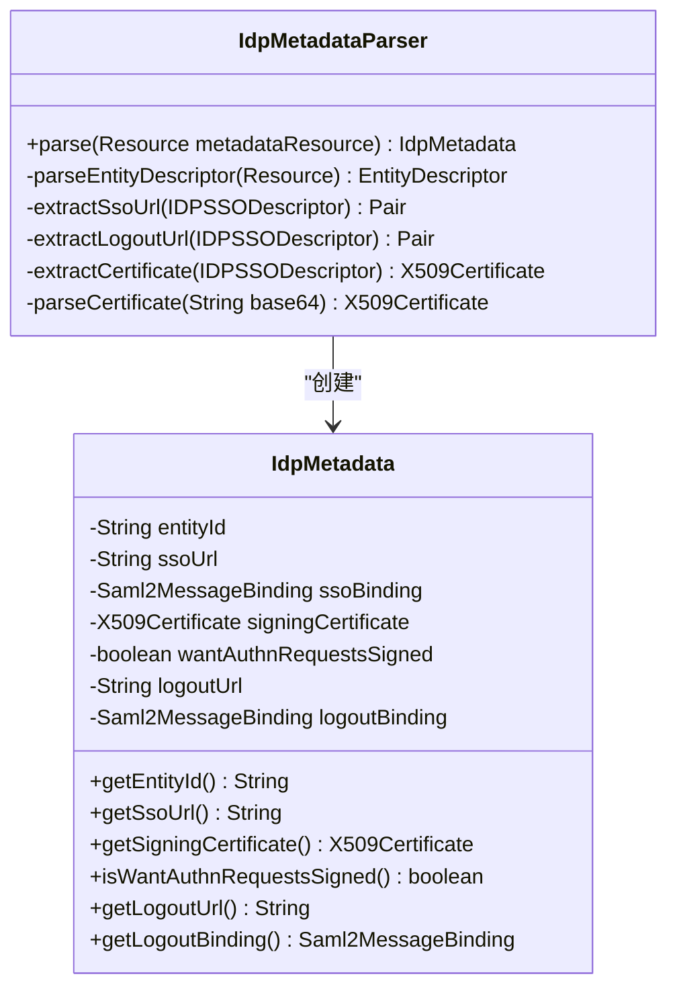
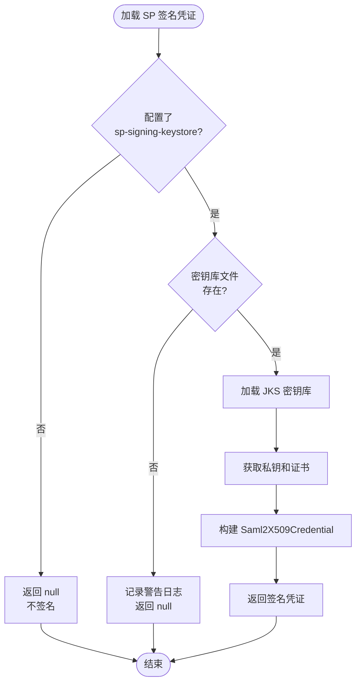
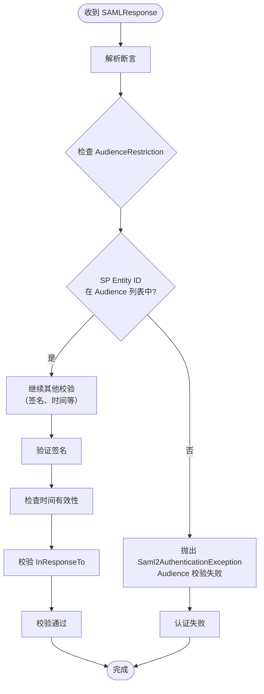
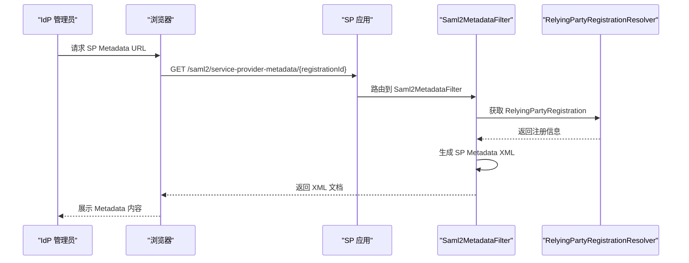
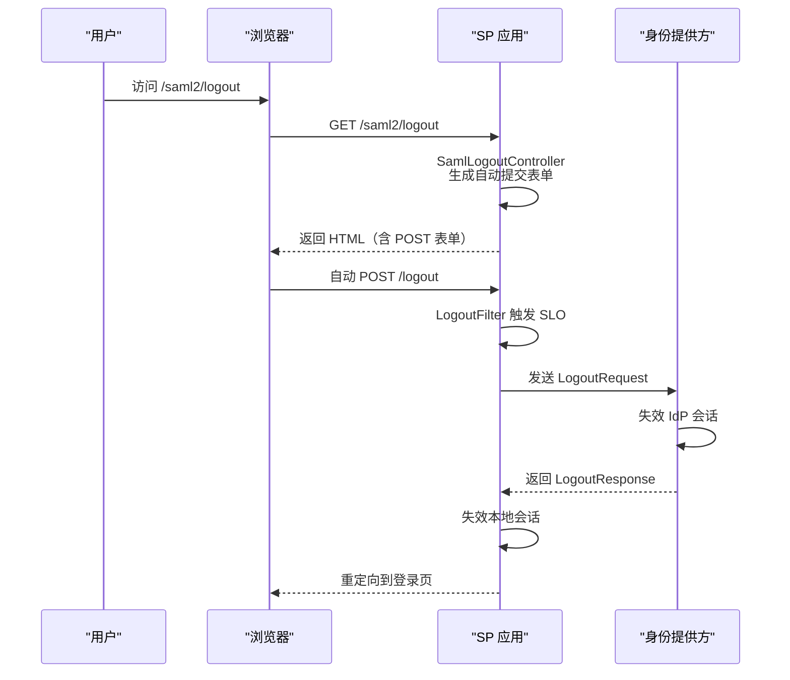
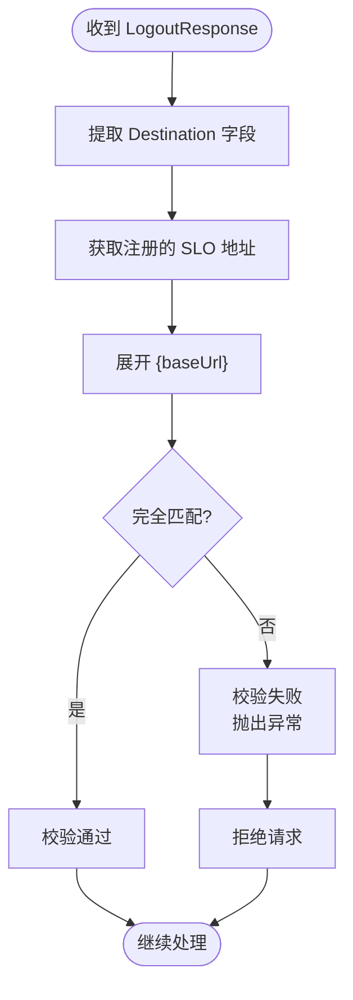

# SAML2 单点登录集成指南

<cite>
**本文档引用文件 **
- [SamlConfig.java](file://boot/login-security-spring-boot-starter/src/main/java/com/cu/framework/authentication/saml/SamlConfig.java)
- [IdpMetadataParser.java](file://boot/login-security-spring-boot-starter/src/main/java/com/cu/framework/authentication/saml/IdpMetadataParser.java)
- [SamlProperties.java](file://boot/login-security-spring-boot-starter/src/main/java/com/cu/framework/authentication/saml/properties/SamlProperties.java)
- [SamlSecurityUser.java](file://boot/login-security-spring-boot-starter/src/main/java/com/cu/framework/authentication/saml/SamlSecurityUser.java)
- [SecurityUserSamlAuthenticationConverter.java](file://boot/login-security-spring-boot-starter/src/main/java/com/cu/framework/authentication/saml/SecurityUserSamlAuthenticationConverter.java)
- [SamlLogoutController.java](file://boot/login-security-spring-boot-starter/src/main/java/com/cu/framework/authentication/saml/SamlLogoutController.java)
- [SamlConfiguredCondition.java](file://boot/login-security-spring-boot-starter/src/main/java/com/cu/framework/authentication/config/SamlConfiguredCondition.java)
- [saml2.md](file://boot/login-security-spring-boot-starter/docs/saml2.md)
- [sso-overview.md](file://boot/login-security-spring-boot-starter/docs/sso-overview.md)
- [application.yml](file://docs/application.yml)
- [idp-metadata.xml](file://sample/login-boot-sample/src/main/resources/saml/metadata/idp-metadata.xml)
</cite>

## 目录

1. [简介](#简介)
2. [SP 发起流程详解](#sp-发起流程详解)
3. [Metadata 解析要求](#metadata-解析要求)
4. [签名配置机制](#签名配置机制)
5. [Audience 校验原理](#audience-校验原理)
6. [SP Metadata 端点暴露](#sp-metadata-端点暴露)
7. [SLO 单点登出机制](#slo-单点登出机制)
8. [配置参考](#配置参考)
9. [常见问题与故障排查](#常见问题与故障排查)
10. [安全注意事项](#安全注意事项)

## 简介

本指南详细说明框架中 SAML2 单点登录（SP 发起模式）的完整实现机制，涵盖协议流程、元数据解析、签名验证、受众校验、服务提供者元数据端点以及单点登出（SLO）等核心主题。

SAML2 通过"断言（Assertion）"机制表达身份提供方（IdP）已完成用户认证的事实。本框架作为服务提供方（SP），仅支持 SP 发起的登录流程，不支持 IdP 发起模式。

**Section sources**
- [saml2.md:1-30](file://boot/login-security-spring-boot-starter/docs/saml2.md#L1-L30)
- [sso-overview.md:1-50](file://boot/login-security-spring-boot-starter/docs/sso-overview.md#L1-L50)

## SP 发起流程详解

### 完整交互时序

SP 发起的 SAML2 登录包含以下关键步骤：



**Diagram sources **
- [SamlConfig.java:80-110](file://boot/login-security-spring-boot-starter/src/main/java/com/cu/framework/authentication/saml/SamlConfig.java#L80-L110)
- [SecurityUserSamlAuthenticationConverter.java:45-65](file://boot/login-security-spring-boot-starter/src/main/java/com/cu/framework/authentication/saml/SecurityUserSamlAuthenticationConverter.java#L45-L65)

### 关键端点说明

| 用途 | 方法 | 默认路径 | 处理组件 |
| --- | --- | --- | --- |
| 发起登录 | GET | `/saml2/authenticate/{registrationId}` | `Saml2WebSsoAuthenticationFilter` |
| ACS 回调 | POST | `/login/saml2/sso/{registrationId}` | `Saml2WebSsoAuthenticationFilter` |
| SP Metadata | GET | `/saml2/service-provider-metadata/{registrationId}` | `Saml2MetadataFilter` |
| GET 退出 | GET | `/saml2/logout` | `SamlLogoutController` |
| 实际登出 | POST | `/logout` | Spring Security `LogoutFilter` |
| SLO 请求/响应 | POST | `/logout/saml2/slo` | `Saml2LogoutRequestFilter` / `Saml2LogoutResponseFilter` |

**重要说明：**
- `/saml2/authenticate/{registrationId}` 是 Spring Security 固定入口，本框架未将其做成可配置项
- 要自定义登录入口只能另建 Controller 进行重定向
- ACS 路径模板必须包含 `{registrationId}` 占位符，构建时框架会前置 `{baseUrl}`

**Section sources**
- [SamlConfig.java:85-105](file://boot/login-security-spring-boot-starter/src/main/java/com/cu/framework/authentication/saml/SamlConfig.java#L85-L105)
- [SamlProperties.java:30-35](file://boot/login-security-spring-boot-starter/src/main/java/com/cu/framework/authentication/saml/properties/SamlProperties.java#L30-L35)
- [saml2.md:32-50](file://boot/login-security-spring-boot-starter/docs/saml2.md#L32-L50)

## Metadata 解析要求

### 解析器实现

框架通过 `IdpMetadataParser` 类从 IdP 提供的 metadata.xml 文件中自动解析关键信息，包括 Entity ID、SSO URL、签名证书和登出端点。



**Diagram sources **
- [IdpMetadataParser.java:45-90](file://boot/login-security-spring-boot-starter/src/main/java/com/cu/framework/authentication/saml/IdpMetadataParser.java#L45-L90)
- [IdpMetadataParser.java:100-145](file://boot/login-security-spring-boot-starter/src/main/java/com/cu/framework/authentication/saml/IdpMetadataParser.java#L100-L145)

### Metadata 文件硬性要求

IdP 提供的 metadata.xml 必须满足以下条件：

1. **根元素要求**：必须是 `EntityDescriptor`，并包含 `IDPSSODescriptor` 子元素
2. **SSO 服务端点**：至少包含一个 `SingleSignOnService`，框架优先选择 HTTP-POST 绑定，其次 HTTP-Redirect
3. **签名证书**：必须包含 `KeyDescriptor use="signing"` 下的 X.509 证书
4. **WantAuthnRequestsSigned**：**必须显式写值**（true 或 false），解析器会将其拆箱为 boolean 类型，缺省会导致 NPE
5. **单点登出服务**：`SingleLogoutService` 为可选，不存在时不注册 SLO 功能

### 解析逻辑细节



**Diagram sources **
- [IdpMetadataParser.java:1-50](file://boot/login-security-spring-boot-starter/src/main/java/com/cu/framework/authentication/saml/IdpMetadataParser.java#L1-L50)
- [IdpMetadataParser.java:175-232](file://boot/login-security-spring-boot-starter/src/main/java/com/cu/framework/authentication/saml/IdpMetadataParser.java#L175-L232)

**重要提示：**
- Metadata 在应用启动时加载一次，更新 metadata 后需要重启应用
- 证书有有效期，过期前需从 IdP 管理员处获取新证书并更新 metadata 文件
- 当前不支持手动填写 entityId、SSO URL 或证书，必须通过 metadata 文件解析

**Section sources**
- [IdpMetadataParser.java:45-170](file://boot/login-security-spring-boot-starter/src/main/java/com/cu/framework/authentication/saml/IdpMetadataParser.java#L45-L170)
- [saml2.md:85-105](file://boot/login-security-spring-boot-starter/docs/saml2.md#L85-L105)

## 签名配置机制

### 签名场景

SAML2 协议中的签名涉及两个方向：

1. **IdP 对 SAMLResponse 签名**：通过 metadata 中的签名证书验证，确保断言未被篡改
2. **SP 对 AuthnRequest/LogoutRequest 签名**：当 IdP metadata 中 `WantAuthnRequestsSigned=true` 时必须配置

### SP 签名密钥库配置

```yaml
cu:
  security:
    login:
      saml:
        sp-signing-keystore:
          keystore-resource: classpath:saml/sp-keystore.jks  # JKS 文件路径
          keystore-password: changeit                         # 密钥库密码
          key-alias: sp-signing                               # 密钥别名
          key-password: changeit                              # 密钥密码
```

### 密钥库生成命令

```bash
# 生成密钥对
keytool -genkeypair -alias sp-signing -keyalg RSA -keysize 2048 \
  -validity 3650 -keystore sp-keystore.jks \
  -storepass changeit -keypass changeit

# 导出证书供 IdP 使用
keytool -exportcert -alias sp-signing -keystore sp-keystore.jks \
  -storepass changeit -file sp-certificate.crt
```

### 签名凭证加载流程



**Diagram sources **
- [SamlConfig.java:195-225](file://boot/login-security-spring-boot-starter/src/main/java/com/cu/framework/authentication/saml/SamlConfig.java#L195-L225)

### 签名凭证应用

在构建 `RelyingPartyRegistration` 时，如果加载到签名凭证，会将其添加到注册信息中：

```java
Saml2X509Credential signingCredential = loadSpSigningCredential();
if (signingCredential != null) {
    builder.signingX509Credentials(credentials -> credentials.add(signingCredential));
}
```

此凭证用于：
- 签名发送给 IdP 的 `AuthnRequest`
- 签名发送给 IdP 的 `LogoutRequest`

**Section sources**
- [SamlConfig.java:195-225](file://boot/login-security-spring-boot-starter/src/main/java/com/cu/framework/authentication/saml/SamlConfig.java#L195-L225)
- [SamlConfig.java:175-190](file://boot/login-security-spring-boot-starter/src/main/java/com/cu/framework/authentication/saml/SamlConfig.java#L175-L190)
- [saml2.md:107-130](file://boot/login-security-spring-boot-starter/docs/saml2.md#L107-L130)

## Audience 校验原理

### Audience 概念

Audience（受众）是 SAML2 断言中的重要安全字段，用于指定该断言的目标接收者。IdP 在生成 SAMLResponse 时会在断言中包含 `AudienceRestriction` 条件，其中列出允许的受众列表。

### 校验机制

框架通过以下方式确保 Audience 校验正确执行：

1. **SP Entity ID 配置**：`sp-entity-id` 必须与 IdP 侧配置的 SP entityId/Audience 完全一致
2. **自动校验**：Spring Security 的 `OpenSamlAuthenticationProvider` 会自动校验断言中的 Audience 是否匹配 SP 的 Entity ID
3. **校验失败处理**：不匹配时会抛出 `Saml2AuthenticationException`，认证失败



**Diagram sources **
- [SecurityUserSamlAuthenticationConverter.java:50-75](file://boot/login-security-spring-boot-starter/src/main/java/com/cu/framework/authentication/saml/SecurityUserSamlAuthenticationConverter.java#L50-L75)

### 配置一致性要求

```yaml
cu:
  security:
    login:
      saml:
        registrations:
          - registration-id: corp-saml
            sp-entity-id: cu-framework-local  # 必须与 IdP 侧配置的 Audience 完全一致
```

**关键点：**
- `sp-entity-id` 的值必须与 IdP 管理员在 IdP 侧为本 SP 登记的 Entity ID 完全一致（包括大小写）
- 不一致会导致 `AudienceRestriction` 校验失败，用户无法登录
- 该字段同时用作 SP 在 SAML 协议中的身份标识

**Section sources**
- [SamlProperties.java:115-125](file://boot/login-security-spring-boot-starter/src/main/java/com/cu/framework/authentication/saml/properties/SamlProperties.java#L115-L125)
- [saml2.md:132-145](file://boot/login-security-spring-boot-starter/docs/saml2.md#L132-L145)

## SP Metadata 端点暴露

### 端点说明

Spring Security 5.7 默认不暴露 SP 的 metadata 端点，本框架在 `SamlConfig` 中手动挂载 `Saml2MetadataFilter` 以提供此功能：

**端点地址：** `GET /saml2/service-provider-metadata/{registrationId}`

### 返回内容

该端点返回包含以下信息的 XML 文档：
- SP 的 Entity ID
- ACS（Assertion Consumer Service）端点地址
- 单点登出（SLO）端点地址
- SP 签名证书（配置了 keystore 时）

### 实现机制



**Diagram sources **
- [SamlConfig.java:108-115](file://boot/login-security-spring-boot-starter/src/main/java/com/cu/framework/authentication/saml/SamlConfig.java#L108-L115)

### 代码实现

```java
// 在 SamlConfig.customizer() 方法中
Saml2MetadataFilter saml2MetadataFilter = new Saml2MetadataFilter(
    (RelyingPartyRegistrationResolver)new DefaultRelyingPartyRegistrationResolver(relyingPartyRegistrationRepository()),
    new OpenSamlMetadataResolver()
);
http.addFilterBefore(saml2MetadataFilter, Saml2WebSsoAuthenticationFilter.class);
```

### 使用场景

1. **提供给 IdP 管理员**：将返回的 XML 交给 IdP 管理员，用于在 IdP 侧登记 SP 信息
2. **自动化配置**：某些 IdP 支持通过 URL 自动拉取 SP metadata 进行配置
3. **验证配置**：用于确认 SP 的 Entity ID、ACS 地址等配置是否正确

**Section sources**
- [SamlConfig.java:108-115](file://boot/login-security-spring-boot-starter/src/main/java/com/cu/framework/authentication/saml/SamlConfig.java#L108-L115)
- [saml2.md:107-125](file://boot/login-security-spring-boot-starter/docs/saml2.md#L107-L125)

## SLO 单点登出机制

### SLO 流程概述

单点登出（Single Logout，SLO）允许用户在任一系统登出时，通知所有参与的系统同步登出。框架支持两种 SLO 场景：

1. **SP 发起登出**：用户在本系统点击登出，通知 IdP 及其他 SP 登出
2. **IdP 发起登出**：用户在 IdP 或其他 SP 登出，IdP 通知本系统登出

### SP 发起登出流程



**Diagram sources **
- [SamlLogoutController.java:25-48](file://boot/login-security-spring-boot-starter/src/main/java/com/cu/framework/authentication/saml/SamlLogoutController.java#L25-L48)
- [SamlConfig.java:95-103](file://boot/login-security-spring-boot-starter/src/main/java/com/cu/framework/authentication/saml/SamlConfig.java#L95-L103)

### GET 转 POST 机制

由于 Spring Security 的 `/logout` 端点默认只接受 POST 请求（CSRF 保护），框架提供了 `SamlLogoutController` 来处理 GET 请求：

```java
@GetMapping("/saml2/logout")
public void logout(HttpServletRequest request, HttpServletResponse response) throws IOException {
    String logoutUrl = request.getContextPath() + "/logout";
    
    // 获取 CSRF token（如果启用了 CSRF）
    String csrfInput = "";
    CsrfToken csrfToken = (CsrfToken) request.getAttribute(CsrfToken.class.getName());
    if (csrfToken != null) {
        csrfInput = "<input type=\"hidden\" name=\"" + csrfToken.getParameterName()
                + "\" value=\"" + csrfToken.getToken() + "\"/>";
    }
    
    response.setContentType("text/html;charset=UTF-8");
    PrintWriter writer = response.getWriter();
    writer.write("<!DOCTYPE html><html><head><title>Logging out...</title></head><body>");
    writer.write("<form id=\"logoutForm\" method=\"POST\" action=\"" + logoutUrl + "\">");
    writer.write(csrfInput);
    writer.write("</form>");
    writer.write("<script>document.getElementById('logoutForm').submit();</script>");
    writer.write("</body></html>");
    writer.flush();
}
```

### SLO 相关端点配置

```yaml
cu:
  security:
    login:
      saml:
        logout-request-url: /logout/saml2/slo   # SP 接收 LogoutRequest 的地址
        logout-response-url: /logout/saml2/slo  # SP 接收 LogoutResponse 的地址
```

### Destination 校验

Spring Security 的 `OpenSamlLogoutResponseValidator.validateDestination` 使用全匹配方式校验 destination：



**Diagram sources **
- [SamlConfig.java:155-165](file://boot/login-security-spring-boot-starter/src/main/java/com/cu/framework/authentication/saml/SamlConfig.java#L155-L165)

**重要提示：**
- 反向代理场景下，需确保 `{baseUrl}` 解析出的 scheme/host/port 与 IdP 侧登记的 destination 完全一致
- 如果 IdP metadata 中没有 `SingleLogoutService`，则只失效本地会话，不会通知 IdP

### 会话索引传递

框架在 `SecurityUserSamlAuthenticationConverter` 中保留断言中的会话索引，用于 SLO 时定位 IdP 侧的会话：

```java
private List<String> sessionIndexes(Response response) {
    List<String> indexes = new ArrayList<>();
    Assertion assertion = response.getAssertions().get(0);
    for (AuthnStatement statement : assertion.getAuthnStatements()) {
        String sessionIndex = statement.getSessionIndex();
        if (sessionIndex != null) {
            indexes.add(sessionIndex);
        }
    }
    return indexes;
}
```

**Section sources**
- [SamlLogoutController.java:1-50](file://boot/login-security-spring-boot-starter/src/main/java/com/cu/framework/authentication/saml/SamlLogoutController.java#L1-L50)
- [SamlConfig.java:95-103](file://boot/login-security-spring-boot-starter/src/main/java/com/cu/framework/authentication/saml/SamlConfig.java#L95-L103)
- [SecurityUserSamlAuthenticationConverter.java:75-85](file://boot/login-security-spring-boot-starter/src/main/java/com/cu/framework/authentication/saml/SecurityUserSamlAuthenticationConverter.java#L75-L85)
- [saml2.md:147-165](file://boot/login-security-spring-boot-starter/docs/saml2.md#L147-L165)

## 配置参考

### 完整配置示例

```yaml
cu:
  security:
    login:
      saml:
        # SP 接收 SAMLResponse 的 ACS 路径模板（必须包含 {registrationId}）
        login-processing-url: /login/saml2/sso/{registrationId}
        # SP 单点登出请求接收地址
        logout-request-url: /logout/saml2/slo
        # SP 单点登出响应接收地址
        logout-response-url: /logout/saml2/slo
        
        # IdP 注册配置列表（至少一条才装配 SAML）
        registrations:
          - registration-id: corp-saml              # 注册 ID（留空时回退 sp-entity-id）
            sp-entity-id: cu-framework-local         # SP Entity ID（需与 IdP 侧 Audience 一致）
            display-name: 企业 SAML                   # 登录页按钮文案
            metadata-resource: classpath:saml/idp-metadata.xml  # IdP metadata 文件路径
        
        # SP 签名密钥库配置（不配则 AuthnRequest/LogoutRequest 不签名）
        sp-signing-keystore:
          keystore-resource: classpath:saml/sp-keystore.jks
          keystore-password: changeit
          key-alias: sp-signing
          key-password: changeit
```

### 配置项详解

#### 全局配置

| 配置项 | 默认值 | 必填 | 说明 |
| --- | --- | --- | --- |
| `login-processing-url` | `/login/saml2/sso/{registrationId}` | 否 | ACS 路径模板，**必须包含 `{registrationId}`** |
| `logout-request-url` | `/logout/saml2/slo` | 否 | SP 侧 LogoutRequest 接收地址 |
| `logout-response-url` | `/logout/saml2/slo` | 否 | SP 侧 LogoutResponse 接收地址 |
| `registrations` | — | 否 | 留空时不装配 SAML；配置后至少一条 |
| `sp-signing-keystore` | — | 否 | 不配则 AuthnRequest/LogoutRequest 不签名 |

#### 每个 registrations[i] 配置

| 配置项 | 默认值 | 必填 | 说明 |
| --- | --- | --- | --- |
| `registration-id` | 回退 `sp-entity-id` | 建议 | 用于端点路径和 ACS 识别 |
| `sp-entity-id` | `cu-saml` | 是 | SP Entity ID，必须与 IdP 侧配置一致 |
| `metadata-resource` | `classpath:saml/idp-metadata.xml` | 是 | IdP metadata 文件路径 |
| `display-name` | 回退 `registration-id` | 否 | 登录页按钮文案，不参与协议字段 |

#### sp-signing-keystore 配置

| 配置项 | 默认值 | 必填 | 说明 |
| --- | --- | --- | --- |
| `keystore-resource` | — | 否 | JKS 文件路径，如 `classpath:saml/sp-keystore.jks` |
| `keystore-password` | `changeit` | 否 | JKS 密码 |
| `key-alias` | `sp-signing` | 否 | 密钥别名 |
| `key-password` | `changeit` | 否 | 密钥密码 |

### 装配条件

SAML 配置仅在 `cu.security.login.saml.registrations` 至少配置一条时才生效，由 `SamlConfiguredCondition` 控制：

```java
public class SamlConfiguredCondition implements Condition {
    @Override
    public boolean matches(ConditionContext context, AnnotatedTypeMetadata metadata) {
        return !Binder.get(context.getEnvironment())
                .bind("cu.security.login.saml.registrations",
                        Bindable.listOf(SamlProperties.RegistrationSamlProperties.class))
                .orElse(Collections.emptyList())
                .isEmpty();
    }
}
```

纯账号密码登录的部署无需配置 registrations，此时不注册 SAML 登录过滤器。

**Section sources**
- [SamlProperties.java:1-152](file://boot/login-security-spring-boot-starter/src/main/java/com/cu/framework/authentication/saml/properties/SamlProperties.java#L1-L152)
- [SamlConfiguredCondition.java:1-29](file://boot/login-security-spring-boot-starter/src/main/java/com/cu/framework/authentication/config/SamlConfiguredCondition.java#L1-L29)
- [application.yml:180-212](file://docs/application.yml#L180-L212)

## 常见问题与故障排查

### 问题 1：registrations 为空导致 SAML 不装配

**现象：** 访问 `/saml2/authenticate/...` 返回 404

**原因：** `cu.security.login.saml.registrations` 未配置或为空列表

**解决方案：** 
- 检查配置文件中的 `registrations` 配置
- 确保至少配置了一个注册项
- 查看启动日志确认 SAML 配置是否生效

### 问题 2：启动时 NPE 异常

**现象：** 应用启动失败，抛出 NullPointerException

**原因：** IdP metadata.xml 中 `WantAuthnRequestsSigned` 未显式赋值

**解决方案：**
- 打开 metadata.xml 文件
- 确保 `IDPSSODescriptor` 元素的 `WantAuthnRequestsSigned` 属性有明确值（true 或 false）
- 示例：`<md:IDPSSODescriptor WantAuthnRequestsSigned="false" ...>`

### 问题 3：Audience 不匹配

**现象：** 登录时认证失败，日志显示 Audience 校验错误

**原因：** `sp-entity-id` 与 IdP 侧配置的 Audience 不一致

**解决方案：**
- 核对配置文件中的 `sp-entity-id` 值
- 联系 IdP 管理员确认 IdP 侧登记的 SP Entity ID
- 确保两者完全一致（包括大小写）

### 问题 4：IdP 拒绝 AuthnRequest

**现象：** 跳转到 IdP 后被拒绝，提示请求未签名

**原因：** IdP metadata 中 `WantAuthnRequestsSigned=true` 但 SP 未配置签名密钥库

**解决方案：**
- 生成 SP 签名密钥库（参见签名配置章节）
- 在配置文件中添加 `sp-signing-keystore` 配置
- 将导出的证书提供给 IdP 管理员

### 问题 5：SLO destination 不匹配

**现象：** 单点登出失败，校验 destination 时出错

**原因：** 反向代理场景下 `{baseUrl}` 解析出的地址与 IdP 登记值不一致

**解决方案：**
- 检查反向代理配置，确保正确传递 Host、X-Forwarded-Proto 等头信息
- 确认 IdP 侧登记的 SLO destination 与实际访问地址一致
- 必要时调整 `logout-request-url` 和 `logout-response-url` 配置

### 问题 6：login-page-url 配置不生效

**现象：** 配置了 `login-page-url` 但访问该地址无反应

**原因：** 该字段已标记为 `@Deprecated` 且未实现

**解决方案：**
- 如需自定义登录入口，创建 Controller 重定向到 `/saml2/authenticate/{registrationId}`
- 示例：
```java
@Controller
public class CustomLoginController {
    @GetMapping("/custom-login")
    public String customLogin() {
        return "redirect:/saml2/authenticate/demo-saml";
    }
}
```

**Section sources**
- [saml2.md:167-185](file://boot/login-security-spring-boot-starter/docs/saml2.md#L167-L185)
- [SamlProperties.java:85-95](file://boot/login-security-spring-boot-starter/src/main/java/com/cu/framework/authentication/saml/properties/SamlProperties.java#L85-L95)

## 安全注意事项

### 1. 保持安全校验启用

- **不要关闭签名验证**：确保 IdP metadata 中的签名证书有效
- **不要关闭 Audience 校验**：这是防止断言被重放攻击的关键
- **不要关闭时间校验**：防止过期断言被重用
- **不要关闭 InResponseTo 校验**：确保响应是对应请求的回复

### 2. 证书管理

- **从可信渠道获取 metadata 和证书**：避免中间人攻击
- **定期更新证书**：在证书过期前从 IdP 获取新证书
- **妥善保护 SP 私钥**：不要将密钥库文件暴露在公开仓库
- **更新证书后重启应用**：确保证书变更生效

### 3. HTTPS 部署

- **生产环境必须使用 HTTPS**：防止 SAML 消息被窃听或篡改
- **确保 SLO destination 使用外部可达地址**：保证跨域登出正常工作
- **配置正确的 TLS 证书**：避免浏览器安全警告

### 4. 权限隔离

- **断言属性不参与授权**：本框架中权限来自本地 `SecurityUserDetailsService`
- **身份源只负责证明"这个人是谁"**：账号信息与权限一律来自本系统
- **主体是登录时快照**：修改权限或资料后需要重新登录才生效

### 5. 会话安全

- **不要导出会话表**：会话行里存储着身份源声明与 ID Token
- **不要将会话数据同步到日志**：避免敏感信息泄露
- **合理配置会话超时**：平衡安全性和用户体验

### 6. 兼容性说明

- **使用 OpenSamlAuthenticationProvider**：而非 `OpenSaml4AuthenticationProvider`，后者要求 JDK 11+，本框架保持 JDK 8 兼容
- **仅支持 SP 发起模式**：框架未为 IdP 发起提供配置或示例，不承诺该模式可用

**Section sources**
- [saml2.md:187-210](file://boot/login-security-spring-boot-starter/docs/saml2.md#L187-L210)
- [sso-overview.md:15-35](file://boot/login-security-spring-boot-starter/docs/sso-overview.md#L15-L35)
- [SecurityUserSamlAuthenticationConverter.java:60-75](file://boot/login-security-spring-boot-starter/src/main/java/com/cu/framework/authentication/saml/SecurityUserSamlAuthenticationConverter.java#L60-L75)

## 总结

本指南详细介绍了框架中 SAML2 单点登录的完整实现机制，包括：

1. **SP 发起流程**：从生成 AuthnRequest 到接收 SAMLResponse 的完整时序
2. **Metadata 解析**：硬性要求、解析逻辑和常见陷阱
3. **签名配置**：密钥库生成、凭证加载和应用机制
4. **Audience 校验**：原理、配置要求和一致性保障
5. **SP Metadata 端点**：手动挂载机制和使用场景
6. **SLO 机制**：SP 发起和 IdP 发起的完整流程，以及 destination 校验
7. **配置参考**：完整的配置项说明和装配条件
8. **故障排查**：六大常见问题及解决方案
9. **安全注意**：关键安全实践和兼容性说明

通过遵循本指南，开发者可以正确配置和使用框架的 SAML2 单点登录功能，确保与企业身份提供方的安全集成。

**相关文档：**
- [单点登录总览](file://boot/login-security-spring-boot-starter/docs/sso-overview.md)
- [OAuth2 集成指南](file://boot/login-security-spring-boot-starter/docs/oauth2.md)
- [OIDC 集成指南](file://boot/login-security-spring-boot-starter/docs/oidc.md)
- [login-security-spring-boot-starter README](file://boot/login-security-spring-boot-starter/README.md)
- [登录示例项目](file://sample/login-boot-sample/README.md)