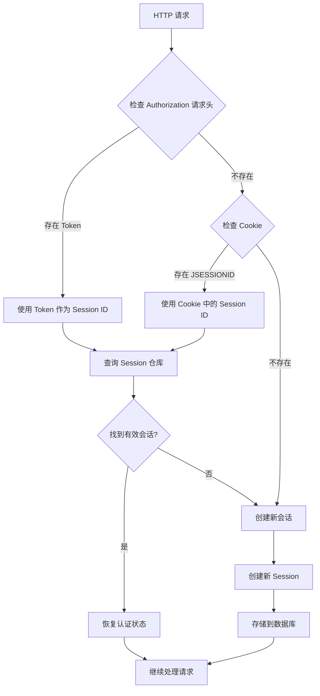
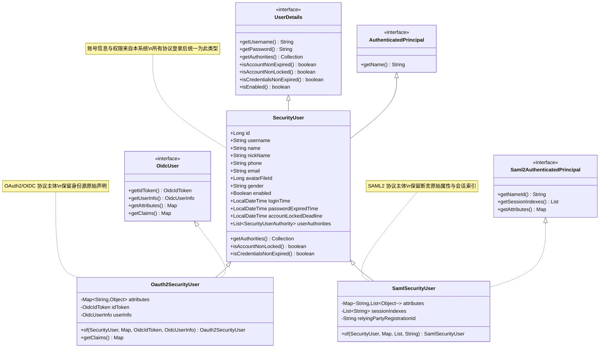
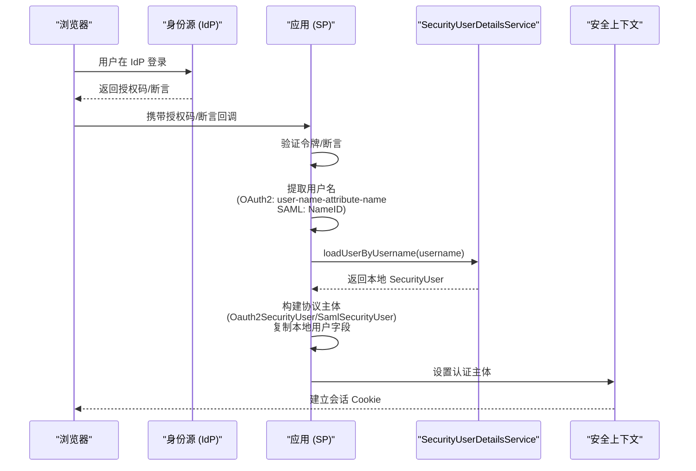
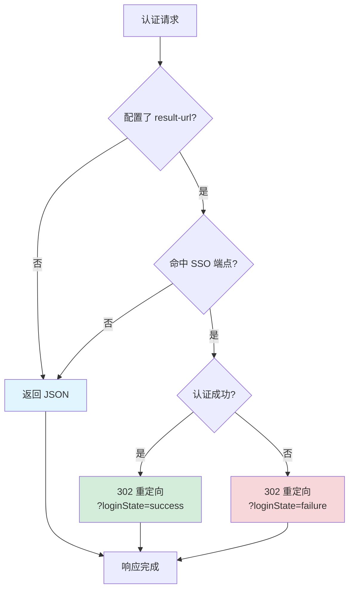
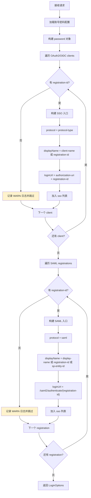
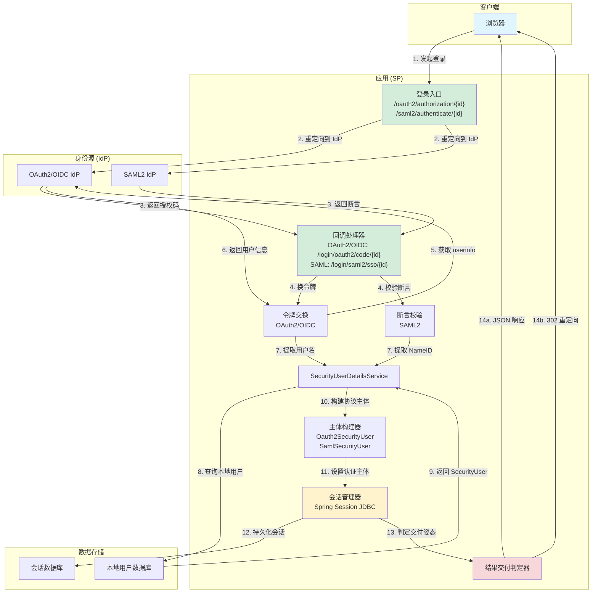
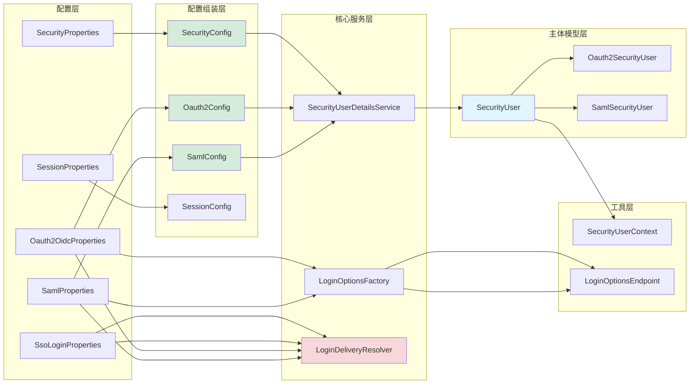

# 单点登录架构总览

<cite>
**本文档引用文件 **
- [sso-overview.md](file://boot/login-security-spring-boot-starter/docs/sso-overview.md)
- [oauth2.md](file://boot/login-security-spring-boot-starter/docs/oauth2.md)
- [oidc.md](file://boot/login-security-spring-boot-starter/docs/oidc.md)
- [saml2.md](file://boot/login-security-spring-boot-starter/docs/saml2.md)
- [SecurityUser.java](file://boot/login-security-spring-boot-starter/src/main/java/com/cu/framework/authentication/model/SecurityUser.java)
- [Oauth2SecurityUser.java](file://boot/login-security-spring-boot-starter/src/main/java/com/cu/framework/authentication/oauth2/Oauth2SecurityUser.java)
- [SamlSecurityUser.java](file://boot/login-security-spring-boot-starter/src/main/java/com/cu/framework/authentication/saml/SamlSecurityUser.java)
- [SecurityUserContext.java](file://boot/login-security-spring-boot-starter/src/main/java/com/cu/framework/authentication/SecurityUserContext.java)
- [LoginOptionsEndpoint.java](file://boot/login-security-spring-boot-starter/src/main/java/com/cu/framework/authentication/loginpage/LoginOptionsEndpoint.java)
- [LoginOptionsFactory.java](file://boot/login-security-spring-boot-starter/src/main/java/com/cu/framework/authentication/loginpage/LoginOptionsFactory.java)
- [LoginDeliveryResolver.java](file://boot/login-security-spring-boot-starter/src/main/java/com/cu/framework/authentication/response/LoginDeliveryResolver.java)
- [SessionConfig.java](file://boot/login-security-spring-boot-starter/src/main/java/com/cu/framework/authentication/config/SessionConfig.java)
- [SecurityConfig.java](file://boot/login-security-spring-boot-starter/src/main/java/com/cu/framework/authentication/config/SecurityConfig.java)
- [Oauth2Config.java](file://boot/login-security-spring-boot-starter/src/main/java/com/cu/framework/authentication/oauth2/Oauth2Config.java)
- [SamlConfig.java](file://boot/login-security-spring-boot-starter/src/main/java/com/cu/framework/authentication/saml/SamlConfig.java)
- [SsoLoginProperties.java](file://boot/login-security-spring-boot-starter/src/main/java/com/cu/framework/authentication/properties/SsoLoginProperties.java)
- [NoLoginException.java](file://boot/login-security-spring-boot-starter/src/main/java/com/cu/framework/authentication/exception/NoLoginException.java)
- [SamlLogoutController.java](file://boot/login-security-spring-boot-starter/src/main/java/com/cu/framework/authentication/saml/SamlLogoutController.java)
- [spring-session-mysql.sql](file://relation/login-security/spring-session-mysql.sql)
</cite>

## 目录
1. [概述](#概述)
2. [三协议共享的会话管理](#三协议共享的会话管理)
3. [统一认证主体 SecurityUser](#统一认证主体-securityuser)
4. [结果交付规则](#结果交付规则)
5. [登录方式发现接口](#登录方式发现接口)
6. [明确不支持的功能项](#明确不支持的功能项)
7. [架构总览图](#架构总览图)
8. [相关文档](#相关文档)

## 概述

本框架支持三种单点登录协议：**OAuth2**、**OIDC（OpenID Connect）**和**SAML2**。这三种协议虽然实现细节不同，但在框架层面共享以下核心机制：

- **统一的会话管理**：所有协议认证成功后都使用相同的 Spring Session 持久化机制
- **统一的认证主体**：无论通过哪种协议登录，进入安全上下文的主体都是 `SecurityUser` 及其协议子类型
- **一致的结果交付规则**：成功与失败的响应格式由配置决定，遵循相同的判定逻辑
- **集中的登录方式发现**：通过单一接口动态返回所有可用的登录入口

本文档从架构层面说明这些共享机制的设计原则、实现方式和使用注意事项。各协议的详细配置与排错指南请参考对应的专项文档。

## 三协议共享的会话管理

### 会话解析策略

框架采用双模式会话解析策略，优先从请求头读取令牌，其次回退到 Cookie：



**Diagram sources **
- [SessionConfig.java:39-43](file://boot/login-security-spring-boot-starter/src/main/java/com/cu/framework/authentication/config/SessionConfig.java#L39-L43)
- [TokenSessionRequestFilter.java:1-200](file://boot/login-security-spring-boot-starter/src/main/java/com/cu/framework/authentication/filter/TokenSessionRequestFilter.java#L1-L200)

### 会话持久化

框架使用 `spring-session-jdbc` 进行会话持久化：

- **H2 数据库**：自动使用 jar 包内的 schema 初始化
- **MySQL 数据库**：需手动执行 [spring-session-mysql.sql](file://relation/login-security/spring-session-mysql.sql)，并设置 `initialize-schema: never`

会话数据存储在数据库中，包含：
- 会话标识符
- 认证主体信息（`SecurityUser` 序列化）
- OAuth2/OIDC 的身份源声明与 ID Token
- SAML2 的断言属性与会话索引
- 会话元数据（创建时间、最后访问时间等）

**重要安全提示**：会话表中存储了敏感的身份源声明和令牌信息，禁止将会话表导出或同步到日志系统。

### 并发控制

通过 `SessionProperties` 配置会话并发限制：

| 配置项 | 默认值 | 说明 |
| --- | --- | --- |
| `cu.security.session.maximum-sessions` | 10 | 每个用户允许的最大并发会话数 |
| `cu.security.session.max-sessions-prevents-login` | false | 达到上限时是否阻止新登录（false 表示踢掉最早会话） |

当会话超限时，根据配置采取以下策略之一：
- **阻止登录**：返回错误提示，不允许创建新会话
- **挤掉旧会话**：使最早的会话失效，新登录正常进行

会话过期时的处理：
- 返回 HTTP 401 状态码
- 响应体为 JSON：`{"code": 401, "message": "登录状态失效，请重新登录"}`

**Section sources**
- [SessionConfig.java:93-120](file://boot/login-security-spring-boot-starter/src/main/java/com/cu/framework/authentication/config/SessionConfig.java#L93-L120)
- [SessionProperties.java:1-22](file://boot/login-security-spring-boot-starter/src/main/java/com/cu/framework/authentication/properties/SessionProperties.java#L1-L22)

## 统一认证主体 SecurityUser

### 主体层次结构

框架定义了统一的认证主体层次结构，确保无论通过哪种协议登录，业务代码都能以一致的方式访问当前用户信息：



**Diagram sources **
- [SecurityUser.java:1-161](file://boot/login-security-spring-boot-starter/src/main/java/com/cu/framework/authentication/model/SecurityUser.java#L1-L161)
- [Oauth2SecurityUser.java:1-81](file://boot/login-security-spring-boot-starter/src/main/java/com/cu/framework/authentication/oauth2/Oauth2SecurityUser.java#L1-L81)
- [SamlSecurityUser.java:1-72](file://boot/login-security-spring-boot-starter/src/main/java/com/cu/framework/authentication/saml/SamlSecurityUser.java#L1-L72)

### 主体设计原则

#### 1. 账号信息统一来自本系统

无论通过哪种协议认证，最终进入安全上下文的主体都基于本系统的 `SecurityUserDetailsService` 加载的本地账号：



**Diagram sources **
- [Oauth2Config.java:145-165](file://boot/login-security-spring-boot-starter/src/main/java/com/cu/framework/authentication/oauth2/Oauth2Config.java#L145-L165)
- [SamlConfig.java:85-95](file://boot/login-security-spring-boot-starter/src/main/java/com/cu/framework/authentication/saml/SamlConfig.java#L85-L95)

关键流程：
1. **身份源只负责证明"这个人是谁"**：OAuth2/OIDC 提供 userinfo，SAML2 提供断言
2. **按身份源给出的用户名调用 `SecurityUserDetailsService`**：获取本系统的完整账号信息与权限
3. **取不到本地账号时以 `sso_local_user_not_found` 结束认证**：不会创建没有权限的会话
4. **构建协议子类型主体**：复制本地用户字段，同时保留身份源的原始声明

#### 2. 协议子类型的职责划分

**Oauth2SecurityUser**（用于 OAuth2 和 OIDC）：
- 实现 `OidcUser` 接口，兼容两种协议
- 纯 OAuth2 客户端的 `idToken` 为 null
- 保留身份源返回的原始声明（`attributes`）
- 存储 ID Token 和 UserInfo 对象（仅 OIDC）

**SamlSecurityUser**（用于 SAML2）：
- 实现 `Saml2AuthenticatedPrincipal` 接口
- 保留断言的原始属性（多值映射）
- 存储会话索引（`sessionIndexes`），供单点登出使用
- 存储服务注册标识（`relyingPartyRegistrationId`）

为什么不能合并为一个类？
- `OidcUser.getAttributes()` 返回 `Map<String, Object>`
- `Saml2AuthenticatedPrincipal.getAttributes()` 返回 `Map<String, List<Object>>`
- 两个接口的同名方法返回类型不兼容，无法在同一个类中同时实现

#### 3. 主体是登录时的快照

会话中存储的主体是登录时刻的快照：
- **修改权限或资料需要重新登录才生效**
- 不会实时从数据库刷新用户信息
- 这是出于性能和安全考虑的设计决策

### 获取当前用户

业务代码通过 `SecurityUserContext.getCurrentUser()` 获取当前登录用户：

```java
SecurityUser currentUser = SecurityUserContext.getCurrentUser();
String username = currentUser.getUsername();
List<SecurityUserAuthority> authorities = currentUser.getUserAuthorities();
```

该方法的特点：
- **不需要知道本次登录走了哪种协议**：统一返回 `SecurityUser` 基类
- **未登录时抛出 `NoLoginException`**：包括匿名访问或主体不是统一认证实体的情况
- **适用于所有场景**：账号密码登录、OAuth2、OIDC、SAML2

**Section sources**
- [SecurityUserContext.java:1-37](file://boot/login-security-spring-boot-starter/src/main/java/com/cu/framework/authentication/SecurityUserContext.java#L1-L37)
- [NoLoginException.java:1-20](file://boot/login-security-spring-boot-starter/src/main/java/com/cu/framework/authentication/exception/NoLoginException.java#L1-L20)

### 用户名映射规则

身份源标识必须能对上本地用户名：

| 协议 | 用户名来源 | 配置项 |
| --- | --- | --- |
| OAuth2 | userinfo 响应中的指定字段 | `user-name-attribute-name` |
| OIDC | 同 OAuth2，未配置时回退 `sub` | `user-name-attribute-name`（可选） |
| SAML2 | 断言的 NameID | 无需配置 |

**常见错误**：
- OAuth2 手动模式把 `sub` 配成用户名：`sub` 通常是身份源自己的数字 ID，与本系统用户名不是一回事
- OIDC 未配置 `user-name-attribute-name`：会使用 `sub`，通常对不上本系统用户名
- 两边取值口径不一致：导致认证失败，不会创建无权限会话

## 结果交付规则

### 交付姿态判定器

框架通过 `LoginDeliveryResolver` 决定认证结果应该返回 JSON 还是重定向到前端页面：



**Diagram sources **
- [LoginDeliveryResolver.java:1-114](file://boot/login-security-spring-boot-starter/src/main/java/com/cu/framework/authentication/response/LoginDeliveryResolver.java#L1-L114)

### 判定依据

判定依据是**请求命中的认证端点属于哪类协议**，而不是请求特征（如 Accept 头或 User-Agent）：

| 请求命中的端点 | 配置了 `result-url` | 未配置 `result-url` |
| --- | --- | --- |
| `/login`（账号密码） | JSON | JSON |
| OAuth2/OIDC 回调 `/login/oauth2/code/{id}` | 302 + `?loginState=success` | JSON |
| SAML ACS `/login/saml2/sso/{id}` | 302 + `?loginState=success` | JSON |
| 上述回调上的认证失败 | 302 + `?loginState=failure` | JSON 错误体 |
| `/logout`、业务接口、静态资源 | JSON | JSON |

### 配置方式

通过 `SsoLoginProperties` 配置结果页地址：

```yaml
cu:
  security:
    login:
      sso:
        result-url: /login.html  # 相对地址，容器按当前请求解析
        # 或 https://frontend.example.com/login  # 绝对地址，原样使用
```

配置特点：
- **留空时三类协议的成功与失败响应都保持 JSON 输出**
- **配置后成败都回到同一个地址**，靠查询参数里的 `loginState` 区分
- **写相对地址时由容器按当前请求的 scheme/host/port 解析**
- **写绝对地址则原样使用**，因此同一项同时适用于同源页面与独立部署的前端

### 重要特性

1. **账号密码登录永远返回 JSON**：不因请求是脚本还是表单导航而改变
2. **回跳地址只带状态标记**：不含会话标识与令牌；会话靠 Cookie 生效
3. **配置 `result-url` 后，消费方自定义的 `AuthenticationSuccessResultResolver` 在跳转场景不会被调用**

**Section sources**
- [SsoLoginProperties.java:1-24](file://boot/login-security-spring-boot-starter/src/main/java/com/cu/framework/authentication/properties/SsoLoginProperties.java#L1-L24)
- [LoginDeliveryResolver.java:60-114](file://boot/login-security-spring-boot-starter/src/main/java/com/cu/framework/authentication/response/LoginDeliveryResolver.java#L60-L114)

## 登录方式发现接口

### 接口定义

框架提供统一的登录方式发现接口，供前端登录页动态渲染登录入口：

```
GET /api/login/options
```

该接口标记为 `@SecurityIgnore`，未经认证即可访问。

### 响应格式

```json
{
  "code": 200,
  "data": {
    "password": {
      "loginUrl": "/login",
      "usernameParameter": "username",
      "passwordParameter": "password"
    },
    "sso": [
      {
        "protocol": "oauth2",
        "registrationId": "demo-oauth2",
        "displayName": "演示 OAuth2 登录",
        "loginUrl": "/oauth2/authorization/demo-oauth2"
      },
      {
        "protocol": "oidc",
        "registrationId": "corp-oidc",
        "displayName": "企业 OIDC",
        "loginUrl": "/oauth2/authorization/corp-oidc"
      },
      {
        "protocol": "saml",
        "registrationId": "corp-saml",
        "displayName": "企业 SAML",
        "loginUrl": "/saml2/authenticate/corp-saml"
      }
    ]
  }
}
```

### 装配逻辑



**Diagram sources **
- [LoginOptionsFactory.java:1-136](file://boot/login-security-spring-boot-starter/src/main/java/com/cu/framework/authentication/loginpage/LoginOptionsFactory.java#L1-L136)

### 数据来源

接口数据直接来源于框架的配置属性类，而非 Spring Security 的内部仓库：

- **OAuth2/OIDC**：从 `Oauth2OidcProperties.clients` 读取
- **SAML2**：从 `SamlProperties.registrations` 读取

原因：
- `Oauth2Config` 中的 `ClientRegistrationRepository` 是私有构造，同一份配置会被重复构建多次
- `RelyingPartyRegistrationRepository` 在手动端点模式下根本不写入展示名
- 配置属性类才是配置的真相源

### 过滤规则

- **缺失 `registration-id` 的客户端会被排除**：并输出 WARN 日志
- **入口条数等于配置有效的身份源条数**：能解析出注册标识才算有效
- **只返回展示所需字段**：不含 `client-id`、`client-secret`、密钥库口令、证书或资源路径

### 前端优势

前端由此不需要知道任何身份源的数量、标识与端点差异：
- **配置增减一条，页面重新加载即反映**：无需改前端代码
- **统一的入口结构**：所有 SSO 入口都有相同的字段
- **不包含敏感信息**：安全地暴露给未认证的前端

**Section sources**
- [LoginOptionsEndpoint.java:1-35](file://boot/login-security-spring-boot-starter/src/main/java/com/cu/framework/authentication/loginpage/LoginOptionsEndpoint.java#L1-L35)
- [LoginOptionsFactory.java:50-136](file://boot/login-security-spring-boot-starter/src/main/java/com/cu/framework/authentication/loginpage/LoginOptionsFactory.java#L50-L136)

## 明确不支持的功能项

框架在设计时明确排除了以下功能，避免开发者误用或产生错误预期：

### 1. Remember-Me 功能

**状态**：`[未接线]`

- `cu.security.remember-me.*` 配置项已声明
- Bean 已创建但未挂入过滤器链
- 前端不应渲染 remember-me 控件
- 登录方式发现接口不返回 remember-me 相关信息

### 2. OIDC RP-Initiated Logout

**状态**：处理器已声明为 Bean，但未接入 `http.logout()`

- `/logout` 只失效本地会话
- 不会通知 IdP 终止身份源侧的会话
- 如需完整的单点登出，应使用 SAML2 协议

### 3. SAML IdP 发起

**状态**：没有配置或示例，不承诺可用

- Spring Security 5.7 的 `saml2Login` 没有为 IdP 发起提供专门入口
- 框架也没有相应配置或示例
- 当前只文档化 SP 发起流程

### 4. 账号密码登录页

**状态**：`formLogin` 未启用

- `loginPage(...)` 配置会导致启动失败
- 账号密码登录通过 POST `/login` 接口完成
- 返回 JSON 响应，不提供 HTML 登录页

### 5. OAuth2 其他授权类型

**状态**：`authorization-grant-type` `[未接线]`

- 固定使用授权码模式（Authorization Code）
- 配置其他授权类型不会生效
- 不要尝试配置隐式模式、密码模式等

### 6. 自定义授权解析器

**建议**：除非有特殊需求，否则不要自定义

- 默认解析器已经按 `sso-authorization-uri` 拼接 `registrationId`
- 只有要改请求参数或 state 生成方式时才需要自定义
- 自定义可能绕过 `state` 校验，带来安全风险

**Section sources**
- [sso-overview.md:117-128](file://boot/login-security-spring-boot-starter/docs/sso-overview.md#L117-L128)
- [oauth2.md:101-103](file://boot/login-security-spring-boot-starter/docs/oauth2.md#L101-L103)

## 架构总览图

### 三协议认证流程对比



### 组件依赖关系



**Diagram sources **
- [SecurityConfig.java:1-144](file://boot/login-security-spring-boot-starter/src/main/java/com/cu/framework/authentication/config/SecurityConfig.java#L1-L144)
- [Oauth2Config.java:1-200](file://boot/login-security-spring-boot-starter/src/main/java/com/cu/framework/authentication/oauth2/Oauth2Config.java#L1-L200)
- [SamlConfig.java:1-200](file://boot/login-security-spring-boot-starter/src/main/java/com/cu/framework/authentication/saml/SamlConfig.java#L1-L200)

## 相关文档

### 协议专项文档

- **[OAuth2 细节](oauth2.md)**：授权码模式的端点、配置项、用户名映射与排错指南
- **[OIDC 细节](oidc.md)**：ID Token 校验、Discovery 机制、JWKS 与常见错误定位
- **[SAML2 细节](saml2.md)**：Metadata 解析、签名配置、Audience 校验与 SLO 流程

### 框架文档

- **[login-security-spring-boot-starter](../README.md)**：Starter 的使用说明与快速开始
- **[全量配置参考](../../../docs/application.yml)**：所有配置项的完整示例

### 示例项目

- **[login 示例](../../../sample/login-boot-sample/README.md)**：包含三种协议的完整演示
- **[auth-core-boot-sample](../../../sample/auth-core-boot-sample/README.md)**：认证核心功能的验证示例

### 数据库脚本

- **[Spring Session MySQL Schema](../../../relation/login-security/spring-session-mysql.sql)**：MySQL 环境的会话表结构