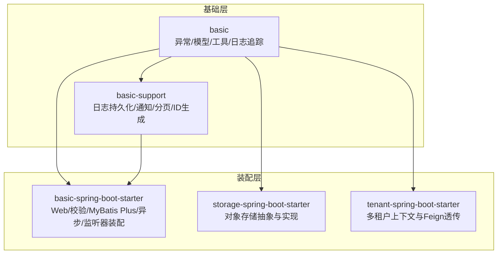
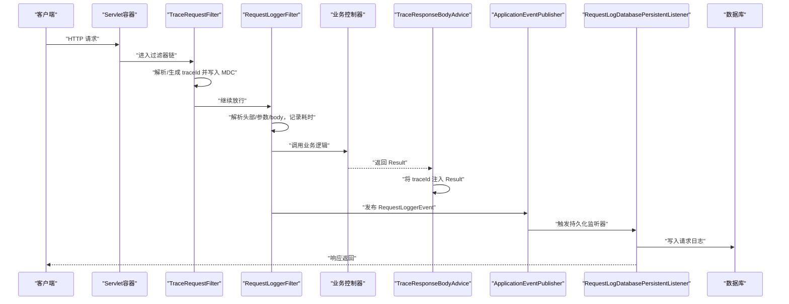
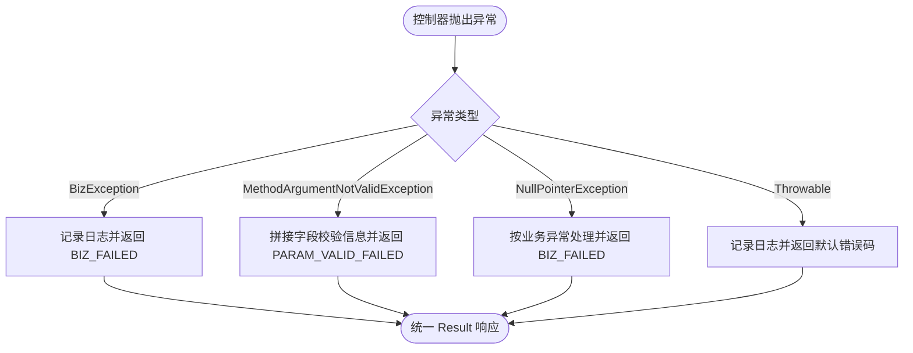
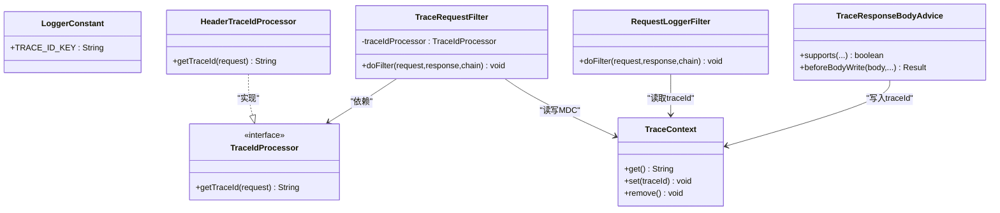
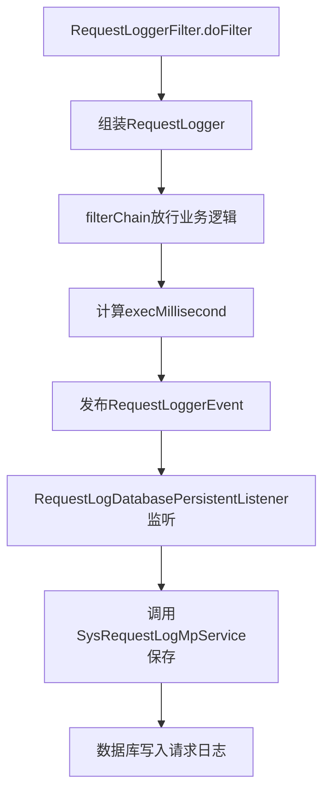
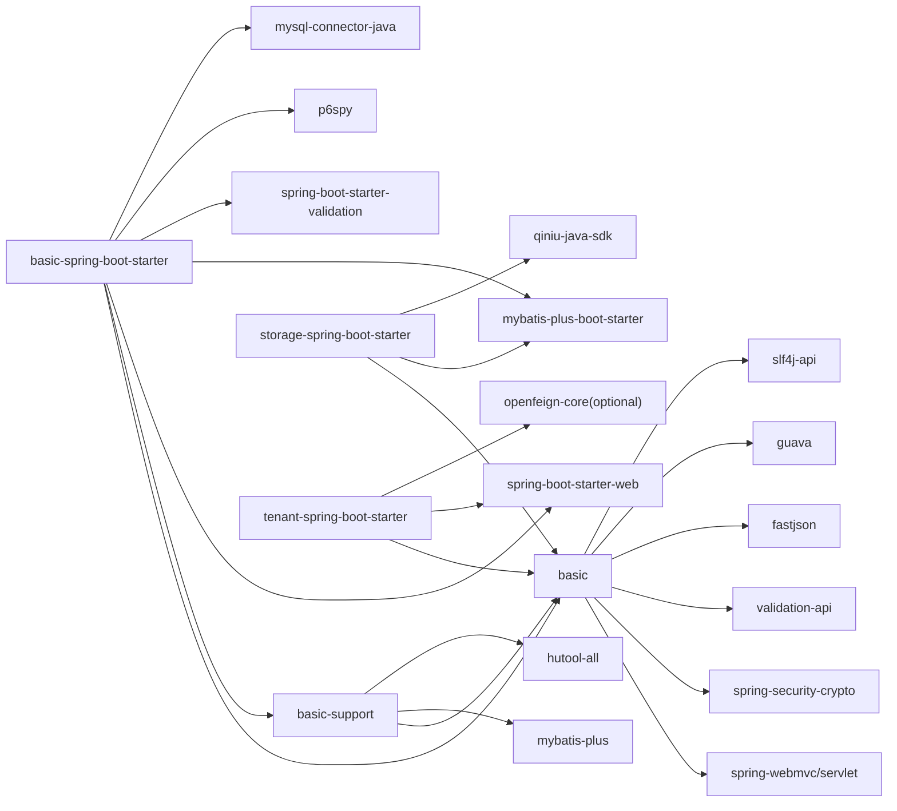

# 基础支撑模块

<cite>
**本文引用的文件**   
- [basic/pom.xml](file://basic/pom.xml)
- [basic-support/pom.xml](file://basic-support/pom.xml)
- [boot/basic-spring-boot-starter/pom.xml](file://boot/basic-spring-boot-starter/pom.xml)
- [boot/storage-spring-boot-starter/pom.xml](file://boot/storage-spring-boot-starter/pom.xml)
- [boot/tenant-spring-boot-starter/pom.xml](file://boot/tenant-spring-boot-starter/pom.xml)
- [GlobalExceptionHandlerAdvice.java](file://basic/src/main/java/com/cu/framework/basic/exception/GlobalExceptionHandlerAdvice.java)
- [Result.java](file://basic/src/main/java/com/cu/framework/basic/model/Result.java)
- [PageReq.java](file://basic/src/main/java/com/cu/framework/basic/model/PageReq.java)
- [EarlyRequestFilter.java](file://basic/src/main/java/com/cu/framework/basic/filter/EarlyRequestFilter.java)
- [LoggerConstant.java](file://basic/src/main/java/com/cu/framework/basic/logger/LoggerConstant.java)
- [TraceRequestFilter.java](file://basic/src/main/java/com/cu/framework/basic/logger/TraceRequestFilter.java)
- [HeaderTraceIdProcessor.java](file://basic/src/main/java/com/cu/framework/basic/logger/trace/HeaderTraceIdProcessor.java)
- [TraceContext.java](file://basic/src/main/java/com/cu/framework/basic/logger/trace/TraceContext.java)
- [TraceResponseBodyAdvice.java](file://basic/src/main/java/com/cu/framework/basic/logger/trace/TraceResponseBodyAdvice.java)
- [RequestLoggerFilter.java](file://basic/src/main/java/com/cu/framework/basic/logger/RequestLoggerFilter.java)
- [RequestLogger.java](file://basic/src/main/java/com/cu/framework/basic/logger/request/RequestLogger.java)
- [RequestIpUtil.java](file://basic/src/main/java/com/cu/framework/basic/utils/RequestIpUtil.java)
- [BasicSupportEndpoint.java](file://basic-support/basic-support/src/main/java/com/cu/framework/basic/support/BasicSupportEndpoint.java)
- [SysRequestLogMpService.java](file://basic-support/basic-support/src/main/java/com/cu/framework/basic/support/mp/service/SysRequestLogMpService.java)
- [SysRequestLogMpServiceImpl.java](file://basic-support/basic-support/src/main/java/com/cu/framework/basic/support/mp/service/impl/SysRequestLogMpServiceImpl.java)
- [SysRequestLogMpMapper.java](file://basic-support/basic-support/src/main/java/com/cu/framework/basic/support/mp/mapper/SysRequestLogMpMapper.java)
- [SysRequestLog.java](file://basic-support/basic-support/src/main/java/com/cu/framework/basic/support/mp/entity/SysRequestLog.java)
- [SnowflakeIdGenerator.java](file://basic-support/basic-support/src/main/java/com/cu/framework/basic/support/utils/SnowflakeIdGenerator.java)
- [PageUtil.java](file://basic-support/basic-support/src/main/java/com/cu/framework/basic/support/utils/PageUtil.java)
- [MybatisPageExecutor.java](file://basic-support/basic-support/src/main/java/com/cu/framework/basic/support/utils/MybatisPageExecutor.java)
- [FangTangMessageClient.java](file://basic-support/basic-support/src/main/java/com/cu/framework/basic/support/notify/fangtang/FangTangMessageClient.java)
- [FangTangMessageDTO.java](file://basic-support/basic-support/src/main/java/com/cu/framework/basic/support/notify/fangtang/FangTangMessageDTO.java)
- [RequestLogDatabasePersistentListener.java](file://basic-support/basic-support/src/main/java/com/cu/framework/basic/support/log/RequestLogDatabasePersistentListener.java)
- [RequestLogFangTangMessageListener.java](file://basic-support/basic-support/src/main/java/com/cu/framework/basic/support/log/RequestLogFangTangMessageListener.java)
- [AsyncConfig.java](file://boot/basic-spring-boot-starter/src/main/java/com/cu/framework/boot/basic/config/AsyncConfig.java)
- [BasicSupportConfig.java](file://boot/basic-spring-boot-starter/src/main/java/com/cu/framework/boot/basic/config/BasicSupportConfig.java)
- [EarlyFilterConfig.java](file://boot/basic-spring-boot-starter/src/main/java/com/cu/framework/boot/basic/config/EarlyFilterConfig.java)
- [FangTangMessageConfig.java](file://boot/basic-spring-boot-starter/src/main/java/com/cu/framework/boot/basic/config/FangTangMessageConfig.java)
- [MybatisPlusConfig.java](file://boot/basic-spring-boot-starter/src/main/java/com/cu/framework/boot/basic/config/MybatisPlusConfig.java)
- [RequestResponseFormatConfig.java](file://boot/basic-spring-boot-starter/src/main/java/com/cu/framework/boot/basic/config/RequestResponseFormatConfig.java)
- [YmlPropertySourceFactory.java](file://boot/basic-spring-boot-starter/src/main/java/com/cu/framework/boot/basic/context/YmlPropertySourceFactory.java)
- [FangTangProperties.java](file://boot/basic-spring-boot-starter/src/main/java/com/cu/framework/boot/basic/properties/FangTangProperties.java)
- [TenantConfig.java](file://boot/tenant-spring-boot-starter/src/main/java/com/cu/framework/boot/tenant/config/TenantConfig.java)
- [TenantRequestFilter.java](file://boot/tenant-spring-boot-starter/src/main/java/com/cu/framework/boot/tenant/TenantRequestFilter.java)
- [TenantContext.java](file://boot/tenant-spring-boot-starter/src/main/java/com/cu/framework/boot/tenant/TenantContext.java)
- [TenantHeaderInterceptor.java](file://boot/tenant-spring-boot-starter/src/main/java/com/cu/framework/boot/tenant/feign/TenantHeaderInterceptor.java)
</cite>

## 目录
1. [引言](#引言)
2. [项目结构](#项目结构)
3. [核心组件](#核心组件)
4. [架构总览](#架构总览)
5. [详细组件分析](#详细组件分析)
6. [依赖关系分析](#依赖关系分析)
7. [性能与可观测性](#性能与可观测性)
8. [集成指南与配置说明](#集成指南与配置说明)
9. [故障排查](#故障排查)
10. [结论](#结论)

## 引言
本文件聚焦框架中的基础支撑能力，围绕三个层次展开：
- basic 模块：提供异常处理、统一返回模型、分页请求模型、通用工具类、请求日志采集与链路追踪等基础能力。
- basic-support 模块：在 basic 基础上提供企业级支撑能力，包括请求日志持久化、消息通知、分页查询辅助、分布式 ID 生成、健康检查端点等。
- boot 模块：以 Spring Boot Starter 形式装配这些能力，暴露基本启动器、存储启动器、租户启动器等，帮助上层业务模块快速复用基础能力。

目标读者包括需要理解框架基础层设计、快速集成并扩展这些能力的后端开发者。

## 项目结构
仓库中与基础支撑相关的主要模块如下：
- basic：纯 Web 基础能力，不依赖数据库或第三方存储，仅依赖 Spring Web、Servlet、常用工具库。
- basic-support：基于 MyBatis Plus、Hutool 等提供持久化、工具、通知等扩展能力，依赖 basic。
- boot：Spring Boot Starter 集合，负责将 basic 与 basic-support 的能力自动装配到应用中；同时包含 storage-spring-boot-starter（对象存储）、tenant-spring-boot-starter（多租户）等特性 Starter。

图表来源
- [basic/pom.xml:1-84](file://basic/pom.xml#L1-L84)
- [basic-support/pom.xml:1-43](file://basic-support/pom.xml#L1-L43)
- [boot/basic-spring-boot-starter/pom.xml:1-62](file://boot/basic-spring-boot-starter/pom.xml#L1-L62)
- [boot/storage-spring-boot-starter/pom.xml:1-51](file://boot/storage-spring-boot-starter/pom.xml#L1-L51)
- [boot/tenant-spring-boot-starter/pom.xml:1-42](file://boot/tenant-spring-boot-starter/pom.xml#L1-L42)

章节来源
- [basic/pom.xml:1-84](file://basic/pom.xml#L1-L84)
- [basic-support/pom.xml:1-43](file://basic-support/pom.xml#L1-L43)
- [boot/basic-spring-boot-starter/pom.xml:1-62](file://boot/basic-spring-boot-starter/pom.xml#L1-L62)
- [boot/storage-spring-boot-starter/pom.xml:1-51](file://boot/storage-spring-boot-starter/pom.xml#L1-L51)
- [boot/tenant-spring-boot-starter/pom.xml:1-42](file://boot/tenant-spring-boot-starter/pom.xml#L1-L42)

## 核心组件
本节从使用视角归纳各模块对外暴露的核心能力。

### basic 模块能力
- 全局异常处理：统一捕获业务异常、参数校验异常、空指针异常与未处理异常，并以统一 Result 响应。
- 统一响应模型：Result 封装 code、success、message、data，提供成功与失败工厂方法。
- 分页请求模型：PageReq 提供 page、size、search 与 offset 计算。
- 请求日志与追踪：
  - TraceRequestFilter 解析 traceId 写入 MDC。
  - HeaderTraceIdProcessor 从请求头读取或生成 traceId。
  - RequestLoggerFilter 收集请求头、参数、body、耗时并发布事件。
  - TraceResponseBodyAdvice 将 traceId 注入返回的 Result。
- 工具类：RequestIpUtil 获取客户端真实 IP。
- 过滤器契约：EarlyRequestFilter 定义“最早执行”的过滤器接口。

章节来源
- [GlobalExceptionHandlerAdvice.java:1-83](file://basic/src/main/java/com/cu/framework/basic/exception/GlobalExceptionHandlerAdvice.java#L1-L83)
- [Result.java:1-73](file://basic/src/main/java/com/cu/framework/basic/model/Result.java#L1-L73)
- [PageReq.java:1-39](file://basic/src/main/java/com/cu/framework/basic/model/PageReq.java#L1-L39)
- [TraceRequestFilter.java:1-60](file://basic/src/main/java/com/cu/framework/basic/logger/TraceRequestFilter.java#L1-L60)
- [HeaderTraceIdProcessor.java:1-27](file://basic/src/main/java/com/cu/framework/basic/logger/trace/HeaderTraceIdProcessor.java#L1-L27)
- [RequestLoggerFilter.java:1-133](file://basic/src/main/java/com/cu/framework/basic/logger/RequestLoggerFilter.java#L1-L133)
- [TraceResponseBodyAdvice.java:1-42](file://basic/src/main/java/com/cu/framework/basic/logger/trace/TraceResponseBodyAdvice.java#L1-L42)
- [RequestIpUtil.java:1-46](file://basic/src/main/java/com/cu/framework/basic/utils/RequestIpUtil.java#L1-L46)
- [EarlyRequestFilter.java:1-23](file://basic/src/main/java/com/cu/framework/basic/filter/EarlyRequestFilter.java#L1-L23)

### basic-support 模块能力
- 请求日志持久化：通过 ApplicationEvent 监听 RequestLoggerEvent，持久化为 SysRequestLog。
- 消息通知：FangTangMessageClient 封装方糖消息发送 DTO 与客户端。
- 分页与执行器：PageUtil、MybatisPageExecutor 为分页查询与执行提供辅助。
- 分布式 ID：SnowflakeIdGenerator 提供雪花 ID 生成。
- 健康检查端点：BasicSupportEndpoint 暴露基础运行状态。
- 数据访问层：MyBatis Plus 实体、Mapper、Service 分层组织请求日志表操作。

章节来源
- [RequestLogDatabasePersistentListener.java](file://basic-support/basic-support/src/main/java/com/cu/framework/basic/support/log/RequestLogDatabasePersistentListener.java)
- [RequestLogFangTangMessageListener.java](file://basic-support/basic-support/src/main/java/com/cu/framework/basic/support/log/RequestLogFangTangMessageListener.java)
- [FangTangMessageClient.java](file://basic-support/basic-support/src/main/java/com/cu/framework/basic/support/notify/fangtang/FangTangMessageClient.java)
- [FangTangMessageDTO.java](file://basic-support/basic-support/src/main/java/com/cu/framework/basic/support/notify/fangtang/FangTangMessageDTO.java)
- [PageUtil.java](file://basic-support/basic-support/src/main/java/com/cu/framework/basic/support/utils/PageUtil.java)
- [MybatisPageExecutor.java](file://basic-support/basic-support/src/main/java/com/cu/framework/basic/support/utils/MybatisPageExecutor.java)
- [SnowflakeIdGenerator.java](file://basic-support/basic-support/src/main/java/com/cu/framework/basic/support/utils/SnowflakeIdGenerator.java)
- [BasicSupportEndpoint.java](file://basic-support/basic-support/src/main/java/com/cu/framework/basic/support/BasicSupportEndpoint.java)
- [SysRequestLog.java](file://basic-support/basic-support/src/main/java/com/cu/framework/basic/support/mp/entity/SysRequestLog.java)
- [SysRequestLogMpMapper.java](file://basic-support/basic-support/src/main/java/com/cu/framework/basic/support/mp/mapper/SysRequestLogMpMapper.java)
- [SysRequestLogMpService.java](file://basic-support/basic-support/src/main/java/com/cu/framework/basic/support/mp/service/SysRequestLogMpService.java)
- [SysRequestLogMpServiceImpl.java](file://basic-support/basic-support/src/main/java/com/cu/framework/basic/support/mp/service/impl/SysRequestLogMpServiceImpl.java)

### boot 模块 Starter 作用
- basic-spring-boot-starter：装配 Web、校验、MyBatis Plus、P6Spy、MySQL；注册异步线程池、早期过滤器、日志监听、方糖消息配置、请求响应格式、YAML 属性源工厂等。
- storage-spring-boot-starter：封装对象存储能力，依赖 MyBatis Plus 与七牛 SDK。
- tenant-spring-boot-starter：提供多租户上下文、请求过滤与 Feign 拦截器透传租户标识。

章节来源
- [boot/basic-spring-boot-starter/pom.xml:1-62](file://boot/basic-spring-boot-starter/pom.xml#L1-L62)
- [boot/storage-spring-boot-starter/pom.xml:1-51](file://boot/storage-spring-boot-starter/pom.xml#L1-L51)
- [boot/tenant-spring-boot-starter/pom.xml:1-42](file://boot/tenant-spring-boot-starter/pom.xml#L1-L42)

## 架构总览
下图展示一次 HTTP 请求在基础层的完整生命周期，以及 basic 与 basic-support 的协作方式。

图表来源
- [TraceRequestFilter.java:1-60](file://basic/src/main/java/com/cu/framework/basic/logger/TraceRequestFilter.java#L1-L60)
- [HeaderTraceIdProcessor.java:1-27](file://basic/src/main/java/com/cu/framework/basic/logger/trace/HeaderTraceIdProcessor.java#L1-L27)
- [RequestLoggerFilter.java:1-133](file://basic/src/main/java/com/cu/framework/basic/logger/RequestLoggerFilter.java#L1-L133)
- [TraceResponseBodyAdvice.java:1-42](file://basic/src/main/java/com/cu/framework/basic/logger/trace/TraceResponseBodyAdvice.java#L1-L42)
- [RequestLogDatabasePersistentListener.java](file://basic-support/basic-support/src/main/java/com/cu/framework/basic/support/log/RequestLogDatabasePersistentListener.java)

## 详细组件分析

### 异常处理与统一响应
- GlobalExceptionHandlerAdvice 作为 @RestControllerAdvice，集中处理 BizException、MethodArgumentNotValidException、NullPointerException 与 Throwable，统一输出 Result。
- Result 提供 success(data)、failed(code, message)、failed(message) 等工厂方法，保证前后端交互一致性。

图表来源
- [GlobalExceptionHandlerAdvice.java:1-83](file://basic/src/main/java/com/cu/framework/basic/exception/GlobalExceptionHandlerAdvice.java#L1-L83)
- [Result.java:1-73](file://basic/src/main/java/com/cu/framework/basic/model/Result.java#L1-L73)

章节来源
- [GlobalExceptionHandlerAdvice.java:1-83](file://basic/src/main/java/com/cu/framework/basic/exception/GlobalExceptionHandlerAdvice.java#L1-L83)
- [Result.java:1-73](file://basic/src/main/java/com/cu/framework/basic/model/Result.java#L1-L73)

### 请求追踪与日志采集
- LoggerConstant 定义 traceId 键名。
- TraceRequestFilter 优先使用容器中注册的 TraceIdProcessor，否则回退为 HeaderTraceIdProcessor；将 traceId 写入 TraceContext（MDC），并在 finally 中清理。
- RequestLoggerFilter 解析请求头、参数与 body，记录执行耗时，并发布 RequestLoggerEvent。
- TraceResponseBodyAdvice 仅在返回类型为 Result 时生效，将当前 traceId 注入响应体。

图表来源
- [LoggerConstant.java:1-10](file://basic/src/main/java/com/cu/framework/basic/logger/LoggerConstant.java#L1-L10)
- [HeaderTraceIdProcessor.java:1-27](file://basic/src/main/java/com/cu/framework/basic/logger/trace/HeaderTraceIdProcessor.java#L1-L27)
- [TraceRequestFilter.java:1-60](file://basic/src/main/java/com/cu/framework/basic/logger/TraceRequestFilter.java#L1-L60)
- [TraceContext.java:1-22](file://basic/src/main/java/com/cu/framework/basic/logger/trace/TraceContext.java#L1-L22)
- [RequestLoggerFilter.java:1-133](file://basic/src/main/java/com/cu/framework/basic/logger/RequestLoggerFilter.java#L1-L133)
- [TraceResponseBodyAdvice.java:1-42](file://basic/src/main/java/com/cu/framework/basic/logger/trace/TraceResponseBodyAdvice.java#L1-L42)

章节来源
- [LoggerConstant.java:1-10](file://basic/src/main/java/com/cu/framework/basic/logger/LoggerConstant.java#L1-L10)
- [HeaderTraceIdProcessor.java:1-27](file://basic/src/main/java/com/cu/framework/basic/logger/trace/HeaderTraceIdProcessor.java#L1-L27)
- [TraceRequestFilter.java:1-60](file://basic/src/main/java/com/cu/framework/basic/logger/TraceRequestFilter.java#L1-L60)
- [TraceContext.java:1-22](file://basic/src/main/java/com/cu/framework/basic/logger/trace/TraceContext.java#L1-L22)
- [RequestLoggerFilter.java:1-133](file://basic/src/main/java/com/cu/framework/basic/logger/RequestLoggerFilter.java#L1-L133)
- [TraceResponseBodyAdvice.java:1-42](file://basic/src/main/java/com/cu/framework/basic/logger/trace/TraceResponseBodyAdvice.java#L1-L42)

### 请求日志持久化流程
RequestLoggerFilter 在 finally 中发布 RequestLoggerEvent，由 RequestLogDatabasePersistentListener 消费并持久化到数据库。

图表来源
- [RequestLoggerFilter.java:1-133](file://basic/src/main/java/com/cu/framework/basic/logger/RequestLoggerFilter.java#L1-L133)
- [RequestLogDatabasePersistentListener.java](file://basic-support/basic-support/src/main/java/com/cu/framework/basic/support/log/RequestLogDatabasePersistentListener.java)
- [SysRequestLogMpService.java](file://basic-support/basic-support/src/main/java/com/cu/framework/basic/support/mp/service/SysRequestLogMpService.java)
- [SysRequestLogMpServiceImpl.java](file://basic-support/basic-support/src/main/java/com/cu/framework/basic/support/mp/service/impl/SysRequestLogMpServiceImpl.java)

章节来源
- [RequestLoggerFilter.java:1-133](file://basic/src/main/java/com/cu/framework/basic/logger/RequestLoggerFilter.java#L1-L133)
- [RequestLogger.java:1-40](file://basic/src/main/java/com/cu/framework/basic/logger/request/RequestLogger.java#L1-L40)
- [RequestLogDatabasePersistentListener.java](file://basic-support/basic-support/src/main/java/com/cu/framework/basic/support/log/RequestLogDatabasePersistentListener.java)
- [SysRequestLogMpService.java](file://basic-support/basic-support/src/main/java/com/cu/framework/basic/support/mp/service/SysRequestLogMpService.java)
- [SysRequestLogMpServiceImpl.java](file://basic-support/basic-support/src/main/java/com/cu/framework/basic/support/mp/service/impl/SysRequestLogMpServiceImpl.java)

### 分页与 ID 生成
- PageReq 提供 page、size、search 与 offset 计算，适合前端从 1 开始的页码习惯。
- basic-support 提供 PageUtil 与 MybatisPageExecutor，便于结合 MyBatis Plus 完成分页查询。
- SnowflakeIdGenerator 提供分布式 ID 生成能力，常用于业务主键或日志主键。

章节来源
- [PageReq.java:1-39](file://basic/src/main/java/com/cu/framework/basic/model/PageReq.java#L1-L39)
- [PageUtil.java](file://basic-support/basic-support/src/main/java/com/cu/framework/basic/support/utils/PageUtil.java)
- [MybatisPageExecutor.java](file://basic-support/basic-support/src/main/java/com/cu/framework/basic/support/utils/MybatisPageExecutor.java)
- [SnowflakeIdGenerator.java](file://basic-support/basic-support/src/main/java/com/cu/framework/basic/support/utils/SnowflakeIdGenerator.java)

### 多租户能力
- TenantRequestFilter 在请求入口处设置租户上下文。
- TenantContext 提供线程内租户标识存取。
- TenantHeaderInterceptor 用于 Feign 调用时透传租户头。
- TenantConfig 负责装配相关配置。

章节来源
- [TenantRequestFilter.java](file://boot/tenant-spring-boot-starter/src/main/java/com/cu/framework/boot/tenant/TenantRequestFilter.java)
- [TenantContext.java](file://boot/tenant-spring-boot-starter/src/main/java/com/cu/framework/boot/tenant/TenantContext.java)
- [TenantHeaderInterceptor.java](file://boot/tenant-spring-boot-starter/src/main/java/com/cu/framework/boot/tenant/feign/TenantHeaderInterceptor.java)
- [TenantConfig.java](file://boot/tenant-spring-boot-starter/src/main/java/com/cu/framework/boot/tenant/config/TenantConfig.java)

### 对象存储能力
- storage-spring-boot-starter 依赖 MyBatis Plus 与七牛 SDK，封装对象存储模板与 Web 上传能力。
- 测试用例展示了七牛存储模板的使用方式。

章节来源
- [boot/storage-spring-boot-starter/pom.xml:1-51](file://boot/storage-spring-boot-starter/pom.xml#L1-L51)

## 依赖关系分析
- basic 依赖 Spring Web、Servlet、安全加密、验证 API、Fastjson、Guava、SLF4J、Lombok。
- basic-support 依赖 basic、MyBatis Plus、Hutool。
- basic-spring-boot-starter 依赖 basic、basic-support、Spring Boot Web、MyBatis Plus Boot、Validation、P6Spy、MySQL。
- storage-spring-boot-starter 依赖 basic、Spring Boot、MyBatis Plus Boot、七牛 SDK。
- tenant-spring-boot-starter 依赖 basic、Spring Boot Web，并可选引入 OpenFeign Core。

图表来源
- [basic/pom.xml:1-84](file://basic/pom.xml#L1-L84)
- [basic-support/pom.xml:1-43](file://basic-support/pom.xml#L1-L43)
- [boot/basic-spring-boot-starter/pom.xml:1-62](file://boot/basic-spring-boot-starter/pom.xml#L1-L62)
- [boot/storage-spring-boot-starter/pom.xml:1-51](file://boot/storage-spring-boot-starter/pom.xml#L1-L51)
- [boot/tenant-spring-boot-starter/pom.xml:1-42](file://boot/tenant-spring-boot-starter/pom.xml#L1-L42)

## 性能与可观测性
- 链路追踪：通过 MDC 传递 traceId，避免业务代码显式透传，降低耦合；TraceResponseBodyAdvice 在 Response 阶段注入 traceId，便于前端与日志关联。
- 请求日志：RequestLoggerFilter 在 finally 中计算耗时并发布事件，避免阻塞正常流程；日志持久化在监听器中异步落库，降低主链路延迟。
- 参数解析：RequestLoggerFilter 对 header、param、body 进行序列化与解析，需注意大 body 场景的性能开销。
- IP 提取：RequestIpUtil 依次尝试多个代理头，确保在反向代理环境下的准确性。

章节来源
- [TraceRequestFilter.java:1-60](file://basic/src/main/java/com/cu/framework/basic/logger/TraceRequestFilter.java#L1-L60)
- [TraceResponseBodyAdvice.java:1-42](file://basic/src/main/java/com/cu/framework/basic/logger/trace/TraceResponseBodyAdvice.java#L1-L42)
- [RequestLoggerFilter.java:1-133](file://basic/src/main/java/com/cu/framework/basic/logger/RequestLoggerFilter.java#L1-L133)
- [RequestIpUtil.java:1-46](file://basic/src/main/java/com/cu/framework/basic/utils/RequestIpUtil.java#L1-L46)

## 集成指南与配置说明

### 启用 basic 基础能力
- 在应用依赖中添加 basic-spring-boot-starter，即可自动装配 Web、校验、MyBatis Plus、P6Spy、MySQL。
- 该 Starter 会注册早期过滤器、异步线程池、日志监听器、方糖消息配置、请求响应格式化等。

建议配置要点：
- 数据库连接与 MyBatis Plus 配置由 MybatisPlusConfig 管理。
- 异步任务线程池由 AsyncConfig 管理。
- 早期过滤器由 EarlyFilterConfig 管理，确保日志与追踪在业务前执行。
- 方糖消息客户端由 FangTangMessageConfig 管理，并通过 FangTangProperties 注入配置。
- YAML 外部化配置由 YmlPropertySourceFactory 支持。

章节来源
- [boot/basic-spring-boot-starter/pom.xml:1-62](file://boot/basic-spring-boot-starter/pom.xml#L1-L62)
- [AsyncConfig.java](file://boot/basic-spring-boot-starter/src/main/java/com/cu/framework/boot/basic/config/AsyncConfig.java)
- [BasicSupportConfig.java](file://boot/basic-spring-boot-starter/src/main/java/com/cu/framework/boot/basic/config/BasicSupportConfig.java)
- [EarlyFilterConfig.java](file://boot/basic-spring-boot-starter/src/main/java/com/cu/framework/boot/basic/config/EarlyFilterConfig.java)
- [FangTangMessageConfig.java](file://boot/basic-spring-boot-starter/src/main/java/com/cu/framework/boot/basic/config/FangTangMessageConfig.java)
- [MybatisPlusConfig.java](file://boot/basic-spring-boot-starter/src/main/java/com/cu/framework/boot/basic/config/MybatisPlusConfig.java)
- [RequestResponseFormatConfig.java](file://boot/basic-spring-boot-starter/src/main/java/com/cu/framework/boot/basic/config/RequestResponseFormatConfig.java)
- [YmlPropertySourceFactory.java](file://boot/basic-spring-boot-starter/src/main/java/com/cu/framework/boot/basic/context/YmlPropertySourceFactory.java)
- [FangTangProperties.java](file://boot/basic-spring-boot-starter/src/main/java/com/cu/framework/boot/basic/properties/FangTangProperties.java)

### 启用请求日志持久化
- 依赖 basic-support，并确保已添加 MyBatis Plus 与数据库驱动。
- 应用需存在请求日志表 SysRequestLog，并由 SysRequestLogMpService 完成持久化。
- 如需通过消息通道上报日志，可启用 RequestLogFangTangMessageListener。

建议配置要点：
- 确认数据库表结构与 SysRequestLog 实体一致。
- 开启 MyBatis Plus 扫描 mapper 包路径。
- 根据业务规模调整日志持久化策略，必要时结合异步与批量写入。

章节来源
- [basic-support/pom.xml:1-43](file://basic-support/pom.xml#L1-L43)
- [SysRequestLog.java](file://basic-support/basic-support/src/main/java/com/cu/framework/basic/support/mp/entity/SysRequestLog.java)
- [SysRequestLogMpMapper.java](file://basic-support/basic-support/src/main/java/com/cu/framework/basic/support/mp/mapper/SysRequestLogMpMapper.java)
- [SysRequestLogMpService.java](file://basic-support/basic-support/src/main/java/com/cu/framework/basic/support/mp/service/SysRequestLogMpService.java)
- [SysRequestLogMpServiceImpl.java](file://basic-support/basic-support/src/main/java/com/cu/framework/basic/support/mp/service/impl/SysRequestLogMpServiceImpl.java)
- [RequestLogDatabasePersistentListener.java](file://basic-support/basic-support/src/main/java/com/cu/framework/basic/support/log/RequestLogDatabasePersistentListener.java)
- [RequestLogFangTangMessageListener.java](file://basic-support/basic-support/src/main/java/com/cu/framework/basic/support/log/RequestLogFangTangMessageListener.java)

### 启用多租户
- 依赖 tenant-spring-boot-starter，在请求入口设置租户上下文，或在网关层注入租户头。
- 如需跨服务调用，启用 Feign 并使用 TenantHeaderInterceptor 透传租户标识。

建议配置要点：
- 在应用启动时加载 TenantConfig。
- 在网关或前置过滤器中设置租户上下文。
- 在服务间调用时确保租户头正确透传。

章节来源
- [boot/tenant-spring-boot-starter/pom.xml:1-42](file://boot/tenant-spring-boot-starter/pom.xml#L1-L42)
- [TenantConfig.java](file://boot/tenant-spring-boot-starter/src/main/java/com/cu/framework/boot/tenant/config/TenantConfig.java)
- [TenantRequestFilter.java](file://boot/tenant-spring-boot-starter/src/main/java/com/cu/framework/boot/tenant/TenantRequestFilter.java)
- [TenantContext.java](file://boot/tenant-spring-boot-starter/src/main/java/com/cu/framework/boot/tenant/TenantContext.java)
- [TenantHeaderInterceptor.java](file://boot/tenant-spring-boot-starter/src/main/java/com/cu/framework/boot/tenant/feign/TenantHeaderInterceptor.java)

### 启用对象存储
- 依赖 storage-spring-boot-starter，并根据具体存储实现（如七牛）配置密钥与桶信息。
- 通过存储模板进行上传、下载、删除等操作。

章节来源
- [boot/storage-spring-boot-starter/pom.xml:1-51](file://boot/storage-spring-boot-starter/pom.xml#L1-L51)

## 故障排查
- 日志未持久化：
  - 检查是否依赖 basic-support 且数据库可用。
  - 确认 SysRequestLog 表是否存在且结构匹配。
  - 检查 RequestLogDatabasePersistentListener 是否被装配。
- traceId 为空：
  - 检查 TraceRequestFilter 是否被装配。
  - 确认 HeaderTraceIdProcessor 是否正确生成或透传 traceId。
  - 检查自定义 TraceIdProcessor 是否覆盖了默认行为。
- 参数校验失败：
  - 确认 MethodArgumentNotValidException 被 GlobalExceptionHandlerAdvice 捕获。
  - 检查前端传递参数是否符合后端校验注解。
- IP 获取不准确：
  - 检查反向代理是否设置 x-forwarded-for、X-Real-IP 等头。
  - 确认 RequestIpUtil 的取头顺序符合部署环境。

章节来源
- [RequestLogDatabasePersistentListener.java](file://basic-support/basic-support/src/main/java/com/cu/framework/basic/support/log/RequestLogDatabasePersistentListener.java)
- [TraceRequestFilter.java:1-60](file://basic/src/main/java/com/cu/framework/basic/logger/TraceRequestFilter.java#L1-L60)
- [HeaderTraceIdProcessor.java:1-27](file://basic/src/main/java/com/cu/framework/basic/logger/trace/HeaderTraceIdProcessor.java#L1-L27)
- [GlobalExceptionHandlerAdvice.java:1-83](file://basic/src/main/java/com/cu/framework/basic/exception/GlobalExceptionHandlerAdvice.java#L1-L83)
- [RequestIpUtil.java:1-46](file://basic/src/main/java/com/cu/framework/basic/utils/RequestIpUtil.java#L1-L46)

## 结论
- basic 模块提供了异常处理、统一返回、分页请求、工具方法与请求追踪等基础能力，是框架的基石。
- basic-support 模块在此基础上实现了请求日志持久化、消息通知、分页辅助与分布式 ID 等企业级支撑能力。
- boot 模块通过 Spring Boot Starter 将这些能力自动化装配，显著降低上层模块集成成本。
- 建议在项目中优先引入 basic-spring-boot-starter，按需启用 basic-support 的多项能力，并结合 storage-spring-boot-starter 与 tenant-spring-boot-starter 满足对象存储与多租户需求。