# 架构概览与模块设计

<cite>
**本文引用的文件**   
- [根项目 pom.xml](file://pom.xml)
- [认证聚合模块 pom.xml](file://auth/pom.xml)
- [认证核心接口 AuthCurrentUserContextHolder.java](file://auth/auth-core/src/main/java/com/cu/framework/auth/core/AuthCurrentUserContextHolder.java)
- [数据权限适配器 AuthDataAdaptor.java](file://auth/auth-core/src/main/java/com/cu/framework/auth/core/AuthDataAdaptor.java)
- [菜单权限注解 AuthMenu.java](file://auth/auth-core/src/main/java/com/cu/framework/auth/core/AuthMenu.java)
- [菜单文档注解 AuthMenuDoc.java](file://auth/auth-core/src/main/java/com/cu/framework/auth/core/AuthMenuDoc.java)
- [行级数据范围注解 AuthDataRange.java](file://auth/auth-core/src/main/java/com/cu/framework/auth/core/AuthDataRange.java)
- [行级数据操作注解 AuthDataOperation.java](file://auth/auth-core/src/main/java/com/cu/framework/auth/core/AuthDataOperation.java)
- [菜单访问拦截器 MenuAccessInterceptor.java](file://auth/auth-core/src/main/java/com/cu/framework/auth/core/menu/MenuAccessInterceptor.java)
- [菜单处理器接口 AuthMenuHandler.java](file://auth/auth-core/src/main/java/com/cu/framework/auth/core/menu/AuthMenuHandler.java)
- [数据操作切面 DataCheckAspect.java](file://auth/auth-core/src/main/java/com/cu/framework/auth/core/data/edit/DataCheckAspect.java)
- [JDBC 数据权限处理器 JdbcAuthDataHandler.java](file://auth/auth-core/src/main/java/com/cu/framework/auth/core/data/JdbcAuthDataHandler.java)
- [扁平化权限 FlatteningAuthority.java](file://auth/auth-core/src/main/java/com/cu/framework/auth/core/entity/FlatteningAuthority.java)
- [抽象权限体 AbstractAuthObject.java](file://auth/auth-core/src/main/java/com/cu/framework/auth/core/entity/AbstractAuthObject.java)
- [当前用户 CurrentUser.java](file://auth/auth-core/src/main/java/com/cu/framework/auth/core/entity/CurrentUser.java)
- [认证核心自动装配 AuthCoreConfig.java](file://auth/auth-core-spring-boot-starter/src/main/java/com/cu/framework/boot/auth/core/config/AuthCoreConfig.java)
- [Web 拦截器装配 AuthWebConfig.java](file://auth/auth-core-spring-boot-starter/src/main/java/com/cu/framework/boot/auth/core/config/AuthWebConfig.java)
- [RBAC 菜单处理器 RbacAnnotationAuthHandler.java](file://auth/auth-rbac/src/main/java/com/cu/framework/auth/rbac/RbacAnnotationAuthHandler.java)
- [RBAC 当前用户服务 RbacCurrentUserService.java](file://auth/auth-rbac/src/main/java/com/cu/framework/auth/rbac/extension/RbacCurrentUserService.java)
- [RBAC Starter 配置 AuthRbacConfig.java](file://auth/auth-rbac-spring-boot-starter/src/main/java/com/cu/framework/boot/auth/rbac/config/AuthRbacConfig.java)
- [RBAC Starter 扫描配置 AuthRbacScanConfig.java](file://auth/auth-rbac-spring-boot-starter/src/main/java/com/cu/framework/boot/auth/rbac/config/AuthRbacScanConfig.java)
- [登录 Starter 说明 README.md](file://login-spring-boot-starter/README.md)
- [单点登录说明 README-SSO.md](file://login-spring-boot-starter/README-SSO.md)
- [用户详情服务 SecurityUserDetailsService.java](file://login-spring-boot-starter/src/main/java/com/cu/framework/authentication/service/SecurityUserDetailsService.java)
- [JSON 登录过滤器 JsonLoginFilter.java](file://login-spring-boot-starter/src/main/java/com/cu/framework/authentication/password/filter/JsonLoginFilter.java)
- [安全异常处理器 SecurityAuthenticationExceptionResolverHandler.java](file://login-spring-boot-starter/src/main/java/com/cu/framework/authentication/response/SecurityAuthenticationExceptionResolverHandler.java)
- [请求日志持久化监听器 RequestLogDatabasePersistentListener.java](file://basic-support/src/main/java/com/cu/framework/basic/support/log/RequestLogDatabasePersistentListener.java)
- [雪花 ID 生成器 SnowflakeIdGenerator.java](file://basic-support/src/main/java/com/cu/framework/basic/support/utils/SnowflakeIdGenerator.java)
- [租户 Starter 配置 TenantConfig.java](file://boot/boot/tenant-spring-boot-starter/src/main/java/com/cu/framework/tenant/config/TenantConfig.java)
- [基础功能 Starter 异步配置 AsyncConfig.java](file://boot/boot/basic-spring-boot-starter/src/main/java/com/cu/framework/boot/basic/config/AsyncConfig.java)
- [存储 Starter 自动配置 StorageAutoConfiguration.java](file://boot/boot/storage-spring-boot-starter/src/main/java/com/cu/framework/storage/boot/StorageAutoConfiguration.java)
</cite>

## 目录

1. [引言](#引言)
2. [项目结构](#项目结构)
3. [核心组件](#核心组件)
4. [架构总览](#架构总览)
5. [详细组件分析](#详细组件分析)
6. [依赖关系分析](#依赖关系分析)
7. [性能与扩展性](#性能与扩展性)
8. [故障排查指南](#故障排查指南)
9. [结论](#结论)

## 引言

Kewen Framework 是一个以 Spring Boot 为基础的企业级框架集合，围绕“认证、授权、基础设施、多租户、对象存储、代码生成”等通用能力提供可插拔的 Starter。仓库顶层 `pom.xml` 将 `basic`、`basic-support`、`boot`、`login-spring-boot-starter`、`sample`、`other`、`auth` 七个主要方向纳入统一构建；`auth` 子聚合又进一步拆出 `auth-core`、`auth-core-spring-boot-starter`、`auth-rbac`、`auth-rbac-spring-boot-starter`、`auth-rbac-security-spring-boot-starter`。

从职责上看：

| 模块 | 核心职责 | 是否面向业务直接编码 |
|---|---|---|
| `auth-core` | 定义权限声明模型、菜单权限入口、行级数据操作校验、数据范围 SQL 注入、权限实体编解码契约 | 否，是权限抽象层 |
| `auth-rbac` | 用 RBAC 数据库模型实现菜单权限判定、用户凭证、角色、部门等复合查询 | 否，是具体实现层 |
| `auth-*-spring-boot-starter` | 把抽象或实现装配为 Spring Bean，注册拦截器、切面、Mapper 扫描、条件 Bean | 否，是装配层 |
| `login-spring-boot-starter` | 在 Spring Security 上挂载账号密码、OAuth2/OIDC、SAML2 三条认证链路 | 否，是认证基础设施 |
| `basic` | 全局异常、请求过滤、日志采集、分页模型、工具类 | 否，是基础库 |
| `basic-support` | 基于 `basic` 的请求日志落库、MyBatis-Plus 封装、雪花 ID、基础监控端点 | 否，是支撑实现 |
| `boot` | 各领域 Starter 装配：基础、存储、多租户、示例魔法结果等 | 否，是装配层 |
| `sample` | 验证框架能力的启动示例 | 是，用于演示 |

该文档重点解释：`auth-core` 如何只规定“权限怎么声明”，`auth-rbac` 如何给出“权限存在哪张表、怎么查”，以及 `login-spring-boot-starter` 如何负责“用户从哪来”。

**章节来源**
- [根项目 pom.xml:1-40](file://pom.xml#L1-L40)
- [认证聚合模块 pom.xml:1-30](file://auth/pom.xml#L1-L30)

## 项目结构

整体工程采用 Maven 多模块聚合，顶层父工程统一版本、公共依赖和模块清单，不承载业务代码。

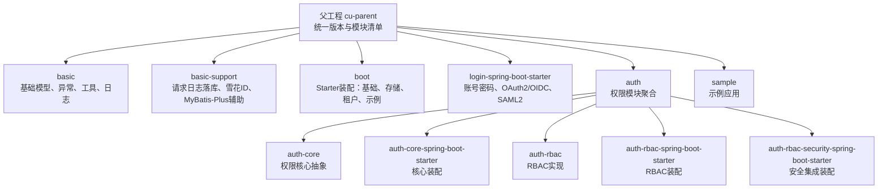

**图表来源**
- [根项目 pom.xml:1-40](file://pom.xml#L1-L40)
- [认证聚合模块 pom.xml:1-30](file://auth/pom.xml#L1-L30)

### 分层组织方式

| 层次 | 典型位置 | 职责 |
|---|---|---|
| 控制器层 | `sample/*`、`auth-rbac/**/controller` | 暴露 HTTP API，调用服务 |
| 服务层 | `auth-rbac/**/mp/service`、业务 Service | 编排业务流程、调用复合查询 |
| 数据访问层 | `auth-rbac/**/mapper`、`basic-support/**/mp/mapper` | MyBatis-Plus Mapper |
| 基础设施层 | `basic`、`basic-support`、`boot` | 异常、日志、分页、存储、租户 |
| 认证层 | `login-spring-boot-starter` | 身份认证、会话、SSO |
| 权限层 | `auth-core`、`auth-rbac` | 权限抽象、RBAC 实现 |

这种组织让权限逻辑既不被写死在 Controller 中，也不被混入登录流程：登录负责“你是谁”，权限负责“你能做什么”。

**章节来源**
- [根项目 pom.xml:1-40](file://pom.xml#L1-L40)

## 核心组件

### 认证核心抽象层：auth-core

`auth-core` 不关心用户从哪里登录，也不关心权限最终存在 `sys_role`、`demo_user_auth` 还是其他表。它只暴露以下关键抽象：

| 类型 | 作用 | 使用位置 |
|---|---|---|
| `AuthCurrentUserContextHolder` | 提供当前用户及其扁平化权限集合 | 菜单拦截器、数据切面 |
| `AuthMenu` | 声明某个方法或类受菜单权限管辖 | Controller 方法或类 |
| `AuthMenuDoc` | 为菜单自动生成显示文案 | Controller 方法或类 |
| `AuthMenuHandler` | 根据权限串判断路径是否可访问 | 菜单拦截器 |
| `AuthDataOperation` | 声明写方法需要对哪些数据执行行级权限检查 | Service / Controller 写方法 |
| `AuthDataRange` | 声明 Mapper 查询需要按用户权限追加数据范围 | MyBatis Mapper 查询方法 |
| `AuthDataAdaptor` | 在 Service 层直接维护权限槽位 | 业务编辑逻辑 |
| `FlatteningAuthority` | 扁平化权限字符串及描述 | 所有判权环节 |
| `AbstractAuthObject` | 权限实体解析与编解码模板 | 业务侧权限体 |

#### 关键接口与实体关系

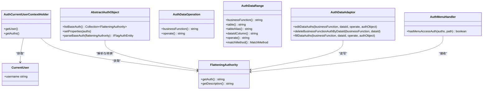

**图表来源**
- [认证核心接口 AuthCurrentUserContextHolder.java:1-25](file://auth/auth-core/src/main/java/com/cu/framework/auth/core/AuthCurrentUserContextHolder.java#L1-L25)
- [菜单处理器接口 AuthMenuHandler.java:1-27](file://auth/auth-core/src/main/java/com/cu/framework/auth/core/menu/AuthMenuHandler.java#L1-L27)
- [数据权限适配器 AuthDataAdaptor.java:1-45](file://auth/auth-core/src/main/java/com/cu/framework/auth/core/AuthDataAdaptor.java#L1-L45)
- [扁平化权限 FlatteningAuthority.java:1-63](file://auth/auth-core/src/main/java/com/cu/framework/auth/core/entity/FlatteningAuthority.java#L1-L63)
- [当前用户 CurrentUser.java:1-13](file://auth/auth-core/src/main/java/com/cu/framework/auth/core/entity/CurrentUser.java#L1-L13)
- [抽象权限体 AbstractAuthObject.java:1-92](file://auth/auth-core/src/main/java/com/cu/framework/auth/core/entity/AbstractAuthObject.java#L1-L92)

**章节来源**
- [认证核心接口 AuthCurrentUserContextHolder.java:1-25](file://auth/auth-core/src/main/java/com/cu/framework/auth/core/AuthCurrentUserContextHolder.java#L1-L25)
- [数据权限适配器 AuthDataAdaptor.java:1-45](file://auth/auth-core/src/main/java/com/cu/framework/auth/core/AuthDataAdaptor.java#L1-L45)
- [菜单权限注解 AuthMenu.java:1-16](file://auth/auth-core/src/main/java/com/cu/framework/auth/core/AuthMenu.java#L1-L16)
- [菜单文档注解 AuthMenuDoc.java:1-22](file://auth/auth-core/src/main/java/com/cu/framework/auth/core/AuthMenuDoc.java#L1-L22)
- [行级数据范围注解 AuthDataRange.java:1-81](file://auth/auth-core/src/main/java/com/cu/framework/auth/core/AuthDataRange.java#L1-L81)
- [行级数据操作注解 AuthDataOperation.java:1-51](file://auth/auth-core/src/main/java/com/cu/framework/auth/core/AuthDataOperation.java#L1-L51)
- [扁平化权限 FlatteningAuthority.java:1-63](file://auth/auth-core/src/main/java/com/cu/framework/auth/core/entity/FlatteningAuthority.java#L1-L63)
- [抽象权限体 AbstractAuthObject.java:1-92](file://auth/auth-core/src/main/java/com/cu/framework/auth/core/entity/AbstractAuthObject.java#L1-L92)

### RBAC 具体实现层：auth-rbac

`auth-rbac` 把 `auth-core` 的抽象落地到 RBAC 模型。其装配由 `auth-rbac-spring-boot-starter` 完成，主要工作包括：

1. 当容器中不存在自定义 `AuthMenuHandler` 时，注册 `RbacAnnotationAuthHandler`。
2. 通过 `SysAuthMenuComposite` 把菜单路径与用户权限串关联起来。
3. 提供 `AuthDataAdaptor` Bean，让业务 Service 可以直接维护权限槽位。
4. 提供 `RbacCurrentUserService`，封装基于 `PasswordEncoder` 的密码更新。
5. 提供默认内存版 `AuthMenuStore`，并允许替换为 Redis 等实现。
6. 扫描 RBAC 包下的 Mapper、Service、Composite 和 Controller。

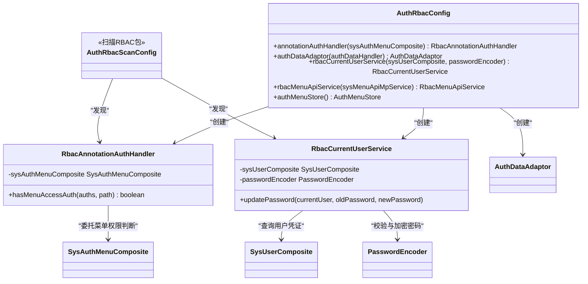

**图表来源**
- [RBAC 菜单处理器 RbacAnnotationAuthHandler.java:1-27](file://auth/auth-rbac/src/main/java/com/cu/framework/auth/rbac/RbacAnnotationAuthHandler.java#L1-L27)
- [RBAC 当前用户服务 RbacCurrentUserService.java:1-42](file://auth/auth-rbac/src/main/java/com/cu/framework/auth/rbac/extension/RbacCurrentUserService.java#L1-L42)
- [RBAC Starter 配置 AuthRbacConfig.java:1-75](file://auth/auth-rbac-spring-boot-starter/src/main/java/com/cu/framework/boot/auth/rbac/config/AuthRbacConfig.java#L1-L75)
- [RBAC Starter 扫描配置 AuthRbacScanConfig.java:1-24](file://auth/auth-rbac-spring-boot-starter/src/main/java/com/cu/framework/boot/auth/rbac/config/AuthRbacScanConfig.java#L1-L24)

**章节来源**
- [RBAC 菜单处理器 RbacAnnotationAuthHandler.java:1-27](file://auth/auth-rbac/src/main/java/com/cu/framework/auth/rbac/RbacAnnotationAuthHandler.java#L1-L27)
- [RBAC 当前用户服务 RbacCurrentUserService.java:1-42](file://auth/auth-rbac/src/main/java/com/cu/framework/auth/rbac/extension/RbacCurrentUserService.java#L1-L42)
- [RBAC Starter 配置 AuthRbacConfig.java:1-75](file://auth/auth-rbac-spring-boot-starter/src/main/java/com/cu/framework/boot/auth/rbac/config/AuthRbacConfig.java#L1-L75)
- [RBAC Starter 扫描配置 AuthRbacScanConfig.java:1-24](file://auth/auth-rbac-spring-boot-starter/src/main/java/com/cu/framework/boot/auth/rbac/config/AuthRbacScanConfig.java#L1-L24)

### 认证授权基础设施：login-spring-boot-starter

该 Starter 在同一套 Spring Security 过滤器链上并列支持三种登录方式：

| 协议 | 配置前缀 | 关键组件 | 是否依赖 `SecurityUserDetailsService` |
|---|---|---|---|
| 账号密码 | `cu.security.login.password` | `PasswordSecurityConfig`、`JsonLoginFilter` | 是 |
| OAuth2 / OIDC | `cu.security.login.oauth2` | `Oauth2Config`、`OAuth2LoginAuthenticationFilter` | 否 |
| SAML2 | `cu.security.login.saml` | `SamlConfig`、`Saml2WebSsoAuthenticationFilter` | 否 |

统一交付点是 `SecurityUserDetailsService`。账号密码登录必须实现它；单点登录则从 IdP 拉取用户信息，但进入安全上下文的主体仍统一到 `SecurityUser` 或其协议子类型。

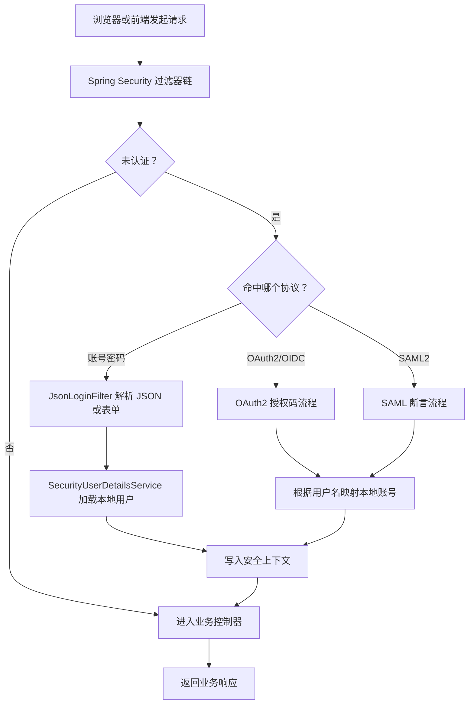

**图表来源**
- [登录 Starter 说明 README.md:1-120](file://login-spring-boot-starter/README.md#L1-L120)
- [单点登录说明 README-SSO.md:1-120](file://login-spring-boot-starter/README-SSO.md#L1-L120)
- [用户详情服务 SecurityUserDetailsService.java:1-27](file://login-spring-boot-starter/src/main/java/com/cu/framework/authentication/service/SecurityUserDetailsService.java#L1-L27)
- [JSON 登录过滤器 JsonLoginFilter.java:1-55](file://login-spring-boot-starter/src/main/java/com/cu/framework/authentication/password/filter/JsonLoginFilter.java#L1-L55)

**章节来源**
- [登录 Starter 说明 README.md:1-120](file://login-spring-boot-starter/README.md#L1-L120)
- [单点登录说明 README-SSO.md:1-120](file://login-spring-boot-starter/README-SSO.md#L1-L120)
- [用户详情服务 SecurityUserDetailsService.java:1-27](file://login-spring-boot-starter/src/main/java/com/cu/framework/authentication/service/SecurityUserDetailsService.java#L1-L27)
- [JSON 登录过滤器 JsonLoginFilter.java:1-55](file://login-spring-boot-starter/src/main/java/com/cu/framework/authentication/password/filter/JsonLoginFilter.java#L1-L55)

### 基础功能库：basic

`basic` 提供框架最底层的通用能力：

- 后端异常模型：`BackendException`、`BizException`、`ExceptionConstant`、全局异常处理建议。
- 早期请求过滤：`EarlyRequestFilter`、`EarlyRequestFilterProxy`。
- 日志采集：`RequestLoggerFilter`、Trace 相关组件。
- 标准响应与分页：`Result`、`PageReq`、`PageResult`、`IdReq`、`IdsReq`。
- 常用工具：Bean 拷贝、文件工具、正则、树形结构、YAML 读取、IP 获取。

这些能力被 `basic-support`、`auth-*`、`login-spring-boot-starter` 和业务示例共同复用。

**章节来源**
- [根项目 pom.xml:1-40](file://pom.xml#L1-L40)

### 支撑功能：basic-support

`basic-support` 建立在 `basic` 之上，补充可观测性和常用基础设施：

- 请求日志数据库持久化监听器：异步消费 `RequestLoggerEvent`，写入 `sys_request_log`。
- MyBatis-Plus 分页执行器、雪花 ID 生成器。
- 基础监控端点 `BasicSupportEndpoint`。
- 通知与工具类。

雪花 ID 生成器提供分布式 ID 生成，包含时间戳、机器 ID、序列号字段，并内置时钟回拨策略。

**章节来源**
- [请求日志持久化监听器 RequestLogDatabasePersistentListener.java:1-66](file://basic-support/src/main/java/com/cu/framework/basic/support/log/RequestLogDatabasePersistentListener.java#L1-L66)
- [雪花 ID 生成器 SnowflakeIdGenerator.java:1-200](file://basic-support/src/main/java/com/cu/framework/basic/support/utils/SnowflakeIdGenerator.java#L1-L200)

### 装配层：boot

`boot` 下包含多个独立 Starter：

- `basic-spring-boot-starter`：基础 Web、异步、MyBatis-Plus、消息、格式化等装配。
- `storage-spring-boot-starter`：对象存储自动配置。
- `tenant-spring-boot-starter`：多租户上下文、过滤器、Feign 透传。
- `magic-spring-boot-starter`：示例型魔法结果装配。

这些 Starter 的职责不是实现业务，而是把已有组件装配成 Spring 容器可用的 Bean。

**章节来源**
- [基础功能 Starter 异步配置 AsyncConfig.java:1-40](file://boot/boot/basic-spring-boot-starter/src/main/java/com/cu/framework/boot/basic/config/AsyncConfig.java#L1-L40)
- [存储 Starter 自动配置 StorageAutoConfiguration.java:1-40](file://boot/boot/storage-spring-boot-starter/src/main/java/com/cu/framework/storage/boot/StorageAutoConfiguration.java#L1-L40)
- [租户 Starter 配置 TenantConfig.java:1-40](file://boot/boot/tenant-spring-boot-starter/src/main/java/com/cu/framework/tenant/config/TenantConfig.java#L1-L40)

## 架构总览

下图展示一次带菜单和数据范围的数据操作请求在 Kewen Framework 中的完整路径：

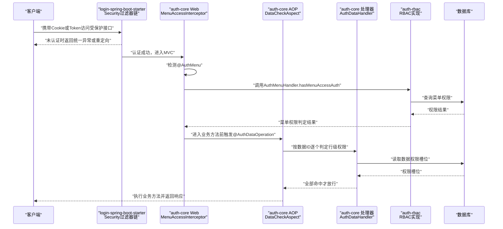

**图表来源**
- [JSON 登录过滤器 JsonLoginFilter.java:1-55](file://login-spring-boot-starter/src/main/java/com/cu/framework/authentication/password/filter/JsonLoginFilter.java#L1-L55)
- [菜单访问拦截器 MenuAccessInterceptor.java:1-93](file://auth/auth-core/src/main/java/com/cu/framework/auth/core/menu/MenuAccessInterceptor.java#L1-L93)
- [数据操作切面 DataCheckAspect.java:1-149](file://auth/auth-core/src/main/java/com/cu/framework/auth/core/data/edit/DataCheckAspect.java#L1-L149)
- [JDBC 数据权限处理器 JdbcAuthDataHandler.java:1-119](file://auth/auth-core/src/main/java/com/cu/framework/auth/core/data/JdbcAuthDataHandler.java#L1-L119)
- [RBAC 菜单处理器 RbacAnnotationAuthHandler.java:1-27](file://auth/auth-rbac/src/main/java/com/cu/framework/auth/rbac/RbacAnnotationAuthHandler.java#L1-L27)

### 控制流关键点

1. **登录阶段**：`login-spring-boot-starter` 决定用户是否能进入应用。
2. **菜单阶段**：`MenuAccessInterceptor` 只在标记了 `@AuthMenu` 的路径上做菜单级鉴权。
3. **行级数据阶段**：`DataCheckAspect` 只对标记了 `@AuthDataOperation` 的写方法进行数据 ID 级别权限检查。
4. **SQL 范围阶段**：`MybatisDataRangeInterceptor`（由 `AuthCoreConfig` 装配）对标记了 `@AuthDataRange` 的查询语句追加数据范围。
5. **权限数据维护阶段**：业务 Service 通过 `AuthDataAdaptor` 或 RBAC 层的服务维护权限槽位。

**章节来源**
- [菜单访问拦截器 MenuAccessInterceptor.java:1-93](file://auth/auth-core/src/main/java/com/cu/framework/auth/core/menu/MenuAccessInterceptor.java#L1-L93)
- [数据操作切面 DataCheckAspect.java:1-149](file://auth/auth-core/src/main/java/com/cu/framework/auth/core/data/edit/DataCheckAspect.java#L1-L149)
- [认证核心自动装配 AuthCoreConfig.java:1-200](file://auth/auth-core-spring-boot-starter/src/main/java/com/cu/framework/boot/auth/core/config/AuthCoreConfig.java#L1-L200)

## 详细组件分析

### 注解驱动：菜单与数据权限

框架大量使用注解作为“声明式配置”，开发者不需要手写鉴权逻辑，只需要标注：

| 注解 | 目标 | 含义 |
|---|---|---|
| `@AuthMenu` | 方法、类、注解 | 该端点受菜单权限管辖 |
| `@AuthMenuDoc` | 方法、类、注解 | 菜单树显示名称 |
| `@AuthDataOperation` | 方法 | 该方法要对参数中的数据 ID 做行级权限检查 |
| `@AuthDataRange` | Mapper 查询方法 | 该查询要按用户权限追加数据范围 |

注解本身不参与运行时判定，真正的工作由拦截器和切面承担。

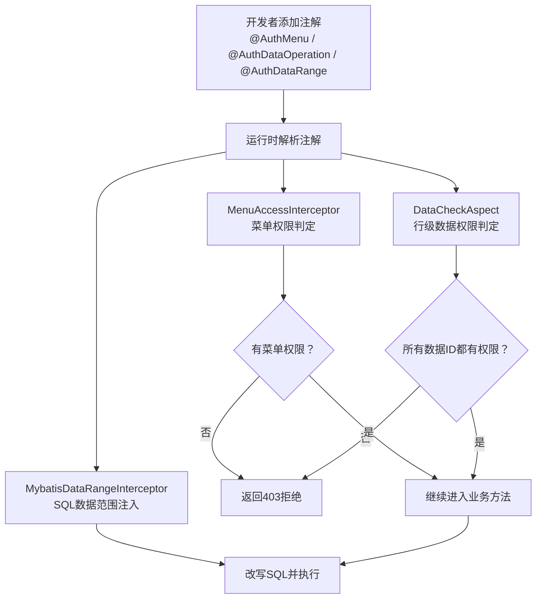

**图表来源**
- [菜单权限注解 AuthMenu.java:1-16](file://auth/auth-core/src/main/java/com/cu/framework/auth/core/AuthMenu.java#L1-L16)
- [菜单文档注解 AuthMenuDoc.java:1-22](file://auth/auth-core/src/main/java/com/cu/framework/auth/core/AuthMenuDoc.java#L1-L22)
- [行级数据操作注解 AuthDataOperation.java:1-51](file://auth/auth-core/src/main/java/com/cu/framework/auth/core/AuthDataOperation.java#L1-L51)
- [行级数据范围注解 AuthDataRange.java:1-81](file://auth/auth-core/src/main/java/com/cu/framework/auth/core/AuthDataRange.java#L1-L81)
- [菜单访问拦截器 MenuAccessInterceptor.java:1-93](file://auth/auth-core/src/main/java/com/cu/framework/auth/core/menu/MenuAccessInterceptor.java#L1-L93)
- [数据操作切面 DataCheckAspect.java:1-149](file://auth/auth-core/src/main/java/com/cu/framework/auth/core/data/edit/DataCheckAspect.java#L1-L149)

**章节来源**
- [菜单权限注解 AuthMenu.java:1-16](file://auth/auth-core/src/main/java/com/cu/framework/auth/core/AuthMenu.java#L1-L16)
- [菜单文档注解 AuthMenuDoc.java:1-22](file://auth/auth-core/src/main/java/com/cu/framework/auth/core/AuthMenuDoc.java#L1-L22)
- [行级数据操作注解 AuthDataOperation.java:1-51](file://auth/auth-core/src/main/java/com/cu/framework/auth/core/AuthDataOperation.java#L1-L51)
- [行级数据范围注解 AuthDataRange.java:1-81](file://auth/auth-core/src/main/java/com/cu/framework/auth/core/AuthDataRange.java#L1-L81)

### AOP 切面编程：行级数据操作校验

`DataCheckAspect` 是典型的 AOP 方案：它不侵入业务方法体，而是在方法执行前收集实参中的业务数据 ID，再统一判定权限。

关键行为：

- 切入点仅匹配带 `@AuthDataOperation` 的方法。
- 从方法参数中递归识别一层数组或集合元素里的 `DataIdCarrier`。
- 对数据 ID 去重后限制最多 100 条。
- 任一 ID 没有对应权限即整体拒绝，且方法体不会执行。
- 用户权限集合不进 SQL 查询条件，避免权限规模影响语句。

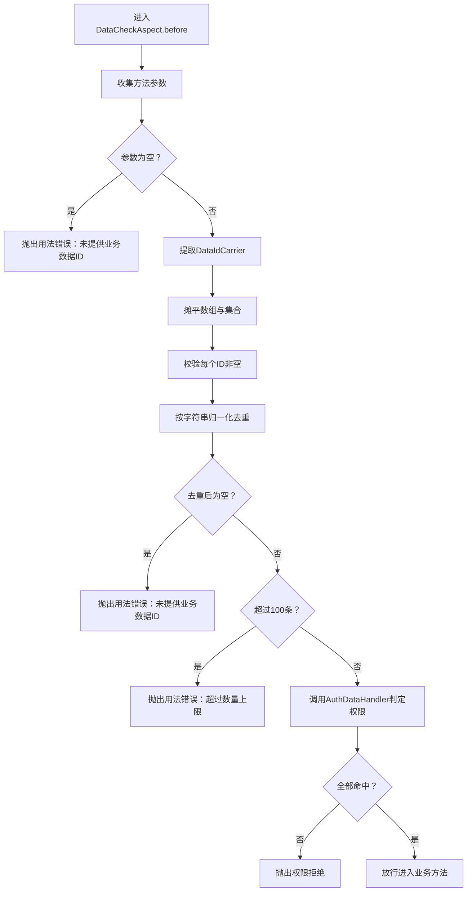

**图表来源**
- [数据操作切面 DataCheckAspect.java:1-149](file://auth/auth-core/src/main/java/com/cu/framework/auth/core/data/edit/DataCheckAspect.java#L1-L149)

**章节来源**
- [数据操作切面 DataCheckAspect.java:1-149](file://auth/auth-core/src/main/java/com/cu/framework/auth/core/data/edit/DataCheckAspect.java#L1-L149)

### 策略模式：菜单权限与数据权限处理器

`auth-core` 定义接口，`auth-rbac` 提供默认实现，这是典型的策略模式：

- `AuthMenuHandler`：菜单权限判定策略。
- `RbacAnnotationAuthHandler`：基于 RBAC 菜单复合查询的策略实现。
- `AuthDataHandler`：数据权限持久化和判定策略。
- `JdbcAuthDataHandler`：基于 JDBC 的默认策略实现。

如果业务需要缓存、分库分表或其他存储形式，只需提供自己的 `AuthMenuHandler` 或 `AuthDataHandler` Bean，而不必修改核心拦截器和切面。

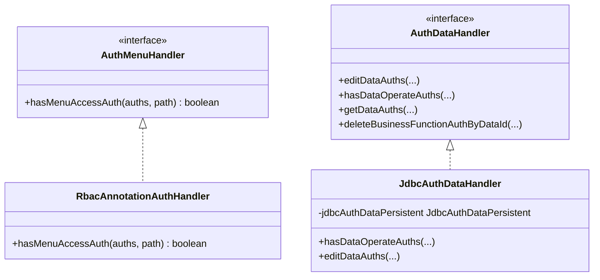

**图表来源**
- [菜单处理器接口 AuthMenuHandler.java:1-27](file://auth/auth-core/src/main/java/com/cu/framework/auth/core/menu/AuthMenuHandler.java#L1-L27)
- [RBAC 菜单处理器 RbacAnnotationAuthHandler.java:1-27](file://auth/auth-rbac/src/main/java/com/cu/framework/auth/rbac/RbacAnnotationAuthHandler.java#L1-L27)
- [JDBC 数据权限处理器 JdbcAuthDataHandler.java:1-119](file://auth/auth-core/src/main/java/com/cu/framework/auth/core/data/JdbcAuthDataHandler.java#L1-L119)

**章节来源**
- [菜单处理器接口 AuthMenuHandler.java:1-27](file://auth/auth-core/src/main/java/com/cu/framework/auth/core/menu/AuthMenuHandler.java#L1-L27)
- [RBAC 菜单处理器 RbacAnnotationAuthHandler.java:1-27](file://auth/auth-rbac/src/main/java/com/cu/framework/auth/rbac/RbacAnnotationAuthHandler.java#L1-L27)
- [JDBC 数据权限处理器 JdbcAuthDataHandler.java:1-119](file://auth/auth-core/src/main/java/com/cu/framework/auth/core/data/JdbcAuthDataHandler.java#L1-L119)

### 模板方法模式：权限实体编解码

`AbstractAuthObject` 定义了权限实体从扁平化权限串解析到具体权限对象的模板流程：

1. 启动时扫描所有 `IFlagAuthEntity` 实现，建立权限标记到实体类型的映射。
2. 子类只需关注自身权限集合与扁平化权限串的转换。
3. `parseBaseAuth` 根据权限串中的标记动态实例化对应实体。
4. `setProperties` 批量解析并交给子类回调设置。

这降低了不同权限模型（用户、角色、部门角色等）之间的重复代码。

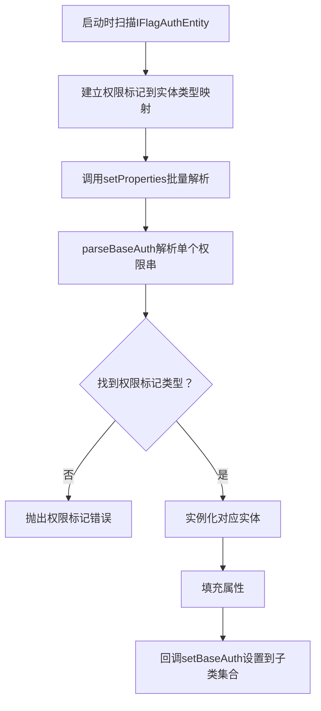

**图表来源**
- [抽象权限体 AbstractAuthObject.java:1-92](file://auth/auth-core/src/main/java/com/cu/framework/auth/core/entity/AbstractAuthObject.java#L1-L92)

**章节来源**
- [抽象权限体 AbstractAuthObject.java:1-92](file://auth/auth-core/src/main/java/com/cu/framework/auth/core/entity/AbstractAuthObject.java#L1-L92)

### SPI 设计与扩展机制

框架的扩展点集中在几个接口和条件装配上：

| 扩展点 | 所属模块 | 用途 | 如何扩展 |
|---|---|---|---|
| `AuthCurrentUserContextHolder` | `auth-core` | 提供当前用户和权限 | 实现该接口并注册 Bean |
| `AuthMenuHandler` | `auth-core` | 菜单权限判定 | 实现该接口，覆盖默认 RBAC 实现 |
| `AuthDataHandler` | `auth-core` | 数据权限持久化和判定 | 实现该接口，覆盖 `JdbcAuthDataHandler` |
| `IAuthObject` / `AbstractAuthObject` | `auth-core` | 权限集合体 | 继承抽象类实现权限编解码 |
| `IFlagAuthEntity` | `auth-core` | 权限标记实体 | 新增权限类型并注册 |
| `SecurityUserDetailsService` | `login-spring-boot-starter` | 用户详情与密码更新 | 实现该接口供账号密码登录使用 |
| 菜单 API 服务 | `auth-core` | 菜单行持久化 | 提供 `MenuApiService` Bean |

条件装配保证扩展优先：例如 `AuthRbacConfig` 使用 `@ConditionalOnMissingBean(AuthMenuHandler.class)`，`AuthCoreConfig` 使用 `@ConditionalOnMissingBean(AuthDataHandler.class)`。这意味着只要业务侧提供了同类型 Bean，核心默认实现就不会生效。

**章节来源**
- [认证核心接口 AuthCurrentUserContextHolder.java:1-25](file://auth/auth-core/src/main/java/com/cu/framework/auth/core/AuthCurrentUserContextHolder.java#L1-L25)
- [RBAC Starter 配置 AuthRbacConfig.java:1-75](file://auth/auth-rbac-spring-boot-starter/src/main/java/com/cu/framework/boot/auth/rbac/config/AuthRbacConfig.java#L1-L75)
- [认证核心自动装配 AuthCoreConfig.java:1-200](file://auth/auth-core-spring-boot-starter/src/main/java/com/cu/framework/boot/auth/core/config/AuthCoreConfig.java#L1-L200)
- [用户详情服务 SecurityUserDetailsService.java:1-27](file://login-spring-boot-starter/src/main/java/com/cu/framework/authentication/service/SecurityUserDetailsService.java#L1-L27)

## 依赖关系分析

### 模块依赖图

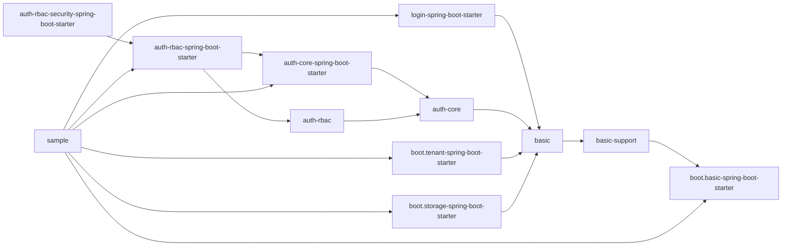

**图表来源**
- [根项目 pom.xml:1-40](file://pom.xml#L1-L40)
- [认证聚合模块 pom.xml:1-30](file://auth/pom.xml#L1-L30)

### 关键耦合关系

| 耦合 | 方向 | 说明 |
|---|---|---|
| `auth-core` → `basic` | 间接 | 通过权限异常、工具类和基础模型 |
| `auth-rbac` → `auth-core` | 强 | 实现核心定义的接口 |
| `auth-*-starter` → 对应模块 | 强 | Starter 装配对应模块的 Bean |
| `login-spring-boot-starter` → `auth-core` | 弱 | 通过 `SecurityUserContext` 与 `CurrentUser` 协作，但不强制依赖 RBAC |
| `basic-support` → `basic` | 强 | 扩展基础日志、分页、工具 |
| `boot` 下各 Starter | 各自独立 | 通过 Spring Boot 自动装配解耦 |

### 启动装配顺序

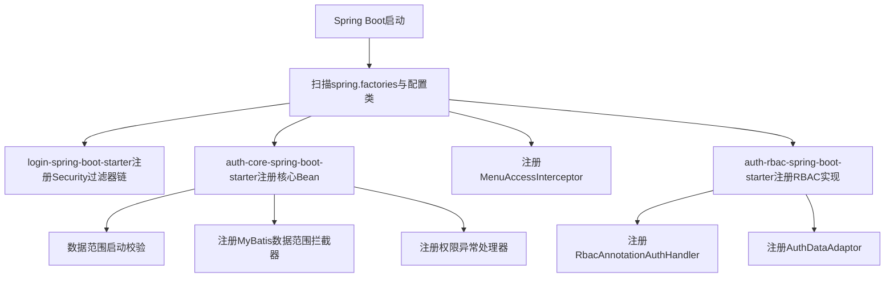

**图表来源**
- [认证核心自动装配 AuthCoreConfig.java:1-200](file://auth/auth-core-spring-boot-starter/src/main/java/com/cu/framework/boot/auth/core/config/AuthCoreConfig.java#L1-L200)
- [Web 拦截器装配 AuthWebConfig.java:1-30](file://auth/auth-core-spring-boot-starter/src/main/java/com/cu/framework/boot/auth/core/config/AuthWebConfig.java#L1-L30)
- [RBAC Starter 配置 AuthRbacConfig.java:1-75](file://auth/auth-rbac-spring-boot-starter/src/main/java/com/cu/framework/boot/auth/rbac/config/AuthRbacConfig.java#L1-L75)

**章节来源**
- [认证核心自动装配 AuthCoreConfig.java:1-200](file://auth/auth-core-spring-boot-starter/src/main/java/com/cu/framework/boot/auth/core/config/AuthCoreConfig.java#L1-L200)
- [Web 拦截器装配 AuthWebConfig.java:1-30](file://auth/auth-core-spring-boot-starter/src/main/java/com/cu/framework/boot/auth/core/config/AuthWebConfig.java#L1-L30)
- [RBAC Starter 配置 AuthRbacConfig.java:1-75](file://auth/auth-rbac-spring-boot-starter/src/main/java/com/cu/framework/boot/auth/rbac/config/AuthRbacConfig.java#L1-L75)

## 性能与扩展性

### 性能特性

| 场景 | 框架行为 | 性能意义 |
|---|---|---|
| 行级数据权限判定 | 用户权限集合留在内存比对，不放入 SQL | 避免大权限集合污染查询计划 |
| 数据 ID 上限 | 去重后最多 100 条 | 防止批量权限判定退化 |
| 数据范围缓存 | `AuthRangeCache` 缓存语句级静态信息 | 减少重复解析 |
| 菜单权限判定 | 由 `AuthMenuHandler` 策略实现 | 可替换为缓存或预计算实现 |
| 请求日志持久化 | 通过事件异步落库 | 不阻塞主请求线程 |
| 雪花 ID | 本地生成分布式 ID | 降低数据库自增压力 |

### 扩展性建议

1. **替换菜单权限实现**：提供自定义 `AuthMenuHandler`，把菜单权限落到 Redis、网关或外部权限中心。
2. **替换数据权限实现**：提供自定义 `AuthDataHandler`，接入分库分表、权限缓存或多数据源。
3. **扩展权限类型**：新增 `IFlagAuthEntity` 实现，并在权限体中支持新的权限串格式。
4. **扩展认证来源**：保留 `SecurityUserDetailsService`，新增业务用户加载逻辑；SSO 场景则由协议适配层映射到本地用户。
5. **扩展日志输出**：通过 `basic-support` 的事件机制增加消息队列、远端日志或审计系统。
6. **扩展存储与租户**：通过 `boot` 下 Starter 的条件装配切换对象存储和多租户策略。

**章节来源**
- [数据操作切面 DataCheckAspect.java:1-149](file://auth/auth-core/src/main/java/com/cu/framework/auth/core/data/edit/DataCheckAspect.java#L1-L149)
- [请求日志持久化监听器 RequestLogDatabasePersistentListener.java:1-66](file://basic-support/src/main/java/com/cu/framework/basic/support/log/RequestLogDatabasePersistentListener.java#L1-L66)
- [雪花 ID 生成器 SnowflakeIdGenerator.java:1-200](file://basic-support/src/main/java/com/cu/framework/basic/support/utils/SnowflakeIdGenerator.java#L1-L200)

## 故障排查指南

### 常见问题定位

| 现象 | 可能原因 | 排查方向 |
|---|---|---|
| 启动失败提示找不到 `AuthCurrentUserContextHolder` | 未实现当前用户上下文 | 检查是否实现并注册该 Bean |
| 启动失败提示缺少菜单权限处理 | 未实现 `AuthMenuHandler` | RBAC 模式下确保引入 RBAC 模块；否则需自行提供实现 |
| 菜单权限无效 | 未加 `@AuthMenu` 或路径不一致 | 检查 Controller 方法或类上的注解 |
| 写方法未执行但返回 403 | `@AuthDataOperation` 判定失败 | 检查数据 ID 是否正确、权限槽位是否存在 |
| 查询未按预期过滤 | 未加 `@AuthDataRange` 或语句不是查询 | 检查 Mapper 方法注解及 SQL 类型 |
| 单点登录失败跳转状态不对 | 未正确配置 `result-url` 或回调端点 | 对照 OAuth2/OIDC/SAML2 回调路径 |
| 账号密码登录 Content-Type 报错 | JSON 头大小写或字符集不匹配 | 确认前端发送 `application/json` |
| 请求日志未落库 | 未配置异步或持久化监听器 | 检查事件监听器与数据库服务 |

### 安全异常处理

`SecurityAuthenticationExceptionResolverHandler` 统一处理未认证、无权限和认证失败的请求。它会：

- 对单点登录回调失败进行重定向，携带失败状态。
- 尝试委托 Spring MVC 的 `HandlerExceptionResolver`。
- 如果没有解析器，返回兜底的 JSON 文本。

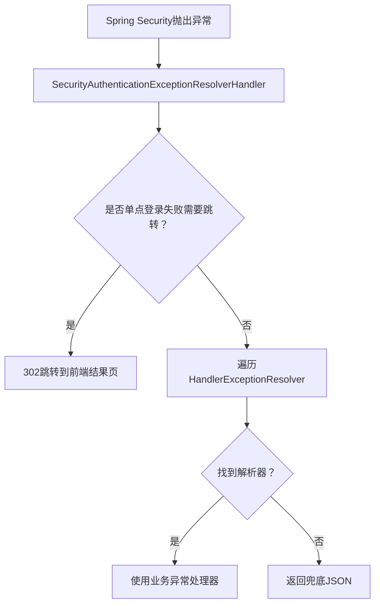

**图表来源**
- [安全异常处理器 SecurityAuthenticationExceptionResolverHandler.java:1-110](file://login-spring-boot-starter/src/main/java/com/cu/framework/authentication/response/SecurityAuthenticationExceptionResolverHandler.java#L1-L110)

**章节来源**
- [安全异常处理器 SecurityAuthenticationExceptionResolverHandler.java:1-110](file://login-spring-boot-starter/src/main/java/com/cu/framework/authentication/response/SecurityAuthenticationExceptionResolverHandler.java#L1-L110)

## 结论

Kewen Framework 的核心设计可以概括为：**登录由 `login-spring-boot-starter` 负责，权限由 `auth-core` 抽象、`auth-rbac` 实现，基础设施由 `basic` 和 `basic-support` 提供，装配由 `boot` 和各 Starter 完成**。

它的优势在于：

- 注解驱动让权限声明靠近业务，但又不侵入业务逻辑。
- AOP 切面把行级数据权限检查从方法体中剥离。
- 策略模式让菜单权限和数据权限可替换。
- 模板方法模式简化了多种权限实体编解码。
- SPI 和条件装配让扩展在不修改核心代码的前提下发生。
- Starter 装配让认证、权限、存储、租户等能力按需启用。

对于新加入的开发者，推荐理解顺序是：

1. 先看 `login-spring-boot-starter` 如何拿到当前用户。
2. 再看 `auth-core` 如何用注解声明菜单和数据权限。
3. 然后看 `auth-rbac` 如何用 RBAC 模型实现这些声明。
4. 最后看 `basic`、`basic-support`、`boot` 如何提供通用支撑。