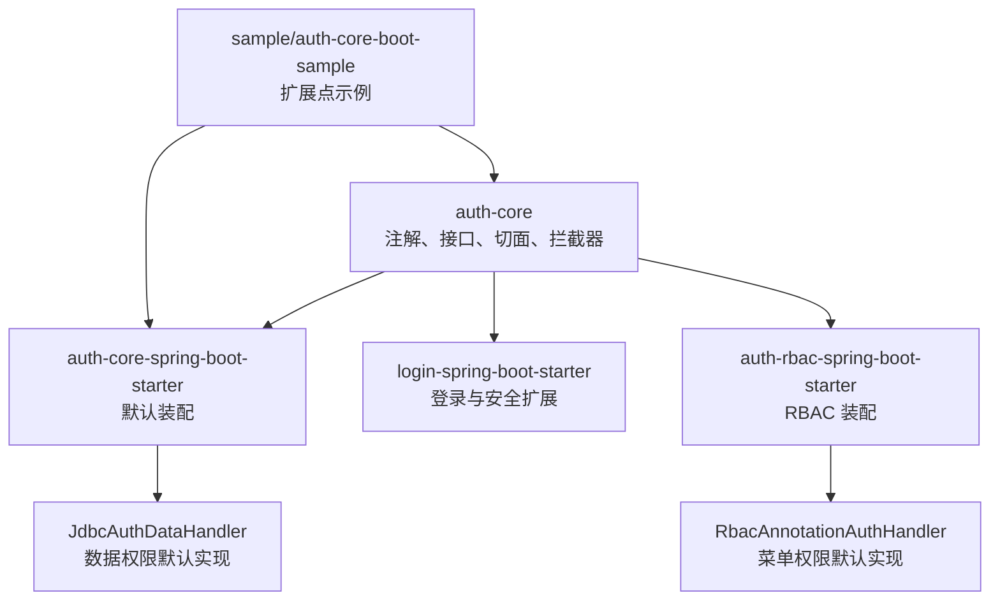
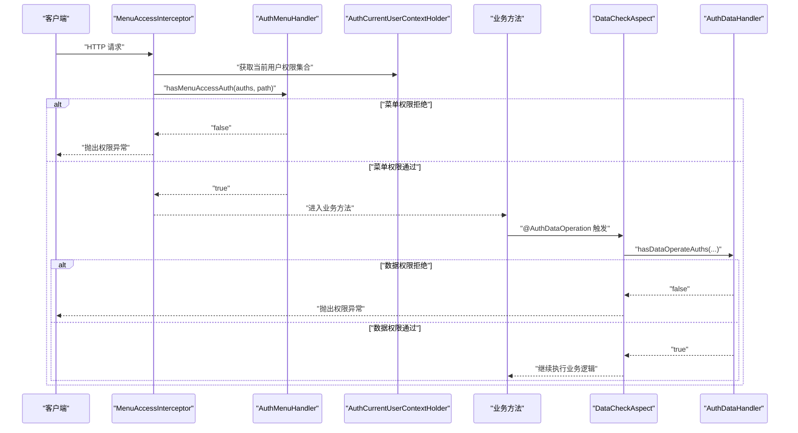
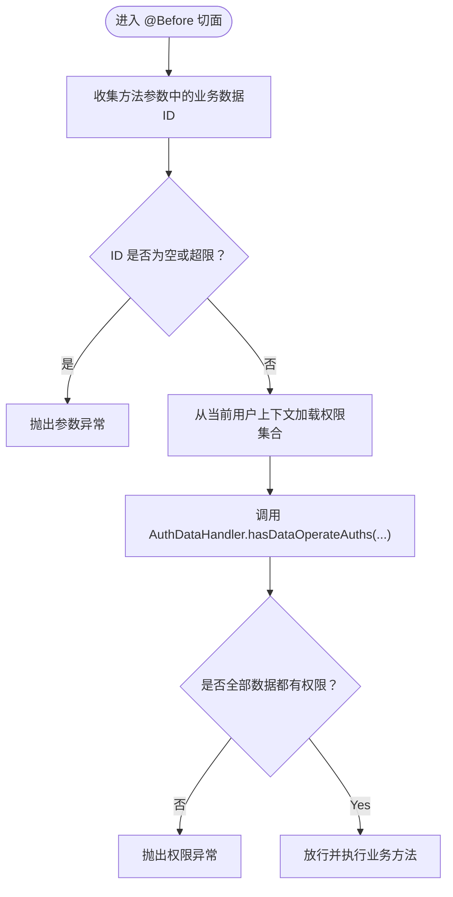
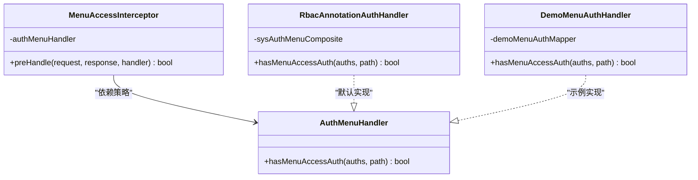
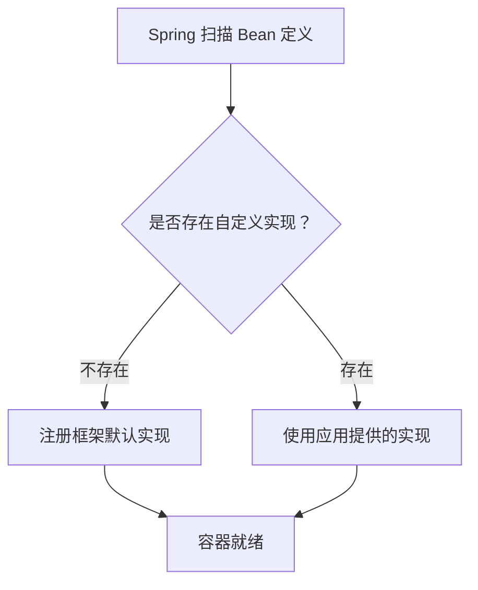
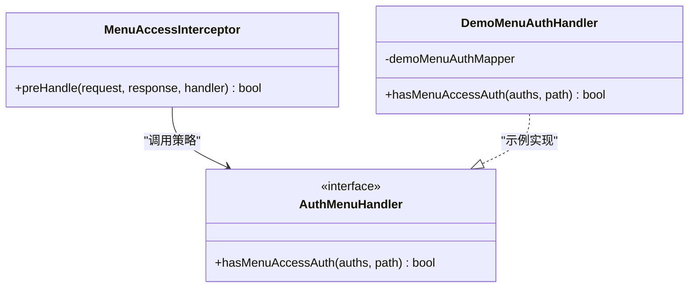
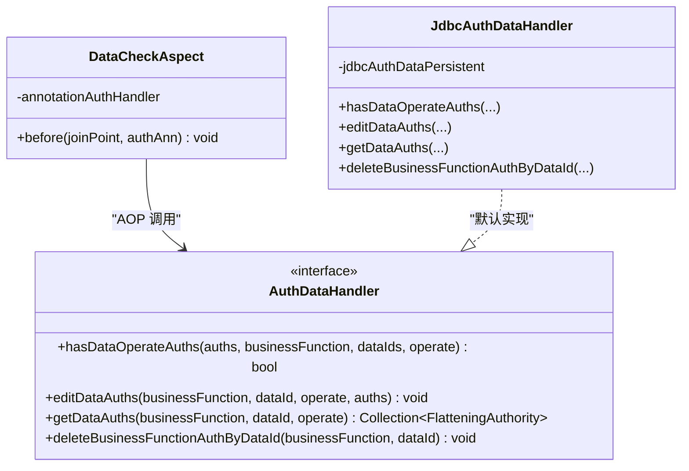
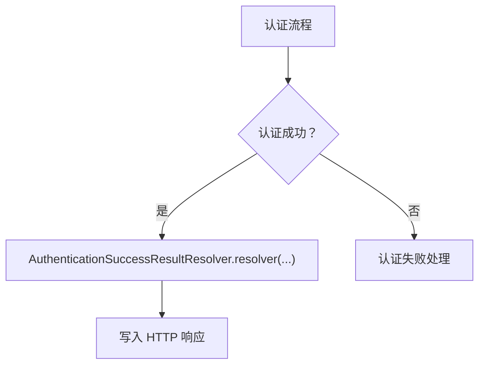
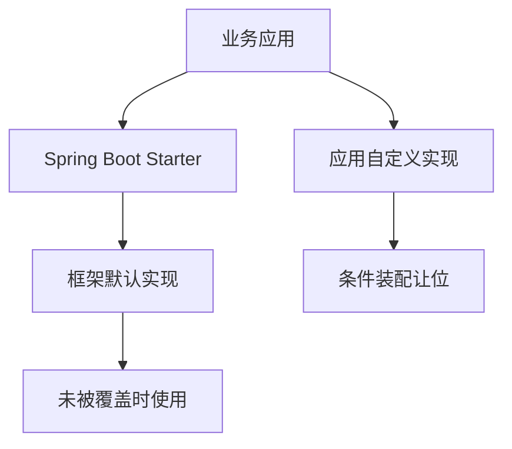
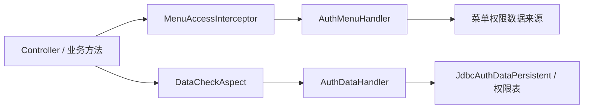

# 架构模式与设计原则

<cite>
**本文引用的文件**   
- [README_Auth.md](file://README_Auth.md)
- [AuthMenuHandler.java](file://auth/auth-core/src/main/java/com/cu/framework/auth/core/menu/AuthMenuHandler.java)
- [MenuAccessInterceptor.java](file://auth/auth-core/src/main/java/com/cu/framework/auth/core/menu/MenuAccessInterceptor.java)
- [AuthDataHandler.java](file://auth/auth-core/src/main/java/com/cu/framework/auth/core/data/AuthDataHandler.java)
- [JdbcAuthDataHandler.java](file://auth/auth-core/src/main/java/com/cu/framework/auth/core/data/JdbcAuthDataHandler.java)
- [DataCheckAspect.java](file://auth/auth-core/src/main/java/com/cu/framework/auth/core/data/edit/DataCheckAspect.java)
- [RbacAnnotationAuthHandler.java](file://auth/auth-rbac/src/main/java/com/cu/framework/auth/rbac/RbacAnnotationAuthHandler.java)
- [AuthCoreConfig.java](file://auth/auth-core-spring-boot-starter/src/main/java/com/cu/framework/boot/auth/core/config/AuthCoreConfig.java)
- [AuthenticationSuccessResultResolver.java](file://login-spring-boot-starter/src/main/java/com/cu/framework/authentication/response/AuthenticationSuccessResultResolver.java)
- [DemoAuthConfig.java](file://sample/auth-core-boot-sample/src/main/java/com/cu/framework/sample/authcore/config/DemoAuthConfig.java)
- [DemoMenuAuthHandler.java](file://sample/auth-core-boot-sample/src/main/java/com/cu/framework/sample/authcore/context/DemoMenuAuthHandler.java)
- [DemoMetaController.java](file://sample/auth-core-boot-sample/src/main/java/com/cu/framework/sample/authcore/web/DemoMetaController.java)
</cite>

## 目录
1. [引言](#引言)
2. [项目结构](#项目结构)
3. [核心组件](#核心组件)
4. [架构总览](#架构总览)
5. [详细组件分析](#详细组件分析)
6. [依赖关系分析](#依赖关系分析)
7. [性能与可扩展性](#性能与可扩展性)
8. [故障排查指南](#故障排查指南)
9. [结论](#结论)

## 引言
Kewen Framework 的权限体系围绕“注解驱动、切面拦截、策略扩展、模板装配、SPI 服务发现”展开。其核心思路是：在核心模块中定义最小且稳定的抽象，将具体业务规则下沉到实现或示例工程中；通过 Spring Boot Starter 自动装配默认行为，同时保留条件化让位能力，使外部系统能在不开源核心代码的前提下进行功能扩展。

框架文档指出该权限体系基于 RBAC 思想，提供菜单权限与数据权限两大控制面，并通过注解完成声明式校验，减少重复的鉴权样板代码。认证成功返回等安全层细节则通过独立的安全启动器暴露可替换接口，形成清晰的职责边界。

**章节来源**
- [README_Auth.md:1-200](file://README_Auth.md#L1-L200)

## 项目结构
从架构视角，仓库可划分为四层：
- 核心抽象层：auth-core 定义注解、处理器接口、实体模型、切面与拦截器。
- 默认实现层：auth-rbac 提供 RBAC 相关默认实现；auth-core 内置 JdbcAuthDataHandler 作为数据权限默认实现。
- 自动装配层：auth-core-spring-boot-starter、login-spring-boot-starter、auth-rbac-spring-boot-starter 等 Starter 负责 Bean 注册、条件装配和 SPI 注册。
- 示例与应用层：sample 工程演示如何扩展 AuthMenuHandler、AuthDataHandler、当前用户上下文等扩展点。

**图表来源**
- [AuthCoreConfig.java:1-203](file://auth/auth-core-spring-boot-starter/src/main/java/com/cu/framework/boot/auth/core/config/AuthCoreConfig.java#L1-L203)
- [RbacAnnotationAuthHandler.java:1-27](file://auth/auth-rbac/src/main/java/com/cu/framework/auth/rbac/RbacAnnotationAuthHandler.java#L1-L27)
- [JdbcAuthDataHandler.java:1-119](file://auth/auth-core/src/main/java/com/cu/framework/auth/core/data/JdbcAuthDataHandler.java#L1-L119)
- [DemoAuthConfig.java:1-104](file://sample/auth-core-boot-sample/src/main/java/com/cu/framework/sample/authcore/config/DemoAuthConfig.java#L1-L104)

**章节来源**
- [README_Auth.md:1-200](file://README_Auth.md#L1-L200)

## 核心组件
框架的关键扩展点集中在三类组件：
- 菜单权限处理器：AuthMenuHandler 定义“路径是否允许访问”的策略接口；MenuAccessInterceptor 在请求进入 Controller 前执行校验。
- 数据权限处理器：AuthDataHandler 定义“行级操作权限判定、编辑、查询、删除”等策略接口；DataCheckAspect 通过 AOP 拦截带注解的方法并调用处理器。
- 认证成功结果解析器：AuthenticationSuccessResultResolver 定义安全层认证成功后的统一响应封装策略。

这些组件共同构成“声明式权限 + 运行时拦截 + 策略替换”的基础设施。

**章节来源**
- [AuthMenuHandler.java:1-27](file://auth/auth-core/src/main/java/com/cu/framework/auth/core/menu/AuthMenuHandler.java#L1-L27)
- [MenuAccessInterceptor.java:1-93](file://auth/auth-core/src/main/java/com/cu/framework/auth/core/menu/MenuAccessInterceptor.java#L1-L93)
- [AuthDataHandler.java:1-102](file://auth/auth-core/src/main/java/com/cu/framework/auth/core/data/AuthDataHandler.java#L1-L102)
- [DataCheckAspect.java:1-149](file://auth/auth-core/src/main/java/com/cu/framework/auth/core/data/edit/DataCheckAspect.java#L1-L149)
- [AuthenticationSuccessResultResolver.java:1-23](file://login-spring-boot-starter/src/main/java/com/cu/framework/authentication/response/AuthenticationSuccessResultResolver.java#L1-L23)

## 架构总览
Kewen Framework 的权限架构以“注解为入口、拦截器与切面为执行点、处理器为策略中心、Starter 为装配中心”。

**图表来源**
- [MenuAccessInterceptor.java:24-93](file://auth/auth-core/src/main/java/com/cu/framework/auth/core/menu/MenuAccessInterceptor.java#L24-L93)
- [AuthMenuHandler.java:14-27](file://auth/auth-core/src/main/java/com/cu/framework/auth/core/menu/AuthMenuHandler.java#L14-L27)
- [DataCheckAspect.java:40-149](file://auth/auth-core/src/main/java/com/cu/framework/auth/core/data/edit/DataCheckAspect.java#L40-L149)
- [AuthDataHandler.java:16-102](file://auth/auth-core/src/main/java/com/cu/framework/auth/core/data/AuthDataHandler.java#L16-L102)

## 详细组件分析

### 注解驱动开发
框架使用注解描述权限需求，包括菜单权限注解和数据权限注解。注解本身不直接执行校验，而是由拦截器和切面在运行期读取注解元信息，再委托给对应的处理器。

关键特征：
- 菜单权限通过类或方法上的注解声明管辖端点。
- 数据权限通过方法注解声明业务功能和操作类型。
- 注解处理器由 Starter 注入，避免业务代码耦合具体实现。

这种设计把“需要做什么”和“怎么做”解耦，符合开闭原则：新增权限策略不需要修改现有注解或拦截逻辑。

**章节来源**
- [MenuAccessInterceptor.java:24-93](file://auth/auth-core/src/main/java/com/cu/framework/auth/core/menu/MenuAccessInterceptor.java#L24-L93)
- [DataCheckAspect.java:40-149](file://auth/auth-core/src/main/java/com/cu/framework/auth/core/data/edit/DataCheckAspect.java#L40-L149)

### AOP 切面编程
DataCheckAspect 是典型的前置通知切面，目标是在业务方法执行前完成行级数据权限校验。它的工作流程如下：

**图表来源**
- [DataCheckAspect.java:40-149](file://auth/auth-core/src/main/java/com/cu/framework/auth/core/data/edit/DataCheckAspect.java#L40-L149)

该切面还设置了单次校验的最大 ID 数量上限，防止一次批量请求退化为不可控规模的权限判定。这是用 AOP 解决横切关注点的典型实践。

**章节来源**
- [DataCheckAspect.java:1-149](file://auth/auth-core/src/main/java/com/cu/framework/auth/core/data/edit/DataCheckAspect.java#L1-L149)

### 策略模式
AuthMenuHandler 与 AuthDataHandler 是两个核心策略接口：
- AuthMenuHandler：决定某个路径是否允许当前用户访问。
- AuthDataHandler：决定某条或多条数据在指定操作下是否允许当前用户操作。

默认实现分别位于 RBAC 模块和 JDBC 数据权限模块中；示例工程又提供了自定义 DemoMenuAuthHandler，证明策略可以完全替换。

**图表来源**
- [AuthMenuHandler.java:14-27](file://auth/auth-core/src/main/java/com/cu/framework/auth/core/menu/AuthMenuHandler.java#L14-L27)
- [RbacAnnotationAuthHandler.java:14-27](file://auth/auth-rbac/src/main/java/com/cu/framework/auth/rbac/RbacAnnotationAuthHandler.java#L14-L27)
- [DemoMenuAuthHandler.java:25-63](file://sample/auth-core-boot-sample/src/main/java/com/cu/framework/sample/authcore/context/DemoMenuAuthHandler.java#L25-L63)
- [MenuAccessInterceptor.java:24-93](file://auth/auth-core/src/main/java/com/cu/framework/auth/core/menu/MenuAccessInterceptor.java#L24-L93)

**章节来源**
- [AuthMenuHandler.java:1-27](file://auth/auth-core/src/main/java/com/cu/framework/auth/core/menu/AuthMenuHandler.java#L1-L27)
- [RbacAnnotationAuthHandler.java:1-27](file://auth/auth-rbac/src/main/java/com/cu/framework/auth/rbac/RbacAnnotationAuthHandler.java#L1-L27)
- [DemoMenuAuthHandler.java:1-63](file://sample/auth-core-boot-sample/src/main/java/com/cu/framework/sample/authcore/context/DemoMenuAuthHandler.java#L1-L63)

### 模板方法模式
模板方法模式体现在“核心流程固定、可替换步骤开放”的设计中：
- 菜单访问流程：拦截器固定“提取路径、加载权限、调用策略、拒绝或放行”，具体路径与权限匹配规则由 AuthMenuHandler 实现决定。
- 数据权限流程：切面固定“收集 ID、加载权限、调用处理器、拒绝或放行”，具体判定逻辑由 AuthDataHandler 实现决定。
- 认证成功返回流程：Security 流程固定“认证成功”，但返回体封装由 AuthenticationSuccessResultResolver 实现决定。

这些模板让框架具备一致的执行语义，同时把差异逻辑下沉到可插拔实现中。

**章节来源**
- [MenuAccessInterceptor.java:24-93](file://auth/auth-core/src/main/java/com/cu/framework/auth/core/menu/MenuAccessInterceptor.java#L24-L93)
- [DataCheckAspect.java:40-149](file://auth/auth-core/src/main/java/com/cu/framework/auth/core/data/edit/DataCheckAspect.java#L40-L149)
- [AuthenticationSuccessResultResolver.java:1-23](file://login-spring-boot-starter/src/main/java/com/cu/framework/authentication/response/AuthenticationSuccessResultResolver.java#L1-L23)

### SPI 服务发现与条件装配
框架大量使用 Spring 的条件装配模拟 SPI 行为：
- AuthDataHandler：当应用提供自己的实现时，默认 JdbcAuthDataHandler 被跳过。
- AuthExceptionHandler：当应用提供自定义异常处理器时，框架默认处理器让位。
- AuthMenuHandler：应用可通过配置类注册自定义菜单权限策略。
- AuthenticationSuccessResultResolver：应用可替换认证成功结果的封装方式。

**图表来源**
- [AuthCoreConfig.java:55-118](file://auth/auth-core-spring-boot-starter/src/main/java/com/cu/framework/boot/auth/core/config/AuthCoreConfig.java#L55-L118)
- [AuthCoreConfig.java:150-170](file://auth/auth-core-spring-boot-starter/src/main/java/com/cu/framework/boot/auth/core/config/AuthCoreConfig.java#L150-L170)

**章节来源**
- [AuthCoreConfig.java:55-118](file://auth/auth-core-spring-boot-starter/src/main/java/com/cu/framework/boot/auth/core/config/AuthCoreConfig.java#L55-L118)
- [AuthCoreConfig.java:150-170](file://auth/auth-core-spring-boot-starter/src/main/java/com/cu/framework/boot/auth/core/config/AuthCoreConfig.java#L150-L170)

### 扩展点设计与二次开发示例

#### AuthMenuHandler：菜单权限策略
AuthMenuHandler 只暴露一个判断接口，核心约束是“路径未登记不应视为放行”。示例中的 DemoMenuAuthHandler 通过 Mapper 查询路径已授予的权限串，并与当前用户权限集合求交集。这样，菜单访问规则可以完全由业务系统定义，无需修改框架。

**图表来源**
- [AuthMenuHandler.java:14-27](file://auth/auth-core/src/main/java/com/cu/framework/auth/core/menu/AuthMenuHandler.java#L14-L27)
- [DemoMenuAuthHandler.java:25-63](file://sample/auth-core-boot-sample/src/main/java/com/cu/framework/sample/authcore/context/DemoMenuAuthHandler.java#L25-L63)
- [MenuAccessInterceptor.java:24-93](file://auth/auth-core/src/main/java/com/cu/framework/auth/core/menu/MenuAccessInterceptor.java#L24-L93)

**章节来源**
- [DemoMenuAuthHandler.java:1-63](file://sample/auth-core-boot-sample/src/main/java/com/cu/framework/sample/authcore/context/DemoMenuAuthHandler.java#L1-L63)

#### AuthDataHandler：数据权限策略
AuthDataHandler 定义了数据权限的完整生命周期：判定、编辑、查询、填充、删除。JdbcAuthDataHandler 是基于数据库的默认实现，按业务功能、数据 ID 和操作槽位维护权限关系。示例工程通过 DemoAuthConfig 注入观察探针，在不改变判定逻辑的前提下验证实际执行的 SQL。

**图表来源**
- [AuthDataHandler.java:16-102](file://auth/auth-core/src/main/java/com/cu/framework/auth/core/data/AuthDataHandler.java#L16-L102)
- [JdbcAuthDataHandler.java:18-119](file://auth/auth-core/src/main/java/com/cu/framework/auth/core/data/JdbcAuthDataHandler.java#L18-L119)
- [DataCheckAspect.java:40-149](file://auth/auth-core/src/main/java/com/cu/framework/auth/core/data/edit/DataCheckAspect.java#L40-L149)

**章节来源**
- [AuthDataHandler.java:1-102](file://auth/auth-core/src/main/java/com/cu/framework/auth/core/data/AuthDataHandler.java#L1-L102)
- [JdbcAuthDataHandler.java:1-119](file://auth/auth-core/src/main/java/com/cu/framework/auth/core/data/JdbcAuthDataHandler.java#L1-L119)
- [DemoAuthConfig.java:60-104](file://sample/auth-core-boot-sample/src/main/java/com/cu/framework/sample/authcore/config/DemoAuthConfig.java#L60-L104)

#### AuthenticationSuccessResultResolver：认证成功结果解析策略
AuthenticationSuccessResultResolver 是安全层的扩展点，用于把认证成功、登出成功、获取当前用户等 Security 层面的结果转换成业务系统期望的统一返回格式。应用只需实现该接口并注册为 Bean，即可替换默认响应封装。

**图表来源**
- [AuthenticationSuccessResultResolver.java:1-23](file://login-spring-boot-starter/src/main/java/com/cu/framework/authentication/response/AuthenticationSuccessResultResolver.java#L1-L23)

**章节来源**
- [AuthenticationSuccessResultResolver.java:1-23](file://login-spring-boot-starter/src/main/java/com/cu/framework/authentication/response/AuthenticationSuccessResultResolver.java#L1-L23)

### 插件化架构：如何在不开源核心代码的情况下扩展
框架通过“接口 + 默认实现 + 条件装配 + 示例工程”的方式实现插件化：
1. 引入 starter 后，框架自动装配默认 Bean。
2. 应用只要提供同类型 Bean，就能让默认实现让位。
3. 示例工程展示了三个强制扩展点和可选扩展点：当前用户上下文、菜单权限处理器、菜单 API 存储，以及数据权限观察探针。
4. 示例还提供一个“权限透视台”控制器，用于在不执行业务方法的前提下预检菜单和数据权限，便于测试和问题定位。

**图表来源**
- [AuthCoreConfig.java:55-118](file://auth/auth-core-spring-boot-starter/src/main/java/com/cu/framework/boot/auth/core/config/AuthCoreConfig.java#L55-L118)
- [AuthCoreConfig.java:150-170](file://auth/auth-core-spring-boot-starter/src/main/java/com/cu/framework/boot/auth/core/config/AuthCoreConfig.java#L150-L170)
- [DemoAuthConfig.java:1-104](file://sample/auth-core-boot-sample/src/main/java/com/cu/framework/sample/authcore/config/DemoAuthConfig.java#L1-L104)

**章节来源**
- [DemoAuthConfig.java:1-104](file://sample/auth-core-boot-sample/src/main/java/com/cu/framework/sample/authcore/config/DemoAuthConfig.java#L1-L104)
- [DemoMetaController.java:1-200](file://sample/auth-core-boot-sample/src/main/java/com/cu/framework/sample/authcore/web/DemoMetaController.java#L1-L200)

## 依赖关系分析
核心依赖方向是“Web 层 → 拦截器/切面 → 策略接口 → 具体实现 → 持久化或业务服务”。

**图表来源**
- [MenuAccessInterceptor.java:24-93](file://auth/auth-core/src/main/java/com/cu/framework/auth/core/menu/MenuAccessInterceptor.java#L24-L93)
- [DataCheckAspect.java:40-149](file://auth/auth-core/src/main/java/com/cu/framework/auth/core/data/edit/DataCheckAspect.java#L40-L149)
- [JdbcAuthDataHandler.java:18-119](file://auth/auth-core/src/main/java/com/cu/framework/auth/core/data/JdbcAuthDataHandler.java#L18-L119)

**章节来源**
- [MenuAccessInterceptor.java:1-93](file://auth/auth-core/src/main/java/com/cu/framework/auth/core/menu/MenuAccessInterceptor.java#L1-L93)
- [DataCheckAspect.java:1-149](file://auth/auth-core/src/main/java/com/cu/framework/auth/core/data/edit/DataCheckAspect.java#L1-L149)
- [JdbcAuthDataHandler.java:1-119](file://auth/auth-core/src/main/java/com/cu/framework/auth/core/data/JdbcAuthDataHandler.java#L1-L119)

## 性能与可扩展性
- 数据权限判定限制单次最大 ID 数量，避免一次性校验过多数据导致数据库压力放大。
- 用户权限集合通常放在内存上下文中，JdbcAuthDataHandler 在判定数据权限时将权限串转为集合进行内存比对，降低复杂查询带来的性能风险。
- 条件装配保证多实现共存时的可替换性，同时避免重复 Bean 注册。
- 切面与拦截器属于横切逻辑，对业务方法的侵入性低，适合扩展日志、审计、链路追踪等非功能性能力。

[本节为通用指导，不直接分析具体源码]

## 故障排查指南
常见问题与定位建议：
- 菜单权限总是拒绝：检查路径是否与拦截器使用的“去掉 contextPath 的应用内路径”一致；确认 DemoMenuAuthHandler 或自定义实现是否正确登记路径与权限。
- 数据权限校验失败：检查方法是否携带正确的业务数据 ID；确认 ID 集合不为空且未超过切面限制；核对业务功能名称、操作类型与权限表是否一致。
- 自定义 AuthDataHandler 未生效：确认应用是否注册了同类型 Bean，使默认 JdbcAuthDataHandler 被条件装配跳过。
- 认证成功返回格式不符合预期：检查是否实现了 AuthenticationSuccessResultResolver 并正确注册为 Spring Bean。
- 权限透视台无法反映真实判定：确保当前用户上下文、菜单权限处理器和数据权限处理器均已注入，并使用示例中的预检接口查看 required/matched/missing 依据。

**章节来源**
- [MenuAccessInterceptor.java:24-93](file://auth/auth-core/src/main/java/com/cu/framework/auth/core/menu/MenuAccessInterceptor.java#L24-L93)
- [DataCheckAspect.java:40-149](file://auth/auth-core/src/main/java/com/cu/framework/auth/core/data/edit/DataCheckAspect.java#L40-L149)
- [AuthCoreConfig.java:55-118](file://auth/auth-core-spring-boot-starter/src/main/java/com/cu/framework/boot/auth/core/config/AuthCoreConfig.java#L55-L118)
- [AuthenticationSuccessResultResolver.java:1-23](file://login-spring-boot-starter/src/main/java/com/cu/framework/authentication/response/AuthenticationSuccessResultResolver.java#L1-L23)
- [DemoMetaController.java:1-200](file://sample/auth-core-boot-sample/src/main/java/com/cu/framework/sample/authcore/web/DemoMetaController.java#L1-L200)

## 结论
Kewen Framework 的权限体系以注解驱动为入口，以拦截器和切面为执行骨架，以策略接口为核心扩展点，并以 Starter 条件装配实现 SPI 式服务发现。AuthMenuHandler、AuthDataHandler、AuthenticationSuccessResultResolver 等接口分别承担菜单权限、数据权限和安全返回封装的职责，既保证了核心流程稳定，又为业务系统留出充分的二次开发空间。示例工程进一步示范了如何在不开源核心代码的情况下完成上下文、菜单规则、数据权限观察和权限透视台的扩展，体现了高内聚、低耦合、可替换的架构设计原则。

[本节为总结性内容，不直接分析具体源码]