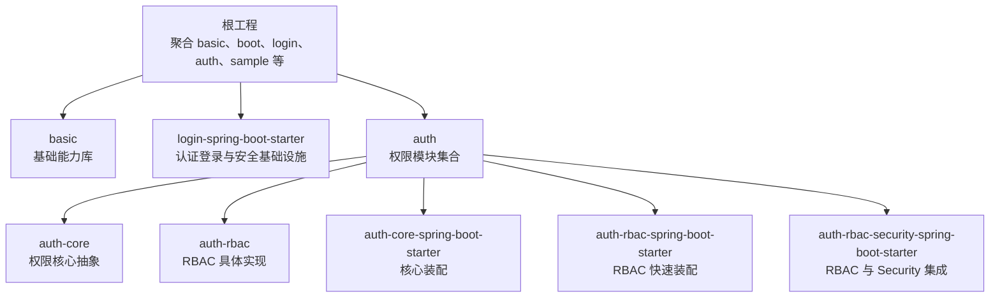
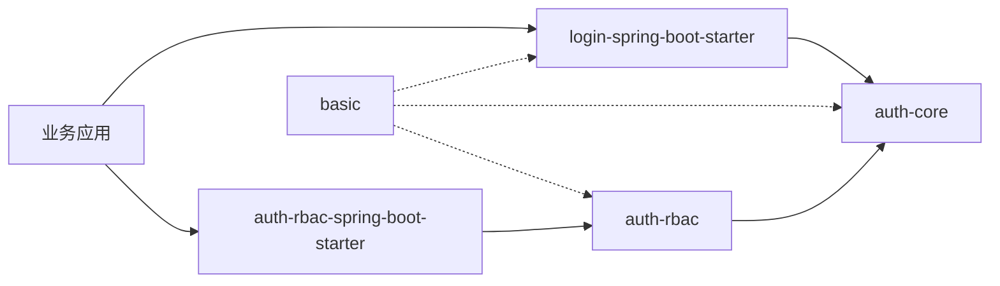
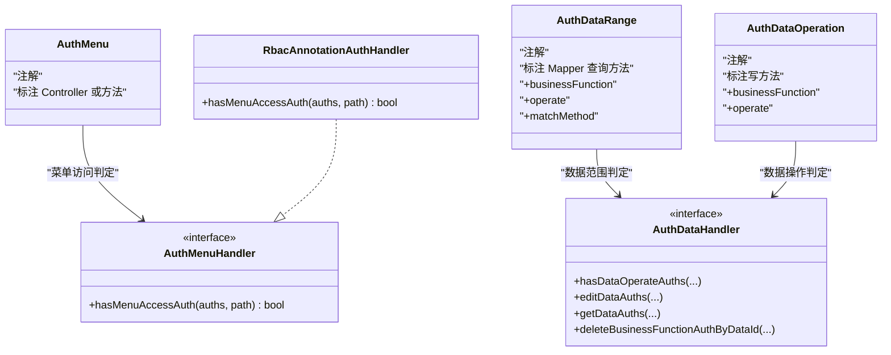
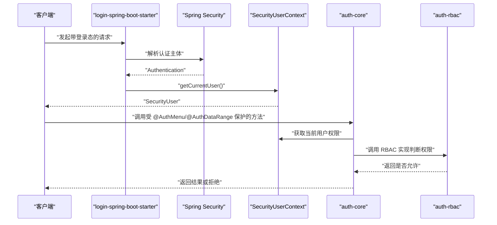
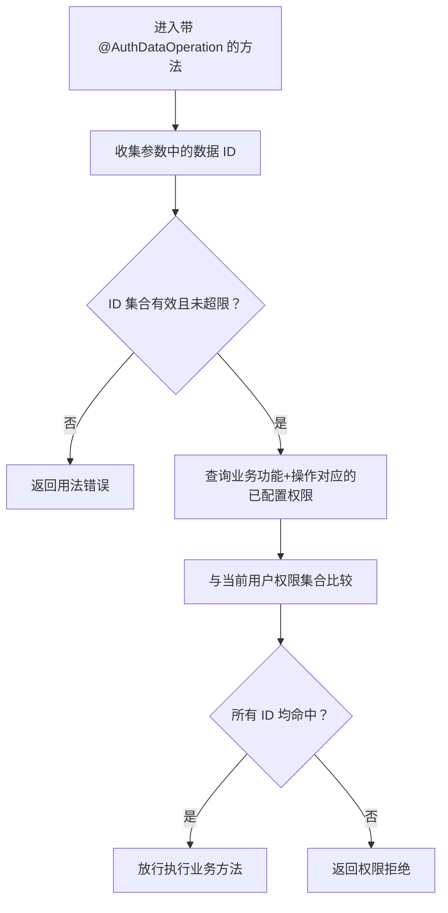
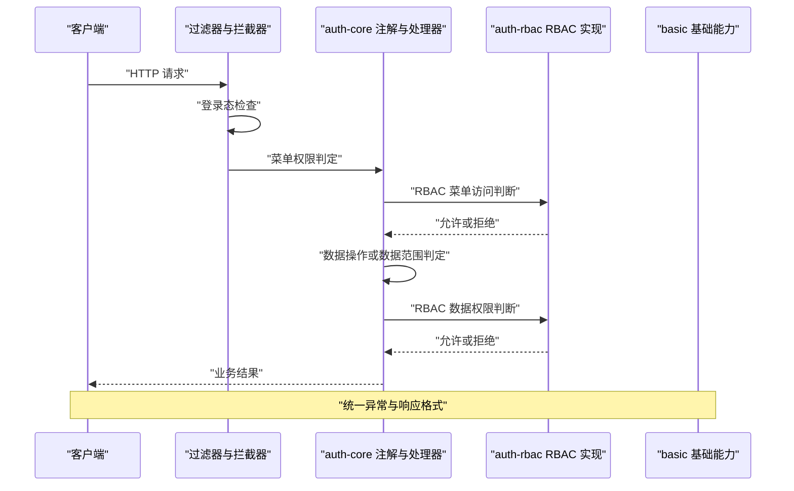

# 核心模块总览

<cite>
**本文引用的文件**   
- [README_Auth.md](file://README_Auth.md)
- [pom.xml](file://pom.xml)
- [AuthCurrentUserContextHolder.java](file://auth/auth-core/src/main/java/com/cu/framework/auth/core/AuthCurrentUserContextHolder.java)
- [AuthDataAdaptor.java](file://auth/auth-core/src/main/java/com/cu/framework/auth/core/AuthDataAdaptor.java)
- [AuthDataOperation.java](file://auth/auth-core/src/main/java/com/cu/framework/auth/core/AuthDataOperation.java)
- [AuthDataRange.java](file://auth/auth-core/src/main/java/com/cu/framework/auth/core/AuthDataRange.java)
- [AuthMenu.java](file://auth/auth-core/src/main/java/com/cu/framework/auth/core/AuthMenu.java)
- [AuthDataHandler.java](file://auth/auth-core/src/main/java/com/cu/framework/auth/core/data/AuthDataHandler.java)
- [AuthMenuHandler.java](file://auth/auth-core/src/main/java/com/cu/framework/auth/core/menu/AuthMenuHandler.java)
- [CurrentUser.java](file://auth/auth-core/src/main/java/com/cu/framework/auth/core/entity/CurrentUser.java)
- [IAuthObject.java](file://auth/auth-core/src/main/java/com/cu/framework/auth/core/entity/IAuthObject.java)
- [RbacAnnotationAuthHandler.java](file://auth/auth-rbac/src/main/java/com/cu/framework/auth/rbac/RbacAnnotationAuthHandler.java)
- [SecurityUserContext.java](file://login-spring-boot-starter/src/main/java/com/cu/framework/authentication/SecurityUserContext.java)
</cite>

## 目录
1. [引言](#引言)
2. [项目结构](#项目结构)
3. [核心模块职责边界](#核心模块职责边界)
4. [架构总览与依赖关系](#架构总览与依赖关系)
5. [关键组件分析](#关键组件分析)
6. [数据流与调用关系](#数据流与调用关系)
7. [模块化设计原因](#模块化设计原因)
8. [模块选择指南](#模块选择指南)
9. [性能与可维护性要点](#性能与可维护性要点)
10. [故障排查建议](#故障排查建议)
11. [结论](#结论)

## 引言
Kewen Framework 的认证授权体系围绕“认证登录、权限抽象、RBAC 实现、基础能力支撑”四个层次组织。文档聚焦以下核心模块：
- `auth` 下的 `auth-core`：权限核心抽象层，定义菜单权限、数据范围、数据操作、用户上下文等抽象。
- `auth` 下的 `auth-rbac`：基于 RBAC（用户-部门-角色）的具体实现，提供注解处理器和 RBAC 业务组合服务。
- `login-spring-boot-starter`：认证授权基础设施，负责 Spring Security 集成、登录流程、安全上下文、统一返回等。
- `basic`：基础功能库，提供异常模型、请求过滤、日志追踪、通用工具类和统一响应体。

整体目标是让业务系统通过引入最小依赖即可接入完整的鉴权能力，避免重复搭建权限体系。

**章节来源**
- [README_Auth.md:1-20](file://README_Auth.md#L1-L20)

## 项目结构
从顶层聚合工程看，根 `pom.xml` 将 `basic`、`login-spring-boot-starter`、`auth`、`sample` 等作为子模块纳入构建；`auth` 下再细分 `auth-core`、`auth-rbac` 及多个 Spring Boot Starter。

**图表来源**
- [pom.xml:12-28](file://pom.xml#L12-L28)

**章节来源**
- [pom.xml:1-28](file://pom.xml#L1-L28)

## 核心模块职责边界

### auth-core：权限核心抽象层
`auth-core` 是框架的权限契约层，不绑定具体实现。它定义了：
- 菜单权限注解 `@AuthMenu` 与菜单访问处理器接口 `AuthMenuHandler`。
- 数据范围注解 `@AuthDataRange`，用于在 MyBatis 查询中注入数据权限条件。
- 数据操作注解 `@AuthDataOperation`，用于校验写操作的数据行级权限。
- 数据权限适配器 `AuthDataAdaptor` 与数据权限处理器接口 `AuthDataHandler`，用于在 Service 层直接操作数据权限。
- 用户上下文接口 `AuthCurrentUserContextHolder`，以及 `CurrentUser`、`IAuthObject`、`FlatteningAuthority` 等权限实体。

该模块的职责是“描述权限是什么”，而不是“权限如何存储或如何与数据库交互”。

**章节来源**
- [AuthMenu.java:10-16](file://auth/auth-core/src/main/java/com/cu/framework/auth/core/AuthMenu.java#L10-L16)
- [AuthMenuHandler.java:10-27](file://auth/auth-core/src/main/java/com/cu/framework/auth/core/menu/AuthMenuHandler.java#L10-L27)
- [AuthDataRange.java:14-81](file://auth/auth-core/src/main/java/com/cu/framework/auth/core/AuthDataRange.java#L14-L81)
- [AuthDataOperation.java:14-51](file://auth/auth-core/src/main/java/com/cu/framework/auth/core/AuthDataOperation.java#L14-L51)
- [AuthDataAdaptor.java:10-45](file://auth/auth-core/src/main/java/com/cu/framework/auth/core/AuthDataAdaptor.java#L10-L45)
- [AuthDataHandler.java:10-102](file://auth/auth-core/src/main/java/com/cu/framework/auth/core/data/AuthDataHandler.java#L10-L102)
- [AuthCurrentUserContextHolder.java:10-25](file://auth/auth-core/src/main/java/com/cu/framework/auth/core/AuthCurrentUserContextHolder.java#L10-L25)
- [CurrentUser.java:6-13](file://auth/auth-core/src/main/java/com/cu/framework/auth/core/entity/CurrentUser.java#L6-L13)
- [IAuthObject.java:10-35](file://auth/auth-core/src/main/java/com/cu/framework/auth/core/entity/IAuthObject.java#L10-L35)

### auth-rbac：RBAC 具体实现
`auth-rbac` 基于 RBAC 思想，为 `auth-core` 中的抽象提供默认实现。例如：
- `RbacAnnotationAuthHandler` 实现 `AuthMenuHandler`，通过 RBAC 组合服务判断菜单访问权限。
- 模块还包含 RBAC 模型、控制器、组合服务、持久层等，把用户、部门、角色、菜单、权限等实体落到数据库表。

其职责是“用 RBAC 的方式解释并落地权限规则”，并向上暴露给 Starter 装配。

**章节来源**
- [RbacAnnotationAuthHandler.java:10-27](file://auth/auth-rbac/src/main/java/com/cu/framework/auth/rbac/RbacAnnotationAuthHandler.java#L10-L27)

### login-spring-boot-starter：认证授权基础设施
该模块负责认证登录与安全基础设施，包括：
- Spring Security 集成、登录态处理、过滤器链、统一异常与响应。
- 统一认证主体 `SecurityUserContext`，从 Spring Security 上下文中获取当前用户。
- 登录页、OAuth2、SAML、密码策略、SSO 扩展点等。

它是业务应用接入 Kewen 认证能力的入口 Starter，也是 `auth-core` 中 `AuthCurrentUserContextHolder` 的实现提供方所在层级。

**章节来源**
- [SecurityUserContext.java:10-37](file://login-spring-boot-starter/src/main/java/com/cu/framework/authentication/SecurityUserContext.java#L10-L37)

### basic：基础功能库
`basic` 提供跨模块共享的基础能力：
- 异常模型：`BackendException`、`BizException`、`GlobalExceptionHandlerAdvice`。
- 请求早期过滤器：`EarlyRequestFilter`、`EarlyRequestFilterProxy`。
- 日志与追踪：`RequestLoggerFilter`、`TraceRequestFilter`、`TraceContext`、`TraceResponseBodyAdvice`。
- 通用模型与工具：`Result`、`PageResult`、`TreeUtil`、`YmlUtils`、`RegUtil` 等。

它不关心权限语义，但被其他模块复用，提升框架一致性。

**章节来源**
- [basic/src/main/java/com/cu/framework/basic/exception/GlobalExceptionHandlerAdvice.java:22-22](file://basic/src/main/java/com/cu/framework/basic/exception/GlobalExceptionHandlerAdvice.java#L22-L22)
- [basic/src/main/java/com/cu/framework/basic/filter/EarlyRequestFilterProxy.java:25-25](file://basic/src/main/java/com/cu/framework/basic/filter/EarlyRequestFilterProxy.java#L25-L25)
- [basic/src/main/java/com/cu/framework/basic/logger/RequestLoggerFilter.java:34-34](file://basic/src/main/java/com/cu/framework/basic/logger/RequestLoggerFilter.java#L34-L34)
- [basic/src/main/java/com/cu/framework/basic/logger/trace/TraceContext.java:11-11](file://basic/src/main/java/com/cu/framework/basic/logger/trace/TraceContext.java#L11-L11)

## 架构总览与依赖关系
下图展示核心模块之间的主要依赖方向：业务代码依赖 Starter，Starter 依赖 `auth-core`，RBAC 实现依赖 `auth-core`，而 `basic` 被多个模块共享。

依赖说明：
- `auth-core` 是权限抽象层，不应依赖具体登录实现。
- `auth-rbac` 依赖 `auth-core`，但不反向依赖 `login-spring-boot-starter`。
- `login-spring-boot-starter` 提供安全上下文，供 `auth-core` 的用户上下文接口使用。
- `basic` 是横切能力，不参与权限语义。

**图表来源**
- [AuthMenuHandler.java:10-27](file://auth/auth-core/src/main/java/com/cu/framework/auth/core/menu/AuthMenuHandler.java#L10-L27)
- [RbacAnnotationAuthHandler.java:10-27](file://auth/auth-rbac/src/main/java/com/cu/framework/auth/rbac/RbacAnnotationAuthHandler.java#L10-L27)
- [AuthCurrentUserContextHolder.java:10-25](file://auth/auth-core/src/main/java/com/cu/framework/auth/core/AuthCurrentUserContextHolder.java#L10-L25)
- [SecurityUserContext.java:10-37](file://login-spring-boot-starter/src/main/java/com/cu/framework/authentication/SecurityUserContext.java#L10-L37)

## 关键组件分析

### 权限注解与处理器关系
`auth-core` 通过注解声明权限需求，由处理器执行实际判断：
- `@AuthMenu` 标注端点是否受菜单权限控制。
- `@AuthDataRange` 在 Mapper 查询方法上注入数据范围条件。
- `@AuthDataOperation` 在写方法上校验单条或多条数据的操作权限。
- `AuthMenuHandler` 与 `AuthDataHandler` 是抽象接口，`auth-rbac` 提供 RBAC 实现。

**图表来源**
- [AuthMenu.java:10-16](file://auth/auth-core/src/main/java/com/cu/framework/auth/core/AuthMenu.java#L10-L16)
- [AuthDataRange.java:14-81](file://auth/auth-core/src/main/java/com/cu/framework/auth/core/AuthDataRange.java#L14-L81)
- [AuthDataOperation.java:14-51](file://auth/auth-core/src/main/java/com/cu/framework/auth/core/AuthDataOperation.java#L14-L51)
- [AuthMenuHandler.java:10-27](file://auth/auth-core/src/main/java/com/cu/framework/auth/core/menu/AuthMenuHandler.java#L10-L27)
- [AuthDataHandler.java:10-102](file://auth/auth-core/src/main/java/com/cu/framework/auth/core/data/AuthDataHandler.java#L10-L102)
- [RbacAnnotationAuthHandler.java:10-27](file://auth/auth-rbac/src/main/java/com/cu/framework/auth/rbac/RbacAnnotationAuthHandler.java#L10-L27)

### 用户上下文与登录态
`auth-core` 只定义 `AuthCurrentUserContextHolder`，要求实现类提供当前用户和扁平化权限集合。`login-spring-boot-starter` 通过 Spring Security 管理会话，并提供 `SecurityUserContext` 读取统一认证主体。

**图表来源**
- [AuthCurrentUserContextHolder.java:10-25](file://auth/auth-core/src/main/java/com/cu/framework/auth/core/AuthCurrentUserContextHolder.java#L10-L25)
- [SecurityUserContext.java:10-37](file://login-spring-boot-starter/src/main/java/com/cu/framework/authentication/SecurityUserContext.java#L10-L37)
- [RbacAnnotationAuthHandler.java:10-27](file://auth/auth-rbac/src/main/java/com/cu/framework/auth/rbac/RbacAnnotationAuthHandler.java#L10-L27)

### 数据操作权限校验流程
`@AuthDataOperation` 的校验逻辑强调“按数据 ID 逐个判定”，所有 ID 都命中才放行。

**图表来源**
- [AuthDataOperation.java:14-51](file://auth/auth-core/src/main/java/com/cu/framework/auth/core/AuthDataOperation.java#L14-L51)
- [AuthDataHandler.java:28-63](file://auth/auth-core/src/main/java/com/cu/framework/auth/core/data/AuthDataHandler.java#L28-L63)

## 数据流与调用关系
从一次典型请求看，数据流大致如下：
1. 请求进入 `login-spring-boot-starter` 的安全过滤器链。
2. 若未登录或认证主体不是统一实体，则抛出未登录异常。
3. 若请求受 `@AuthMenu` 保护，则调用 `AuthMenuHandler`，由 RBAC 实现判断路径是否属于当前用户。
4. 若请求涉及数据写入，`@AuthDataOperation` 触发 `AuthDataHandler`，按数据 ID 校验操作权限。
5. 若请求是列表查询，`@AuthDataRange` 在 MyBatis 层注入数据范围条件，限制返回数据。
6. 最终返回统一响应体，异常由 `basic` 的统一异常处理机制收敛。

**图表来源**
- [SecurityUserContext.java:10-37](file://login-spring-boot-starter/src/main/java/com/cu/framework/authentication/SecurityUserContext.java#L10-L37)
- [AuthMenuHandler.java:10-27](file://auth/auth-core/src/main/java/com/cu/framework/auth/core/menu/AuthMenuHandler.java#L10-L27)
- [AuthDataHandler.java:10-102](file://auth/auth-core/src/main/java/com/cu/framework/auth/core/data/AuthDataHandler.java#L10-L102)
- [RbacAnnotationAuthHandler.java:10-27](file://auth/auth-rbac/src/main/java/com/cu/framework/auth/rbac/RbacAnnotationAuthHandler.java#L10-L27)

## 模块化设计原因
根据仓库文档和设计意图，采用多模块的主要原因包括：
- **避免重复建设**：每个系统自行搭建权限体系成本高，公共部分应抽象出来。
- **统一 RBAC 模型**：用户-部门-角色是常见共性，框架以 RBAC 为基础提供统一权限管理。
- **注解驱动**：通过注解完成菜单权限和数据权限，减少业务侧重复校验。
- **可扩展**：保留扩展接口，支持差异化实现。
- **分层清晰**：认证登录、权限抽象、RBAC 实现、基础能力分离，便于单独演进和维护。

**章节来源**
- [README_Auth.md:1-20](file://README_Auth.md#L1-L20)
- [README_Auth.md:21-60](file://README_Auth.md#L21-L60)

## 模块选择指南

### 仅需要基础能力
适用场景：不需要完整权限体系，只需要统一异常、分页模型、日志追踪、工具类。
推荐引入：
- `basic`
可选引入：
- `basic-support`、`boot` 下的相关 Starter

### 需要认证登录与统一安全基础设施
适用场景：希望使用统一的登录流程、Session、Token、安全异常处理、统一返回。
推荐引入：
- `login-spring-boot-starter`

### 需要菜单权限和数据权限
适用场景：业务需要基于注解的菜单访问控制和数据范围控制。
推荐引入：
- `auth-core`
- `auth-core-spring-boot-starter`
如需 RBAC 默认实现：
- `auth-rbac`
- `auth-rbac-spring-boot-starter`
如需与 Spring Security 登录态集成：
- `auth-rbac-security-spring-boot-starter`

### 最小可用权限方案
仓库 README 明确建议同时引入：
- `login-spring-boot-starter`
- `auth-rbac-spring-boot-starter`

并配合数据库初始化脚本与基本数据源配置启动。

**章节来源**
- [README_Auth.md:60-120](file://README_Auth.md#L60-L120)

## 性能与可维护性要点
- **数据范围匹配方式**：`@AuthDataRange` 支持 `IN` 与 `EXISTS` 两种匹配方式，当权限表数据较大时应考虑使用 `EXISTS`，遵循小表驱动大表的关联原则。
- **数据操作上限**：`@AuthDataOperation` 对一次调用中涉及的业务 ID 设置上限，超出时要求调用方分批提交，避免单次权限判定压力过大。
- **权限对象空值处理**：当权限对象为空时，数据权限填充和编辑会跳过，避免无意义的数据库操作。
- **权限体缺失行为**：当用户权限体装载失败时，`listBaseAuth()` 返回空权限集合而不抛异常，防止把装载层缺陷伪装成数据问题。
- **注解作用域隔离**：`@AuthDataRange` 只在声明的 Mapper 方法上生效，不影响同一调用链上的其他语句，降低误注入风险。

**章节来源**
- [AuthDataRange.java:54-81](file://auth/auth-core/src/main/java/com/cu/framework/auth/core/AuthDataRange.java#L54-L81)
- [AuthDataOperation.java:24-51](file://auth/auth-core/src/main/java/com/cu/framework/auth/core/AuthDataOperation.java#L24-L51)
- [AuthDataHandler.java:40-79](file://auth/auth-core/src/main/java/com/cu/framework/auth/core/data/AuthDataHandler.java#L40-L79)
- [auth-core/README.md:1-15](file://auth/auth-core/README.md#L1-L15)

## 故障排查建议
- **未登录或认证主体异常**：若 `SecurityUserContext` 抛出未登录异常，检查登录流程是否正确写入统一认证主体。
- **权限注解无效**：确认 `@AuthMenu`、`@AuthDataRange`、`@AuthDataOperation` 是否标注在正确位置，且对应 Starter 已启用。
- **数据范围 SQL 注入失败**：检查 `@AuthDataRange` 的 `businessFunction`、`operate`、`table`、`dataIdColumn` 是否与业务 SQL 一致。
- **RBAC 菜单权限不生效**：检查 `RbacAnnotationAuthHandler` 是否被装配，以及 RBAC 菜单数据是否正确入库。
- **统一异常未生效**：确认 `basic` 中的全局异常处理是否被引入。

**章节来源**
- [SecurityUserContext.java:18-37](file://login-spring-boot-starter/src/main/java/com/cu/framework/authentication/SecurityUserContext.java#L18-L37)
- [AuthDataRange.java:28-53](file://auth/auth-core/src/main/java/com/cu/framework/auth/core/AuthDataRange.java#L28-L53)
- [RbacAnnotationAuthHandler.java:10-27](file://auth/auth-rbac/src/main/java/com/cu/framework/auth/rbac/RbacAnnotationAuthHandler.java#L10-L27)
- [basic/src/main/java/com/cu/framework/basic/exception/GlobalExceptionHandlerAdvice.java:22-22](file://basic/src/main/java/com/cu/framework/basic/exception/GlobalExceptionHandlerAdvice.java#L22-L22)

## 结论
Kewen Framework 的核心模块通过清晰的职责划分实现了解耦：
- `basic` 提供横切基础能力。
- `login-spring-boot-starter` 提供认证登录与安全基础设施。
- `auth-core` 定义权限抽象与注解契约。
- `auth-rbac` 提供 RBAC 默认实现。

这种设计使业务系统可以按需引入模块，既能快速获得完整权限能力，又能在需要时替换或扩展具体实现。对于大多数企业后台系统，推荐以 `login-spring-boot-starter` 和 `auth-rbac-spring-boot-starter` 作为起点，逐步接入菜单权限与数据权限。