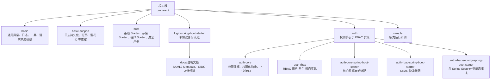
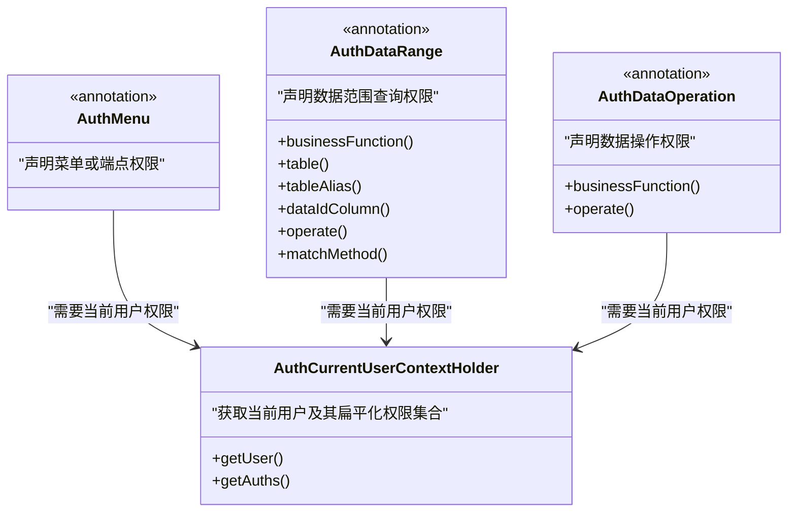
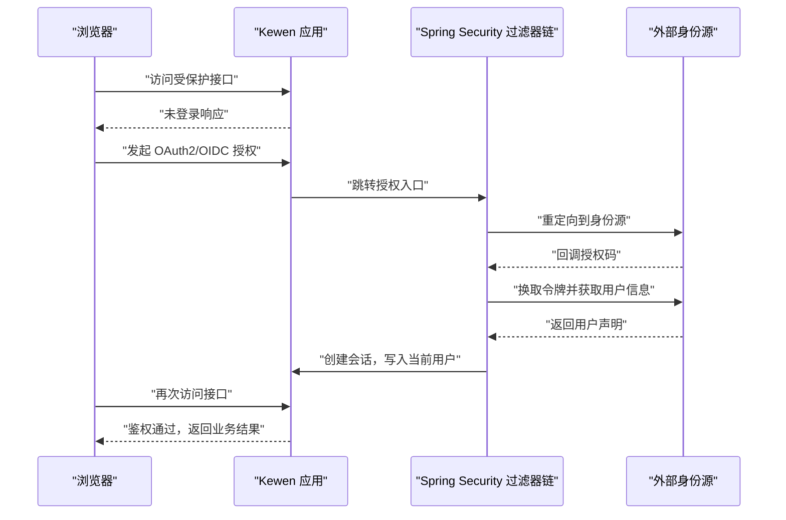
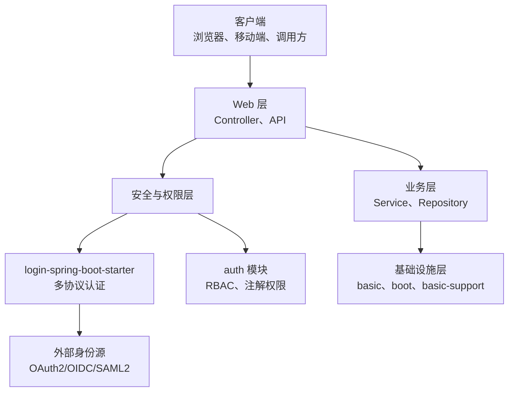
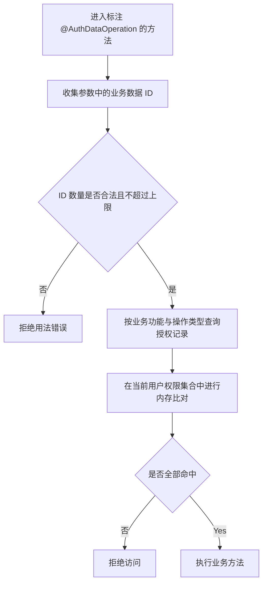
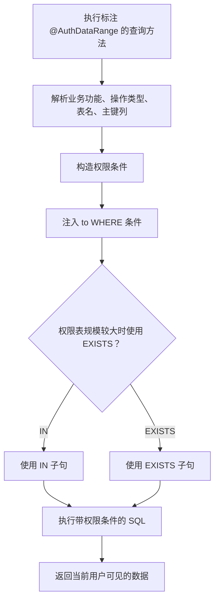
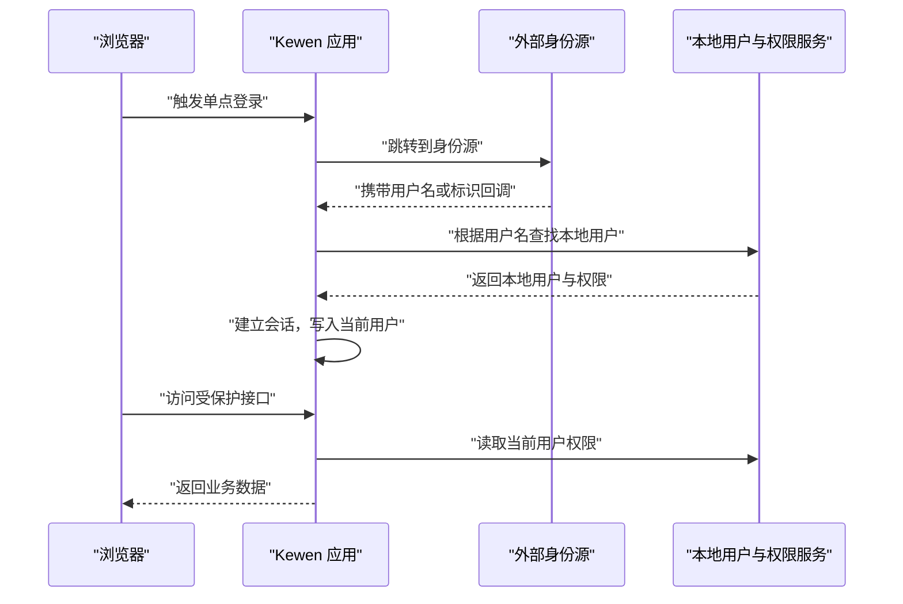

# 框架简介与核心价值

<cite>
**本文引用的文件**   
- [README_Auth.md](file://README_Auth.md)
- [pom.xml](file://pom.xml)
- [login-spring-boot-starter/README.md](file://login-spring-boot-starter/README.md)
- [login-spring-boot-starter/README-SSO.md](file://login-spring-boot-starter/README-SSO.md)
- [auth/auth-core/README.md](file://auth/auth-core/README.md)
- [auth/auth-core/src/main/java/com/cu/framework/auth/core/AuthCurrentUserContextHolder.java](file://auth/auth-core/src/main/java/com/cu/framework/auth/core/AuthCurrentUserContextHolder.java)
- [auth/auth-core/src/main/java/com/cu/framework/auth/core/AuthMenu.java](file://auth/auth-core/src/main/java/com/cu/framework/auth/core/AuthMenu.java)
- [auth/auth-core/src/main/java/com/cu/framework/auth/core/AuthDataOperation.java](file://auth/auth-core/src/main/java/com/cu/framework/auth/core/AuthDataOperation.java)
- [auth/auth-core/src/main/java/com/cu/framework/auth/core/AuthDataRange.java](file://auth/auth-core/src/main/java/com/cu/framework/auth/core/AuthDataRange.java)
- [auth/auth-rbac-security-spring-boot-starter/README.md](file://auth/auth-rbac-security-spring-boot-starter/README.md)
- [auth/auth-rbac-spring-boot-starter/README.md](file://auth/auth-rbac-spring-boot-starter/README.md)
- [docs/说明文档/SAML2_SP_Metadata配置指南.md](file://docs/说明文档/SAML2_SP_Metadata配置指南.md)
- [docs/说明文档/oidc接入踩坑记录.md](file://docs/说明文档/oidc接入踩坑记录.md)
</cite>

## 目录
1. [引言](#引言)
2. [项目结构总览](#项目结构总览)
3. [核心组件与能力](#核心组件与能力)
4. [架构总览](#架构总览)
5. [关键流程详解](#关键流程详解)
6. [适用场景与设计哲学](#适用场景与设计哲学)
7. [同类方案对比与独特优势](#同类方案对比与独特优势)
8. [性能与可扩展性考量](#性能与可扩展性考量)
9. [常见问题与排错建议](#常见问题与排错建议)
10. [结论](#结论)

## 引言
Kewen Framework 是一个基于 Spring Boot 的企业级权限管理与身份认证解决方案。它的核心目标很明确：让企业应用不必重复造轮子，就能快速获得一套完整的 RBAC 权限体系、注解驱动的菜单和数据权限控制，以及账号密码、OAuth2/OIDC、SAML2 多协议身份认证能力。

从仓库内容看，框架围绕以下关键词构建：
- **Spring Boot 生态**：依赖管理、自动装配、Starter 化模块，降低集成成本。
- **RBAC 模型**：用户、角色、部门（岗位）为核心的权限建模，并通过注解把权限校验从业务代码中抽离。
- **声明式编程**：通过 `@AuthMenu`、`@AuthDataRange`、`@AuthDataOperation` 等注解声明“管什么”和“怎么管”，减少样板逻辑。
- **最小侵入**：权限判断、数据范围过滤、异常统一返回等横切逻辑由框架承担，业务方法尽量保持干净。
- **高度可扩展**：当前用户上下文、用户服务、密码编码器、安全处理器等都预留扩展点，允许替换默认实现。

对初学者而言，可以这样理解：
- **身份认证**回答“你是谁”。例如用账号密码登录，或通过企业微信、钉钉、Keycloak、Azure AD 等第三方系统单点登录。
- **授权**回答“你能做什么”。例如能否进入某个菜单、能否查看某条订单、能否编辑某个资源。
- Kewen Framework 同时提供这两层能力，并把它们组织成可复用、可配置的模块化工程。

**章节来源**
- [README_Auth.md:1-40](file://README_Auth.md#L1-L40)
- [pom.xml:1-40](file://pom.xml#L1-L40)

## 项目结构总览
仓库采用 Maven 多模块结构，围绕基础能力、启动器、认证、权限、示例工程进行划分。核心目录关系如下：

**图示来源**
- [pom.xml:18-39](file://pom.xml#L18-L39)
- [README_Auth.md:120-190](file://README_Auth.md#L120-L190)

该结构体现出一个分层思路：
- `basic` 提供跨模块的公共基础。
- `boot` 提供面向 Spring Boot 的基础 Starter。
- `login-spring-boot-starter` 专注身份认证。
- `auth` 专注权限建模与 RBAC 实现。
- `sample` 演示如何组合这些能力。

**章节来源**
- [pom.xml:18-39](file://pom.xml#L18-L39)
- [README_Auth.md:120-190](file://README_Auth.md#L120-L190)

## 核心组件与能力
### 一、注解驱动的 RBAC 权限控制
框架在 `auth-core` 中定义了权限的核心概念与注解：
- `@AuthMenu`：用于声明菜单或端点的访问权限。它只表达“管辖范围”，显示文案由其他注解承担。
- `@AuthDataRange`：用于数据范围查询，在 Mapper 查询时注入权限条件，让不可见数据不出现在列表里。
- `@AuthDataOperation`：用于单条或多条数据的操作校验，防止越权修改或删除。

这三个注解体现了“声明式权限”的设计：开发者只需在方法上标注“这是什么功能、对哪些数据生效”，具体拦截、比对、拒绝语义由框架处理。

**图示来源**
- [auth/auth-core/src/main/java/com/cu/framework/auth/core/AuthMenu.java:1-16](file://auth/auth-core/src/main/java/com/cu/framework/auth/core/AuthMenu.java#L1-L16)
- [auth/auth-core/src/main/java/com/cu/framework/auth/core/AuthDataRange.java:1-81](file://auth/auth-core/src/main/java/com/cu/framework/auth/core/AuthDataRange.java#L1-L81)
- [auth/auth-core/src/main/java/com/cu/framework/auth/core/AuthDataOperation.java:1-51](file://auth/auth-core/src/main/java/com/cu/framework/auth/core/AuthDataOperation.java#L1-L51)
- [auth/auth-core/src/main/java/com/cu/framework/auth/core/AuthCurrentUserContextHolder.java:1-25](file://auth/auth-core/src/main/java/com/cu/framework/auth/core/AuthCurrentUserContextHolder.java#L1-L25)

权限体的设计还区分了“配置型权限对象”和“用户拥有的权限对象”。前者用于权限字符串反解析，后者是登录后加载到用户上下文中的权限集合；当用户权限缺失时，框架倾向返回空集合而不是抛出异常，避免把装载层缺陷伪装成普通数据问题。

**章节来源**
- [auth/auth-core/README.md:1-15](file://auth/auth-core/README.md#L1-L15)
- [auth/auth-core/src/main/java/com/cu/framework/auth/core/AuthMenu.java:1-16](file://auth/auth-core/src/main/java/com/cu/framework/auth/core/AuthMenu.java#L1-L16)
- [auth/auth-core/src/main/java/com/cu/framework/auth/core/AuthDataRange.java:1-81](file://auth/auth-core/src/main/java/com/cu/framework/auth/core/AuthDataRange.java#L1-L81)
- [auth/auth-core/src/main/java/com/cu/framework/auth/core/AuthDataOperation.java:1-51](file://auth/auth-core/src/main/java/com/cu/framework/auth/core/AuthDataOperation.java#L1-L51)
- [auth/auth-core/src/main/java/com/cu/framework/auth/core/AuthCurrentUserContextHolder.java:1-25](file://auth/auth-core/src/main/java/com/cu/framework/auth/core/AuthCurrentUserContextHolder.java#L1-L25)

### 二、多协议身份认证支持
`login-spring-boot-starter` 在同一套 Spring Security 过滤器链上并列挂载三种登录方式：
- **账号密码登录**：基于 JSON 的登录接口，适合前后端分离。
- **OAuth2 / OIDC 单点登录**：共享同一条过滤器链，OIDC 在 OAuth2 基础上增加 ID Token 校验和用户信息拉取。
- **SAML2 单点登录**：支持企业级 SAML2 协议，包括 SP Metadata、断言消费、单点登出等。

三者共享登出、成功失败处理器、放行 URL 汇总等基础设施，但配置前缀、路径、认证源彼此独立。所有协议进入安全上下文后都统一为 `SecurityUser`，因此后续权限判定不需要按协议分支。

**图示来源**
- [login-spring-boot-starter/README.md:1-60](file://login-spring-boot-starter/README.md#L1-L60)
- [login-spring-boot-starter/README-SSO.md:1-60](file://login-spring-boot-starter/README-SSO.md#L1-L60)

### 三、企业级支撑功能
除了权限和认证，仓库还提供一组企业常用能力：
- 全局异常处理与统一响应模型。
- 请求日志、链路追踪。
- MyBatis-Plus 分页、雪花 ID。
- 多存储适配的 Starter。
- 多租户上下文。
- 代码生成器。

这些能力不是权限系统的附属品，而是为了支撑中大型企业应用在开发效率、运维可观测性、部署弹性上的需求。

**章节来源**
- [pom.xml:18-39](file://pom.xml#L18-L39)
- [README_Auth.md:1-40](file://README_Auth.md#L1-L40)

## 架构总览
从整体上看，Kewen Framework 的架构可以理解为三层：
- **表现层与业务层**：由应用自身的 Controller、Service 组成。
- **安全与权限层**：由 `login-spring-boot-starter` 和 `auth` 模块构成。
- **基础设施层**：由 `basic`、`boot`、`basic-support` 等模块提供。

**图示来源**
- [pom.xml:18-39](file://pom.xml#L18-L39)
- [README_Auth.md:1-40](file://README_Auth.md#L1-L40)
- [login-spring-boot-starter/README.md:1-60](file://login-spring-boot-starter/README.md#L1-L60)

## 关键流程详解
### 一、注解驱动的数据操作权限流程
`@AuthDataOperation` 的判定逻辑可以概括为：
1. 解析方法参数，收集所有承载业务数据 ID 的对象。
2. 去重后限制最大数量，超出上限直接拒绝。
3. 根据业务功能和操作类型，查询候选数据授权记录。
4. 将登录人权限与候选记录在内存中比对。
5. 全部命中才放行，任一条无权限即整体拒绝。

**图示来源**
- [auth/auth-core/src/main/java/com/cu/framework/auth/core/AuthDataOperation.java:1-51](file://auth/auth-core/src/main/java/com/cu/framework/auth/core/AuthDataOperation.java#L1-L51)

这个流程的价值在于：
- 业务代码不再手动写“谁能改这条数据”。
- 权限校验集中在注解处理器中，更容易统一审计和测试。
- 失败语义统一，不会泄漏内部明细。

**章节来源**
- [auth/auth-core/src/main/java/com/cu/framework/auth/core/AuthDataOperation.java:1-51](file://auth/auth-core/src/main/java/com/cu/framework/auth/core/AuthDataOperation.java#L1-L51)

### 二、注解驱动的数据范围查询流程
`@AuthDataRange` 用在 Mapper 查询方法上，目的是让查询结果天然带上权限边界。其核心思想是：不改变业务 SQL 的主要意图，只在末尾追加权限过滤条件。

**图示来源**
- [auth/auth-core/src/main/java/com/cu/framework/auth/core/AuthDataRange.java:1-81](file://auth/auth-core/src/main/java/com/cu/framework/auth/core/AuthDataRange.java#L1-L81)

需要注意：
- 注解绑定的是具体 Mapper 方法，而不是整个 Service。
- 内建 MyBatis-Plus 方法不受本注解直接管辖。
- 当权限表数据量较大时，应选择合适的匹配方式，避免性能退化。

**章节来源**
- [auth/auth-core/src/main/java/com/cu/framework/auth/core/AuthDataRange.java:1-81](file://auth/auth-core/src/main/java/com/cu/framework/auth/core/AuthDataRange.java#L1-L81)

### 三、单点登录与本地权限的关系
一个重要的设计点是：**身份源只证明“这个人是谁”，而账号信息与权限一律来自本系统**。这意味着：
- OAuth2/OIDC 的 `preferred_username`、SAML 的 NameID 必须与本系统用户名一致。
- 认证成功后的会话主体是本地用户对象，不是外部身份源的原始声明。
- 改了权限或资料后，通常需要重新登录才能刷新会话快照。

**图示来源**
- [login-spring-boot-starter/README-SSO.md:1-60](file://login-spring-boot-starter/README-SSO.md#L1-L60)

**章节来源**
- [login-spring-boot-starter/README-SSO.md:1-60](file://login-spring-boot-starter/README-SSO.md#L1-L60)

## 适用场景与设计哲学
### 适用场景
Kewen Framework 更适合以下环境：
- **中大型企业应用**：需要统一的权限模型、统一的安全策略、统一的异常和日志规范。
- **细粒度权限控制系统**：既有菜单级权限，又有数据行级权限，还有数据操作级权限。
- **集成单点登录的企业环境**：已有 Keycloak、Azure AD、企业微信、钉钉或其他支持 OAuth2/OIDC/SAML2 的身份提供方。
- **希望以注解声明权限、减少样板代码的团队**：不希望每个 Controller 都手写权限判断。
- **需要快速搭建 RBAC 管理后台的团队**：框架提供 RBAC 相关实体、Mapper、控制器与 Starter 装配。

### 设计哲学
1. **声明式优先**：通过注解表达权限意图，而不是在业务方法中写大量 if-else。
2. **最小侵入**：业务代码尽量关注领域逻辑，横切逻辑交给框架。
3. **约定优于配置**：默认提供 RBAC 实现和 Starter 装配，开箱即用；复杂场景再自定义。
4. **可扩展但不隐藏原理**：保留 `AuthCurrentUserContextHolder`、`SecurityUserDetailsService`、`PasswordEncoder` 等扩展点，同时给出默认行为。
5. **企业可用**：统一异常、统一响应、统一日志、统一安全处理，降低团队协作和维护成本。

**章节来源**
- [README_Auth.md:1-40](file://README_Auth.md#L1-L40)
- [auth/auth-core/src/main/java/com/cu/framework/auth/core/AuthMenu.java:1-16](file://auth/auth-core/src/main/java/com/cu/framework/auth/core/AuthMenu.java#L1-L16)
- [auth/auth-rbac-security-spring-boot-starter/README.md:1-5](file://auth/auth-rbac-security-spring-boot-starter/README.md#L1-L5)
- [auth/auth-rbac-spring-boot-starter/README.md:1-5](file://auth/auth-rbac-spring-boot-starter/README.md#L1-L5)

## 同类方案对比与独特优势
### 与传统 Spring Security 原生方案对比
| 维度 | 传统 Spring Security 方案 | Kewen Framework |
|---|---|---|
| 权限模型 | 通常需自行实现 RBAC 表和校验逻辑 | 内置 RBAC 用户-角色-部门模型与 Starter |
| 菜单权限 | 需自行设计路由权限、注解或拦截器 | 提供 `@AuthMenu` 及启动期 API 入库能力 |
| 数据权限 | 通常需 AOP、MyBatis 插件或硬编码拼接 | 提供 `@AuthDataRange`、`@AuthDataOperation` |
| 单点登录 | 需自行整合 OAuth2/OIDC/SAML2 | 同一 Starter 并行支持账号密码、OAuth2/OIDC、SAML2 |
| 统一体验 | 各团队可能各自实现异常、响应、日志 | 提供基础异常、日志、响应模型与 Starter |

### 与其他轻量权限库对比
| 维度 | 轻量权限库 | Kewen Framework |
|---|---|---|
| 目标 | 通常只解决简单角色或菜单权限 | 同时覆盖认证、RBAC、菜单权限、数据权限 |
| 企业集成 | 常需额外集成日志、租户、异常、多协议登录 | 配套 basic、boot、login、auth 多个模块 |
| 学习成本 | 相对低 | 相对较高，但更贴近企业真实需求 |
| 定制空间 | 有限 | 通过 Starter、Context、Handler 等扩展点开放 |

Kewen Framework 的独特优势可以总结为：
- **一体化**：认证、授权、基础能力、示例工程放在同一个仓库，便于理解和使用。
- **企业导向**：强调统一异常、统一响应、统一安全处理、单点登录与企业协议支持。
- **注解驱动**：把权限校验从业务方法中剥离，提升可读性和可维护性。
- **可演进**：既适合小型项目快速起步，也适合中大型项目逐步扩展。

[本节为对比分析，不直接引用具体代码片段]

## 性能与可扩展性考量
### 性能特征
- 数据操作权限校验会在内存中比对用户权限与候选数据授权记录，应避免一次性提交过多数据 ID。
- 数据范围查询支持 IN 与 EXISTS 两种匹配方式，权限表规模较大时应选择 EXISTS，避免大 IN 列表导致性能问题。
- 当前用户权限是登录后快照，会话中保存用户信息和相关声明，读路径不需要每次查库，但权限变更后需要重新登录。

### 可扩展点
- `AuthCurrentUserContextHolder`：替换当前用户上下文实现。
- `SecurityUserDetailsService`：替换用户加载逻辑。
- `PasswordEncoder`：替换密码加密策略。
- 安全成功处理器、异常处理器：替换统一返回与安全异常处理。
- RBAC 扫描与装配：可通过 Starter 配置调整扫描和行为。

**章节来源**
- [auth/auth-core/src/main/java/com/cu/framework/auth/core/AuthDataOperation.java:1-51](file://auth/auth-core/src/main/java/com/cu/framework/auth/core/AuthDataOperation.java#L1-L51)
- [auth/auth-core/src/main/java/com/cu/framework/auth/core/AuthDataRange.java:1-81](file://auth/auth-core/src/main/java/com/cu/framework/auth/core/AuthDataRange.java#L1-L81)
- [auth/auth-core/src/main/java/com/cu/framework/auth/core/AuthCurrentUserContextHolder.java:1-25](file://auth/auth-core/src/main/java/com/cu/framework/auth/core/AuthCurrentUserContextHolder.java#L1-L25)
- [auth/auth-rbac-security-spring-boot-starter/README.md:1-5](file://auth/auth-rbac-security-spring-boot-starter/README.md#L1-L5)
- [auth/auth-rbac-spring-boot-starter/README.md:1-5](file://auth/auth-rbac-spring-boot-starter/README.md#L1-L5)

## 常见问题与排错建议
### 单点登录相关问题
- **本地用户名与身份源不一致**：OAuth2/OIDC 的用户名字段、SAML 的 NameID 必须等于本地系统用户名，否则认证会失败。
- **会话中不应导出敏感声明**：会话表可能包含原始声明和 ID Token，不要随意同步到日志或备份。
- **SAML2 Metadata 端点**：需要在适当位置暴露 SP Metadata，以便 IdP 自动发现 SP 配置。

**章节来源**
- [login-spring-boot-starter/README-SSO.md:1-60](file://login-spring-boot-starter/README-SSO.md#L1-L60)
- [docs/说明文档/SAML2_SP_Metadata配置指南.md:1-60](file://docs/说明文档/SAML2_SP_Metadata配置指南.md#L1-L60)

### OIDC 配置相关问题
- **Discovery URL 配置错误**：应配置 IdP 基础地址，而不是直接拼 `.well-known/openid-configuration`。
- **JWKS 端点非标准**：某些 IdP 的 JWKS 端点需要携带 `client_id`，此时应通过配置覆盖 `jwk-set-uri`。
- **OAuth2 手动配置与 OIDC 自动发现互斥**：不能同时启用两套配置。

**章节来源**
- [docs/说明文档/oidc接入踩坑记录.md:1-120](file://docs/说明文档/oidc接入踩坑记录.md#L1-L120)

### 权限注解相关问题
- **忘记实现必要上下文或服务**：如果未实现 `AuthCurrentUserContextHolder` 或 `SecurityUserDetailsService`，相关模块可能无法正常工作。
- **数据范围注解绑定错误**：注解应放在 Mapper 查询方法上，而不是任意 Service 方法。
- **权限表与业务表关联不正确**：`@AuthDataRange` 需要正确指定业务功能、操作类型、表名和数据 ID 列。

**章节来源**
- [auth/auth-rbac-spring-boot-starter/README.md:1-5](file://auth/auth-rbac-spring-boot-starter/README.md#L1-L5)
- [auth/auth-rbac-security-spring-boot-starter/README.md:1-5](file://auth/auth-rbac-security-spring-boot-starter/README.md#L1-L5)
- [auth/auth-core/src/main/java/com/cu/framework/auth/core/AuthDataRange.java:1-81](file://auth/auth-core/src/main/java/com/cu/framework/auth/core/AuthDataRange.java#L1-L81)

## 结论
Kewen Framework 不是一个简单的“权限注解库”，而是一个面向企业应用的完整基础平台。它以 Spring Boot 为基础，把身份认证、RBAC 权限、注解式菜单和数据权限、统一异常与日志、多协议单点登录整合在一起，目标是让企业应用少写重复代码、少踩重复坑、更快上线。

对于初学者，建议从以下顺序理解：
1. 先理解“认证”和“授权”的区别。
2. 再理解 RBAC 中用户、角色、部门之间的关系。
3. 然后理解 `@AuthMenu`、`@AuthDataRange`、`@AuthDataOperation` 分别管哪一层。
4. 最后结合 `login-spring-boot-starter` 理解账号密码、OAuth2/OIDC、SAML2 三种登录如何共用安全上下文。

最终，Kewen Framework 的价值不在于“技术栈有多新”，而在于它把企业中最常见、最容易出错、最难维护的权限和安全问题，整理成了一套可复用、可配置、可扩展的工程方案。