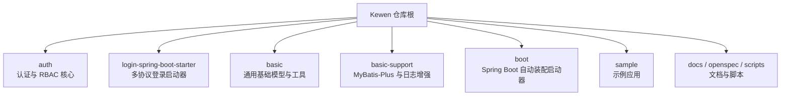
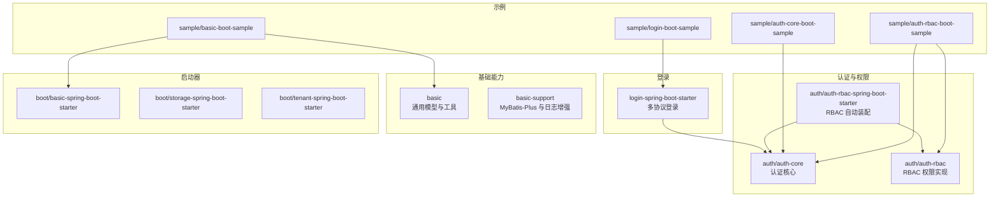
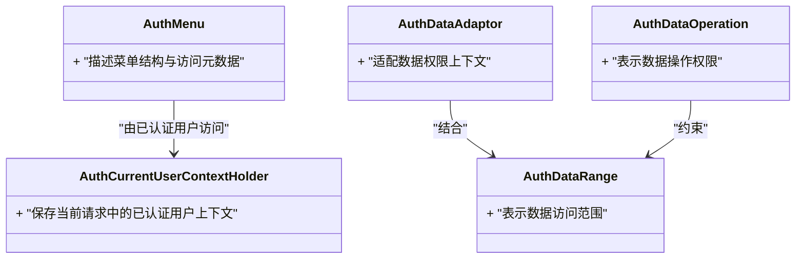
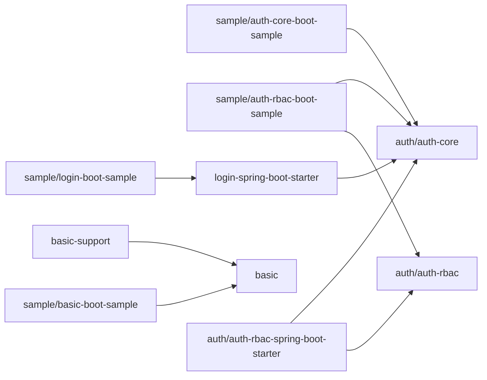

# 项目概述

<cite>
**本文引用的文件**   
- [pom.xml](file://pom.xml)
- [application.yml](file://application.yml)
- [README_Auth.md](file://README_Auth.md)
- [auth/auth-core/pom.xml](file://auth/auth-core/pom.xml)
- [auth/auth-core/src/main/java/com/cu/framework/auth/core/AuthCurrentUserContextHolder.java](file://auth/auth-core/src/main/java/com/cu/framework/auth/core/AuthCurrentUserContextHolder.java)
- [auth/auth-core/src/main/java/com/cu/framework/auth/core/AuthMenu.java](file://auth/auth-core/src/main/java/com/cu/framework/auth/core/AuthMenu.java)
- [auth/auth-rbac/pom.xml](file://auth/auth-rbac/pom.xml)
- [auth/auth-rbac-spring-boot-starter/README.md](file://auth/auth-rbac-spring-boot-starter/README.md)
- [login-spring-boot-starter/pom.xml](file://login-spring-boot-starter/pom.xml)
- [login-spring-boot-starter/README.md](file://login-spring-boot-starter/README.md)
- [basic/pom.xml](file://basic/pom.xml)
- [basic-support/pom.xml](file://basic-support/pom.xml)
- [boot/basic-spring-boot-starter/pom.xml](file://boot/basic-spring-boot-starter/pom.xml)
- [boot/storage-spring-boot-starter/pom.xml](file://boot/storage-spring-boot-starter/pom.xml)
- [boot/tenant-spring-boot-starter/pom.xml](file://boot/tenant-spring-boot-starter/pom.xml)
- [sample/auth-core-boot-sample/pom.xml](file://sample/auth-core-boot-sample/pom.xml)
- [sample/auth-rbac-boot-sample/pom.xml](file://sample/auth-rbac-boot-sample/pom.xml)
</cite>

## 目录
1. [引言](#引言)
2. [项目结构](#项目结构)
3. [核心能力与定位](#核心能力与定位)
4. [技术栈选择](#技术栈选择)
5. [模块化架构设计](#模块化架构设计)
6. [快速开始指南](#快速开始指南)
7. [依赖关系分析](#依赖关系分析)
8. [常见使用场景](#常见使用场景)
9. [结论](#结论)

## 引言
Kewen Framework 是一个面向企业级 Java 应用的后端基础框架，围绕身份认证、权限控制、通用基础设施和可插拔启动器组织代码。它适合需要快速搭建多协议登录、RBAC 权限体系、统一响应模型、日志追踪、分库分表与租户隔离等能力的中后台系统、微服务公共模块或内部平台。

该仓库采用 Maven 多模块结构，把“认证核心”“RBAC 权限实现”“登录启动器”“基础工具与响应模型”“Spring Boot 自动装配启动器”以及多个示例工程拆分到独立模块，既便于复用，也便于按业务需求裁剪组合。

## 项目结构
仓库根目录下的主要分组如下：
- `auth`：认证与权限相关核心模块及 Spring Boot Starter。
- `login-spring-boot-starter`：多协议身份认证启动器，集成密码、OAuth2、SAML、SSO 等登录流程。
- `basic`：通用请求响应模型、异常处理、过滤器、日志跟踪和工具类。
- `basic-support`：对 MyBatis-Plus、日志持久化、消息通知、分页工具等的增强支持。
- `boot`：基于 Spring Boot 的自动装配启动器，包括基础配置、存储抽象、租户上下文等。
- `sample`：示例应用，演示如何组合使用上述模块。
- `openspec`、`scripts`、`docs`：变更规范、脚本和文档资料。

**图表来源**
- [pom.xml:1-200](file://pom.xml#L1-L200)

**章节来源**
- [pom.xml:1-200](file://pom.xml#L1-L200)

## 核心能力与定位
Kewen Framework 的核心价值在于降低企业级系统在“安全认证”“权限控制”“通用后端能力”上的重复建设成本。其关键能力包括：

- **身份认证**：通过 `login-spring-boot-starter` 提供密码登录、OAuth2、SAML、单点登录等多种协议接入方式，并暴露统一的登录结果和会话上下文。
- **RBAC 权限管理**：通过 `auth/auth-rbac` 及其 Spring Boot Starter 提供角色、菜单、数据范围、数据操作等企业级权限扩展点，配合 `auth-core` 的统一用户上下文和菜单声明。
- **通用后端基础**：`basic` 提供统一响应体、分页请求、异常处理、请求过滤和链路追踪；`basic-support` 在此基础上增加 MyBatis-Plus 工具、雪花 ID、Markdown 工具、请求日志持久化等。
- **可插拔启动器**：`boot` 下包含基础启动器、存储抽象、租户上下文等，使业务应用可以按需引入能力，避免单体式耦合。
- **示例驱动**：`sample` 中的 `auth-core-boot-sample`、`auth-rbac-boot-sample`、`basic-boot-sample`、`login-boot-sample`、`storage-boot-sample`、`tenant-boot-sample` 展示了不同能力组合方式。

对于初学者，可以从 `sample/basic-boot-sample` 或 `sample/login-boot-sample` 入手，先理解通用响应、异常处理和登录流程；再进入 `auth/auth-core` 和 `auth/auth-rbac`，逐步掌握当前用户上下文、菜单、RBAC 权限和数据范围。

**章节来源**
- [README_Auth.md:1-200](file://README_Auth.md#L1-L200)
- [login-spring-boot-starter/README.md:1-200](file://login-spring-boot-starter/README.md#L1-L200)
- [auth/auth-rbac-spring-boot-starter/README.md:1-200](file://auth/auth-rbac-spring-boot-starter/README.md#L1-L200)

## 技术栈选择
根据根 POM 和各子模块 POM 的依赖声明，Kewen Framework 主要依赖以下技术：

| 技术 | 作用 | 优势 |
|---|---|---|
| Spring Boot | Web 应用框架与自动装配基础 | 生态成熟、约定优于配置、易于构建 Starter |
| MyBatis-Plus | ORM 与数据库访问增强 | 减少样板 SQL，提供分页、条件构造等能力 |
| Hutool | 通用工具集 | 简化字符串、日期、加密、集合等常用操作 |
| Lombok | 减少样板代码 | 提升实体、DTO、工具类编写效率 |
| Jackson | JSON 序列化 | 兼容 Spring Web 默认序列化方案 |
| MySQL 驱动 | 主流关系型数据库连接 | 在企业环境中广泛可用 |
| Swagger / Knife4j（视具体 Starter） | API 文档生成 | 提高接口可读性与联调效率 |

这些选择在仓库 POM 中集中体现，例如根 `pom.xml` 定义统一版本与依赖管理，各子模块如 `basic`、`auth/auth-core`、`login-spring-boot-starter`、`boot/*` 在各自 `pom.xml` 中声明所需依赖。

**章节来源**
- [pom.xml:1-200](file://pom.xml#L1-L200)
- [basic/pom.xml:1-200](file://basic/pom.xml#L1-L200)
- [auth/auth-core/pom.xml:1-200](file://auth/auth-core/pom.xml#L1-L200)
- [login-spring-boot-starter/pom.xml:1-200](file://login-spring-boot-starter/pom.xml#L1-L200)

## 模块化架构设计
Kewen Framework 采用“核心能力 + 启动器 + 示例”的分层模块化设计：

- `auth/auth-core`：认证核心领域模型与上下文。典型类型包括当前用户上下文、菜单声明、数据适配、数据范围、数据操作等。它是 RBAC 和登录流程共享的基础能力。
- `auth/auth-rbac`：RBAC 权限实现，包含角色、权限、菜单、数据范围等权限相关的数据模型、Mapper 和扩展点。
- `auth/auth-rbac-spring-boot-starter`：将 RBAC 能力装配到 Spring Boot 应用中，负责扫描、注册、加载 RBAC 相关配置。
- `login-spring-boot-starter`：登录协议抽象与实现，包括密码、OAuth2、SAML、SSO、登录页面、拦截器、处理器、统一响应等。
- `basic`：通用基础包，定义统一响应体、分页请求、异常常量、全局异常处理、早期请求过滤器、请求日志、链路追踪和工具类。
- `basic-support`：对基础能力的增强，包括 MyBatis-Plus 扩展、日志持久化、消息通知、分页执行器、雪花 ID 生成器等。
- `boot/basic-spring-boot-starter`：基础 Spring Boot 自动装配，通常用于启用基础配置、Jackson、校验、异常处理等。
- `boot/storage-spring-boot-starter`：文件存储抽象与模板，便于对接多种存储后端。
- `boot/tenant-spring-boot-starter`：租户上下文与请求过滤器，为多租户场景提供租户标识传播。
- `sample/*`：示例应用，演示如何在真实项目中组合上述模块。

**图表来源**
- [auth/auth-core/pom.xml:1-200](file://auth/auth-core/pom.xml#L1-L200)
- [auth/auth-rbac/pom.xml:1-200](file://auth/auth-rbac/pom.xml#L1-L200)
- [auth/auth-rbac-spring-boot-starter/README.md:1-200](file://auth/auth-rbac-spring-boot-starter/README.md#L1-L200)
- [login-spring-boot-starter/pom.xml:1-200](file://login-spring-boot-starter/pom.xml#L1-L200)
- [basic/pom.xml:1-200](file://basic/pom.xml#L1-L200)
- [basic-support/pom.xml:1-200](file://basic-support/pom.xml#L1-L200)
- [boot/basic-spring-boot-starter/pom.xml:1-200](file://boot/basic-spring-boot-starter/pom.xml#L1-L200)
- [boot/storage-spring-boot-starter/pom.xml:1-200](file://boot/storage-spring-boot-starter/pom.xml#L1-L200)
- [boot/tenant-spring-boot-starter/pom.xml:1-200](file://boot/tenant-spring-boot-starter/pom.xml#L1-L200)
- [sample/auth-core-boot-sample/pom.xml:1-200](file://sample/auth-core-boot-sample/pom.xml#L1-L200)
- [sample/auth-rbac-boot-sample/pom.xml:1-200](file://sample/auth-rbac-boot-sample/pom.xml#L1-L200)
- [sample/login-boot-sample/pom.xml:1-200](file://sample/login-boot-sample/pom.xml#L1-L200)

### 认证核心模块职责
`auth/auth-core` 主要承载认证相关的领域概念，例如：
- 当前用户上下文持有者，用于在请求上下文中获取已认证用户信息。
- 菜单声明注解或模型，用于描述系统菜单结构。
- 数据适配、数据范围和数据处理操作，用于权限控制中的数据可见性。

**图表来源**
- [auth/auth-core/src/main/java/com/cu/framework/auth/core/AuthCurrentUserContextHolder.java:1-200](file://auth/auth-core/src/main/java/com/cu/framework/auth/core/AuthCurrentUserContextHolder.java#L1-L200)
- [auth/auth-core/src/main/java/com/cu/framework/auth/core/AuthMenu.java:1-200](file://auth/auth-core/src/main/java/com/cu/framework/auth/core/AuthMenu.java#L1-L200)

**章节来源**
- [auth/auth-core/pom.xml:1-200](file://auth/auth-core/pom.xml#L1-L200)
- [auth/auth-core/src/main/java/com/cu/framework/auth/core/AuthCurrentUserContextHolder.java:1-200](file://auth/auth-core/src/main/java/com/cu/framework/auth/core/AuthCurrentUserContextHolder.java#L1-L200)
- [auth/auth-core/src/main/java/com/cu/framework/auth/core/AuthMenu.java:1-200](file://auth/auth-core/src/main/java/com/cu/framework/auth/core/AuthMenu.java#L1-L200)

### RBAC 权限模块职责
`auth/auth-rbac` 在 `auth-core` 之上扩展 RBAC 能力，通常包含：
- 角色、权限、菜单、部门等权限实体。
- 基于 MyBatis-Plus 的 Mapper 和数据访问逻辑。
- 与权限校验、数据范围、菜单访问控制相关的扩展点。

`auth/auth-rbac-spring-boot-starter` 则负责将这些能力以 Spring Boot Starter 形式装配进应用，包括扫描 RBAC 相关组件、注册配置类等。

**章节来源**
- [auth/auth-rbac/pom.xml:1-200](file://auth/auth-rbac/pom.xml#L1-L200)
- [auth/auth-rbac-spring-boot-starter/README.md:1-200](file://auth/auth-rbac-spring-boot-starter/README.md#L1-L200)

### 登录启动器职责
`login-spring-boot-starter` 是 Kewen Framework 中与企业身份源对接的关键模块。它通常提供：
- 密码登录、OAuth2、SAML、SSO 等多协议登录入口。
- 登录拦截器、处理器、统一响应封装。
- 登录成功后的用户上下文装配，供 `auth-core` 和 RBAC 使用。
- 登录页面、错误响应、登录方法发现等扩展能力。

**章节来源**
- [login-spring-boot-starter/pom.xml:1-200](file://login-spring-boot-starter/pom.xml#L1-L200)
- [login-spring-boot-starter/README.md:1-200](file://login-spring-boot-starter/README.md#L1-L200)

### 基础模块与启动器职责
- `basic`：定义统一返回结果、分页请求、分页结果、异常类和全局异常处理；提供早期请求过滤器、请求日志、链路追踪和工具类。
- `basic-support`：在 `basic` 基础上增加 MyBatis-Plus 增强、日志持久化、消息通知、分页执行器和雪花 ID 生成器。
- `boot/basic-spring-boot-starter`：将基础能力以 Spring Boot 自动装配方式启用。
- `boot/storage-spring-boot-starter`：提供文件存储抽象，便于扩展不同存储后端。
- `boot/tenant-spring-boot-starter`：提供租户上下文和请求过滤器，支撑多租户架构。

**章节来源**
- [basic/pom.xml:1-200](file://basic/pom.xml#L1-L200)
- [basic-support/pom.xml:1-200](file://basic-support/pom.xml#L1-L200)
- [boot/basic-spring-boot-starter/pom.xml:1-200](file://boot/basic-spring-boot-starter/pom.xml#L1-L200)
- [boot/storage-spring-boot-starter/pom.xml:1-200](file://boot/storage-spring-boot-starter/pom.xml#L1-L200)
- [boot/tenant-spring-boot-starter/pom.xml:1-200](file://boot/tenant-spring-boot-starter/pom.xml#L1-L200)

## 快速开始指南
本节给出一个通用的起步流程。由于仓库包含多个示例模块，实际使用时应优先选择一个与你目标能力最接近的 sample 作为起点。

### 环境要求
- JDK 版本需满足 Spring Boot 2.7.x 的要求。
- 如果使用 RBAC 示例，需要 MySQL 或其他关系型数据库。
- 建议使用 Maven 进行构建。

### 依赖引入
以业务应用为例，通常在业务模块的 `pom.xml` 中引入所需 Starter：
- 仅基础能力：引入 `boot/basic-spring-boot-starter` 和 `basic`。
- 登录能力：引入 `login-spring-boot-starter`。
- RBAC 权限：引入 `auth/auth-core`、`auth/auth-rbac` 和 `auth/auth-rbac-spring-boot-starter`。
- 存储能力：引入 `boot/storage-spring-boot-starter`。
- 多租户能力：引入 `boot/tenant-spring-boot-starter`。

参考示例模块的依赖写法：
- [sample/basic-boot-sample/pom.xml](file://sample/basic-boot-sample/pom.xml)
- [sample/login-boot-sample/pom.xml](file://sample/login-boot-sample/pom.xml)
- [sample/auth-core-boot-sample/pom.xml](file://sample/auth-core-boot-sample/pom.xml)
- [sample/auth-rbac-boot-sample/pom.xml](file://sample/auth-rbac-boot-sample/pom.xml)

### 数据库初始化
如果启用 RBAC 或日志持久化等功能，需要先创建数据库表并插入初始数据：
- RBAC 相关 SQL：位于 `docs/sql/auth-rbac.sql`。
- basic-support 相关 SQL：位于 `docs/sql/basic-support.sql`。
- auth-core 示例数据：位于 `sample/auth-core-boot-sample/sql/schema.sql` 与 `seed-data.sql`。
- auth-rbac 示例数据：位于 `sample/auth-rbac-boot-sample/sql/schema.sql` 与 `seed-data.sql`。

### 应用配置
在业务应用的 `application.yml` 中配置数据库、Redis、第三方登录参数等。仓库根目录的 `application.yml` 可作为整体配置参考，但实际业务应用应在自己的 `application.yml` 中覆盖必要项。

**章节来源**
- [application.yml:1-200](file://application.yml#L1-L200)
- [sample/auth-core-boot-sample/pom.xml:1-200](file://sample/auth-core-boot-sample/pom.xml#L1-L200)
- [sample/auth-rbac-boot-sample/pom.xml:1-200](file://sample/auth-rbac-boot-sample/pom.xml#L1-L200)

### 应用启动
1. 初始化数据库表结构和种子数据。
2. 修改业务应用配置，指向正确的数据库、缓存和外部服务。
3. 运行示例应用主类，例如：
   - `sample/auth-core-boot-sample`
   - `sample/auth-rbac-boot-sample`
   - `sample/login-boot-sample`
   - `sample/basic-boot-sample`
4. 访问示例提供的控制器或 API，验证登录、菜单、权限和基础能力是否正常工作。

## 依赖关系分析
从模块维度看，Kewen Framework 的依赖方向大致如下：

- `sample` 依赖 `auth`、`login-spring-boot-starter`、`basic`、`basic-support`、`boot` 中的部分 Starter。
- `auth/auth-rbac-spring-boot-starter` 依赖 `auth/auth-rbac` 和 `auth/auth-core`。
- `auth/auth-rbac` 依赖 `auth/auth-core` 和 `basic-support` 中的 MyBatis-Plus 能力。
- `login-spring-boot-starter` 依赖 `auth/auth-core` 提供的用户上下文和菜单能力。
- `basic-support` 依赖 `basic`。
- `boot` 下的各个 Starter 相互独立，分别装配不同能力。

**图表来源**
- [auth/auth-core/pom.xml:1-200](file://auth/auth-core/pom.xml#L1-L200)
- [auth/auth-rbac/pom.xml:1-200](file://auth/auth-rbac/pom.xml#L1-L200)
- [auth/auth-rbac-spring-boot-starter/README.md:1-200](file://auth/auth-rbac-spring-boot-starter/README.md#L1-L200)
- [login-spring-boot-starter/pom.xml:1-200](file://login-spring-boot-starter/pom.xml#L1-L200)
- [basic/pom.xml:1-200](file://basic/pom.xml#L1-L200)
- [basic-support/pom.xml:1-200](file://basic-support/pom.xml#L1-L200)
- [sample/auth-core-boot-sample/pom.xml:1-200](file://sample/auth-core-boot-sample/pom.xml#L1-L200)
- [sample/auth-rbac-boot-sample/pom.xml:1-200](file://sample/auth-rbac-boot-sample/pom.xml#L1-L200)
- [sample/login-boot-sample/pom.xml:1-200](file://sample/login-boot-sample/pom.xml#L1-L200)

**章节来源**
- [auth/auth-core/pom.xml:1-200](file://auth/auth-core/pom.xml#L1-L200)
- [auth/auth-rbac/pom.xml:1-200](file://auth/auth-rbac/pom.xml#L1-L200)
- [login-spring-boot-starter/pom.xml:1-200](file://login-spring-boot-starter/pom.xml#L1-L200)
- [basic/pom.xml:1-200](file://basic/pom.xml#L1-L200)
- [basic-support/pom.xml:1-200](file://basic-support/pom.xml#L1-L200)
- [sample/auth-core-boot-sample/pom.xml:1-200](file://sample/auth-core-boot-sample/pom.xml#L1-L200)
- [sample/auth-rbac-boot-sample/pom.xml:1-200](file://sample/auth-rbac-boot-sample/pom.xml#L1-L200)

## 常见使用场景
- **企业内部管理系统**：使用 `login-spring-boot-starter` 接入企业账号体系，再通过 `auth/auth-rbac` 实现菜单权限、按钮权限和数据范围控制。
- **微服务公共能力层**：将 `basic`、`basic-support`、`boot/basic-spring-boot-starter` 抽取为公共依赖，所有微服务继承统一响应、异常处理和日志追踪。
- **多租户 SaaS 平台**：结合 `boot/tenant-spring-boot-starter` 与 RBAC 数据范围，实现租户隔离和跨租户权限控制。
- **文件上传下载平台**：通过 `boot/storage-spring-boot-starter` 抽象存储后端，灵活切换本地、云存储等实现。

## 结论
Kewen Framework 以 Spring Boot 为核心，围绕认证、RBAC、基础能力和启动器构建了一个清晰的企业级后端基础框架。它的模块化设计允许开发者从最小可用单元起步，再逐步叠加登录、权限、存储、租户等能力。对于初学者，建议从示例应用入手；对于有经验的开发者，可重点阅读 `auth/auth-core`、`auth/auth-rbac` 和 `login-spring-boot-starter` 的模块边界与装配逻辑，以便在自己的业务系统中合理裁剪和扩展。